# Elastic Stack: The Basics | TryHackMe

| | |
|---|---|
| **Platform** | TryHackMe: [Elastic Stack: The Basics](https://tryhackme.com/room/investigatingwithelk101) (premium room, about 180 min) |
| **Path** | SOC Level 1 → Core SOC Solutions |
| **Difficulty** | Medium (as listed on the room page) |
| **Status** | Completed, 24 Nov 2026 <!-- TODO: confirm completion date --> |
| **Environment** | Kibana (Elastic) web interface on a TryHackMe lab machine, opened in the browser |
| **Focus** | ELK components, Kibana Discover, KQL searching, visualisations, dashboards, spotting anomalies in VPN logs |

> Flags are redacted in all screenshots.

## Contents

- [What this lab is about](#what-this-lab-is-about)
- [Objective](#objective)
- [At a Glance](#at-a-glance)
- [Task 1: Introduction](#task-1-introduction)
- [Task 2: Elastic Stack Overview](#task-2-elastic-stack-overview)
- [Task 3: Lab Connection](#task-3-lab-connection)
- [Task 4: Discover Tab](#task-4-discover-tab)
- [Task 5: KQL Overview](#task-5-kql-overview)
- [Task 6: Creating Visualizations](#task-6-creating-visualizations)
- [Task 7: Creating Dashboards](#task-7-creating-dashboards)
- [Task 8: Conclusion](#task-8-conclusion)
- [Investigation Notes: Two Anomalies](#investigation-notes-two-anomalies)
- [Revision Notes](#revision-notes)
- [Key Takeaways](#key-takeaways)
- [Glossary](#glossary)
- [Skills Demonstrated](#skills-demonstrated)

## What this lab is about

Logs are only useful if an analyst can search them quickly and spot what looks wrong. The Elastic Stack (ELK) is a set of tools that collects logs, stores them, and gives a browser interface (Kibana) to search and chart them. Many SOC teams use it like a SIEM, even though it is not a traditional one. In this room I learned what each ELK component does, how to browse and filter VPN logs in Kibana with KQL, and how to turn the results into a visualisation and a dashboard. A SOC L1 analyst needs this because most alert follow-up is a search: find the user or IP, narrow the time, count what happened and decide whether it is normal.

## Objective

Learn the roles of Beats, Logstash, Elasticsearch and Kibana, use Discover and KQL to search VPN logs, and build a simple visualisation and dashboard. Along the way, find the odd activity hidden in the VPN data. This is hands-on practice in a simulated lab, not work experience.

## At a Glance

| Item | Detail |
|---|---|
| What was covered | ELK components, Discover tab, KQL (free text, wildcard, AND / OR / NOT, field search), Lens visualisations, dashboards |
| Tools / views used | Kibana: Analytics home, Discover, Visualize Library (Lens table), Dashboard editor |
| Frameworks | MITRE ATT&CK noted as possible mappings only (T1078, T1110), see Investigation Notes. No alerts in this room |
| Actually did (my own screens) | Browsed the VPN data in Discover, ran a user/country search and a single-user search, built a filtered table, put a table panel on a dashboard |
| Seen in the room's annotated examples | Partial-word, wildcard, AND, OR, NOT searches; the donut and top-IP table; the Beats and Logstash diagrams |
| Findings | Two anomalies: a terminated user's account seen on the VPN, and one user with many failed attempts |
| Data note | The VPN data looks like the same dataset used in my Splunk: The Basics write-up |

## Task 1: Introduction

The room frames ELK as a tool that is not a classic SIEM but is widely used like one because of its search and visualisation strengths. Its goals: understand the components, explore features, search and filter data, investigate VPN logs for anomalies, and create visualisations and dashboards.

<!-- TODO: add screenshot (optional: room header / task 1 view) -->

## Task 2: Elastic Stack Overview

ELK is four parts working as a pipeline. **Beats** are small agents on the source machines that collect data. **Logstash** takes data in, filters or reshapes it and sends it on. **Elasticsearch** indexes and stores the data so it can be searched. **Kibana** is the web interface used to analyse and visualise what Elasticsearch holds.

| Component | Role in one line | SOC use |
|---|---|---|
| Beats | Lightweight data collection agents | Get logs and telemetry off endpoints |
| Logstash | Input, filter, output processing | Clean and parse logs before storing |
| Elasticsearch | Indexes and stores data | The searchable log store |
| Kibana | Analysis and visualisation UI | Where the analyst searches and builds dashboards |

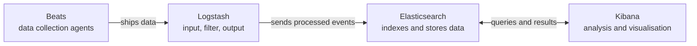

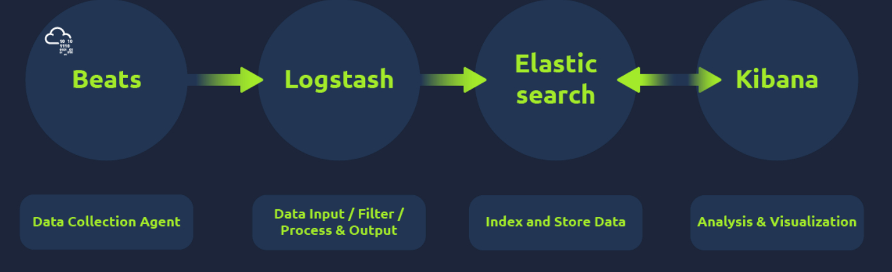

> **What it shows:** The room's diagram with four circles: Beats (Data Collection Agent), Logstash (Data Input / Filter / Process & Output), Elasticsearch (Index and Store Data), Kibana (Analysis & Visualization). Arrows run left to right, with a two-way arrow between Elasticsearch and Kibana.  
> **Why it matters:** When logs are missing or messy, the pipeline tells the analyst where to look: collection, processing, storage or the interface.  
> **Remember:** Beats collect, Logstash processes, Elasticsearch stores, Kibana shows.

Beats come in several types, each for a different kind of data.

| Beat | Collects (my summary) |
|---|---|
| Filebeat | Log files and other file data |
| Metricbeat | Metrics |
| Packetbeat | Network traffic data |
| Winlogbeat | Windows event logs |
| Auditbeat | Audit data |
| Heartbeat | Uptime checks |
| Functionbeat | Cloud data via a serverless shipper |

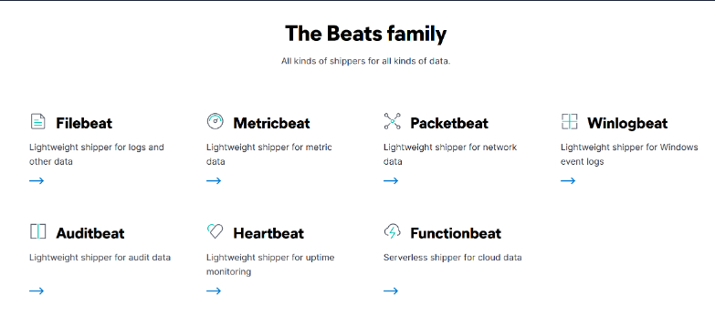

> **What it shows:** A heading "The Beats family" with seven shippers, each with a short description (logs, metrics, network data, Windows event logs, audit data, uptime monitoring, serverless cloud data).  
> **Why it matters:** Choosing the right Beat decides what evidence reaches the SIEM, for example Winlogbeat for Windows security events.  
> **Remember:** Name matches the data: File, Metric, Packet, Winlog, Audit, Heart(uptime), Function(cloud).

A Logstash pipeline is configured in three blocks that run in order.

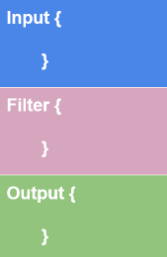

> **What it shows:** Three stacked, colour-coded blocks labelled `Input { }`, `Filter { }` and `Output { }`.  
> **Why it matters:** The filter block is where raw log text becomes fields, so a broken filter explains why a field is missing in Kibana.  
> **Remember:** Input → Filter → Output.

## Task 3: Lab Connection

This is setup. I connected to the lab and opened Kibana in the browser. The first page is the Analytics home, which has tiles for Dashboard and Discover. Discover is where I did most of the work.

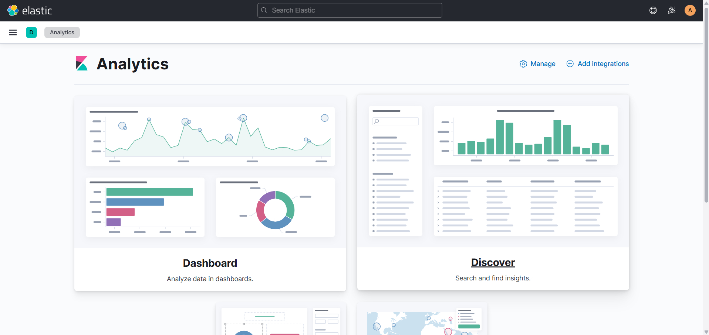

> **What it shows:** The Elastic header with a "Search Elastic" bar, the Analytics page with Manage and Add integrations links, and tiles for Dashboard ("Analyze data in dashboards") and Discover ("Search and find insights"). More tiles are partly visible below.  
> **Why it matters:** Knowing which Kibana tile does what saves time: Discover to search raw logs, Dashboard to see the picture.  
> **Remember:** Discover = search logs; Dashboard = combined views.

## Task 4: Discover Tab

Discover is Kibana's main workspace for searching raw events. The data view `vpn_connections` is selected at the top left, the time range is set at the top, a histogram shows events over time, and each row is one log event. A fields pane on the left lists the parsed fields, and clicking a field adds it as a column. The top bar has New, Open, Share, Inspect and Save, and a search bar and Add filter narrow the results.

| Element | What it does (my words) |
|---|---|
| Data view (`vpn_connections`) | Picks which set of logs to search |
| Search bar (KQL) | Type a query to narrow results |
| Time filter | Sets the period searched |
| Histogram | Event counts over time |
| Fields pane | Lists fields; click to show or filter |
| Add filter | Filter by field without typing a query |
| Top bar | New, Open, Share, Inspect, Save |

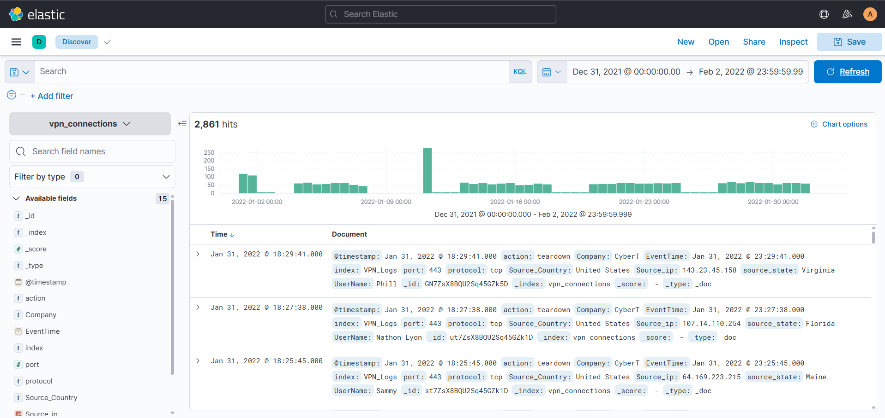

> **What it shows:** Discover on data view `vpn_connections`, range Dec 31, 2021 to Feb 2, 2022, 2,861 hits, 15 available fields. The newest event is Jan 31, 2022 @ 18:29:41: user Phill, action teardown, company CyberT, port 443 tcp, Source_ip 143.23.45.158, United States, Virginia.  
> **Why it matters:** The first thing to check is the data view, time range and hit count, because a wrong one gives a wrong answer.  
> **Remember:** 2,861 hits is the whole VPN dataset in this range.

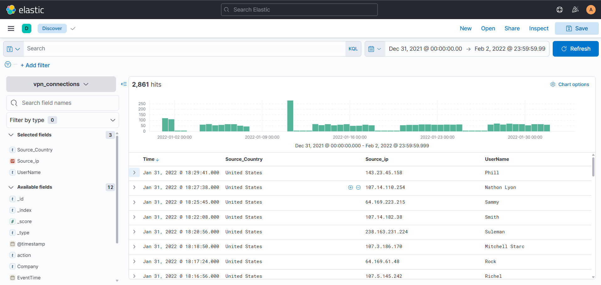

> **What it shows:** The same 2,861 hits with three selected fields (Source_Country, Source_ip, UserName) shown as columns, newest first. Examples: Phill 143.23.45.158, Nathon Lyon 107.14.110.254, Sammy 64.169.223.215, Smith 107.14.182.38, all United States.  
> **Why it matters:** Picking only the fields you need turns a wall of JSON into a table that is quick to read and compare.  
> **Remember:** Click a field in the left pane to add it as a column.

**Observations (not investigated):** The histogram has one day that is much taller than the rest (above 250 events, against roughly 50 to 70 on typical days). Also, in the first screenshot the `@timestamp` of the newest event is 18:29:41 but its `EventTime` field reads 23:29:41, a 5-hour gap in the same event. My reading is that this is a time zone handling difference, but I did not confirm it.

## Task 5: KQL Overview

KQL (Kibana Query Language) is the search syntax in Discover. A quoted phrase searches all fields for that exact value, a `*` is a wildcard, `AND` / `OR` / `NOT` combine terms, and `field : "value"` searches one field. These screenshots are the room's annotated examples unless marked as my own.

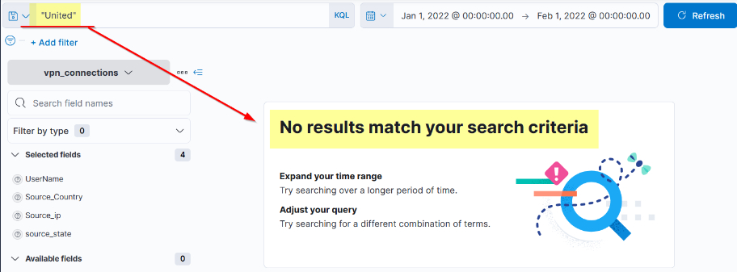

> **What it shows:** Room example: query `"United"` with range Jan 1 to Feb 1, 2022 returns "No results match your search criteria", with hints to expand the time range or adjust the query.  
> **Why it matters:** An empty result does not mean the activity did not happen. The query may be too exact or the time range too narrow.  
> **Remember:** A partial word in quotes does not match a longer value.

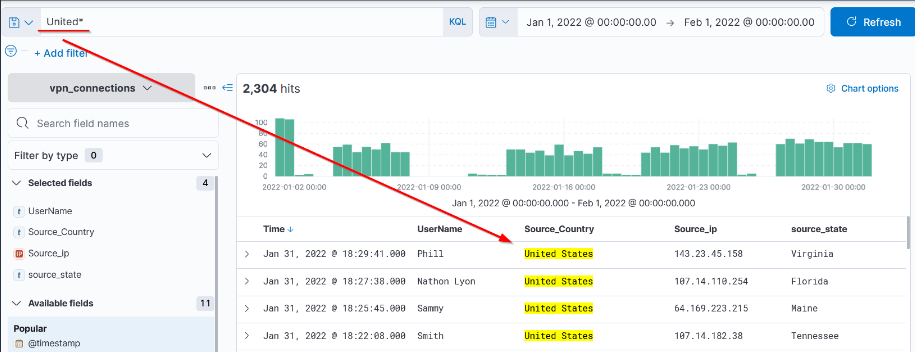

> **What it shows:** Room example: query `United*` returns 2,304 hits. The value United States is highlighted in the Source_Country column, with users such as Phill, Nathon Lyon, Sammy and Smith in the first rows.  
> **Why it matters:** Wildcards help when you only know the start of a value, at the cost of broader matches.  
> **Remember:** `United*` works where `"United"` did not.

My reading (interpretation): the field values look stored as whole strings, which would explain why the partial word failed and the wildcard worked.

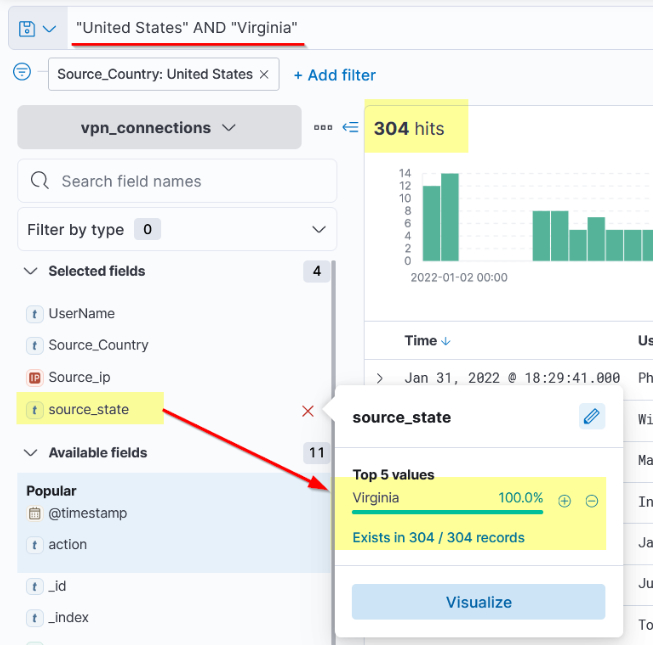

> **What it shows:** Room example: `"United States" AND "Virginia"` returns 304 hits, and a filter pill `Source_Country: United States` is also applied. The source_state popup shows Virginia 100.0%, in 304 of 304 records.  
> **Why it matters:** AND narrows results, which is how an analyst drills from a country down to a state.  
> **Remember:** AND = both must match.

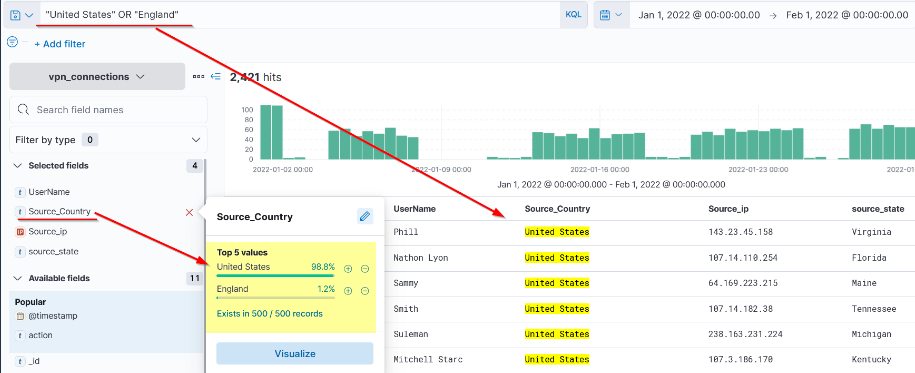

> **What it shows:** Room example: `"United States" OR "England"` returns 2,421 hits. The Source_Country popup says United States 98.8% and England 1.2%, from 500 of 500 records.  
> **Why it matters:** OR widens the search. The popup percentages come from a sample of 500 records, not all 2,421 hits, so they are only a rough guide.  
> **Remember:** OR = either can match; field popups sample 500 records.

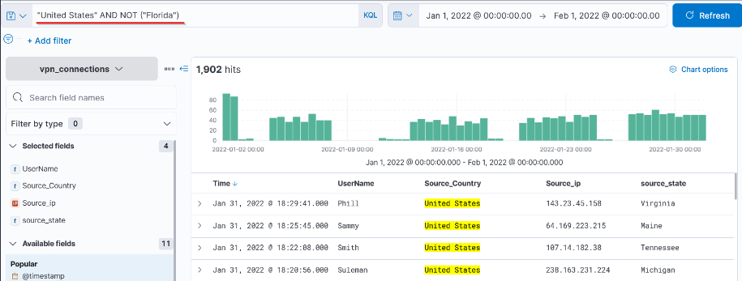

> **What it shows:** Room example: `"United States" AND NOT ("Florida")` returns 1,902 hits. The first rows are Phill (Virginia), Sammy (Maine), Smith (Tennessee), Suleman (Michigan), with no Florida rows.  
> **Why it matters:** NOT strips out known or irrelevant activity so unusual events stand out.  
> **Remember:** AND NOT (...) excludes a value; 2,304 minus 1,902 leaves 402 events removed.

The two searches below are my own, answering the room's questions.

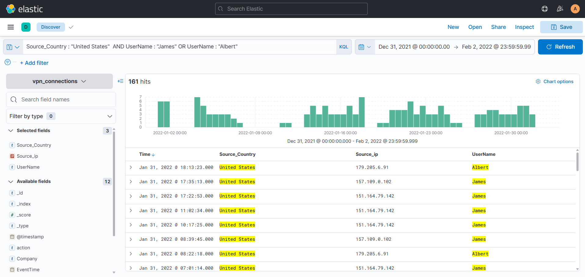

> **What it shows:** My search `Source_Country : "United States" AND UserName : "James" OR UserName : "Albert"` over Dec 31, 2021 to Feb 2, 2022 returned 161 hits. Visible rows are all United States, for James (157.109.0.102 and 151.164.79.142) and Albert (179.205.6.91).  
> **Why it matters:** Field-based queries are more precise than free text. Note that AND is evaluated before OR in KQL, so this reads as (US AND James) OR Albert, which can pull in Albert from other countries.  
> **Remember:** Use brackets: `Source_Country : "United States" AND (UserName : "James" OR UserName : "Albert")`.

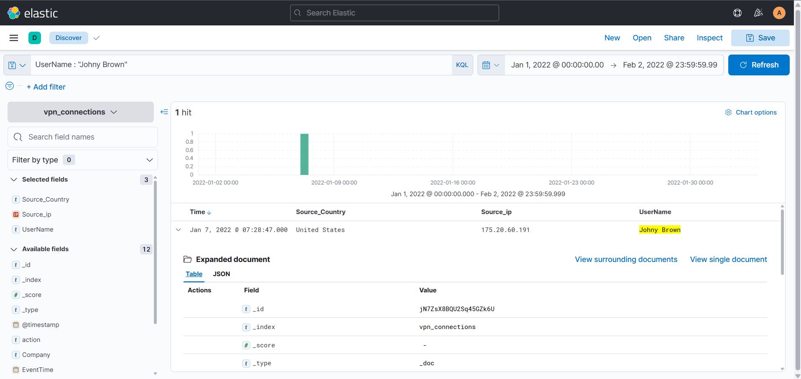

> **What it shows:** My search `UserName : "Johny Brown"` returned 1 hit: Jan 7, 2022 @ 07:28:47.000, United States, Source_ip 175.20.60.191. The expanded document shows `_index` vpn_connections.  
> **Why it matters:** The room's scenario says this user was terminated on 1 Jan 2022, so a VPN event on 7 Jan is the kind of anomaly an analyst should flag.  
> **Remember:** One search by username answers "did this account connect after it should have been closed?"

Task 5 quiz screenshot

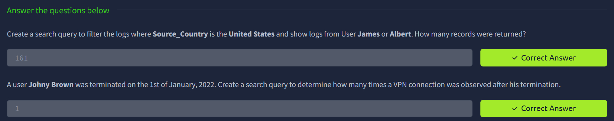

> **What it shows:** Two questions (the US plus James or Albert count, and the connections seen after Johny Brown's termination), both marked "Correct Answer".  
> **Why it matters:** It confirms my search results matched what the room expected.  
> **Remember:** The quiz answers are the same numbers as the two search screenshots.

## Task 6: Creating Visualizations

Visualisations turn counts into charts or tables. In Kibana this is done with Lens: drag fields into rows, columns and metrics, then pick a chart type. The room's example compares top source IPs against top countries, first as a donut chart and then as a table.

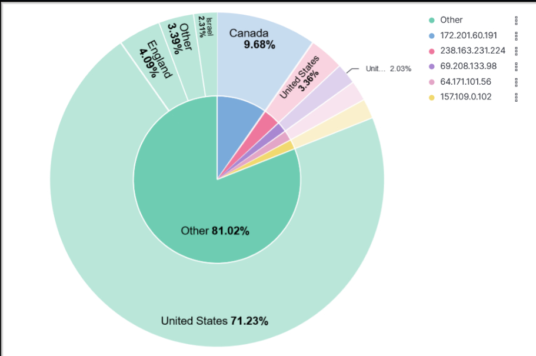

> **What it shows:** Room example: a two-ring donut. Outer-ring labels include United States 71.23%, Canada 9.68%, England 4.09%, Israel 2.31%, Other 3.39%, with the inner ring headed Other 81.02%. The legend lists IPs 172.201.60.191, 238.163.231.224, 69.208.133.98, 64.171.101.56, 157.109.0.102.  
> **Why it matters:** A chart shows proportions at a glance, but small slices are hard to read, so a table is better for exact numbers.  
> **Remember:** Donut for the overall picture, table for exact counts.

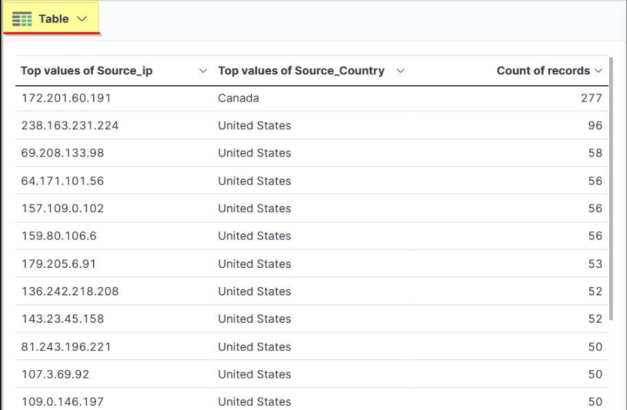

> **What it shows:** Room example: a table (Top values of Source_ip, Source_Country, Count of records). The top row is 172.201.60.191, Canada, 277; next is 238.163.231.224, United States, 96; then several US IPs at 58 to 50.  
> **Why it matters:** Ranking IPs by volume is a quick way to find the noisy ones. One IP with 277 against 96 for the runner-up stands out.  
> **Remember:** Top-values table = field, field, count of records.

My reading (arithmetic, not shown directly): the dashboard in Task 7 lists Canada at 277 records, equal to this one IP, so all the Canadian events seem to come from 172.201.60.191. This is volume only, not a verdict that it is malicious.

Now my own visualisation, filtered to failed actions.

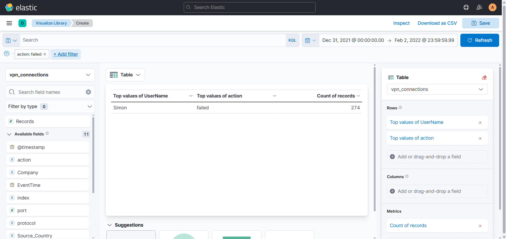

> **What it shows:** Visualize Library, Create, on data view `vpn_connections` with the filter pill `action: failed` over Dec 31, 2021 to Feb 2, 2022. The table (Top values of UserName, Top values of action, Count of records) has one row: Simon, failed, 274.  
> **Why it matters:** Failed logins by user is a standard first view for spotting password guessing or a locked-out user.  
> **Remember:** Filter `action: failed`, then break down by UserName.

Task 6 quiz screenshot

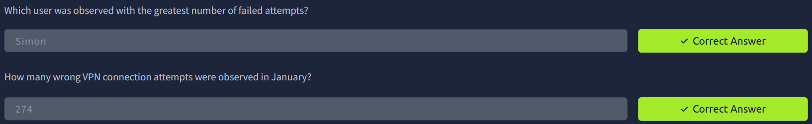

> **What it shows:** Two questions (which user had the most failed attempts, and how many wrong VPN attempts in January), both marked "Correct Answer".  
> **Why it matters:** It confirms the table above gave the answer the room expected.  
> **Remember:** The quiz answers match the single row in the failed-attempts table.

## Task 7: Creating Dashboards

A dashboard collects several visualisations on one screen. I started a new dashboard and added a table panel I titled "Country with TOP traffic". The panel is a count of records per source country.

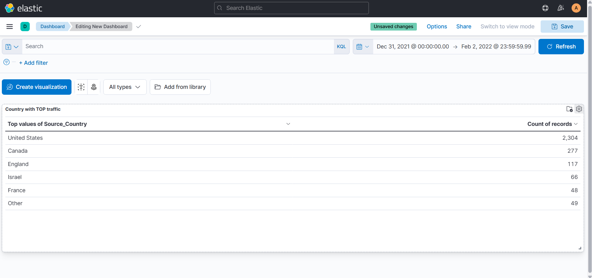

> **What it shows:** Dashboard editor ("Editing New Dashboard", with an "Unsaved changes" badge) over Dec 31, 2021 to Feb 2, 2022. The panel lists United States 2,304, Canada 277, England 117, Israel 66, France 48, Other 49.  
> **Why it matters:** One panel gives a quick traffic breakdown. The counts add up to 2,861, the same as the Discover hit count, which is a good consistency check.  
> **Remember:** Dashboard = saved panels in one view; check the total against Discover.

<!-- TODO: add screenshot of the dashboard after saving it (the screenshot above still shows "Unsaved changes") -->

## Task 8: Conclusion

The room closes by recapping the components, Discover, KQL, visualisations and dashboards.

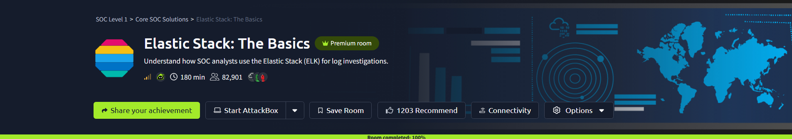

> **What it shows:** The Elastic Stack: The Basics header (SOC Level 1 > Core SOC Solutions, Premium room, 180 min) with a "Share your achievement" button and a green bar reading "Room completed: 100%".  
> **Why it matters:** It is the completion record for this write-up.  
> **Remember:** Simulated lab: hands-on practice, not job experience.

## Investigation Notes: Two Anomalies

The room has no console alerts. These two findings came from my own searches. Evidence is what the screenshots show; the rest is my reading.

### Anomaly 1: VPN event for a terminated user

| W | Evidence from the screenshots |
|---|---|
| Who | Username Johny Brown |
| What | One VPN log event for that username (the action value is not visible in my screenshot) |
| When | Jan 7, 2022 @ 07:28:47. The room's scenario says the user was terminated on 1 Jan 2022 |
| Where | Source_ip 175.20.60.191, United States, data view `vpn_connections` |
| Why | Not answerable from these logs. Possible reasons (my hypotheses): account not disabled after termination, shared or stolen credentials, a wrong termination date |

### Anomaly 2: Many failed VPN attempts by one user

| W | Evidence from the screenshots |
|---|---|
| Who | Username Simon, the only user in the `action: failed` table |
| What | 274 events with action `failed` |
| When | Within Dec 31, 2021 to Feb 2, 2022 (the room's question refers to January). Individual times are not shown |
| Where | Source IPs and states are not shown in my screenshot |
| Why | Not answerable yet. Possible reasons (my hypotheses): repeated wrong password by a real user, or password guessing |

**IOC table (simulated data, none checked against threat intelligence):**

| Type | Value | Context | Screenshot |
|---|---|---|---|
| Username | Johny Brown | Terminated account, 1 VPN event on 7 Jan 2022 | 13 |
| IP address | 175.20.60.191 | Source of that event, United States | 13 |
| Username | Simon | 274 failed VPN events | 17 |

**MITRE ATT&CK (possible, not confirmed):** T1078 Valid Accounts could fit the terminated-user event if the account was used after it should have been disabled. T1110 Brute Force could fit the failed attempts only if the timing and source IPs show guessing. Neither is proven by what I saw.

**What I would do next (recommendations, not actions shown in the room):**

- Johny Brown: confirm the termination date and whether the account was disabled, review everything that user and 175.20.60.191 did in the logs, and escalate if the account was still active.
- Simon: break the 274 failures down by time and source IP, check whether a success followed them, and contact the user or reset the account if it looks like guessing.

## Revision Notes

**One-minute summary**

- ELK is Beats (collect), Logstash (process), Elasticsearch (store) and Kibana (analyse).
- Logstash pipelines have three blocks: input, filter, output.
- Kibana Discover is where raw events are searched, with a data view, time range and KQL bar.
- KQL: quoted phrases, `*` wildcards, AND / OR / NOT and `field : "value"`.
- Lens builds tables and charts; dashboards combine them.
- In the VPN data I found a terminated user's event (Johny Brown) and 274 failed attempts (Simon).
- Always check the data view, the time range and the hit count before trusting a result.

**Core concepts**

| Concept | Plain-English meaning | Example from this room |
|---|---|---|
| Beats | Small agents that collect data | Winlogbeat for Windows event logs |
| Logstash | Pipeline that processes data | Input, filter, output blocks |
| Elasticsearch | Search and storage engine | Holds the VPN events |
| Kibana | Browser interface | Discover, Lens, dashboards |
| Data view | The set of logs being searched | `vpn_connections` |
| KQL | Kibana's search syntax | `UserName : "Johny Brown"` |
| Hit | One matching event | 2,861 hits in total |
| Lens | Drag-and-drop chart builder | Failed-attempts table |

**Cheat sheet**

| Goal | KQL | Result in this room |
|---|---|---|
| Exact value, any field | `"United States"` | 2,304 US events (seen in the `United*` example) |
| Partial value | `United*` | 2,304 hits |
| Partial without wildcard | `"United"` | No results |
| Both conditions | `"United States" AND "Virginia"` | 304 hits |
| Either condition | `"United States" OR "England"` | 2,421 hits |
| Exclude a value | `"United States" AND NOT ("Florida")` | 1,902 hits |
| One field | `UserName : "Johny Brown"` | 1 hit |
| Grouped logic | `Source_Country : "United States" AND (UserName : "James" OR UserName : "Albert")` | safer form of the 161-hit search |
| Filter pill | `action: failed` | Used in the Lens table |

Other points: the VPN fields are `UserName`, `Source_ip`, `Source_Country`, `source_state`, `action` (values seen: teardown, failed), `port`, `protocol`. Beats table is in Task 2.

**Analyst workflow (what this room teaches)**

1. Open Discover and pick the right data view.
2. Set the time range to cover the period of interest.
3. Check the total hits to know what you are working with.
4. Search with KQL, starting broad and narrowing with AND, NOT or field searches.
5. Add useful fields as columns (user, IP, country, state).
6. Expand a single event to read all its fields.
7. Build a table or chart in Lens to count by user or IP.
8. Save panels to a dashboard and cross-check totals against Discover.

**Common mistakes / false-positive traps**

- Wrong time range, so the search returns nothing or too little.
- A partial word in quotes, which returns no results.
- Mixing AND with OR without brackets.
- Reading the field popup percentages as exact (they use a sample of 500 records).
- Mixing up `@timestamp` and `EventTime`, which differed by 5 hours in one event.
- Mixing up the JSON field `index` (VPN_Logs) with the real index `_index` (vpn_connections).
- Treating 274 failed attempts or one login as proof of an attack without looking at timing and source IPs.
- Forgetting to save the dashboard.

**Self-check questions**

1. Which ELK component collects data on the source machines?

Answer
Beats.

2. What are the three blocks of a Logstash pipeline?

Answer
Input, filter and output.

3. Which component indexes and stores the data?

Answer
Elasticsearch.

4. Which Beat is for Windows event logs?

Answer
Winlogbeat.

5. Why did `"United"` return nothing while `United*` worked?

Answer
The quoted word did not match the longer value United States; the wildcard matched anything starting with United.

6. How do you exclude a value in KQL?

Answer
Add `AND NOT (value)`, for example `AND NOT ("Florida")`.

7. Why add brackets around `UserName : "James" OR UserName : "Albert"`?

Answer
AND is evaluated before OR, so without brackets the OR part can escape the country filter.

8. What is the catch with the field popup percentages in Discover?

Answer
They are based on a sample of 500 records, not every hit.

9. Which three Kibana areas did I use after the home page?

Answer
Discover, Lens (Visualize Library) and the dashboard editor.

10. What did the `action: failed` table show?

Answer
A single user, Simon, with 274 failed events.

**Interview angle**

- *What is the ELK stack and how would a SOC use it?* Beats collect logs, Logstash processes them, Elasticsearch stores them and Kibana searches and charts them. A SOC uses Kibana to search for a user or IP, count events and build dashboards.
- *How would you check whether a terminated employee's account was used?* Search the VPN or authentication logs for the username and look for events after the termination date. Then review the source IP and what else that IP did.
- *How would you spot a possible brute-force pattern in Kibana?* Filter on failed actions and break the count down by user, source IP and time. Many failures from one source in a short period, especially followed by a success, is worth escalating.

## Key Takeaways

- ELK is a pipeline, so I can place a problem at collection, processing, storage or display.
- Always check the data view, the time range and the hit count before reading results.
- KQL precision matters: quotes, wildcards, brackets and the AND-before-OR rule change the answer.
- Visualisations are for spotting outliers fast, and tables give the exact numbers.
- Two simple searches found two anomalies, but they are leads for follow-up, not conclusions.
- Cross-checking totals (dashboard against Discover) is a cheap way to catch mistakes.

## Glossary

| Term | Meaning (my words) |
|---|---|
| ELK / Elastic Stack | A set of tools for collecting, storing and searching logs |
| Beats | Lightweight agents that ship data from machines |
| Logstash | Tool that takes in, filters and forwards log data |
| Elasticsearch | Engine that indexes and stores data for fast search |
| Kibana | Web interface for searching and visualising Elasticsearch data |
| Data view | The named set of data a Kibana search runs on |
| KQL | Kibana Query Language, the search syntax in Discover |
| Hit | One event matching a search |
| Lens | Kibana's drag-and-drop visualisation builder |
| Dashboard | A page of saved panels and charts |
| Filter pill | A field filter added through Add filter |

## Skills Demonstrated

`Elastic Stack (ELK)` `Kibana Discover` `KQL searching` `Log filtering` `Lens visualisations` `Dashboards` `VPN log analysis` `Anomaly spotting` `Write-up documentation`

---

[Back to all labs](../../README.md)
