# Introduction to SIEM | TryHackMe

| Field | Details |
|---|---|
| **Platform** | [TryHackMe: Introduction to SIEM](https://tryhackme.com/room/introtosiem) |
| **Path** | SOC Level 1 > Core SOC Solutions |
| **Difficulty** | Easy <!-- TODO: confirm difficulty --> |
| **Status** | Completed, 22 Nov 2026 (room banner shows 100%) |
| **Environment** | TryHackMe browser-based simulated SIEM dashboard (plus Splunk views shown as illustrations) |
| **Focus** | Log sources, log ingestion, SIEM functions, alert triage on a simulated cryptominer alert |

> Flags are redacted in all screenshots.

<!-- TODO: confirm task numbers and titles against the room; sections below follow the order I captured the room -->

## Contents

1. [What this lab is about](#what-this-lab-is-about)
2. [Objective](#objective)
3. [At a Glance](#at-a-glance)
4. [Room overview](#room-overview)
5. [Network visibility: host-centric vs network-centric logs](#network-visibility-host-centric-vs-network-centric-logs)
6. [Why a SIEM is needed](#why-a-siem-is-needed)
7. [Log sources and log ingestion](#log-sources-and-log-ingestion)
8. [Analysing logs, alerts and tuning](#analysing-logs-alerts-and-tuning)
9. [Lab: investigating a CryptoMiner alert](#lab-investigating-a-cryptominer-alert)
10. [Triage Summary](#triage-summary)
11. [Reflection: How I'd Write the Escalation Notes](#reflection-how-id-write-the-escalation-notes)
12. [Revision Notes](#revision-notes)
13. [Key Takeaways](#key-takeaways)
14. [Glossary](#glossary)
15. [Skills Demonstrated](#skills-demonstrated)

---

## What this lab is about

Every device on a network writes its own logs, in its own format, in its own place. During an incident, nobody can log in to dozens of machines and read thousands of lines per second. A SIEM (Security Information and Event Management) solves this by collecting those logs centrally, putting them into one searchable shape, and raising alerts when rules match. This room teaches the problem, the idea of host-centric and network-centric logs, how logs get into a SIEM, and then lets you triage one alert on a simulated dashboard. For a SOC L1 analyst this is the daily tool: alerts arrive in the SIEM, and the first job is to decide whether each one is real.

## Objective

Understand why organisations use a SIEM, which log sources feed it and how, and practise the first steps of alert triage: open the alert, read the rule, find the user and host, and give a verdict.

## At a Glance

| Item | Detail |
|---|---|
| Covered | Host vs network log sources, SIEM challenges and functions, Windows and Linux log locations, ingestion methods, Event ID 104, false positives and tuning, one alert triage |
| Tools / views used | Simulated SIEM dashboard (siem.internal), alert popup, rule view; Splunk dashboard and add-data screens shown as examples |
| Frameworks | MITRE ATT&CK IDs appear on the lab dashboard legend (T1016, T1049, T1036); not used in the alert triage itself |
| Investigated | One alert: Potential CryptoMiner Activity (process, user, host, rule match, verdict) |
| Only seen, not investigated | Top event codes, external RDP sources, destination IP and port chart, MITRE pie, Splunk Historic dashboard |
| Nature of work | Simulated, guided lab. Hands-on practice, not work experience |

---

## Room overview

Completion proof for the room.

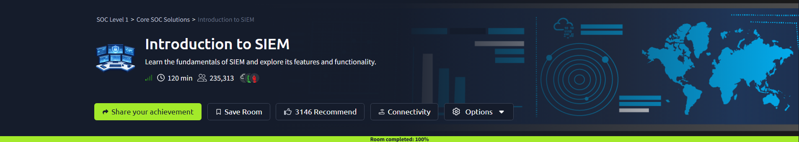

> **What it shows:** The room header with the path breadcrumb (SOC Level 1 > Core SOC Solutions > Introduction to SIEM), a 120 min estimate and the platform bar reading "Room completed: 100%".  
> **Why it matters:** It records where the room sits in the path and that every task was finished on the platform. It is a progress marker, not a certification.  
> **Remember:** Introduction to SIEM = Core SOC Solutions module, 120 min room.

## Network visibility: host-centric vs network-centric logs

**My summary:** logs fall into two families. Host-centric logs describe things that happen on a machine (logins, processes, registry, PowerShell). Network-centric logs describe traffic between machines (SSH, FTP, web, VPN, file sharing). The source device is different too: endpoints and servers for one, firewalls, IDS/IPS and routers for the other.

| Family | Typical sources | Example events |
|---|---|---|
| Host-centric | Windows, Linux, servers | File access, authentication, process execution, registry change, PowerShell |
| Network-centric | Firewall, IDS/IPS, router | SSH, FTP, web traffic, VPN, network file sharing |

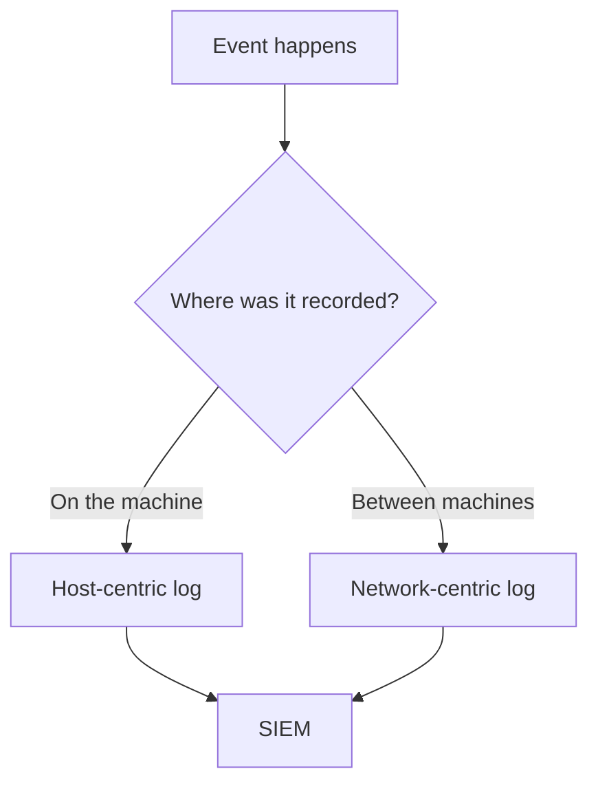

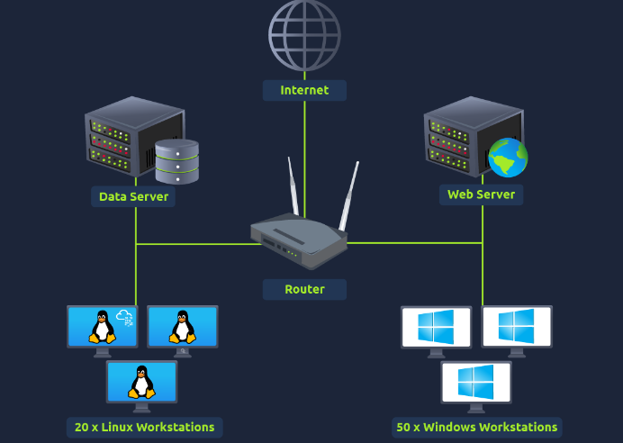

> **What it shows:** A sample network: Internet connected to a router, which links a data server, a web server, 20 Linux workstations and 50 Windows workstations.  
> **Why it matters:** Every one of these devices writes its own logs. Seeing the network as a whole shows why an analyst cannot check each machine by hand.  
> **Remember:** Example network = 2 servers + 20 Linux + 50 Windows endpoints behind one router.

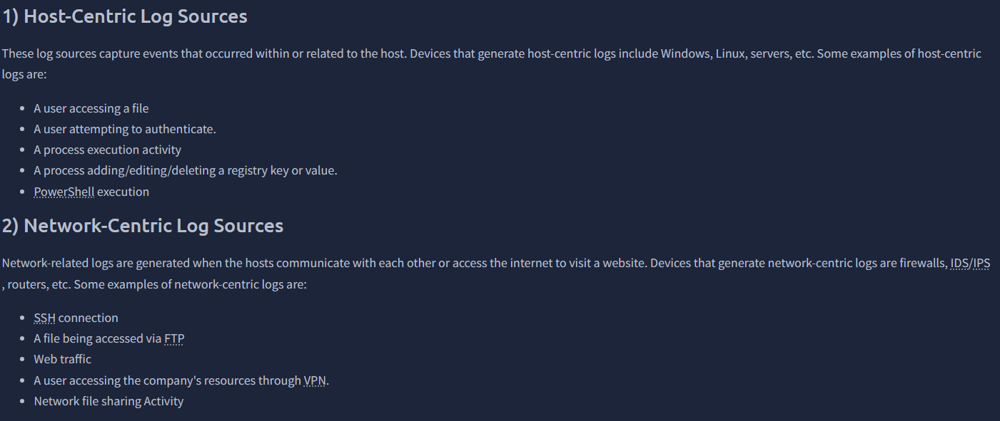

> **What it shows:** Two lists. Host-centric examples: file access, authentication attempts, process execution, registry changes, PowerShell execution (from Windows, Linux, servers). Network-centric examples: SSH, FTP, web traffic, VPN, network file sharing (from firewalls, IDS/IPS, routers).  
> **Why it matters:** A real investigation usually needs both views: what a machine did and what travelled between machines.  
> **Remember:** Host-centric = what happened on the box. Network-centric = what moved between boxes.

Quiz screenshot: classifying registry and VPN activity

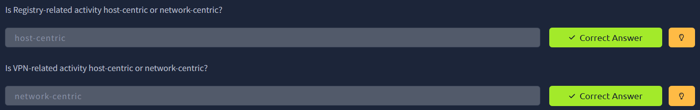

> **What it shows:** Two classification questions, both marked Correct Answer: registry-related activity entered as host-centric, VPN-related activity entered as network-centric.  
> **Why it matters:** Deciding whether an event is host-side or network-side tells the analyst which log source to open first.  
> **Remember:** Registry = host-centric. VPN = network-centric.

---

## Why a SIEM is needed

**My summary:** raw logs are hard to use because there are many sources, they sit on separate machines, one log rarely tells the full story, the volume is too high for people, and every source has its own format. A SIEM collects, aggregates, detects and supports investigation. Dashboards give a quick visual summary of the stored data.

| Raw-log problem | What a SIEM adds |
|---|---|
| Many sources | Collects from all of them |
| No central place | One searchable store |
| Limited context | Lets me correlate across sources |
| Too much volume | Rules and alerts do the first pass |
| Different formats | Normalises data into common fields |

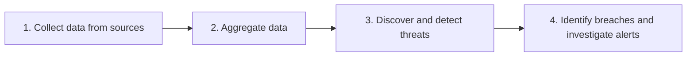

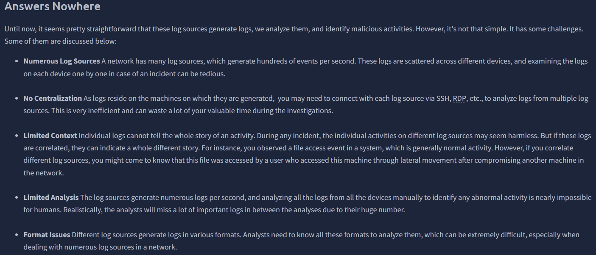

> **What it shows:** A list of five problems with raw logs: too many sources, no central place, limited context in a single log, too much volume for manual analysis, and different formats per source.  
> **Why it matters:** These five problems are the business case for a SIEM. Each SIEM feature maps back to one of them.  
> **Remember:** Many sources, no centralisation, no context, no scale, mixed formats.

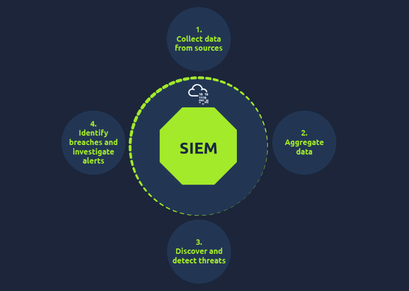

> **What it shows:** A circle around the word SIEM with four labels: 1. collect data from sources, 2. aggregate data, 3. discover and detect threats, 4. identify breaches and investigate alerts.  
> **Why it matters:** It gives the order of work a SIEM performs and the point at which a human analyst takes over (step 4).  
> **Remember:** Collect > Aggregate > Detect > Investigate.

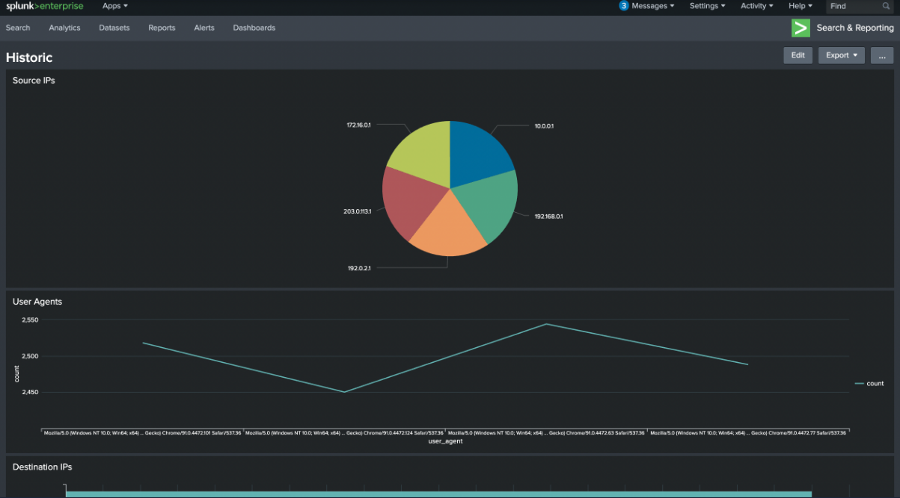

> **What it shows:** Splunk Enterprise, Search & Reporting app, dashboard "Historic". Panels: Source IPs pie (10.0.0.1, 192.168.0.1, 172.16.0.1, 203.0.113.1, 192.0.2.1, roughly equal slices); User Agents line chart (counts between about 2,450 and 2,545 across four Chrome 91 / Windows NT 10.0 user-agent strings); a Destination IPs panel, only partly visible.  
> **Why it matters:** Dashboards compress a lot of log data into one view so an analyst can spot unusual shapes before drilling into raw events.  
> **Remember:** A dashboard shows patterns; it does not give a verdict. Nothing on this screen is flagged as malicious.

---

## Log sources and log ingestion

**My summary:** Windows keeps events in Event Viewer, each with an ID, and forwards them to the SIEM. Linux keeps logs as files under /var/log. Once sources are chosen, the SIEM needs a way to receive the data: an agent, syslog, manual upload or a listening port.

| Linux log path | What it holds |
|---|---|
| /var/log/httpd | Web server requests and errors |
| /var/log/cron | Scheduled job events |
| /var/log/auth.log, /var/log/secure | Authentication events |
| /var/log/kern | Kernel events |

| Ingestion method | Idea | Splunk equivalent shown |
|---|---|---|
| Agent / forwarder | Small program on the endpoint sends logs | Forward |
| Syslog | Standard protocol for sending logs to a central host | not shown in screenshots |
| Manual upload | Load offline files for quick analysis | Upload |
| Port-forwarding | SIEM listens on a port; devices send to it | Monitor (TCP/UDP) |

*The Splunk column is my own mapping of the generic ideas to the Splunk screen, not a statement from the room.*

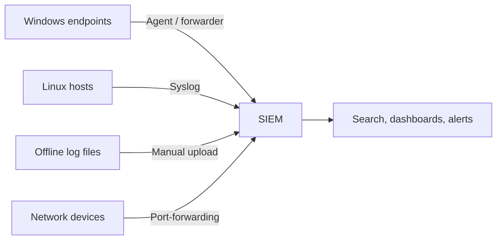

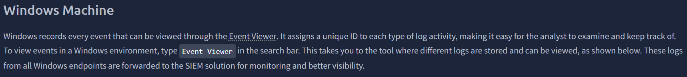

> **What it shows:** Text only: Windows keeps its events in Event Viewer, each event type has an ID, and logs from Windows endpoints are forwarded to the SIEM. The Event Viewer window the text refers to is not part of this capture.  
> **Why it matters:** Event IDs are the shorthand analysts use to search and filter Windows logs.  
> **Remember:** Windows: Event Viewer locally, SIEM centrally, Event ID as the key.

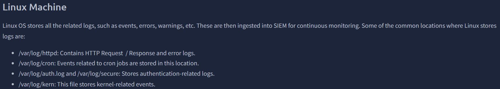

> **What it shows:** Four Linux log locations: /var/log/httpd (HTTP request/response and error logs), /var/log/cron (cron job events), /var/log/auth.log and /var/log/secure (authentication), /var/log/kern (kernel events).  
> **Why it matters:** Knowing where Linux writes each log type tells you what to forward to the SIEM and where to look when the SIEM is not available.  
> **Remember:** httpd = web, cron = scheduled jobs, auth.log/secure = logins, kern = kernel.

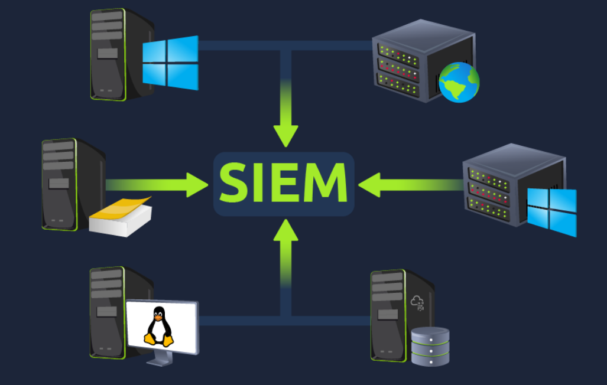

> **What it shows:** Six systems (Windows PC, web server, Windows server, Linux workstation, database/cloud server and a machine with a document icon) with arrows pointing into one box labelled SIEM.  
> **Why it matters:** Centralised collection removes the need to log in to each machine during an incident.  
> **Remember:** Many sources, one place to search.

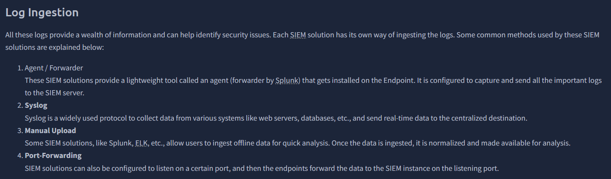

> **What it shows:** A numbered list of four ingestion methods: agent/forwarder installed on the endpoint (Splunk calls it a forwarder), syslog, manual upload of offline data, and port-forwarding to a listening port on the SIEM.  
> **Why it matters:** How data gets in decides what the SIEM can see and how quickly. A missing agent is a blind spot.  
> **Remember:** Agent, Syslog, Upload, Port-forward.

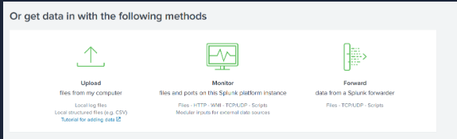

> **What it shows:** Splunk's "get data in" options: Upload (local log or structured files such as CSV), Monitor (files, HTTP, WMI, TCP/UDP, scripts on the Splunk instance) and Forward (data from a Splunk forwarder over TCP/UDP or scripts).  
> **Why it matters:** It shows the generic ingestion ideas from the previous screenshot as real buttons in a real SIEM.  
> **Remember:** Splunk: Upload, Monitor, Forward.

Quiz screenshot: Linux HTTP log location

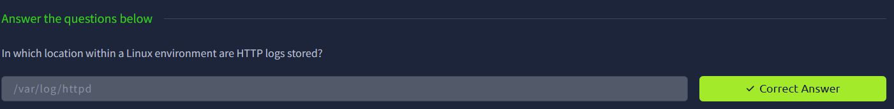

> **What it shows:** One question about where HTTP logs live on Linux, answered /var/log/httpd and marked Correct Answer.  
> **Why it matters:** Web-server logs are a core source for spotting web attacks.  
> **Remember:** HTTP logs on Linux = /var/log/httpd.

---

## Analysing logs, alerts and tuning

**My summary:** the SIEM turns collected logs into alerts using rules. Some alerts are real, some are noise. Alerts that keep firing on harmless activity are false positives and their rules need tuning. One Windows event worth remembering is the ID for cleared event logs, because clearing logs is a common way to hide activity.

| Term | Plain meaning |
|---|---|
| True positive | Alert fired and the activity is really bad |
| False positive | Alert fired but the activity is harmless |
| Tuning | Adjusting a rule so it stops firing on harmless activity |
| Event ID 104 | Log cleared (as answered in the room quiz) |

Quiz screenshot: Event ID 104 and false-positive tuning

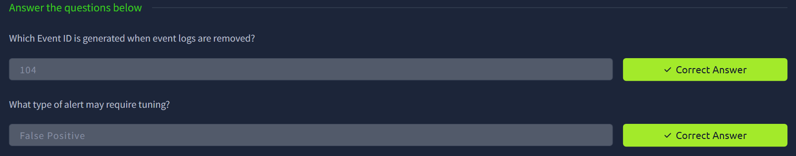

> **What it shows:** Two questions marked Correct Answer: the Event ID for removed (cleared) event logs, entered as 104, and the alert type that may need tuning, entered as False Positive.  
> **Why it matters:** Cleared logs can mean an attacker is covering tracks, and a noisy rule wastes analyst time until it is tuned.  
> **Remember:** Event ID 104 = log cleared. False positives = tune the rule.

---

## Lab: investigating a CryptoMiner alert

**My summary:** the lab dashboard starts in a normal state. After pressing the Start Suspicious Activity button, an alert for possible cryptominer activity appears. I opened the triggering event, read the rule behind it, then answered who, which host and whether it was a real detection.

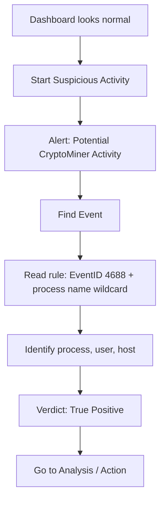

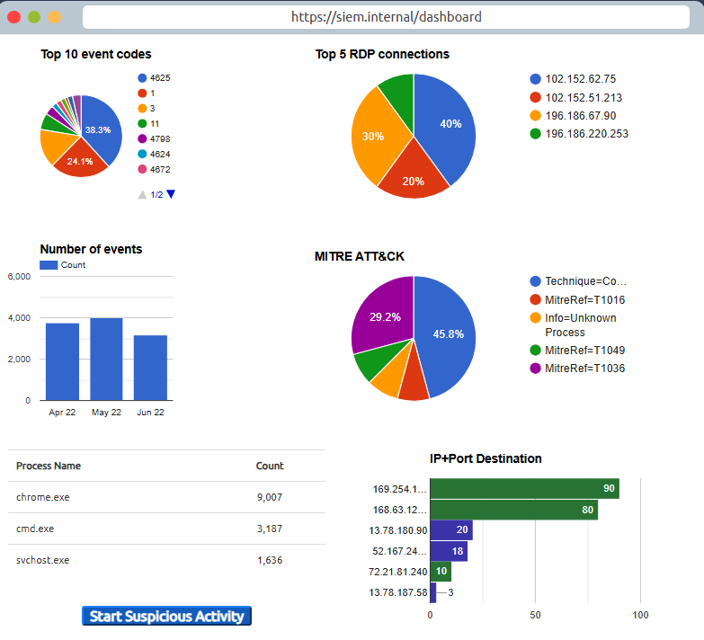

> **What it shows:** Lab dashboard at siem.internal/dashboard. Top 10 event codes pie: 4625 is largest at 38.3%, then code 1 at 24.1% (legend also lists 3, 11, 4798, 4624, 4672; legend page 1/2). Top 5 RDP connections: 102.152.62.75 (40%), 196.186.67.90 (30%), 102.152.51.213 (20%), 196.186.220.253 (rest); only four entries in the legend. Events per month: Apr 22, May 22, Jun 22, each roughly 3,000 to 4,000. MITRE ATT&CK pie: 45.8% "Technique=Co...", MitreRef T1016, T1049, T1036 (29.2%) and "Info=Unknown Process". Process table: chrome.exe 9,007, cmd.exe 3,187, svchost.exe 1,636. IP+Port destination bars from 90 down to 3 (169.254.1... and 168.63.12... highest). A "Start Suspicious Activity" button is at the bottom left.  
> **Why it matters:** This is the baseline an analyst compares against. The alert later in the lab appears as a new item on top of this normal-looking picture.  
> **Remember:** Know the normal first. A new process name in a short list stands out.

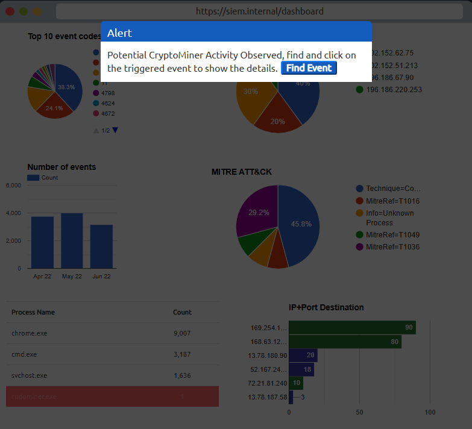

> **What it shows:** The same dashboard dimmed behind an alert box reading Potential CryptoMiner Activity Observed, with a Find Event button. The process table now has an extra red row, hard to read here, with a count of 1; the answer entered in screenshot 18 names cudominer.exe.  
> **Why it matters:** An alert is only a starting point. The analyst must open the triggering event to see who, where and what.  
> **Remember:** New red row in the process table = the process that fired the rule.

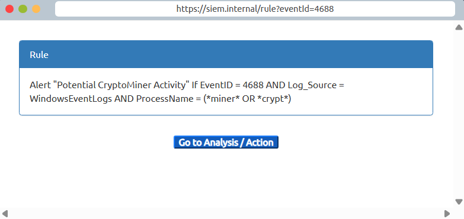

> **What it shows:** Rule page at siem.internal/rule?eventId=4688. Logic: alert when EventID = 4688 AND Log_Source = WindowsEventLogs AND ProcessName matches *miner* or *crypt*. A "Go to Analysis / Action" button is below.  
> **Why it matters:** Reading the rule shows exactly why it fired and how it could misfire or be evaded, which is the basis for tuning.  
> **Remember:** 4688 = process creation. Wildcard name rules catch lazy names and can be dodged by renaming.

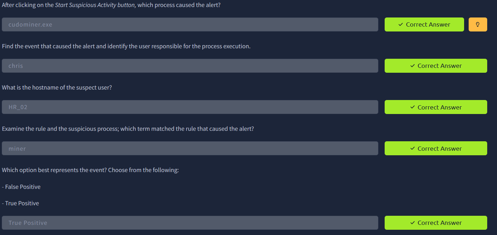

> **What it shows:** Five answers, all marked Correct Answer: process that fired the alert cudominer.exe; user responsible chris; hostname of the suspect machine HR_02; term that matched the rule miner; classification True Positive.  
> **Why it matters:** This is the whole triage outcome: process, user, host, rule match and verdict. It is the only place in my captures where user and host appear.  
> **Remember:** Alert > find event > read rule > identify user and host > decide TP or FP.

<!-- TODO: add screenshot of the triggered event detail view (user, host, command line, timestamp) -->
<!-- TODO: add screenshot of the Analysis / Action page (response, analyst comment, escalation) -->

### Five Ws

Evidence source: the alert popup (16), the rule (17) and the answers shown in (18). The event detail page itself is not captured.

| W | Finding | Evidence |
|---|---|---|
| Who | User `chris` | Screenshot 18 |
| What | Process `cudominer.exe` ran and matched the Potential CryptoMiner Activity rule | Screenshots 16, 17, 18 |
| When | Not visible in my captures <!-- TODO: add event timestamp --> | None |
| Where | Host `HR_02` | Screenshot 18 |
| Why | Process name contains `miner`, which matches the `*miner*` wildcard in the rule for EventID 4688 | Screenshots 17, 18 |

### IOC table

| Type | Value | Source |
|---|---|---|
| Process name | cudominer.exe | Screenshots 16, 18 |
| User account | chris | Screenshot 18 |
| Host | HR_02 | Screenshot 18 |
| File hash, path, command line, destination IP/pool | Not shown <!-- TODO: add if event detail is recaptured --> | None |

### MITRE ATT&CK

The room's alert view shows no ATT&CK technique for this alert. The dashboard legend lists T1016, T1049 and T1036 in a separate pie, but nothing ties them to this alert. *Interpretation, not shown in the room:* cryptomining is commonly mapped to T1496 (Resource Hijacking).

### Evidence vs interpretation

| Evidence (on screen) | Interpretation (my reading) |
|---|---|
| Rule matches EventID 4688 with a process name containing miner or crypt | The match is by name only; a renamed miner would not fire it |
| Verdict entered as True Positive | The process name alone is not proof; the room gives no path, hash or network data in my captures |
| Event code 4625 is the largest slice (38.3%) and RDP sources are public IPs | Possible failed-login or RDP activity worth a look; the room does not investigate it |

### Discrepancies and oddities I noticed

- **Top 5 RDP connections** panel lists only four addresses in the legend although the title says five.
- **MITRE ATT&CK pie** mixes proper IDs (T1016, T1049, T1036) with labels such as "Technique=Co..." and "Info=Unknown Process", which are not technique IDs.
- **Legend is paged (1/2)**, so event code 4688 (the one the rule uses) is not visible in the Top 10 pie page I captured.
- **Alert row** in the process table is red and low-contrast in screenshot 16, so the name is not clearly readable there; the name comes from the answer in screenshot 18.

---

## Triage Summary

| Alert | Verdict | Why | Containment shown |
|---|---|---|---|
| Potential CryptoMiner Activity | True Positive (as entered in the room) | Process cudominer.exe matched the *miner* wildcard on EventID 4688; user chris, host HR_02 identified | None captured <!-- TODO: add Analysis / Action screenshot --> |

**Priority order:** only one alert in the room, so no ranking was needed.

**What I would do next (recommendations, not actions shown in the room):**

1. Isolate HR_02 from the network, following the SOC's playbook.
2. Confirm the process path, hash and parent process, and check the hash against threat intelligence.
3. Look for outbound connections from HR_02 that could be mining-pool traffic.
4. Find how it arrived (download, email, removable media) and what else chris did around that time.
5. Search the SIEM for the same process name or hash on other hosts.
6. Escalate with the notes below and ask the user and manager for context.

---

## Reflection: How I'd Write the Escalation Notes

*Written after the lab. This is not part of the room.*

> **Alert:** Potential CryptoMiner Activity (rule: EventID 4688, Windows Event Logs, process name *miner* or *crypt*).
> **Host / user:** HR_02 / chris.
> **Process:** cudominer.exe, `<path>`, `<hash>`, parent `<parent process>`, at `<timestamp>`.
> **Assessment:** likely true positive; the name matches the rule, `<add supporting evidence>`.
> **Impact:** possible unauthorised resource use on an HR workstation.
> **Actions taken:** `<what was done>`.
> **Recommended:** isolate host, collect process and network evidence, sweep for the same hash.

Items in angle brackets were not visible in my screenshots, so I have left them blank on purpose.

---

## Revision Notes

### One-minute summary

- Logs are spread over many devices, formats and places; manual review does not scale.
- Host-centric logs = events on a machine; network-centric logs = traffic between machines.
- A SIEM collects, aggregates, detects and supports investigation.
- Logs reach a SIEM through agents, syslog, manual upload or port-forwarding.
- Windows uses Event IDs; Linux uses files under /var/log.
- Alerts come from rules; noisy rules create false positives and need tuning.
- The lab: open the alert, read the rule, find user and host, give a verdict.

### Core concepts

| Concept | Plain-English meaning | Example from this room |
|---|---|---|
| SIEM | Central tool that collects logs and raises alerts | siem.internal dashboard |
| Host-centric log | Event recorded on a machine | Registry change |
| Network-centric log | Event recorded about traffic | VPN activity |
| Aggregation | Putting logs from many places together | Six systems feeding one SIEM |
| Correlation | Linking events from different logs to see the story | One log alone gives limited context |
| Ingestion | How data enters the SIEM | Agent, syslog, upload, port |
| Detection rule | Condition that triggers an alert | EventID 4688 and process name wildcard |
| False positive | Alert on harmless activity | Needs tuning |
| True positive | Alert on real malicious activity | cudominer.exe case |

### Cheat sheet

| Item | Meaning | Source |
|---|---|---|
| Event ID 4688 | Windows process creation (used by the lab rule) | Screenshot 17 |
| Event ID 104 | Log cleared | Screenshot 14 |
| Event ID 4625 | Failed logon (standard meaning) | Legend in screenshot 15 |
| Event ID 4624 | Successful logon (standard meaning) | Legend in screenshot 15 |
| /var/log/httpd | HTTP logs | Screenshots 9, 13 |
| /var/log/cron | Cron events | Screenshot 9 |
| /var/log/auth.log, /var/log/secure | Authentication | Screenshot 9 |
| /var/log/kern | Kernel | Screenshot 9 |
| T1016, T1049, T1036 | IDs on the dashboard legend; I read them as System Network Configuration Discovery, System Network Connections Discovery and Masquerading (my reference, not stated in the room) | Screenshot 15 |
| T1496 | Resource Hijacking, my suggested mapping for cryptomining | Interpretation |

Other legend codes (1, 3, 11, 4672, 4798) are shown on the dashboard but not explained in the room; I have not assigned meanings to them here.

### Analyst workflow

1. Read the alert name and open the triggering event.
2. Read the detection rule to see exactly why it fired.
3. Identify the process, user and host.
4. Check the context: is this normal for that user and host?
5. Decide true or false positive.
6. If true, contain and escalate with clear notes; if false, record why and suggest tuning.

### Common mistakes / false-positive traps

- Trusting a process name alone; names can be benign or faked.
- Treating a dashboard pattern as a verdict.
- Ignoring that a rule can be dodged by a simple rename.
- Escalating without user, host, time and process details.
- Forgetting that cleared logs (ID 104) can mean someone is hiding activity.

### Self-check questions

1. Which type of log would show a registry change?

Answer
Host-centric.

2. Which type would show someone connecting over VPN?

Answer
Network-centric.

3. Name two of the problems with raw logs that a SIEM solves.

Answer
Any two of: many sources, no central place, limited context, too much volume, mixed formats.

4. List the four jobs of a SIEM in order.

Answer
Collect, aggregate, detect threats, investigate alerts.

5. Name the four ways logs can reach a SIEM.

Answer
Agent/forwarder, syslog, manual upload, port-forwarding.

6. Where would I look for web-server logs on Linux?

Answer
/var/log/httpd.

7. Which Windows Event ID shows event logs were cleared?

Answer
104.

8. Which Event ID did the lab rule use, and what does it record?

Answer
4688, a new process being created.

9. Why can a name-based rule such as *miner* be unreliable?

Answer
It can miss a renamed miner and may flag harmless programs.

10. What do you do when an alert keeps firing on harmless activity?

Answer
Treat it as a false positive and tune the rule.

### Interview angle

**Q1. What is a SIEM and why do SOCs use it?**
It collects and normalises logs from many sources into one place and raises alerts from rules. That lets analysts triage quickly instead of checking each device by hand.

**Q2. How do logs get into a SIEM?**
Through agents or forwarders, syslog, manual upload, or a listening port. The choice affects coverage, so a missing agent is a blind spot.

**Q3. Walk me through how you would triage a cryptominer alert.**
I open the triggering event, read the rule, note process, user, host and time, and check context. Then I give a verdict, contain if needed, and escalate with clear notes.

---

## Key Takeaways

- A SIEM exists because logs are scattered, large and inconsistent.
- Know whether an event is host-centric or network-centric before choosing where to look.
- Ingestion method matters: no data in means no alert out.
- Always read the rule behind an alert before judging it.
- A verdict needs more than a name match; collect path, hash, parent and network data.
- Good escalation notes carry user, host, time, process and what was done.

## Glossary

| Term | Meaning |
|---|---|
| SIEM | Central platform that collects logs and raises security alerts |
| Log | Record of an event on a device |
| Host-centric | About activity on a machine |
| Network-centric | About traffic between machines |
| Agent / forwarder | Small program that sends logs to the SIEM |
| Syslog | Common protocol for sending logs to a central host |
| Event ID | Number Windows gives to a type of event |
| Rule | Condition that triggers an alert |
| True positive | Real threat correctly flagged |
| False positive | Harmless activity wrongly flagged |
| Tuning | Adjusting a rule to cut false positives |
| IOC | Observable that points to malicious activity, such as a file name or IP |

## Skills Demonstrated

`SIEM concepts` `log source identification` `log ingestion methods` `Windows Event IDs` `Linux log locations` `alert triage` `detection rule reading` `true vs false positive` `Five Ws` `IOC identification` `escalation notes` `technical documentation`

---

[Back to all labs](../../README.md)
