# Introduction to SOAR | TryHackMe

| | |
|---|---|
| **Platform** | TryHackMe: [Introduction to SOAR](https://tryhackme.com/room/soar) (premium room, about 60 min) |
| **Path** | SOC Level 1 → Core SOC Solutions |
| **Difficulty** | Medium (as listed on the room page) |
| **Status** | Completed, 23 Nov 2026 |
| **Environment** | Interactive in-browser simulation on TryHackMe (not a real SOAR product) |
| **Focus** | SOC challenges, what SOAR solves, playbooks, automating a threat intelligence workflow |

> Flags are redacted in all screenshots.

## Contents

- [What this lab is about](#what-this-lab-is-about)
- [Objective](#objective)
- [At a Glance](#at-a-glance)
- [Task 1: Introduction](#task-1-introduction)
- [Task 2: Traditional SOC and Challenges](#task-2-traditional-soc-and-challenges)
- [Task 3: Overcoming SOC Challenges with SOAR](#task-3-overcoming-soc-challenges-with-soar)
- [Task 4: Building SOAR Playbooks](#task-4-building-soar-playbooks)
- [Task 5: Threat Intel Workflow Practical](#task-5-threat-intel-workflow-practical)
- [Task 6: Conclusion](#task-6-conclusion)
- [Revision Notes](#revision-notes)
- [Key Takeaways](#key-takeaways)
- [Glossary](#glossary)
- [Skills Demonstrated](#skills-demonstrated)

## What this lab is about

A SOC runs on many tools (SIEM, EDR, firewall, IAM, threat intel) that rarely talk to each other, so analysts drown in alerts and repeat the same manual steps every shift. SOAR (Security Orchestration, Automation and Response) sits on top of those tools, connects them, and runs repeatable steps automatically while leaving judgement calls to a human. This room explained the problems of a traditional SOC, how SOAR addresses them, how playbooks describe a response as a flow of steps and decisions, and then let me set up a threat intelligence workflow by choosing which steps are automated and which stay manual. For a SOC L1 analyst this matters because much of the day is routine triage, and knowing what can safely be automated is what frees time for the cases that need a person.

## Objective

Understand the challenges of a traditional SOC, see how SOAR helps, read two example playbooks, and configure an automated versus manual threat intelligence workflow. This is hands-on practice in a simulated lab, not work experience.

## At a Glance

| Item | Detail |
|---|---|
| What was covered | SOC capabilities and challenges, what SOAR does, playbooks (phishing email, CVE patching), a threat intel workflow practical |
| Tools / views used | The room's interactive workflow simulation: five settings panels with Automated / Manual toggles. Integrations named in the panels: TheHive, ServiceNow, Slack, email, VirusTotal, Any.Run, Hybrid Analysis |
| Frameworks | None applied. This room has no alerts, so no ATT&CK mapping or triage |
| Actually did | Configured the five panels of the threat intel workflow (Case Ticket, Threat Intel, Data Extraction, Reputation Checks, Course of Action) |
| Only read / seen | The two playbook flowcharts and the SOAR diagrams (concepts, not something I built) |
| Gap | The final successful run of the workflow is not captured in my screenshots |

## Task 1: Introduction

The room opens by listing the tools a SOC relies on and the pressures it faces (alert overload, manual work, disconnected tools, poor communication between teams), and says SOAR is the answer it will explore. Goals: understand the traditional SOC and its challenges, see how SOAR overcomes them, learn playbooks, and walk through a threat intel workflow.

<!-- TODO: add screenshot (optional: room header / task 1 view) -->

## Task 2: Traditional SOC and Challenges

**What a SOC does (my summary):**

| Capability | In plain words | Example |
|---|---|---|
| Monitoring and detection | Watching the environment all the time and flagging suspicious activity, mainly through the SIEM | Many failed logins on an important machine, or a login from an unfamiliar place |
| Recovery and remediation | Acting as first responder and cleaning up, using EDR, firewall and IAM | Isolating a host in EDR, blocking an IP at the firewall, disabling a user in IAM |
| Threat intelligence | Using steady feeds of known-bad IPs, hashes and domains | Blocking a domain that a feed marks as malicious |
| Communication | Keeping IT and management informed so incidents get handled | Raising a ticket for IT to check a new patch |

**Challenges of a traditional SOC (my summary):**

| Challenge | What it means |
|---|---|
| Alert fatigue | Many tools produce many alerts, and most are false positives or too thin to act on, so analysts are overwhelmed |
| Disconnected tools | Firewall, endpoint and other logs live in separate places, so investigation means jumping between tools |
| Manual processes | Steps are often undocumented and rely on what senior analysts remember, which slows response |
| Talent shortage | Hiring is hard while workload grows, so the team is stretched and responses take longer |

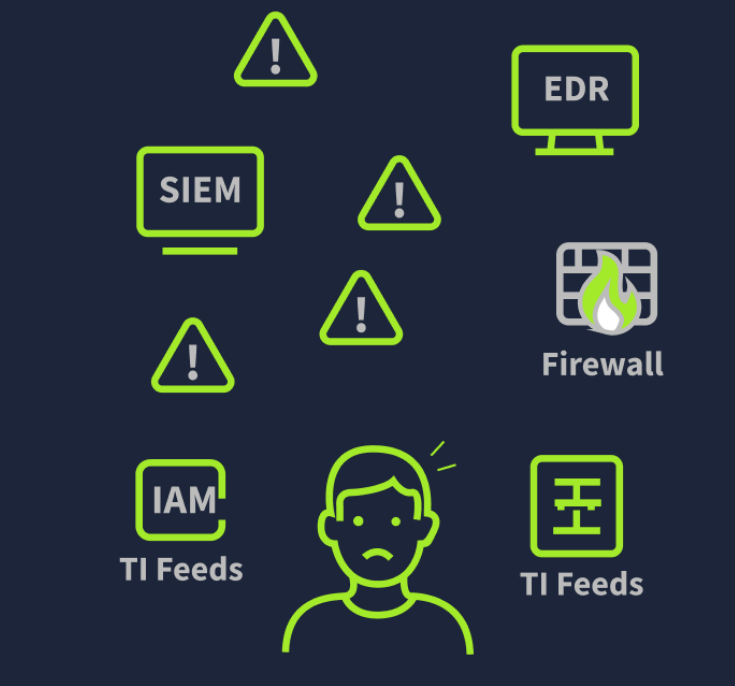

> **What it shows:** Icons for SIEM, EDR, Firewall, IAM and two TI Feeds scattered around four warning triangles and a worried-looking person. The label under the IAM icon reads "TI Feeds".  
> **Why it matters:** It pictures the SOC problem: many separate tools, many alerts, one overloaded analyst.  
> **Remember:** Many tools plus many alerts equals alert fatigue.

## Task 3: Overcoming SOC Challenges with SOAR

SOAR connects the SOC's tools (SIEM, threat intel feeds, firewalls/IDS, IAM) into one place. Instead of an analyst doing every step by hand, SOAR runs defined steps automatically. The room's diagrams list three benefits: automated response, less alert fatigue and consistent workflows. The before/after picture adds faster containment.

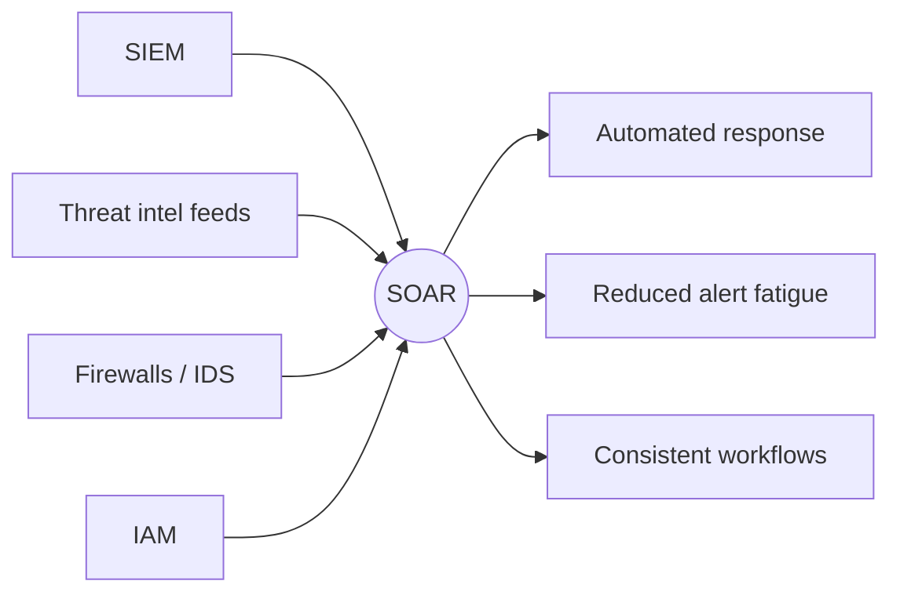

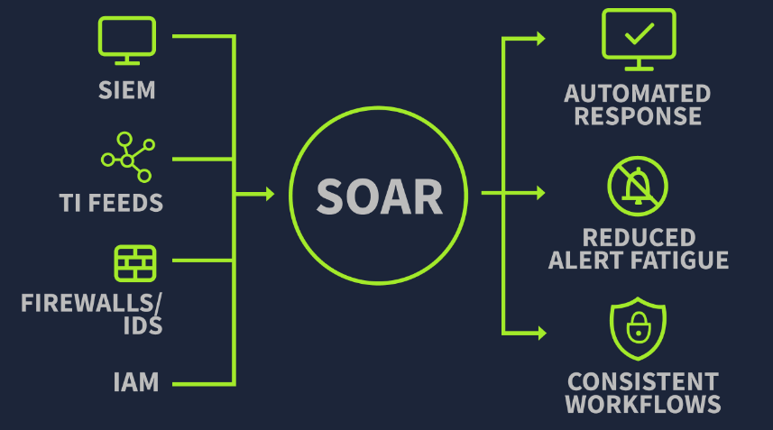

> **What it shows:** SIEM, TI Feeds, Firewalls/IDS and IAM joined by lines into a circle labelled SOAR, with arrows out to Automated Response, Reduced Alert Fatigue and Consistent Workflows.  
> **Why it matters:** It is the core idea: many inputs go in, and SOAR turns them into repeatable actions.  
> **Remember:** Inputs: SIEM, TI, firewall/IDS, IAM. Outputs: automate, less fatigue, consistency.

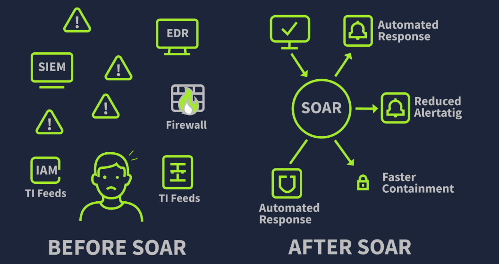

> **What it shows:** "Before SOAR" repeats the scattered tools and warnings from Task 2. "After SOAR" shows a central SOAR circle with arrows to Automated Response (twice), "Reduced Alertatig" and Faster Containment.  
> **Why it matters:** The contrast is the whole case for SOAR: scattered tools become one connected, quicker response.  
> **Remember:** Before: chaos. After: central orchestration, faster containment.

**Notes on the diagrams (evidence of label slips in the room's art):** one label reads "Reduced Alertatig", "Automated Response" appears twice, and the IAM icon is labelled "TI Feeds". I read these as typos or copy slips, not as meaning.

## Task 4: Building SOAR Playbooks

A playbook is a written-down flow of steps and decisions for handling one kind of situation. In SOAR the machine runs the repeatable steps and hands the judgement steps to an analyst. The room shows two examples.

**Playbook 1: suspected phishing email.** The flow creates an investigation ticket, checks whether the email has attachments or URLs, checks hashes and URLs on VirusTotal, deletes the email if something is malicious, and sends it to a sandbox for manual analysis if the checks come back clean.

| Stage | What happens |
|---|---|
| Intake | Suspected email received, investigation ticket created |
| Triage | Does it contain URLs or attachments? If not, notify users over chat channels and end |
| Attachments path | Compute the hash, send it to VirusTotal, decide if the hash is malicious |
| URL path | Send the URL to VirusTotal, decide if the URL is malicious |
| Malicious | Delete the emails |
| Not flagged | Manual analysis of the email in a sandbox by an analyst |
| Close-out | Ticket updated with IOCs |

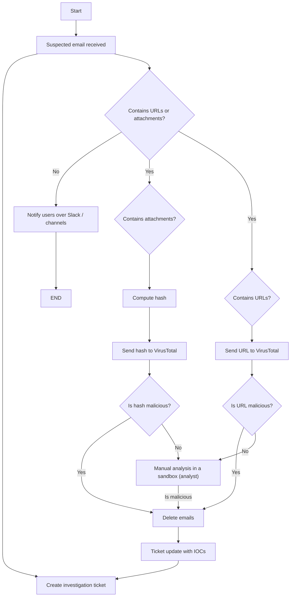

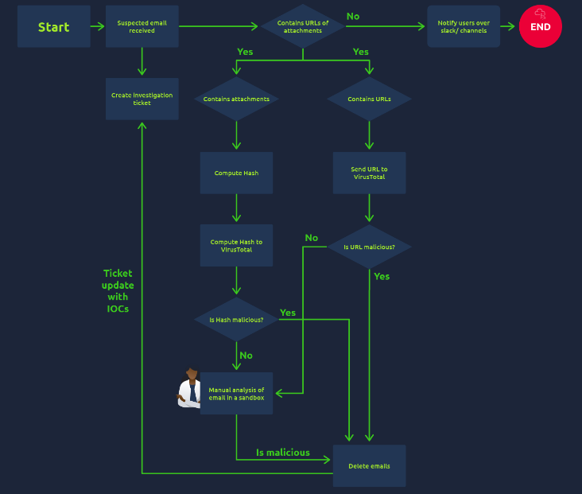

> **What it shows:** A flowchart from Start to END: suspected email received, an investigation ticket, a URLs-or-attachments decision, hash and URL checks on VirusTotal, a manual sandbox step with an analyst icon, "Delete emails", and "Ticket update with IOCs" looping back to the ticket.  
> **Why it matters:** It shows which steps a machine can run (hashing, lookups, deleting) and the one step that stays with a person (sandbox analysis).  
> **Remember:** Auto-check with VirusTotal first; humans handle what is not clearly bad.

**Gaps in the flowchart as drawn:** the first decision is worded "Contains URLs of attachments", one box reads "Compute Hash to VirusTotal", and after the sandbox only an "Is malicious" arrow is drawn, with no exit for an email found to be clean. My Mermaid version tidies the wording but keeps that gap.

**Playbook 2: new CVE and patching.** SOAR watches advisory lists, pulls out new CVE data, and checks with patch management whether the CVE is already handled or applies. If it applies, SOAR opens a CVE ticket for an analyst, finds the affected assets, checks for a patch, tests it on test machines, and logs the results. The SOC then deploys and verifies the patch, SOAR runs a vulnerability scan, and if assets are still vulnerable the SOC builds and deploys a mitigation before closing the ticket.

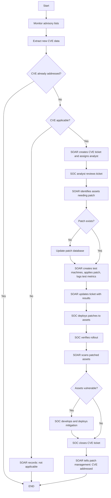

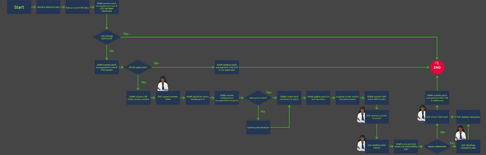

> **What it shows:** A wide flowchart from Start to END covering advisory monitoring, "CVE already addressed?", "Is CVE applicable?", ticket creation, test machines, patch deployment, a vulnerability scan and "Assets vulnerable?", with analyst icons next to the SOC-labelled steps.  
> **Why it matters:** It shows how SOAR and analysts share one process: SOAR does queries, updates and scans, while the SOC reviews, deploys, verifies and closes.  
> **Remember:** SOAR steps are queries and updates; SOC steps are review, deploy, verify, close.

**Gap in the flowchart as drawn:** one box reads "Update path database"; I read it as "patch database".

## Task 5: Threat Intel Workflow Practical

This is the hands-on part. The room is an interactive simulation with five stations: Case Ticket, Threat Intel, Data Extraction, Reputation Checks and Course of Action. Each station opens a settings panel where every item is tagged Automated or Manual, and a RUN control starts the workflow. I went through all five panels.

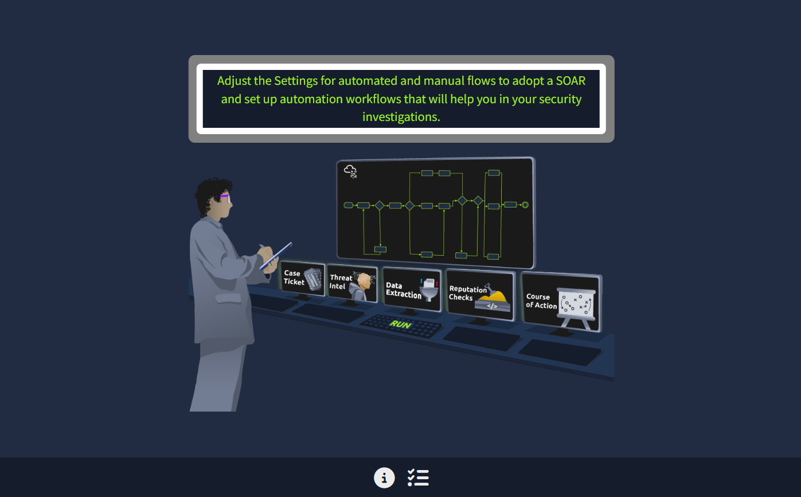

> **What it shows:** A banner telling the player to adjust the settings for automated and manual flows to set up SOAR workflows, an analyst figure, a large workflow screen, five station screens (Case Ticket, Threat Intel, Data Extraction, Reputation Checks, Course of Action), a RUN keyboard, and info and checklist icons at the bottom.  
> **Why it matters:** The five stations map to the stages of a real investigation: open a case, get intel, extract indicators, check reputation, then act.  
> **Remember:** Case, intel, extract, reputation, action.

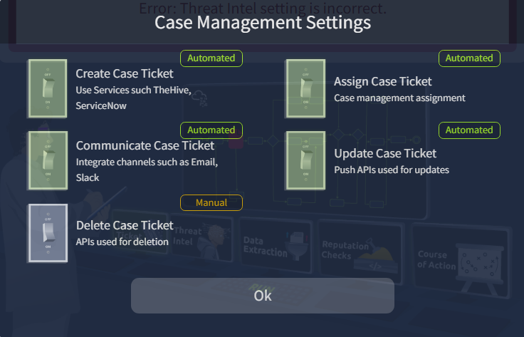

> **What it shows:** Case Management Settings: Create, Assign, Communicate and Update Case Ticket are tagged Automated (integrations named: TheHive, ServiceNow, email, Slack); Delete Case Ticket is tagged Manual. A banner behind the panel reads "Error: Threat Intel setting is incorrect."  
> **Why it matters:** Ticket handling is routine and safe to automate, but deleting records stays with a human. The banner shows an earlier configuration was wrong.  
> **Remember:** Automate create, assign, communicate, update; keep delete manual.

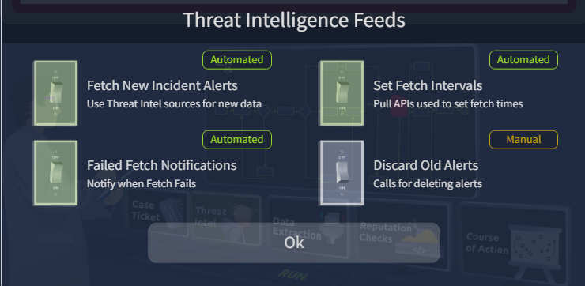

> **What it shows:** Threat Intelligence Feeds: Fetch New Incident Alerts, Set Fetch Intervals and Failed Fetch Notifications are Automated; Discard Old Alerts is Manual.  
> **Why it matters:** Pulling intel on a schedule and being told when a fetch fails keeps the feed fresh without effort. Throwing alerts away is a decision someone should own.  
> **Remember:** Fetch and monitor automatically; discarding stays manual.

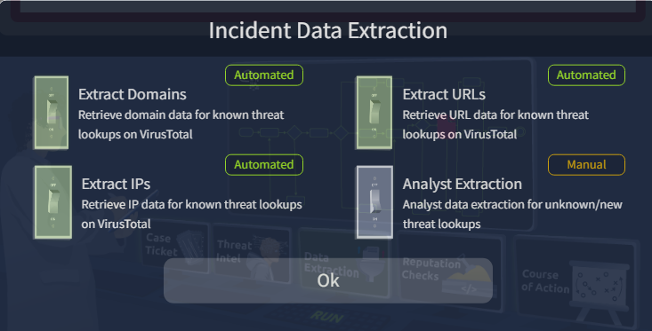

> **What it shows:** Incident Data Extraction: Extract Domains, Extract URLs and Extract IPs are Automated (lookups against VirusTotal for known threats); Analyst Extraction is Manual (for unknown or new threats).  
> **Why it matters:** Pulling indicators out of a case is repetitive, so machines do it for known threats. New or odd indicators need an analyst's eyes.  
> **Remember:** Known indicators auto, unknown indicators manual.

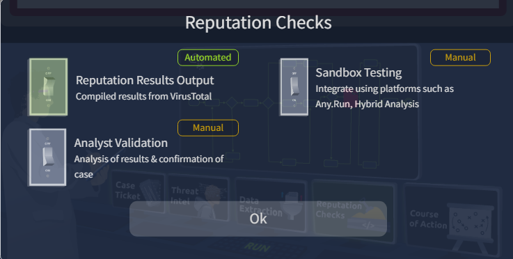

> **What it shows:** Reputation Checks: Reputation Results Output (compiled VirusTotal results) is Automated; Analyst Validation and Sandbox Testing (Any.Run, Hybrid Analysis) are Manual.  
> **Why it matters:** A reputation score is a starting point, not a verdict. A person validates it and uses a sandbox when the score is unclear.  
> **Remember:** Score automatically, validate and sandbox manually.

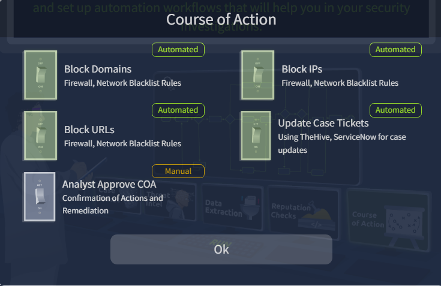

> **What it shows:** Course of Action: Block Domains, Block IPs and Block URLs (firewall and network blacklist rules) and Update Case Tickets (TheHive, ServiceNow) are Automated; Analyst Approve COA is Manual.  
> **Why it matters:** Blocking can disrupt the business if it is wrong, so an analyst approves the plan before it goes ahead.  
> **Remember:** Blocks and ticket updates auto; approval of the course of action is manual.

**Pattern across the panels (my reading):** repeated lookups, enrichment, blocking and ticket updates were Automated, while deleting, discarding, analyst extraction, validation, sandboxing and approval were Manual. The idea I took away is to automate the repetitive work and keep people on the risky or unclear steps.

**Gap:** The banner in the Case Management screenshot shows the Threat Intel setting was wrong at that moment. My screenshots do not show the final run or its success message.

<!-- TODO: add screenshot of the final successful run / result of the workflow -->

## Task 6: Conclusion

The closing task wraps up the room and confirms completion.

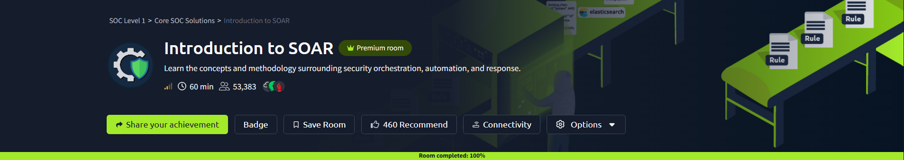

> **What it shows:** The Introduction to SOAR header (SOC Level 1 > Core SOC Solutions, Premium room, 60 min) with "Share your achievement" and Badge buttons and a green bar reading "Room completed: 100%".  
> **Why it matters:** It is the completion record for this write-up.  
> **Remember:** Simulated lab: hands-on practice, not job experience.

## Revision Notes

**One-minute summary**

- A traditional SOC has many disconnected tools, floods of alerts, undocumented manual steps and too few people.
- SOAR connects the tools, automates repeatable steps and keeps workflows consistent.
- A playbook is a documented flow of steps and decisions for one scenario.
- Phishing playbook: ticket, check hash/URL on VirusTotal, delete if malicious, sandbox if not, update ticket with IOCs.
- CVE playbook: check if it applies, ticket, test the patch, deploy, scan, mitigate if still vulnerable, close.
- In the practical, routine steps were Automated and judgement steps were Manual.
- Automate the repetitive; keep people on deletion, validation and approval.

**Core concepts**

| Concept | Plain-English meaning | Example from this room |
|---|---|---|
| Orchestration | Connecting different tools so they work together | SIEM, TI, firewall and IAM feeding SOAR |
| Automation | Running steps without a person | Hash lookup on VirusTotal |
| Response | Taking action on a threat | Blocking an IP at the firewall |
| Playbook | Written flow of steps and decisions | Phishing email playbook |
| Alert fatigue | Too many alerts to handle well | Many tools, many warnings |
| Case ticket | The record of an investigation | TheHive / ServiceNow tickets |
| Manual step | A step that needs human judgement | Analyst approves the course of action |

**Cheat sheet**

| Item | Detail |
|---|---|
| SOC challenges | Alert fatigue, disconnected tools, manual processes, talent shortage |
| SOAR benefits | Automated response, reduced alert fatigue, consistent workflows, faster containment |
| Workflow stations | Case Ticket → Threat Intel → Data Extraction → Reputation Checks → Course of Action |
| Automated examples | Create/assign/update tickets, fetch alerts, extract domains/URLs/IPs, reputation output, block domains/IPs/URLs |
| Manual examples | Delete ticket, discard old alerts, analyst extraction, analyst validation, sandbox testing, approve course of action |
| Tools named in panels | TheHive, ServiceNow, Slack, email, VirusTotal, Any.Run, Hybrid Analysis |

**Analyst workflow (what this room teaches)**

1. Pick the repetitive scenario (for example phishing or a new CVE) and write the steps down.
2. Mark each step as automatable or needing judgement.
3. Connect the tools the steps need (ticketing, threat intel, firewall, chat).
4. Automate collection, extraction, lookups and ticket updates.
5. Keep analyst checks on validation, sandboxing, deletion and approvals.
6. Run the workflow and check that each setting is correct.
7. Record IOCs and outcomes in the ticket.

**Common mistakes / false-positive traps**

- Automating destructive actions (deleting, blocking) with no approval step.
- Trusting one reputation result: a clean score is not proof, hence the sandbox step.
- A playbook with no exit for "checked and clean", as in the phishing flowchart as drawn.
- Stale threat intel because fetch intervals or failure notices are not set.
- A wrong setting somewhere in the workflow, as the error banner showed.
- Treating SOAR as a replacement for analysts rather than a helper.

**Self-check questions**

1. What does SOAR stand for?

Answer
Security Orchestration, Automation and Response.

2. Name two challenges a traditional SOC faces.

Answer
Any two of: alert fatigue, disconnected tools, manual processes, talent shortage.

3. Why do disconnected tools slow an investigation?

Answer
The analyst has to switch between separate tools and logs and stitch the story together by hand.

4. In the phishing playbook, when does an email go to a sandbox?

Answer
When the hash or URL check does not flag it as malicious.

5. What gets added to the ticket at the end of the phishing playbook?

Answer
The IOCs.

6. What happens in the CVE playbook if the CVE is already addressed?

Answer
The flow ends.

7. How does the CVE playbook check the patch worked?

Answer
SOAR runs a vulnerability scan on the patched assets, and if they are still vulnerable the SOC builds a mitigation.

8. Which Reputation Checks items were Manual?

Answer
Analyst Validation and Sandbox Testing.

9. Why keep approval of the course of action manual?

Answer
Blocking or changing things can disrupt the business if wrong, so a person confirms first.

10. Which Course of Action items were Automated?

Answer
Blocking domains, IPs and URLs, and updating case tickets.

**Interview angle**

- *What is SOAR and how is it different from a SIEM?* A SIEM collects and correlates logs and raises alerts. SOAR sits on top, connects tools and runs the response steps automatically through playbooks.
- *How would you automate a phishing response?* Create a ticket, check hashes and URLs against a reputation service, delete the email if malicious, and send unclear cases to an analyst for sandbox review. Then record the IOCs in the ticket.
- *What should you not fully automate?* Actions that are hard to undo or that could disrupt the business, such as deleting data or blocking, should have an analyst approval step. Unclear or new indicators also need a person.

## Key Takeaways

- Alert fatigue and disconnected tools are the main reasons a SOC needs SOAR.
- SOAR is about connecting tools and running repeatable steps, not replacing analysts.
- Playbooks turn tribal knowledge into a documented, repeatable flow.
- Reputation scores start an investigation; a human validates and sandboxes the unclear ones.
- Deciding what to automate and what to keep manual is the key design choice.
- Always check the whole workflow for wrong settings before trusting it, and record the outcome in the ticket.

## Glossary

| Term | Meaning (my words) |
|---|---|
| SOAR | A platform that connects security tools and automates response steps |
| Orchestration | Making separate tools work together in one flow |
| Playbook | A documented set of steps and decisions for one scenario |
| Workflow | The configured flow a SOAR runs |
| Alert fatigue | Being overwhelmed by too many alerts |
| Case ticket | The record that tracks an investigation |
| Threat intel feed | A stream of known-bad indicators |
| IOC | A trace of malicious activity, such as an IP, hash or domain |
| Sandbox | An isolated place to run or open something suspicious safely |
| Course of action (COA) | The planned response steps, such as blocking an IP |
| CVE | A public identifier for a known software vulnerability |
| Patch management | Tracking and deploying software fixes |

## Skills Demonstrated

`SOAR concepts` `Security playbooks` `Phishing response workflow` `Patch management workflow` `Threat intel workflow` `Automation vs manual decisions` `Alert fatigue reduction` `Write-up documentation`

---

[Back to all labs](../../README.md)
