# Splunk: The Basics | TryHackMe

| | |
|---|---|
| **Platform** | TryHackMe: [Splunk: The Basics](https://tryhackme.com/room/splunk101) (premium room, about 30 min) |
| **Path** | SOC Level 1 → Core SOC Solutions |
| **Difficulty** | Easy (as listed on the room page) |
| **Status** | Completed, 23 Nov 2026 |
| **Environment** | Splunk Enterprise web interface on a TryHackMe lab machine, opened in the browser |
| **Focus** | SIEM basics: Splunk components, interface navigation, log ingestion, basic searching |

> Flags are redacted in all screenshots.

## Contents

- [What this lab is about](#what-this-lab-is-about)
- [Objective](#objective)
- [At a Glance](#at-a-glance)
- [Task 1: Introduction](#task-1-introduction)
- [Task 2: Connect with the Lab](#task-2-connect-with-the-lab)
- [Task 3: Splunk Components](#task-3-splunk-components)
- [Task 4: Navigating Splunk](#task-4-navigating-splunk)
- [Task 5: Adding Data](#task-5-adding-data)
- [Task 6: Conclusion](#task-6-conclusion)
- [Revision Notes](#revision-notes)
- [Key Takeaways](#key-takeaways)
- [Glossary](#glossary)
- [Skills Demonstrated](#skills-demonstrated)

## What this lab is about

A SOC analyst cannot investigate what they cannot search. Logs sit on hundreds of machines in different formats, and a SIEM such as Splunk is the place where they are collected, stored and made searchable in one spot. This room taught me the three building blocks of Splunk (forwarder, indexer, search head), how the web interface is laid out, and how a log file gets from my computer into an index. I then used simple searches to answer questions about a VPN log file. As a SOC L1 analyst I will spend a lot of my shift inside a SIEM like this, so knowing where data comes from and how to filter it is the base skill for everything else.

## Objective

Understand what each Splunk component does, find my way around the interface, ingest a JSON VPN log file into its own index, and answer questions about that data using basic field searches. This is hands-on practice in a simulated lab, not work experience.

## At a Glance

| Item | Detail |
|---|---|
| What was covered | Splunk components, interface navigation, data sources and input methods, file upload, index creation, basic searches |
| Tools / views used | Splunk Enterprise: Search & Reporting app, Add Data wizard, New Index dialog |
| Frameworks | None applied. This room has no alerts, so no ATT&CK mapping or triage |
| Actually did | Uploaded a JSON VPN log file, created an index, ran 5 searches (all events, by user, by IP, by exclusion, by second IP) |
| Only seen (not used) | Forwarder Monitoring (shown as disabled), Monitor and Forward input options, Metrics index type, other apps in the Apps list, Reports / Alerts / Dashboards tabs |
| Note on my run | I first went through the upload wizard with the default index and host, then changed those settings. Only the final settings are shown below |

## Task 1: Introduction

The room opens by positioning Splunk as a SIEM that gathers machine and network logs, lets you analyse them and gives better visibility into what is happening on a network. It lists four goals: understand the components, explore the interface, understand log ingestion, and ingest and analyse some logs hands-on. It suggests an introductory SIEM room first if SIEM is new to you.

<!-- TODO: add screenshot (optional: room header / task 1 view) -->

## Task 2: Connect with the Lab

This task is setup only. I started the lab machine and opened it in the browser to reach the Splunk web interface.

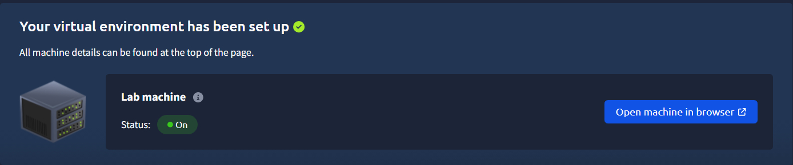

> **What it shows:** A green tick with "Your virtual environment has been set up", a "Lab machine" card with Status: On, and an "Open machine in browser" button.  
> **Why it matters:** A lab machine must be running before any Splunk work can start. In a real SOC the equivalent is confirming you can reach the SIEM before you start triage.  
> **Remember:** Machine status On, then open it in the browser. No AttackBox was needed for this room in my run.

## Task 3: Splunk Components

Splunk is built from three parts. **Forwarders** sit on the source systems and send their data onwards. The **indexer** receives that data, processes it and stores it as searchable events in indexes. The **search head** is the part the analyst actually uses: you type searches there and build reports, alerts and dashboards from the results.

| Component | Job | Analyst's view |
|---|---|---|
| Forwarder | Collects data on the source machine and ships it to Splunk | "Where is this log coming from?" |
| Indexer | Processes and stores events in indexes | "Is the data in Splunk and in which index?" |
| Search head | Search interface; results, reports, alerts, dashboards | "What does the data say?" |

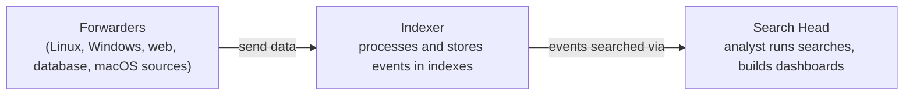

> **What it shows:** Three icons side by side, labelled Indexer, Search Head and Forwarder.  
> **Why it matters:** These are the three terms every Splunk conversation uses, and an L1 analyst should know which one to blame when data is missing (forwarder or indexer) and which one is used for investigation (search head).  
> **Remember:** Forwarder sends, indexer stores, search head searches.

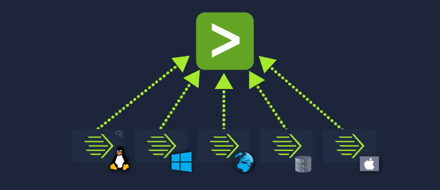

> **What it shows:** Five forwarder icons, each paired with a different source icon (Linux, Windows, a globe, a database, Apple), with arrows pointing up into one central Splunk box.  
> **Why it matters:** One Splunk deployment collects from many operating systems and system types, which is what lets an analyst correlate events across them.  
> **Remember:** Many sources, many forwarders, one central place to search.

## Task 4: Navigating Splunk

This task is a tour of the interface. The home page lists the installed apps, with **Search & Reporting** being the one used for searching. The top bar has Messages, Settings, Activity, Help and a Find box. The "Explore Splunk" panel has three shortcuts: add data, find apps, open the docs. The page also showed that forwarder monitoring was disabled, and I did not change that.

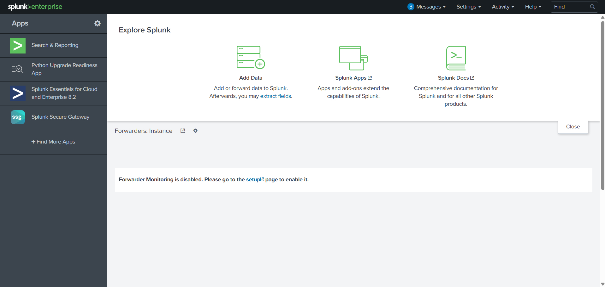

> **What it shows:** Splunk Enterprise home with an Apps list (Search & Reporting, Python Upgrade Readiness App, Splunk Essentials for Cloud and Enterprise 8.2, Splunk Secure Gateway, Find More Apps), the Explore Splunk shortcuts (Add Data, Splunk Apps, Splunk Docs) and a "Forwarder Monitoring is disabled" message. The top bar shows 3 messages.  
> **Why it matters:** Knowing where Search & Reporting and Add Data live saves time during an investigation, and the messages area is where Splunk reports problems with the platform itself.  
> **Remember:** Search & Reporting is the analyst's working app; Add Data is under the Explore Splunk panel.

In the Search & Reporting app (visible in the search screenshots later), the tabs are Search, Analytics, Datasets, Reports, Alerts and Dashboards. I only used the Search tab.

## Task 5: Adding Data

This is the hands-on part. First the room explains what Splunk can ingest, then the ways to bring data in, then I upload a VPN log file and search it.

**Supported data sources (in my words):** Splunk can take in plain files and folders, network events (ports, SNMP), IT operations tools, cloud services, databases, security products, virtualisation platforms, application servers, Windows-specific inputs and scripted or API-driven inputs.

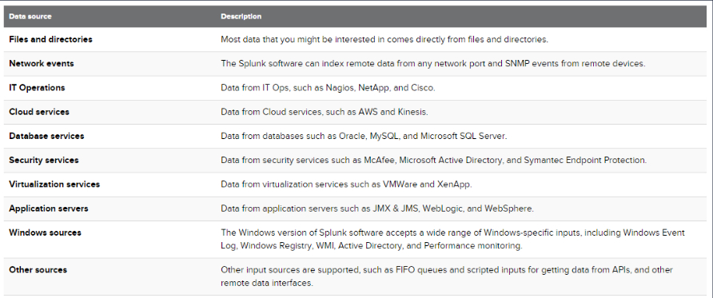

> **What it shows:** A two-column table of data source categories (files and directories, network events, IT operations, cloud, database, security, virtualisation, application servers, Windows sources, other sources) with example products for each.  
> **Why it matters:** When an analyst asks "do we have logs for this?", the answer starts with which source category it belongs to and whether Splunk is ingesting it.  
> **Remember:** Almost anything that produces logs can be a Splunk source, from Windows event logs to cloud services.

**Three ways to add data:**

| Method | Idea | Typical use |
|---|---|---|
| Upload | Send a file from my own computer | One-off or lab files (what I used) |
| Monitor | Watch files and ports on the Splunk machine itself | Local files, TCP/UDP ports, scripts |
| Forward | Receive data from a Splunk forwarder | Ongoing collection from remote machines |

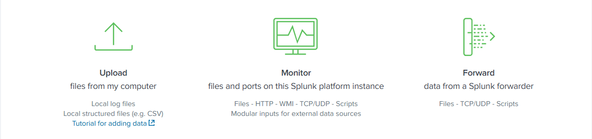

> **What it shows:** Three options on the Add Data page: Upload (files from my computer, such as local logs and CSV), Monitor (files and ports on this Splunk instance) and Forward (data from a Splunk forwarder).  
> **Why it matters:** The choice decides whether data is a one-time import or a continuous feed, and production SOC data is almost always the continuous kind.  
> **Remember:** Upload for lab files, Monitor for local, Forward for remote machines.

**The ingestion flow I followed:** the wizard has five steps (Select Source, Set Source Type, Input Settings, Review, Done). Creating a new index is a side step taken from the Input Settings page.

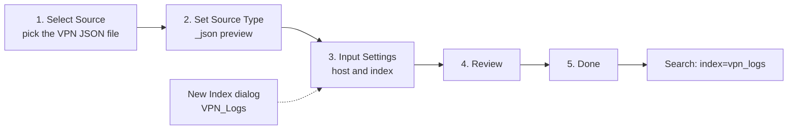

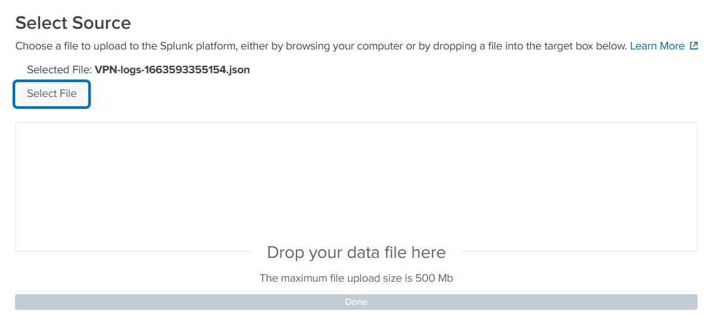

> **What it shows:** The Select Source step with "Selected File: VPN-logs-1663593355154.json", the Select File button highlighted, the note that the maximum upload size is 500 Mb and a greyed-out Done bar.  
> **Why it matters:** Choosing the right file is step one of onboarding a log source. The size limit tells you uploads are for small files, not for big ongoing feeds.  
> **Remember:** Upload limit shown: 500 Mb.

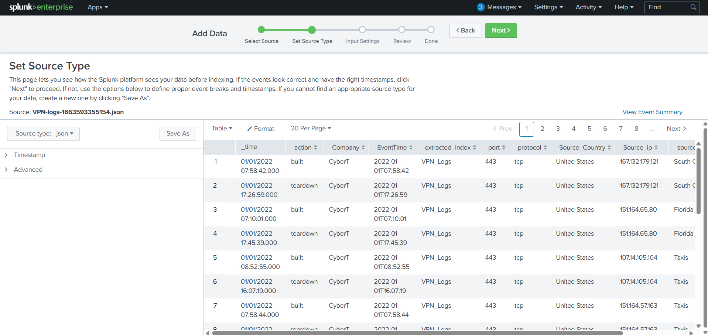

> **What it shows:** Step 2 (Set Source Type) with source type `_json` and a table preview of the VPN events. Columns include `_time`, `action` (built / teardown), `Company` (CyberT), `EventTime`, `port` (443), `protocol` (tcp), `Source_Country`, `Source_ip`. Row 1 is built at 07:58:42 from 167.132.179.121.  
> **Why it matters:** This preview is where an analyst checks that Splunk reads the events and timestamps correctly before indexing. A wrong source type means broken fields later.  
> **Remember:** JSON file → `_json` source type; check timestamps in the preview before clicking Next.

Input Settings is where the host value and the index are chosen. I set the host label to `VPN_CONNECTIONS` and used a new index.

<!-- TODO: add screenshot of the Input Settings page showing the final host (VPN_CONNECTIONS) and index (vpn_logs) values -->

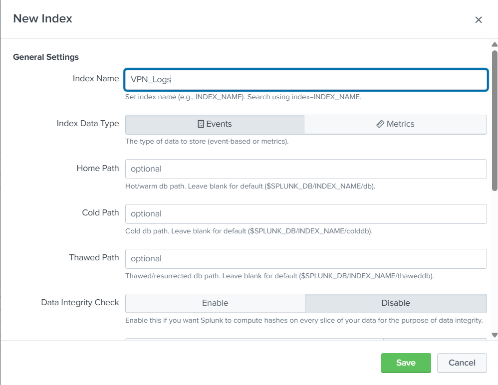

> **What it shows:** The New Index dialog with Index Name `VPN_Logs`, Index Data Type set to Events (Metrics is the other option), optional Home, Cold and Thawed paths left blank, Data Integrity Check showing Disable, and Save / Cancel buttons.  
> **Why it matters:** Keeping a log source in its own index makes searches faster and cleaner, and lets a SOC apply different retention or access to different data.  
> **Remember:** Events index for logs, Metrics index for numeric time series; blank paths use the defaults.

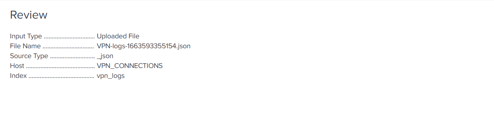

> **What it shows:** Review step: Input Type "Uploaded File", File Name VPN-logs-1663593355154.json, Source Type `_json`, Host `VPN_CONNECTIONS`, Index `vpn_logs`.  
> **Why it matters:** The review page is the last chance to catch a wrong index or host before the data is stored. These two values are what every later search depends on.  
> **Remember:** Host = which machine it is labelled as coming from; index = where it is stored.

Once the data was in, I searched it. Each search below starts with `index="vpn_logs"` and uses the time picker set to All time, because the events are from January 2022.

> **What it shows:** Search `index="vpn_logs"`, time range All time, 2,862 events. The newest event is 31/01/2022 18:29:41: user Phill, action teardown, Source_ip 143.23.45.158, United States, Virginia, port 443, tcp. Footer shows host = VPN_CONNECTIONS, source = VPN-logs-1663593355154.json, sourcetype = _json.  
> **Why it matters:** Searching the whole index with no filter is the baseline. Checking the event count first confirms the whole file was ingested.  
> **Remember:** `index="..."` is the first filter in almost every search; All time is needed for old data.

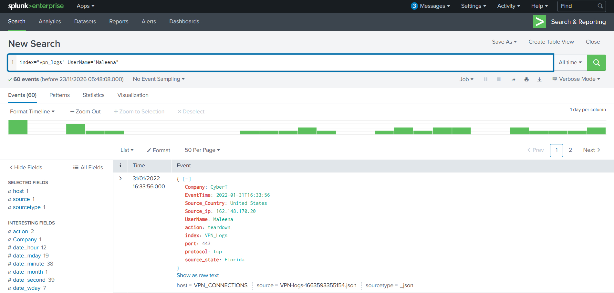

> **What it shows:** Search `index="vpn_logs" UserName="Maleena"` returned 60 events (2 pages at 50 per page). The newest is a teardown from 162.148.170.20, United States, Florida, at 31/01/2022 16:33:56.  
> **Why it matters:** Pulling everything one user did is the standard first step when an account looks suspicious.  
> **Remember:** `field="value"` after the index narrows results to one user.

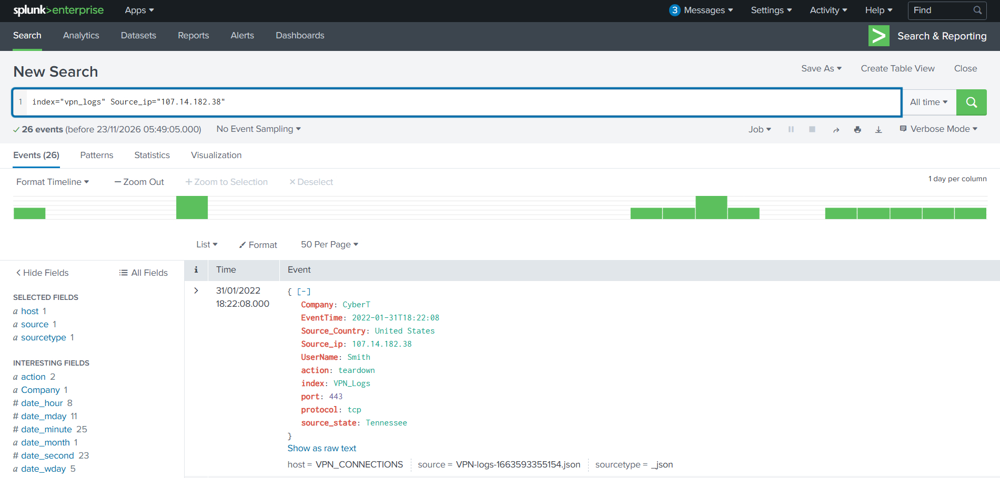

> **What it shows:** Search `index="vpn_logs" Source_ip="107.14.182.38"` returned 26 events. The newest event shows UserName Smith, teardown, Tennessee, at 31/01/2022 18:22:08.  
> **Why it matters:** Going from an IP to the user behind it is the reverse of the user search, and both directions are used when pivoting during triage.  
> **Remember:** Only one event is on screen here, so the username is read from the newest event, not from all 26.

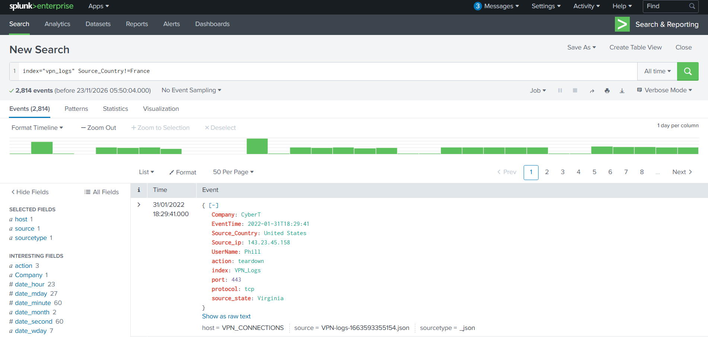

> **What it shows:** Search `index="vpn_logs" Source_Country!=France` returned 2,814 events. The newest event is the same Phill / 143.23.45.158 / United States event as the full search.  
> **Why it matters:** Excluding a value is useful for removing known-good traffic, such as one expected country, so odd ones stand out.  
> **Remember:** `!=` removes matching values; 2,862 minus 2,814 leaves 48 events excluded.

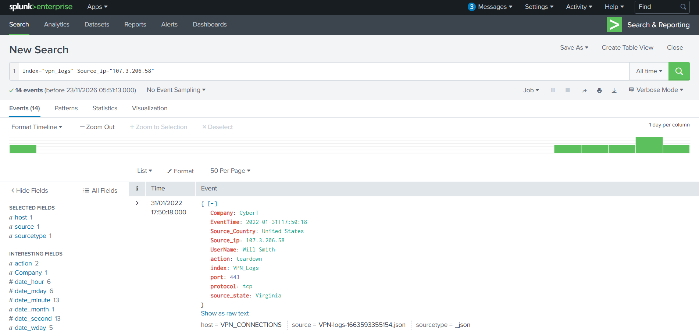

> **What it shows:** Search `index="vpn_logs" Source_ip="107.3.206.58"` returned 14 events. The newest event shows UserName "Will Smith", teardown, Virginia, at 31/01/2022 17:50:18.  
> **Why it matters:** A second IP gave a similar but different username (Smith vs Will Smith). Similar-looking values are still different values until proven otherwise.  
> **Remember:** Do not merge users or IPs just because the names look alike.

**Findings (evidence from the searches above):**

| Search | Events | Newest event shows |
|---|---|---|
| `index="vpn_logs"` | 2,862 | Phill, 143.23.45.158, Virginia, teardown |
| `UserName="Maleena"` | 60 | 162.148.170.20, Florida, teardown |
| `Source_ip="107.14.182.38"` | 26 | Smith, Tennessee, teardown |
| `Source_Country!=France` | 2,814 | Phill, 143.23.45.158, Virginia, teardown |
| `Source_ip="107.3.206.58"` | 14 | Will Smith, Virginia, teardown |

**My reading (interpretation, not shown on screen):** The 48-event gap between the full set and the "not France" search suggests those events are from France, but I did not look at them in the screenshots. The `action` field lists three distinct values in the sidebar, yet I only saw "built" and "teardown" in my views, so I would run a count by `action` to check the third. These are simulated logs and I made no judgement about any user or IP being malicious.

**Data-quality notes:**

- The `source_state` column in the Set Source Type preview reads "Taxis" for rows 5 to 8 (screenshot 08). It looks like a typo in the dataset for Texas. I am only noting it, not correcting it.
- The Splunk index is `vpn_logs` in the review and searches (screenshots 10, 11 to 15), but the New Index dialog shows `VPN_Logs` as typed (screenshot 09), and each event also carries its own `index: VPN_Logs` field inside the JSON. My reading is that Splunk stores index names in lower case and that the JSON field is just data, separate from the real index.

Task 5 quiz screenshot

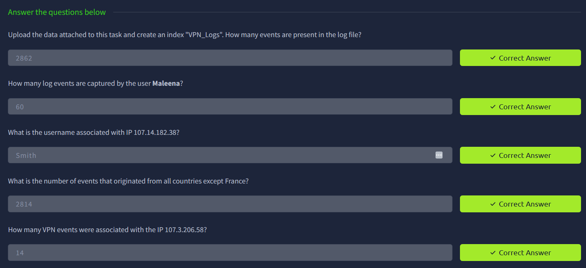

> **What it shows:** Five questions on the upload, event counts, a username, the not-France count and an IP's event count, each marked "Correct Answer".  
> **Why it matters:** It confirms the answers matched what the searches returned.  
> **Remember:** The quiz answers are the same numbers that the search screenshots show.

## Task 6: Conclusion

The closing task wraps up the room and confirms the room is finished.

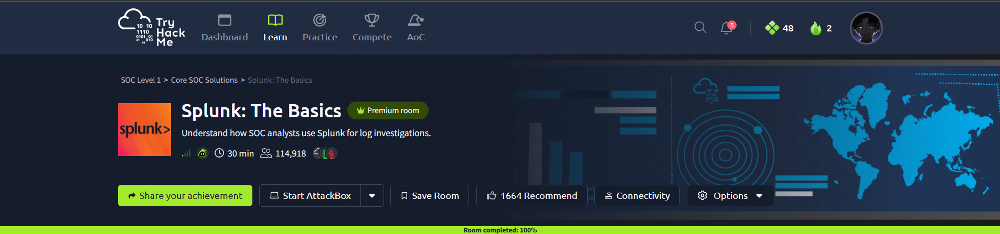

> **What it shows:** The Splunk: The Basics room header (SOC Level 1 > Core SOC Solutions, Premium room, 30 min) with a "Share your achievement" button and a green bar reading "Room completed: 100%".  
> **Why it matters:** It is the completion record for this write-up and the status I list in the info table.  
> **Remember:** This is a simulated lab, so it counts as hands-on practice, not job experience.

## Revision Notes

**One-minute summary**

- Splunk is a SIEM: it collects logs, stores them, and lets analysts search them.
- Three parts: forwarder (sends), indexer (stores), search head (analyst interface).
- Data comes in by upload, monitor or forward, from files, network, cloud, databases, Windows and more.
- Adding a file: Select Source → Set Source Type → Input Settings → Review → Done.
- Source type tells Splunk how to read the file (`_json` for my VPN file); the index is where it is stored.
- Searches start with `index=` and then add `field=value` filters; the time range must cover the data.
- I loaded 2,862 VPN events and filtered them by user, IP and country.

**Core concepts**

| Concept | Plain-English meaning | Example from this room |
|---|---|---|
| Forwarder | Agent that sends logs to Splunk | Five forwarders feeding one Splunk box |
| Indexer | Stores and prepares events for search | Holds the `vpn_logs` events |
| Search head | Where the analyst searches | Search & Reporting app |
| Index | A named store for events | `vpn_logs` |
| Source type | How Splunk should parse the data | `_json` |
| Host | Label for the machine the data comes from | `VPN_CONNECTIONS` |
| Source | The file or input the events came from | `VPN-logs-1663593355154.json` |
| Field | A named value inside an event | `UserName`, `Source_ip`, `action` |

**Cheat sheet**

| Item | Meaning |
|---|---|
| `index="vpn_logs"` | Search one index |
| `UserName="Maleena"` | Filter by a field value |
| `Source_ip="107.14.182.38"` | Filter by an IP |
| `Source_Country!=France` | Exclude a value |
| All time (time picker) | Needed here because events are from 2022 |
| Default fields | `host`, `source`, `sourcetype` |
| Add Data options | Upload / Monitor / Forward |

Extra SPL I want to learn next (standard Splunk, not shown in this room's screenshots): `| stats count by UserName`, `| top limit=5 Source_ip`, `| table _time UserName Source_ip action`, `| dedup UserName`.

**Analyst workflow (what this room teaches)**

1. Confirm the lab or SIEM is reachable and open the Search & Reporting app.
2. Add the data: choose the method (upload, monitor or forward) and select the source.
3. Check the source type and the timestamps in the preview.
4. Set the host and index, using a dedicated index where it makes sense.
5. Review the settings, finish, and confirm the event count.
6. Search the index, then narrow by user, IP, country or other fields.
7. Read the newest event, check the fields, and keep notes of counts.

**Common mistakes / false-positive traps**

- Leaving the time picker on a recent range, which would show nothing for 2022 data.
- Searching without `index=` and getting noisy, mixed results.
- Field names are case-sensitive and use mixed case here (`Source_ip`, `UserName`), so a typo returns zero events.
- `!=` in Splunk also matches events that lack the field (standard Splunk behaviour). Add `Source_Country=*` if only events with the field matter.
- Treating similar names (Smith vs Will Smith) as one person.
- Judging an IP or user from the one event on screen instead of all matching events.
- Choosing a wrong source type, which gives bad event breaks or timestamps.

**Self-check questions**

1. Which component stores events and makes them searchable?

Answer
The indexer.

2. Which component do analysts type their searches into?

Answer
The search head.

3. What does a forwarder do?

Answer
It runs on a source system and sends that system's data to Splunk.

4. Name the three ways to add data on the Add Data page.

Answer
Upload, Monitor, Forward.

5. Which source type did the VPN file use, and why?

Answer
`_json`, because the file is JSON and Splunk can read its fields directly.

6. Why make a separate index for one log source?

Answer
Searches are cleaner and faster, and retention or access can be set per source.

7. What is the difference between `host` and `source`?

Answer
Host is the machine label; source is the file or input the events came from.

8. Why was All time needed for these searches?

Answer
The events are dated January 2022, so a recent time range would miss them.

9. What is the catch with `Source_Country!=France`?

Answer
It also returns events that have no Source_Country field, so the count may include more than just other countries.

10. After creating the index, what did the Review page show for index and host?

Answer
Index `vpn_logs` and host `VPN_CONNECTIONS`.

**Interview angle**

- *What is Splunk and how does it fit into a SOC?* It is a SIEM that collects logs from many systems into one searchable place. Analysts use it to investigate alerts and look for activity by user, IP or host.
- *How would you bring a new log source into Splunk?* Pick the input method (forwarder for ongoing data), set the right source type, host and index, then check the events and timestamps by searching. In my lab I did this with an uploaded JSON file.
- *How would you check what a user or IP did?* Search the right index and filter on the user or IP field, with the time range wide enough. Then read the events in order and note counts, locations and actions.

## Key Takeaways

- A SIEM is only as useful as the data in it, so knowing how data gets in matters as much as searching it.
- Forwarder, indexer and search head each have a different job, and that helps me work out where a problem is.
- Check the source type and timestamp preview before indexing; mistakes there are hard to fix later.
- A dedicated index keeps searches simple, and `index=` is the first filter of nearly every search.
- Always check the time range and read the counts; one visible event is not the whole picture.
- Similar names or IPs are not proof of the same user, so keep evidence and assumptions separate.

## Glossary

| Term | Meaning (my words) |
|---|---|
| SIEM | A system that collects, stores and searches security logs from many sources |
| Forwarder | A Splunk agent that sends data from a source system |
| Indexer | The Splunk component that stores and prepares events for searching |
| Search head | The part of Splunk where analysts search and build dashboards |
| Index | A named storage area for events |
| Source type | A label that tells Splunk how to read a data format |
| Host | The machine name an event is labelled with |
| Source | The file, port or input an event came from |
| Event | One log record stored in Splunk |
| Field | A named piece of data inside an event |
| Time picker | The control that sets which period a search covers |

## Skills Demonstrated

`Splunk` `SIEM fundamentals` `Log ingestion` `Index creation` `JSON source type` `Basic field searches` `Event counting` `Write-up documentation`

---

[Back to all labs](../../README.md)
