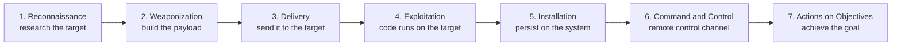
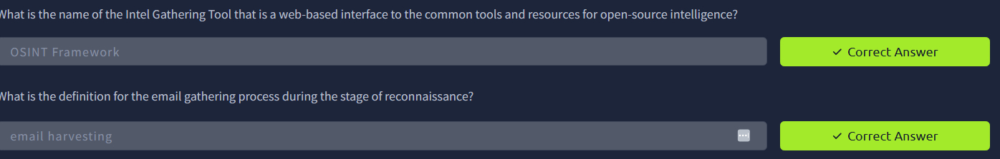
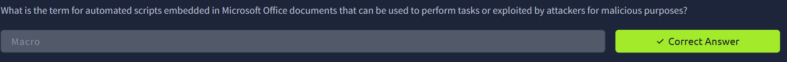
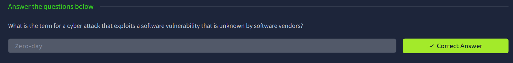
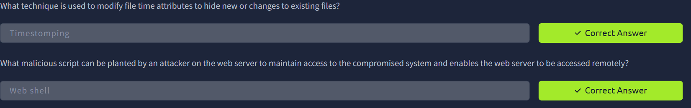
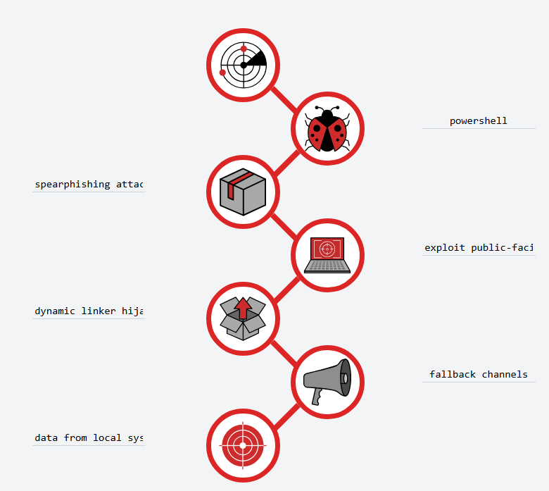
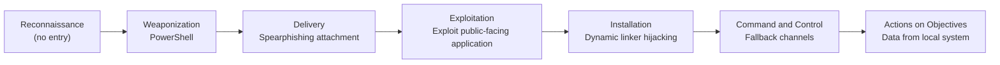

# Cyber Kill Chain | TryHackMe

| | |
|---|---|
| **Platform** | TryHackMe: [Cyber Kill Chain](https://tryhackme.com/room/cyberkillchainzmt) (about 45 min) |
| **Path** | SOC Level 1 → Cyber Defence Frameworks |
| **Difficulty** | Easy (as listed on the room page) |
| **Status** | Completed, 24 Nov 2026 <!-- TODO: confirm completion date --> |
| **Environment** | Browser only: room content and a static-site practical |
| **Focus** | The seven phases of an attack, what an attacker does in each, and how to map an incident onto them |

> Flags are redacted in all screenshots.

## Contents

- [What this lab is about](#what-this-lab-is-about)
- [Objective](#objective)
- [At a Glance](#at-a-glance)
- [Task 1: Introduction](#task-1-introduction)
- [Task 2: Reconnaissance](#task-2-reconnaissance)
- [Task 3: Weaponization](#task-3-weaponization)
- [Task 4: Delivery](#task-4-delivery)
- [Task 5: Exploitation](#task-5-exploitation)
- [Task 6: Installation](#task-6-installation)
- [Task 7: Command & Control](#task-7-command--control)
- [Task 8: Actions on Objectives (Exfiltration)](#task-8-actions-on-objectives-exfiltration)
- [Task 9: Practice Analysis](#task-9-practice-analysis)
- [Task 10: Conclusion](#task-10-conclusion)
- [Revision Notes](#revision-notes)
- [Key Takeaways](#key-takeaways)
- [Glossary](#glossary)
- [Skills Demonstrated](#skills-demonstrated)

## What this lab is about

An intrusion is rarely one event. The attacker has to research a target, build a weapon, get it in, run it, stay in, call home and finally do damage. The Cyber Kill Chain, created by Lockheed Martin in 2011 from a military idea, names those seven steps so that a defender can ask "which step am I looking at, and where can I break the chain?". In this room I went through each phase with a made-up attacker called Megatron, answered a question on most phases, and finished by placing six techniques on the right phases of a real breach scenario (the 2013 Target card breach). A SOC L1 analyst needs this because naming the phase of an alert tells you what probably came before it, what may come next, and how urgent it is.

## Objective

Learn what happens in each of the seven phases, recognise typical signs of each, and understand the limits of the traditional model. Apply it by mapping six techniques onto the phases of a real incident. This is hands-on practice in a simulated lab, not work experience.

## At a Glance

| Item | Detail |
|---|---|
| What was covered | The 7 phases, passive vs active recon, delivery methods, exploitation types, persistence methods, C2 channels, attacker goals, limits of the model |
| Tools / views used | Room content, quiz boxes, and a static-site practical where I placed techniques on a kill chain graphic |
| Frameworks | Lockheed Martin Cyber Kill Chain; MITRE ATT&CK technique names and IDs in the scenario mapping (IDs added by me after the lab) |
| Actually did | Answered the quiz questions on phases 2, 3, 5, 6 and 8, and placed six items in the practice scenario |
| Only read | The text for Delivery and Command & Control (no quiz screenshots for those two) |
| Gaps | No result or flag screen for the practical; no screenshots for Tasks 1, 4, 7, 9 (questions) or 10 |

## Task 1: Introduction

A kill chain is a military idea: identify a target, decide to attack, then destroy it. Lockheed Martin turned it into a cyber framework in 2011. The room says an attacker has to get through every phase to succeed, which is why a defender who breaks any one link can stop the attack. The seven phases are Reconnaissance, Weaponization, Delivery, Exploitation, Installation, Command & Control, and Actions on Objectives. It helps with ransomware, breaches and APTs, and lets you spot missing controls.

<!-- TODO: add screenshot (optional: room header / task 1 view) -->

## Task 2: Reconnaissance

Reconnaissance is the research and planning phase, where the attacker gathers information about the target, such as infrastructure, employees and exposed technology. It is often passive and hard to notice. A key method is **OSINT** (open-source intelligence), which uses public information: search engines, media, social media, forums and blogs, public records, and WHOIS or technical data.

| Type | What it means | Examples |
|---|---|---|
| Passive recon | No direct contact with the target | WHOIS lookups, social media scraping, checking breach data |
| Active recon | Direct contact with the target | Social engineering, port scanning, banner grabbing, probing open services |

**Email harvesting** is collecting email addresses from public, paid or free sources, usually to prepare phishing. Tools named: theHarvester (also finds names, subdomains, IPs and URLs), Hunter.io (contact details linked to a domain) and the OSINT Framework (a web collection of OSINT tools sorted by category).

Task 2 quiz screenshot

> **What it shows:** Two questions, one on the web-based interface to open-source intelligence tools and one on the name of the email gathering process during recon, both marked "Correct Answer" (OSINT Framework, email harvesting).  
> **Why it matters:** It ties the recon phase to a concrete tool and a concrete technique that feeds phishing.  
> **Remember:** Recon gathers emails by email harvesting; the OSINT Framework lists the tools.

## Task 3: Weaponization

Weaponization turns the research into attack tools by combining malware and an exploit into a **payload**. Attackers may generate malware with automated tools or buy it on the dark web, while sophisticated groups write custom malware to avoid detection. In the room's story, Megatron buys a ready-made payload to save time.

| Term | Meaning (my words) |
|---|---|
| Malware | Software built to damage, disrupt or gain unauthorised access |
| Exploit | Code that takes advantage of a flaw in an application or system |
| Payload | The malicious code the attacker runs on the victim system |

Tactics named: an Office document with a malicious macro or VBA script, a worm or payload loaded on USB drives, setting up C2 infrastructure, a backdoor to get past security controls, and tailored phishing templates or OAuth consent apps that look genuine.

Task 3 quiz screenshot

> **What it shows:** One question on the term for automated scripts embedded in Microsoft Office documents, marked "Correct Answer" (Macro).  
> **Why it matters:** Macro-enabled documents are one of the commonest weapons, and they reappear in Exploitation as macro execution.  
> **Remember:** Macro in an Office file = a classic weaponised document.

## Task 4: Delivery

Delivery is how the payload reaches the target. Three methods were covered.

| Method | How it works (my summary) | Example given |
|---|---|---|
| Phishing email | A crafted email with a malicious link or attachment, aimed at one person (spear phishing) or many | Link or attachment that compromises the user |
| USB drop | Infected USB drives left or sent in the real world | Drives with the company logo mailed as a "gift" |
| Watering hole | The attacker compromises a website the target group already visits and redirects them to malware (a drive-by download) | A pop-up asking to install a fake browser extension |

<!-- TODO: add screenshot of the Task 4 question (watering hole) if you have it -->

## Task 5: Exploitation

Exploitation is the moment the attacker's code actually runs on the target by using a weakness. Ways in: running a malicious macro (often delivered by phishing, for example to start ransomware), a zero-day exploit (a flaw the vendor does not know about, so there is nothing to detect at first) or a known CVE on an unpatched system. After getting in, the attacker may escalate privileges or move sideways. Signs to look for: unexpected process spawns, registry changes or new services, and suspicious command-line arguments in system logs.

Task 5 quiz screenshot

> **What it shows:** One question on the term for an attack exploiting a vulnerability unknown to the software vendor, marked "Correct Answer" (Zero-day).  
> **Why it matters:** Zero-days have no signature, so detection has to rely on behaviour such as odd process spawns.  
> **Remember:** Zero-day = unknown to the vendor, no patch yet.

## Task 6: Installation

After getting in, the attacker wants to stay in, even if the connection drops, the access is removed or the system is patched. That needs a **persistent backdoor**.

| Persistence method | What it is (my summary) |
|---|---|
| Web shell | A malicious script (ASP, PHP, JSP) on a web server that keeps remote access. Simple files, so it can look harmless |
| Backdoor | For example Meterpreter, a Metasploit payload that gives an interactive remote shell |
| Windows service | Creating or changing a service to run a payload repeatedly (ATT&CK T1543.003), using tools like `sc.exe` and `reg`, often with a service name that looks legitimate |
| Run keys / Startup folder | A registry run key or startup entry so the payload starts at every logon |

Note: the room's text writes the service tool as "ssc.exe" while explaining `sc.exe`; `sc.exe` is the real Windows tool. The attacker may also use **timestomping**, which changes file timestamps so malware looks like part of a legitimate program and hides from forensic review.

Task 6 quiz screenshot

> **What it shows:** Two questions: the technique that alters file time attributes to hide changes, and the malicious script planted on a web server to keep remote access, both marked "Correct Answer" (Timestomping, Web shell).  
> **Why it matters:** Both are things an analyst hunts for during an investigation: odd timestamps and unexpected script files on a web server.  
> **Remember:** Timestomping hides when; a web shell keeps the way back in.

## Task 7: Command & Control

With persistence set, the malware opens a **command and control (C2)** channel to an external server so the attacker can control the victim. Regular check-ins from the infected host are called **C2 beaconing**. Older IRC-based C2 is easy for modern tools to spot, so attackers prefer channels that blend in.

| C2 channel | Why attackers use it |
|---|---|
| HTTP (port 80) / HTTPS (port 443) | Looks like normal web traffic and passes most firewalls |
| DNS (DNS tunnelling) | The infected machine keeps making DNS requests to a DNS server and domain the attacker owns |

The C2 server can belong to the attacker or to another compromised host.

<!-- TODO: add screenshot of the Task 7 question (DNS tunnelling) if you have it -->

## Task 8: Actions on Objectives (Exfiltration)

After the first six phases the attacker has hands-on access and works towards the real goal. Typical actions: collecting user credentials, privilege escalation (for example from a workstation to domain admin), internal recon, lateral movement, collecting and exfiltrating sensitive data, deleting backups and shadow copies, and overwriting or corrupting data.

Task 8 quiz screenshot

> **What it shows:** One question on the Windows technology that creates backup copies or snapshots of files or volumes, even when in use, marked "Correct Answer" (Shadow Copy).  
> **Why it matters:** Attackers delete shadow copies so the victim cannot restore files after ransomware. Deleting them is a red flag.  
> **Remember:** Shadow copy deletion = ransomware warning sign.

## Task 9: Practice Analysis

The practice scenario is the 2013 Target breach, where about 40 million payment card accounts were affected between late November and mid December 2013, ending in a large multistate settlement. In a static site, I had to place six technique names on the correct phase of a seven-phase chain. Only six phases apply, so Reconnaissance stays empty. The site underlines wrong placements in red and returns a flag when it is correct, and the flag is not shown here.

> **What it shows:** A vertical chain of seven stage icons. Six have a technique typed beside them (names are cut off in the boxes): powershell, spearphishing attac(hment), exploit public-faci(ng application), dynamic linker hija(cking), fallback channels, data from local sys(tem). The top (reconnaissance) icon has no entry. No red underline is visible.  
> **Why it matters:** It is the whole exercise in one picture: an incident is a chain, and each technique belongs to one phase.  
> **Remember:** Seven stages, six entries; the recon stage was left empty.

**My placement, read from the stage order (top to bottom):**

| Phase | Entry I placed | ATT&CK technique (ID added after the lab) |
|---|---|---|
| Reconnaissance | none | none |
| Weaponization | powershell | T1059.001 PowerShell |
| Delivery | spearphishing attachment | T1566.001 Phishing: Spearphishing Attachment |
| Exploitation | exploit public-facing application | T1190 Exploit Public-Facing Application |
| Installation | dynamic linker hijacking | T1574.006 Hijack Execution Flow: Dynamic Linker Hijacking |
| Command & Control | fallback channels | T1008 Fallback Channels |
| Actions on Objectives | data from local system | T1005 Data from Local System |

**Notes (interpretation):** I read the stage of each entry from the order of the icons, since the screenshot has no stage labels. The room accepted the final answer (the room shows 100%), but real techniques can sit in more than one phase, so this is a teaching map, not a forensic timeline.

## Task 10: Conclusion

The model is useful for network defence but has limits. It was last updated in 2011, so it does not cover modern attacks well. It focuses on perimeter defence and malware delivery, attackers now combine many tactics and techniques, and they can dodge threat intelligence by changing file hashes and IPs. It also cannot spot insider threats, where someone uses legitimate access to cause harm. The room recommends using it together with MITRE ATT&CK and the Unified Kill Chain.

> **What it shows:** The Cyber Kill Chain header (SOC Level 1 > Cyber Defence Frameworks, 45 min) with "Share your achievement" and a green bar reading "Room completed: 100%".  
> **Why it matters:** It is the completion record for this write-up.  
> **Remember:** Simulated lab: hands-on practice, not job experience.

## Revision Notes

**One-minute summary**

- The kill chain has seven phases: Reconnaissance, Weaponization, Delivery, Exploitation, Installation, Command & Control, Actions on Objectives.
- Recon is research (passive or active, OSINT, email harvesting); Weaponization builds the payload.
- Delivery is by phishing, USB drop or watering hole.
- Exploitation uses macros, zero-days or known CVEs; Installation adds persistence (web shell, backdoor, services, run keys, timestomping).
- C2 uses HTTP/HTTPS or DNS tunnelling; the final phase is credentials, movement, exfiltration and destruction.
- Break any link and the attack fails.
- The model is old and misses insider threats, so pair it with MITRE ATT&CK.

**Core concepts**

| Concept | Plain-English meaning | Example from this room |
|---|---|---|
| Kill chain | Ordered steps an attacker must complete | Seven phases |
| OSINT | Research from public sources | Search engines, WHOIS, social media |
| Payload | The malicious code that runs | Macro document, backdoor |
| Zero-day | Flaw the vendor does not know about | Exploitation example |
| Persistence | Staying in after a restart or cleanup | Web shell, run keys |
| C2 beaconing | Regular check-in with the attacker's server | HTTPS or DNS traffic |
| Exfiltration | Stealing data out | Final phase |

**Cheat sheet: phase, attacker action, what a defender might look for (defender column is general guidance, not from the screenshots)**

| Phase | Attacker action | Defender view |
|---|---|---|
| Reconnaissance | OSINT, email harvesting, scanning | Scan alerts, limit public information |
| Weaponization | Macro docs, payload build, C2 setup | Usually unseen; threat intel on kits and domains |
| Delivery | Phishing, USB drop, watering hole | Email filtering, URL checks, device control |
| Exploitation | Macro run, zero-day, known CVE | Patching, odd process spawns, new services, odd command lines |
| Installation | Web shell, backdoor, services, run keys, timestomping | New services, run key changes, unexpected web files, file integrity |
| Command & Control | HTTP/HTTPS or DNS beaconing | Regular outbound check-ins, odd DNS patterns |
| Actions on Objectives | Credential theft, movement, exfiltration, backup deletion | Large outbound transfers, shadow copy deletion, admin misuse |

**Analyst workflow (what this room teaches)**

1. Take the alert or event and ask which phase it belongs to.
2. Look backwards: what must have happened before this (delivery, exploitation)?
3. Look forwards: what could the attacker do next (persistence, C2, exfiltration)?
4. Check the typical signs for that phase (process spawns, services, DNS, outbound traffic).
5. Decide where the chain can be broken soonest.
6. Map techniques to MITRE ATT&CK for precise reporting.
7. Record the phase in the ticket.

**Common mistakes / false-positive traps**

- Treating the model as strictly linear; real attacks loop and skip phases.
- Forcing every technique into exactly one phase.
- Ignoring early phases because recon is mostly invisible.
- Relying only on perimeter and malware focus; the model misses insider threats.
- Assuming a legitimate-looking service name or file timestamp means a file is safe (masquerading and timestomping).
- Ignoring "normal" HTTPS or DNS traffic that is really beaconing.

**Self-check questions**

1. Who created the Cyber Kill Chain and in which year?

Answer
Lockheed Martin, in 2011.

2. What is the difference between passive and active recon?

Answer
Passive has no direct contact with the target; active does, for example port scanning.

3. What is email harvesting used for?

Answer
Collecting email addresses to prepare phishing.

4. Name the three delivery methods in the room.

Answer
Phishing email, USB drop and watering hole.

5. What makes a zero-day hard to detect?

Answer
The flaw is unknown to the vendor, so there is no patch or signature at first.

6. Name two ways to achieve persistence.

Answer
Any two of: web shell, backdoor, creating or changing a Windows service, registry run key or startup folder.

7. What does timestomping do?

Answer
It changes a file's timestamps to hide new or changed files.

8. Which two protocols are the common C2 channels?

Answer
HTTP/HTTPS and DNS (DNS tunnelling).

9. Why do attackers delete shadow copies?

Answer
So the victim cannot restore files from snapshots after the attack.

10. Name one limit of the traditional kill chain.

Answer
It was last updated in 2011, focuses on perimeter and malware, and cannot spot insider threats.

**Interview angle**

- *What is the Cyber Kill Chain and how would you use it?* It is a seven-phase model of an intrusion. I use it to place an alert in a phase, work out what came before and may come next, and choose where to break the chain.
- *How would you tell that an attacker has persistence on a server?* Look for new or changed services, run key or startup changes, unexpected scripts on a web server (web shells) and files with odd timestamps. Then check for regular outbound connections.
- *What are the limits of the kill chain, and what do you use alongside it?* It is old, perimeter and malware focused, and it misses insider threats. I would pair it with MITRE ATT&CK for detailed technique mapping.

## Key Takeaways

- Naming the phase of an alert tells me what to look for before and after it.
- Breaking any one phase stops the whole attack.
- Persistence, C2 and shadow copy deletion are strong signs that an attack is well advanced.
- HTTPS and DNS are favourite C2 channels because they blend in.
- The model is a guide, not a strict timeline, and it misses insider threats.
- Combine it with MITRE ATT&CK for precise technique-level reporting.

## Glossary

| Term | Meaning (my words) |
|---|---|
| Kill chain | The ordered steps an attacker must complete to reach their goal |
| OSINT | Gathering intelligence from public sources |
| Email harvesting | Collecting email addresses from public or paid sources |
| Payload | The malicious code delivered to and run on the victim |
| Macro | A script inside an Office document that can run automatically |
| Watering hole | Compromising a site a target group visits so they get infected |
| Zero-day | A vulnerability unknown to the vendor |
| Persistence | Techniques that keep the attacker's access after a restart or cleanup |
| Web shell | A malicious script on a web server used for remote access |
| Timestomping | Changing file timestamps to hide activity |
| C2 beaconing | Regular check-ins from malware to the attacker's server |
| DNS tunnelling | Hiding C2 traffic inside DNS requests |
| Exfiltration | Stealing data out of the network |
| Shadow copy | A Windows snapshot feature that backs up files and volumes |

## Skills Demonstrated

`Cyber Kill Chain` `Attack phase analysis` `OSINT concepts` `Persistence techniques` `C2 detection concepts` `MITRE ATT&CK mapping` `Incident scenario mapping` `Write-up documentation`

---

[Back to all labs](../../README.md)
