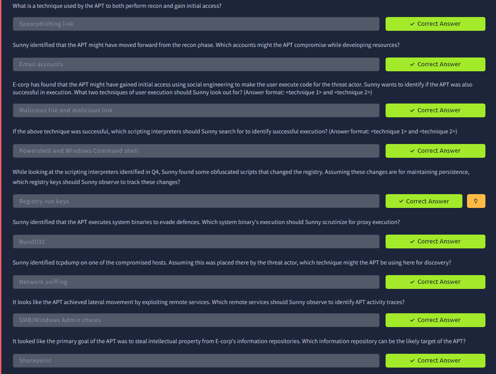
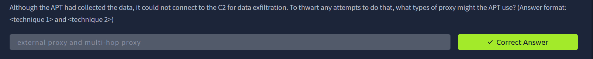

# Eviction | TryHackMe

| Item | Details |
|------|---------|
| **Platform** | [TryHackMe: Eviction](https://tryhackme.com/room/eviction) (premium room) |
| **Path** | SOC Level 1 → Cyber Defence Frameworks |
| **Difficulty** | Easy <!-- TODO: confirm difficulty --> |
| **Status** | Completed, 26 Nov 2026 (room header shows 100%) |
| **Environment** | Browser-based static lab: [static-labs.tryhackme.cloud/sites/eviction](https://static-labs.tryhackme.cloud/sites/eviction/) (no VM) |
| **Focus** | Mapping an APT intrusion story to MITRE ATT&CK techniques and deciding what a SOC analyst should hunt for at each stage |

> Flags are redacted in all screenshots. (This room's screenshots show quiz answers, not flags.)

## Contents

1. [What this lab is about](#what-this-lab-is-about)
2. [Objective](#objective)
3. [At a Glance](#at-a-glance)
4. [Room overview](#room-overview)
5. [Following the intrusion through ATT&CK](#following-the-intrusion-through-attck)
6. [Evidence, interpretation and gaps](#evidence-interpretation-and-gaps)
7. [Revision Notes](#revision-notes)
8. [Key Takeaways](#key-takeaways)
9. [Glossary](#glossary)
10. [Skills Demonstrated](#skills-demonstrated)

---

## What this lab is about

An analyst who only sees "an APT got in" cannot hunt for anything. This room teaches the opposite habit: take a short intrusion story and turn each step of it into a named ATT&CK technique, so that every stage has a concrete thing to search for in the logs. The story follows a junior analyst at a fictional company who is told an advanced threat actor may be inside the network. Step by step, the questions ask which technique fits (phishing, script execution, persistence, proxy execution, lateral movement, collection, exfiltration) and therefore which telemetry to check. For a SOC L1 analyst this matters because alerts and tickets are written in ATT&CK language, and knowing the chain helps me judge whether one alert is an isolated event or part of a larger intrusion.

## Objective

Use the ATT&CK framework as a hunting checklist: for each phase of an APT intrusion, name the most likely technique and say what an analyst should look for. The room is a guided thought exercise, so the result is a set of correct technique choices rather than a log investigation.

## At a Glance

| Area | Detail |
|------|--------|
| What was covered | Recon, resource development, initial access, execution, persistence, defence evasion, discovery, lateral movement, collection, command and control / exfiltration |
| Tools / views used | Browser-based scenario site and the room's question page (no SIEM, no endpoint console) |
| Frameworks | MITRE ATT&CK (tactics and techniques) |
| Investigated | Technique selection for each phase of one intrusion story |
| Only seen | No raw logs, alerts, hashes, IPs or timestamps appear in my screenshots |

## Room overview

The header screenshot confirms the room, its place in the path, and that I finished it.

> **What it shows:** The room "Eviction" under SOC Level 1 > Cyber Defence Frameworks, tagged as a premium room, 45 min, with the progress bar at "Room completed: 100%".
> **Why it matters:** It proves the room is finished and records where it sits in the path; because it is premium, this write-up uses my own wording only.
> **Remember:** Eviction = ATT&CK technique mapping for an APT scenario, in the Cyber Defence Frameworks module.

<!-- TODO: add screenshot of the scenario / intro page if I want to show the story setup (not captured) -->

## Following the intrusion through ATT&CK

The room walks one intrusion from start to finish. I answered each step by choosing the technique that best matches the behaviour described. The IDs below are my own mapping from the ATT&CK matrix, so check them against attack.mitre.org before quoting them in an interview.

```mermaid
flowchart LR
    A["Recon + Initial Access<br/>Spearphishing link"] --> B["Resource Development<br/>Compromised email accounts"]
    B --> C["Execution<br/>Malicious file / link,<br/>PowerShell, cmd"]
    C --> D["Persistence<br/>Registry run keys"]
    D --> E["Defence Evasion<br/>Rundll32 proxy execution"]
    E --> F["Discovery<br/>Network sniffing"]
    F --> G["Lateral Movement<br/>SMB / Windows admin shares"]
    G --> H["Collection<br/>SharePoint"]
    H --> I["C2 / Exfiltration blocked?<br/>External + multi-hop proxy"]
```

| Phase (tactic) | Technique I selected | ATT&CK ID (my mapping) | What the analyst should look for |
|---|---|---|---|
| Recon and Initial Access | Spearphishing link | T1598.003 (recon), T1566.002 (access) | Mail gateway logs, clicks on links, newly seen domains |
| Resource Development | Compromised email accounts | T1586.002 | Unusual mail sent from legitimate accounts, odd sign-in locations |
| Execution (user action) | Malicious file and malicious link | T1204.002, T1204.001 | Office or browser spawning child processes after a user click |
| Execution (interpreters) | PowerShell and Windows Command Shell | T1059.001, T1059.003 | Process creation logs, script block logs, encoded or obfuscated commands |
| Persistence | Registry run keys | T1547.001 | Changes to Run and RunOnce keys |
| Defence Evasion | Rundll32 (system binary proxy execution) | T1218.011 | Rundll32 with unusual DLL paths or arguments, odd parent process |
| Discovery | Network sniffing | T1040 | Packet-capture tools such as tcpdump appearing on a host |
| Lateral Movement | SMB / Windows admin shares | T1021.002 | SMB connections between workstations, admin share access, new logons |
| Collection | SharePoint | T1213.002 | Bulk downloads or unusual access to document repositories |
| C2 / Exfiltration | External proxy and multi-hop proxy | T1090.002, T1090.003 | Traffic to unfamiliar relay hosts, chained connections, blocked C2 retries |

### Recon to collection

In my words: the threat actor likely starts with a link-based phishing email, which can serve both to gather information and to get in. From there the story moves to taking over email accounts, tricking users into running a file or link, and then using PowerShell and the Windows command shell to run obfuscated scripts. Those scripts change registry run keys to survive reboots, and the actor hides activity behind Rundll32. A packet-capture tool on one host points to network sniffing, SMB admin shares explain the spread between machines, and SharePoint is the likely place the intellectual property sat.

> **What it shows:** Nine questions, each with a green "Correct Answer" mark. My answers are: spearphishing link, email accounts, malicious file and malicious link, PowerShell and Windows Command shell, registry run keys, Rundll32, network sniffing, SMB/Windows admin shares, and SharePoint. A lightbulb (hint) icon sits next to the registry run keys row.
> **Why it matters:** Each answer ties a behaviour to a technique, which tells the analyst which log source to open next (mail logs, process creation, registry, network, file-share access).
> **Remember:** Phish link → user execution → script interpreters → run keys → Rundll32 → sniffing → SMB shares → SharePoint.

### Command and control / exfiltration

The last step covers a twist: the actor had the data but could not reach its C2 server directly. In my words, the likely workaround is to relay traffic through intermediate hosts, which fits an external proxy and a multi-hop proxy. For an analyst, blocked outbound C2 is not the end of the story; the actor can try again through another path, so egress monitoring still matters.

> **What it shows:** The last question, about how the actor might get around blocked C2 communication, answered as "external proxy and multi-hop proxy" with a green "Correct Answer" mark.
> **Why it matters:** It shows that exfiltration planning includes ways around blocks, so detection should cover unusual relay or proxy traffic and not only the known C2 address.
> **Remember:** Blocked C2 → expect proxying: external proxy (T1090.002) and multi-hop proxy (T1090.003).

## Evidence, interpretation and gaps

| Type | Content |
|------|---------|
| **Evidence (visible)** | Room header with 100% completion; ten answered questions with "Correct Answer" marks |
| **Interpretation (mine)** | The ATT&CK IDs, the log sources to check, and the phase ordering shown in the diagram |
| **Gaps** | The scenario/intro page and any ATT&CK matrix view from the room are not in my screenshots <!-- TODO: add screenshot --> |

This room has no alert queue, hashes, IPs or timestamps in the screenshots, so there is no Five Ws table, IOC table, triage summary or escalation note in this write-up. Those sections are left out on purpose rather than invented.

---

## Revision Notes

### One-minute summary

- The room is an ATT&CK mapping exercise built around one APT intrusion story.
- Link-based phishing can cover both recon and initial access.
- After access: compromised email accounts, user-run files or links, then PowerShell and cmd scripts.
- Persistence is tracked through registry run keys; Rundll32 is watched for proxy execution.
- Network sniffing, SMB admin shares and SharePoint cover discovery, lateral movement and collection.
- When C2 is blocked, expect proxies: external and multi-hop.
- Lesson: each technique name points to a specific log source to hunt in.

### Core concepts

| Concept | Plain-English meaning | Example from this room |
|---|---|---|
| Tactic vs technique | Tactic = the goal; technique = how it is done | Persistence (tactic) via registry run keys (technique) |
| User execution | The attacker needs the user to run something | Opening a malicious file or clicking a malicious link |
| Scripting interpreter | A built-in tool that runs scripts | PowerShell and Windows Command Shell |
| Proxy execution | Using a trusted system binary to run malicious code | Rundll32 |
| Lateral movement | Spreading from one host to another | SMB / Windows admin shares |
| Collection | Gathering the data the actor wants | SharePoint document store |
| Multi-hop proxy | Traffic bounced through several relays | Used to get around blocked C2 |

### Cheat sheet

| Stage | Technique | ID (verify) | Log source to check |
|---|---|---|---|
| Recon | Spearphishing link | T1598.003 | Mail gateway, proxy logs |
| Initial access | Spearphishing link | T1566.002 | Mail gateway, web proxy, EDR |
| Resource dev | Email accounts | T1586.002 | Mail audit, sign-in logs |
| Execution | Malicious file / link | T1204.002 / T1204.001 | Process creation, EDR |
| Execution | PowerShell / cmd | T1059.001 / T1059.003 | Script block, process logs |
| Persistence | Registry run keys | T1547.001 | Registry monitoring |
| Defence evasion | Rundll32 | T1218.011 | Process creation (command line) |
| Discovery | Network sniffing | T1040 | Process list, EDR |
| Lateral movement | SMB / admin shares | T1021.002 | Windows security logs, network flows |
| Collection | SharePoint | T1213.002 | SharePoint / M365 audit logs |
| Exfiltration / C2 | External / multi-hop proxy | T1090.002 / T1090.003 | Firewall, proxy, DNS |

### Analyst workflow

1. Read the incident story and split it into phases.
2. Match each phase to an ATT&CK tactic.
3. Pick the technique that fits the described behaviour.
4. Note the log source where that technique would leave traces.
5. Search for that behaviour across other hosts, not only the first one.
6. Link findings into one timeline and decide whether the case is bigger than one alert.
7. Check egress and proxy logs even when C2 looks blocked.

### Common mistakes / false-positive traps

- Treating a single script run as harmless without checking its parent process or what it changed.
- Assuming Rundll32, PowerShell or SMB use is always admin activity; these are legitimate tools that attackers abuse.
- Stopping the hunt at the first compromised host.
- Believing a blocked C2 connection means the data is safe.
- Confusing the tactic (goal) with the technique (method).

### Self-check questions

1. Which technique can serve both reconnaissance and initial access in this story?

Answer
Spearphishing link.

2. Which accounts does the actor take over while building resources?

Answer
Email accounts.

3. Name the two user-execution techniques to look for after a phish.

Answer
Malicious file and malicious link.

4. Which two interpreters should be checked for script execution?

Answer
PowerShell and Windows Command Shell.

5. Where do you look for persistence set by those scripts?

Answer
Registry run keys.

6. Which system binary is watched for proxy execution?

Answer
Rundll32.

7. What technique does a tcpdump found on a compromised host suggest?

Answer
Network sniffing.

8. Which remote service explains spread between machines here?

Answer
SMB / Windows admin shares.

9. Which repository was the likely target for stolen IP?

Answer
SharePoint.

10. How might the actor get around a blocked C2 path?

Answer
External proxy and multi-hop proxy.

### Interview angle

**Q1. How do you use MITRE ATT&CK as a SOC analyst?**
I use it to name what an alert is doing and to know what else to look for in the same attack chain. It turns "suspicious activity" into specific techniques with specific log sources.

**Q2. An attacker has persistence and is moving between hosts. What do you check?**
Registry run keys and similar autostart locations for persistence, and SMB/admin-share traffic plus new logons for lateral movement. I would also scope other hosts, not only the first one.

**Q3. C2 traffic is blocked. Is the incident over?**
No. The actor can retry through external or multi-hop proxies, so I would keep watching egress and proxy logs and look for unusual relay connections.

## Key Takeaways

- ATT&CK is most useful when each technique is tied to a log source.
- One phishing technique can cover both recon and initial access.
- PowerShell, cmd and Rundll32 are legitimate tools, so context decides if they are malicious.
- Persistence, discovery and lateral movement leave different traces; check all of them.
- A blocked C2 channel can be bypassed with proxies, so egress monitoring must continue.
- This was a guided mapping exercise, hands-on practice and not work experience.

## Glossary

| Term | Meaning |
|---|---|
| APT | A well-resourced threat actor that stays in a network for a long time |
| ATT&CK | A public catalogue of attacker tactics and techniques |
| Tactic | The attacker's goal at a stage |
| Technique | The method used to reach that goal |
| C2 | Command and control: the channel the attacker uses to direct compromised hosts |
| Exfiltration | Moving stolen data out of the network |
| Proxy (multi-hop) | A relay (or chain of relays) that hides where traffic really goes |
| Run keys | Registry entries that start programs at logon or boot |

## Skills Demonstrated

`MITRE ATT&CK` `Threat mapping` `Phishing analysis concepts` `Persistence detection concepts` `Lateral movement concepts` `Exfiltration and C2 concepts` `Detection-oriented thinking` `Technical documentation`

---

[Back to all labs](../../README.md)
