# MITRE | TryHackMe


| | |
|---|---|
| **Platform** | TryHackMe: [MITRE](https://tryhackme.com/room/mitre) (premium room, about 60 min) |
| **Path** | SOC Level 1 → Cyber Defence Frameworks |
| **Difficulty** | Medium (as listed on the room page) |
| **Status** | Completed, 24 Nov 2026 |
| **Environment** | Browser only: room content with views of MITRE ATT&CK, ATT&CK Navigator, CAR and D3FEND |
| **Focus** | Reading and using MITRE's free frameworks: ATT&CK, CAR, D3FEND and related projects |

> Flags are redacted in all screenshots.

## Contents

- [What this lab is about](#what-this-lab-is-about)
- [Objective](#objective)
- [At a Glance](#at-a-glance)
- [Task 1: Introduction](#task-1-introduction)
- [Task 2: ATT&CK Framework](#task-2-attck-framework)
- [Task 3: ATT&CK in Operation](#task-3-attck-in-operation)
- [Task 4: ATT&CK for Threat Intelligence](#task-4-attck-for-threat-intelligence)
- [Task 5: Cyber Analytics Repository (CAR)](#task-5-cyber-analytics-repository-car)
- [Task 6: MITRE D3FEND Framework](#task-6-mitre-d3fend-framework)
- [Task 7: Other MITRE Projects](#task-7-other-mitre-projects)
- [Task 8: Conclusion](#task-8-conclusion)
- [Threat Profile and Detection Notes](#threat-profile-and-detection-notes)
- [Revision Notes](#revision-notes)
- [Key Takeaways](#key-takeaways)
- [Glossary](#glossary)
- [Skills Demonstrated](#skills-demonstrated)

## What this lab is about

Security teams need a shared language for what attackers do and what defenders can do about it. MITRE, a not-for-profit research organisation, publishes free resources that give that language. ATT&CK describes attacker behaviour as tactics, techniques and sub-techniques. CAR holds detection analytics that match those behaviours, and D3FEND catalogues defensive countermeasures. In this room I learned the structure of ATT&CK, saw how different teams use it, profiled a threat group in the ATT&CK Navigator, mapped a threat report to technique IDs, read two CAR analytics, explored D3FEND, and met MITRE's other projects. A SOC L1 analyst needs this because alerts, reports and detection rules are all described in ATT&CK terms.

## Objective

Understand the purpose and structure of ATT&CK, see how security professionals use it, use cyber threat intelligence together with the ATT&CK matrix to profile a threat, and discover MITRE's other frameworks such as CAR and D3FEND. This is hands-on practice in a simulated lab, not work experience.

## At a Glance

| Item | Detail |
|---|---|
| What was covered | ATT&CK structure and IDs, who uses ATT&CK, Navigator layers, mapping a CTI report, CAR analytics, D3FEND tactics and artifacts, Caldera, AADAPT, ATLAS |
| Tools / views used | ATT&CK matrix and technique pages, ATT&CK Navigator layer, CAR analytic pages, D3FEND technique pages |
| Frameworks | MITRE ATT&CK (Enterprise), CAR, D3FEND, with mentions of Engage, Caldera, AADAPT and ATLAS |
| Actually did | Looked up the answers to the quiz questions for Tasks 2 to 7 in these resources |
| Only read | The room's intro and conclusion; the Caldera, AADAPT and ATLAS logos (not embedded) |
| Gaps | No screenshots for Tasks 1, the Task 7 project descriptions, or a MITRE Engage task item |

## Task 1: Introduction

MITRE is a not-for-profit organisation doing research across areas such as cyber security, AI, healthcare and space systems. The room focuses on its cyber security resources: ATT&CK, the CAR knowledge base, D3FEND, MITRE Engage and a few other tools, which help red and blue teams understand adversary behaviour, build better detections and improve defences. The learning goals are the purpose and structure of ATT&CK, how professionals apply it, using CTI with the matrix to profile threats, and finding CAR and D3FEND. The room expects the Cyber Kill Chain room first.

<!-- TODO: add screenshot (optional: room header / task 1 view) -->

## Task 2: ATT&CK Framework

ATT&CK is a knowledge base of real-world adversary behaviour, organised as a matrix. It has three levels.

| Level | Meaning (my summary) | Example in this room |
|---|---|---|
| Tactic | The attacker's goal, the "why" (a column in the matrix) | Reconnaissance |
| Technique | How they reach that goal, the "how" | Active Scanning |
| Sub-technique | A more specific way of doing the technique | Scanning IP Blocks, Vulnerability Scanning, Wordlist Scanning |

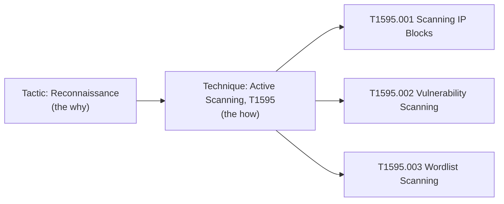

<p align="center">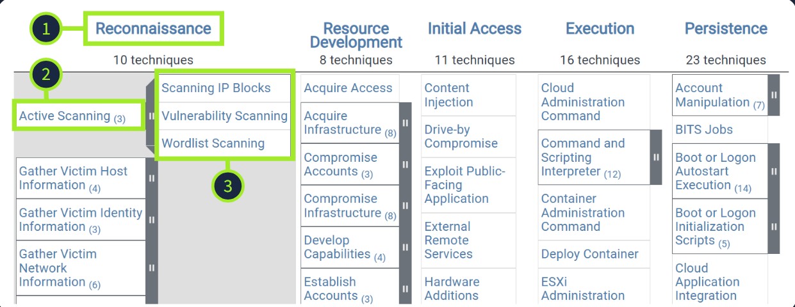</p>

> **What it shows:** The ATT&CK matrix with three numbered callouts: 1 the tactic (Reconnaissance), 2 a technique (Active Scanning, with 3 sub-techniques) and 3 the sub-techniques (Scanning IP Blocks, Vulnerability Scanning, Wordlist Scanning). Columns visible with technique counts: Reconnaissance 10, Resource Development 8, Initial Access 11, Execution 16, Persistence 23.  
> **Why it matters:** Reading the matrix left to right follows an attack from planning to staying in, and each column groups techniques by goal.  
> **Remember:** Tactic = why, technique = how, sub-technique = the specific way.

<p align="center">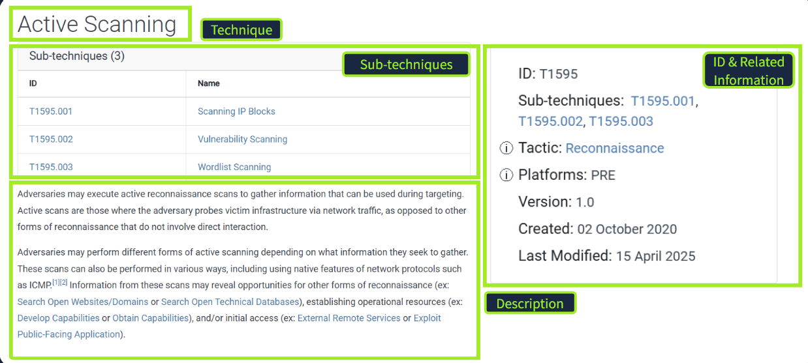</p>

> **What it shows:** The Active Scanning page with labelled parts: technique name, a sub-techniques table (T1595.001, T1595.002, T1595.003), and an "ID & Related Information" box (ID T1595, tactic Reconnaissance, platforms PRE, version 1.0, created 02 October 2020, last modified 15 April 2025), plus the description.  
> **Why it matters:** This is the page an analyst opens to learn what a technique is, what its ID is and which tactic it serves.  
> **Remember:** Technique pages carry the ID, sub-techniques, tactic and description.

<details>
<summary>Task 2 quiz screenshot</summary>

<p align="center">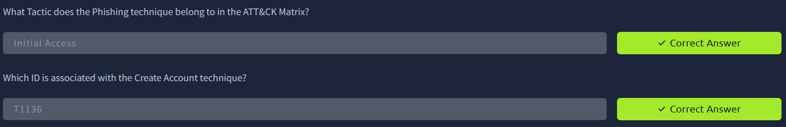</p>

> **What it shows:** Two questions, both marked "Correct Answer": the tactic for Phishing (Initial Access) and the ID for Create Account (T1136).  
> **Why it matters:** It checks that I can find the tactic and the ID of a technique.  
> **Remember:** Phishing is Initial Access; Create Account is T1136.

</details>

## Task 3: ATT&CK in Operation

Different teams use ATT&CK in different ways.

| Who | Their goal | How they use ATT&CK (my summary) |
|---|---|---|
| Cyber threat intelligence teams | Collect and analyse threat information | Map observed actor behaviour to techniques to build usable profiles |
| SOC analysts | Investigate and triage alerts | Link activity to tactics and techniques for context and priority |
| Detection engineers | Build and improve detection | Map SIEM and EDR rules to ATT&CK to check coverage |
| Incident responders | Respond to incidents | Map the incident timeline to tactics and techniques to see the attack |
| Red and purple teams | Emulate adversaries to test defences | Build emulation plans from techniques and known group operations |

The room also showed the **ATT&CK Navigator**, which colours techniques on the matrix to build a "layer", for example the techniques used by one threat group.

<p align="center">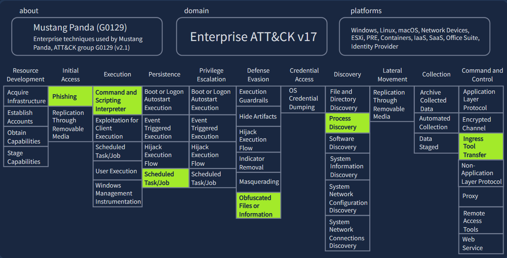</p>

> **What it shows:** A Navigator layer for Mustang Panda (G0129), Enterprise ATT&CK v17, with the listed platforms. Highlighted techniques: Phishing (Initial Access), Command and Scripting Interpreter (Execution), Scheduled Task/Job (Persistence), Obfuscated Files or Information (Defense Evasion), Process Discovery (Discovery) and Ingress Tool Transfer (Command and Control).  
> **Why it matters:** One picture shows a group's habits across the whole attack, which is how a CTI report becomes something a SOC can hunt for.  
> **Remember:** A layer = a matrix with a group's techniques highlighted.

**Observation:** Scheduled Task/Job is listed under Execution, Persistence and Privilege Escalation, but only the Persistence entry is highlighted. This shows that one technique can sit under several tactics.

<details>
<summary>Task 3 quiz screenshot</summary>

<p align="center">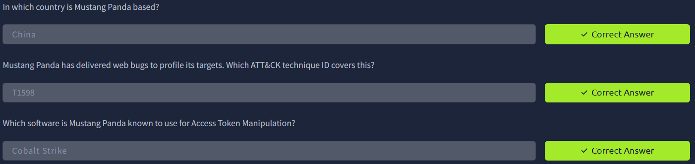</p>

> **What it shows:** Three questions about Mustang Panda, all marked "Correct Answer": its country (China), the technique ID for delivering web bugs to profile targets (T1598), and the software used for Access Token Manipulation (Cobalt Strike).  
> **Why it matters:** It shows how a group's page links to techniques and the software it uses.  
> **Remember:** A group page lists its techniques and its software.

</details>

## Task 4: ATT&CK for Threat Intelligence

Threat intelligence reports describe what an actor did in plain language. Mapping each step to a technique ID makes the report searchable, comparable and easy to turn into detections. The room's example takes a short report and maps its five steps onto the matrix.

| Report step | Technique ID shown | Technique name (added by me) |
|---|---|---|
| 1 Reconnaissance | T1595 | Active Scanning |
| 2 Initial Access | T1190 | Exploit Public-Facing Application |
| 3 Persistence | T1136 | Create Account |
| 4 Defense Evasion | T1564 | Hide Artifacts |
| 5 Collection | T1560 | Archive Collected Data |

<p align="center">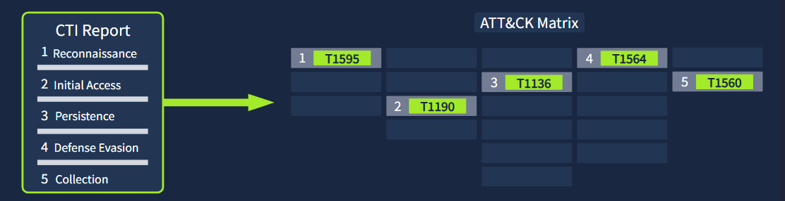</p>

> **What it shows:** A CTI report box with five steps (Reconnaissance, Initial Access, Persistence, Defense Evasion, Collection) and an arrow to an ATT&CK matrix with numbered cells T1595, T1190, T1136, T1564 and T1560.  
> **Why it matters:** This is the CTI workflow in one picture: read the report, pick out behaviours, attach a technique ID to each.  
> **Remember:** Report step in, technique ID out.

<details>
<summary>Task 4 quiz screenshot</summary>

<p align="center">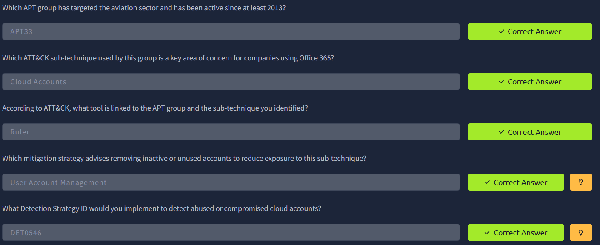</p>

> **What it shows:** Five questions, all marked "Correct Answer": an APT group active in the aviation sector since at least 2013 (APT33), the sub-technique of concern for Office 365 (Cloud Accounts), the linked tool (Ruler), the mitigation that removes unused accounts (User Account Management) and the detection strategy ID (DET0546).  
> **Why it matters:** It walks from a group to a technique, then to a tool, a mitigation and a detection, which is the full ATT&CK pivot.  
> **Remember:** Group → technique → tool → mitigation → detection.

</details>

## Task 5: Cyber Analytics Repository (CAR)

CAR is MITRE's knowledge base of detection analytics, written against ATT&CK. Each analytic page says what it looks for, which ATT&CK techniques it covers, how well it covers them, and how to implement it (for example as pseudocode or as a Splunk search using Sysmon data).

<p align="center">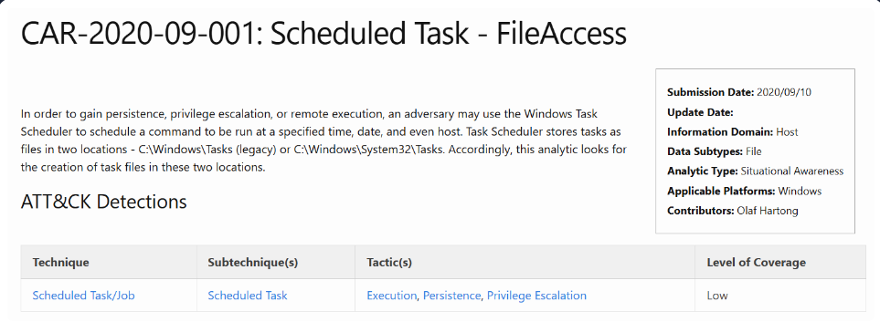</p>

> **What it shows:** CAR-2020-09-001, "Scheduled Task - FileAccess": it looks for new task files in C:\Windows\Tasks and C:\Windows\System32\Tasks. Details: submitted 2020/09/10, domain Host, data subtype File, analytic type Situational Awareness, platform Windows. ATT&CK detection: Scheduled Task/Job (Scheduled Task), tactics Execution, Persistence and Privilege Escalation, coverage Low.  
> **Why it matters:** The page tells you what is watched, where, on which platform and how good the coverage is.  
> **Remember:** Read the coverage level; "Low" means it does not catch everything.

<p align="center">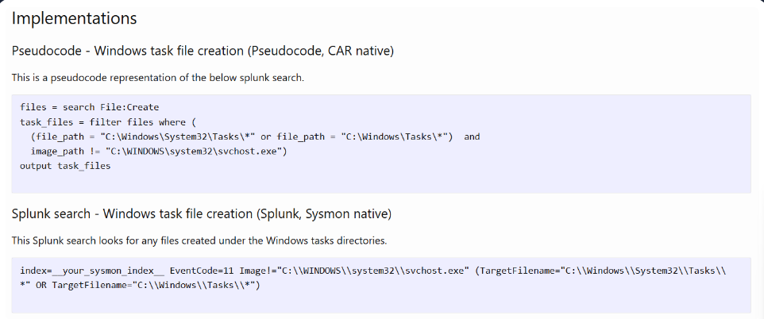</p>

> **What it shows:** The Implementations section with a pseudocode version (file creates under the two Tasks folders by anything other than svchost.exe) and a Splunk search for Sysmon event code 11 with the same filter.  
> **Why it matters:** It turns a detection idea into something an analyst can run. The index name is a placeholder to replace with your own.  
> **Remember:** Sysmon EventCode 11 = file created.

The Splunk search as shown on the CAR page (placeholder index, not my query):

```
index=__your_sysmon_index__ EventCode=11 Image!="C:\\WINDOWS\\system32\\svchost.exe" (TargetFilename="C:\\Windows\\System32\\Tasks\\*" OR TargetFilename="C:\\Windows\\Tasks\\*")
```

<p align="center">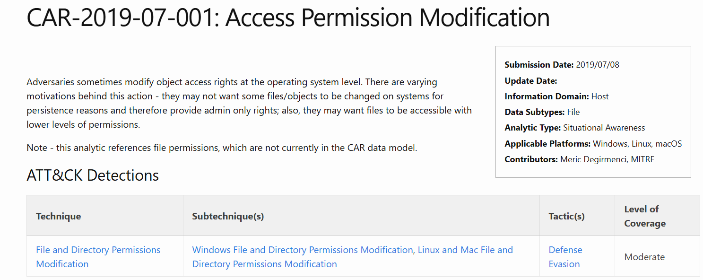</p>

> **What it shows:** CAR-2019-07-001, "Access Permission Modification": adversaries may change object access rights, for example for persistence. Details: submitted 2019/07/08, domain Host, data subtype File, analytic type Situational Awareness, platforms Windows, Linux and macOS. ATT&CK detection: File and Directory Permissions Modification, tactic Defense Evasion, coverage Moderate.  
> **Why it matters:** A second analytic shows how tactic, analytic type and coverage vary between analytics.  
> **Remember:** CAR IDs look like CAR-YYYY-MM-NNN.

<details>
<summary>Task 5 quiz screenshot</summary>

<p align="center">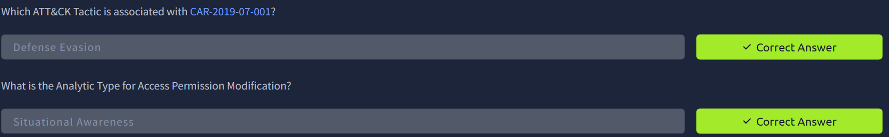</p>

> **What it shows:** Two questions, both marked "Correct Answer": the ATT&CK tactic for CAR-2019-07-001 (Defense Evasion) and the analytic type for Access Permission Modification (Situational Awareness).  
> **Why it matters:** It confirms I could read the key fields from a CAR page.  
> **Remember:** Both answers sit in the page's detail box and detections table.

</details>

## Task 6: MITRE D3FEND Framework

D3FEND (Detection, Denial and Disruption Framework Empowering Network Defense) is a structured framework of defensive techniques, giving a common language for how security controls work. Its matrix has seven tactics, and each technique links to the digital artifacts (such as passwords, credentials or network traffic) it works on.

| D3FEND tactic | Rough meaning (my summary) |
|---|---|
| Model | Understand and map your own environment |
| Harden | Make systems harder to attack |
| Detect | Find malicious activity |
| Isolate | Contain or separate systems and traffic |
| Deceive | Mislead the attacker |
| Evict | Remove the attacker |
| Restore | Recover to a good state |

<p align="center">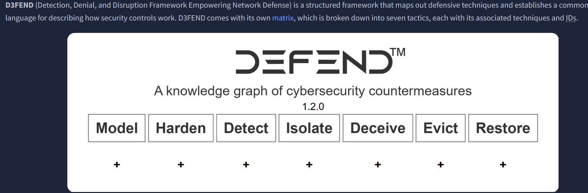</p>

> **What it shows:** The D3FEND header ("A knowledge graph of cybersecurity countermeasures", version 1.2.0) with seven tactic boxes: Model, Harden, Detect, Isolate, Deceive, Evict, Restore, each with a plus sign to expand.  
> **Why it matters:** D3FEND is the defender's mirror of ATT&CK: ATT&CK lists what attackers do, D3FEND lists what you can do back.  
> **Remember:** Seven tactics: Model, Harden, Detect, Isolate, Deceive, Evict, Restore.

<p align="center">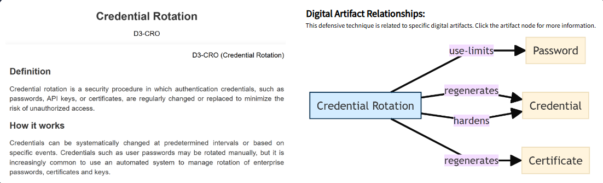</p>

> **What it shows:** The Credential Rotation page (D3-CRO): a definition (regularly changing or replacing passwords, API keys or certificates to reduce unauthorised access), a "How it works" note, and a relationship diagram: it use-limits Password, regenerates Credential, hardens Credential and regenerates Certificate.  
> **Why it matters:** The diagram links a defensive technique to the artifacts it protects, so you can see what a control actually affects.  
> **Remember:** Credential Rotation (D3-CRO) changes secrets on a schedule.

<p align="center">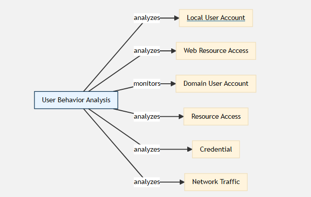</p>

> **What it shows:** User Behavior Analysis linked to six artifacts: analyzes Local User Account, analyzes Web Resource Access, monitors Domain User Account, analyzes Resource Access, analyzes Credential, analyzes Network Traffic.  
> **Why it matters:** It shows what data a behaviour-analysis control needs. This is the parent technique, not the geolocation sub-technique, so the sub-technique's own artifact is not shown alone.  
> **Remember:** User Behavior Analysis works on accounts, access and network traffic.

<details>
<summary>Task 6 quiz screenshot</summary>

<p align="center">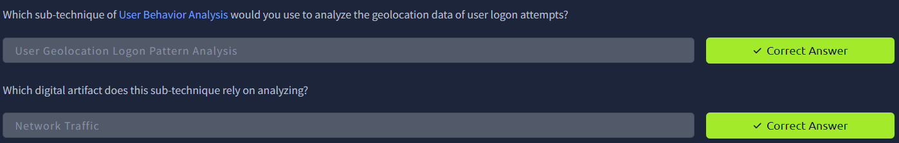</p>

> **What it shows:** Two questions, both marked "Correct Answer": the User Behavior Analysis sub-technique for geolocation of logon attempts (User Geolocation Logon Pattern Analysis) and the digital artifact it relies on (Network Traffic).  
> **Why it matters:** It links a defensive technique to the artifact an analyst must have logged.  
> **Remember:** Geolocation logon analysis needs network traffic data.

</details>

## Task 7: Other MITRE Projects

MITRE has more projects than the ones above. The room's intro also names MITRE Engage. The screenshots for this task show the logos of Caldera, AADAPT and ATLAS, which I did not embed. From my own knowledge (not from the screenshots): Caldera is an automated adversary emulation platform, AADAPT covers adversary actions against digital asset payment technologies, and ATLAS covers threats to AI systems.

<details>
<summary>Task 7 quiz screenshot</summary>

<p align="center">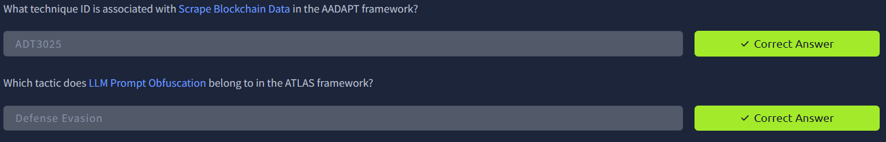</p>

> **What it shows:** Two questions, both marked "Correct Answer": the AADAPT technique ID for Scrape Blockchain Data (ADT3025) and the ATLAS tactic for LLM Prompt Obfuscation (Defense Evasion).  
> **Why it matters:** It shows that other frameworks reuse the ATT&CK style: IDs for techniques and familiar tactic names.  
> **Remember:** AADAPT IDs look like ADT####, and ATLAS reuses tactics like Defense Evasion.

</details>

<!-- TODO: add screenshots of the Caldera / AADAPT / ATLAS explanations if you want them covered -->

## Task 8: Conclusion

The room closes by recapping the resources: ATT&CK for adversary behaviour, CAR for detections, D3FEND for countermeasures, and other projects such as Caldera, AADAPT and ATLAS.

<p align="center">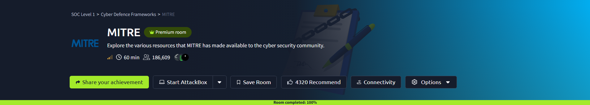</p>

> **What it shows:** The MITRE header (SOC Level 1 > Cyber Defence Frameworks, Premium room, 60 min) with "Share your achievement" and a green bar reading "Room completed: 100%".  
> **Why it matters:** It is the completion record for this write-up.  
> **Remember:** Simulated lab: hands-on practice, not job experience.

## Threat Profile and Detection Notes

The room has no console alerts. These notes tie together what the screenshots showed. Evidence is what was on screen; the rest is my reading.

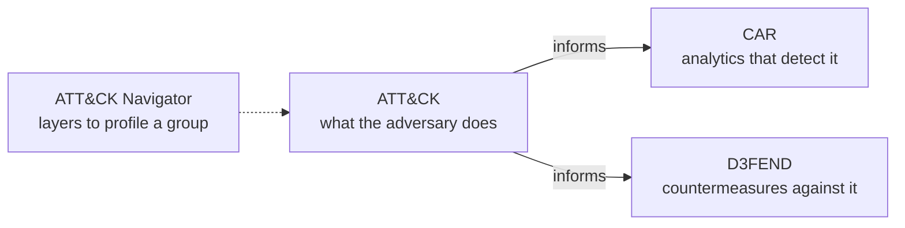

**Mustang Panda (G0129) layer: highlighted techniques** (technique IDs added by me from ATT&CK):

| Tactic | Highlighted technique | ID |
|---|---|---|
| Initial Access | Phishing | T1566 |
| Execution | Command and Scripting Interpreter | T1059 |
| Persistence | Scheduled Task/Job | T1053 |
| Defense Evasion | Obfuscated Files or Information | T1027 |
| Discovery | Process Discovery | T1057 |
| Command and Control | Ingress Tool Transfer | T1105 |

**Link between two screenshots (my reading, not made in the room):** the CAR analytic CAR-2020-09-001 covers Scheduled Task/Job, which is one of the techniques highlighted for Mustang Panda. So that analytic is a candidate detection for that behaviour, though its coverage level is Low.

**Discrepancies and cautions:**

- The Navigator layer is labelled Enterprise ATT&CK v17, while the Task 4 quiz asks for a detection strategy ID (DET0546). To my knowledge, detection strategies came in a later ATT&CK release, so the room's content mixes versions.
- The D3FEND artifact diagram in Task 6 is for the parent technique (User Behavior Analysis), not the geolocation sub-technique the question asks about.
- The CAR Splunk search has a placeholder index name that must be replaced before use.
- A CAR analytic with "Low" coverage will miss some variants.

**What I would do next (recommendations, not actions shown in the room):**

- Test the CAR-2020-09-001 search in a Splunk lab with Sysmon data, tune out known-good task creators, and record the results.
- Build an ATT&CK Navigator layer of the techniques my detections cover, and compare it with a threat group's layer to find gaps.
- Pair each detection with a D3FEND countermeasure (for example credential rotation after credential-theft alerts).

## Revision Notes

**One-minute summary**

- MITRE publishes free frameworks: ATT&CK (attacker behaviour), CAR (detection analytics), D3FEND (defensive techniques), plus Engage, Caldera, AADAPT and ATLAS.
- ATT&CK has tactics (why), techniques (how) and sub-techniques (specific way), each with an ID.
- Teams use ATT&CK differently: CTI profiles actors, SOC adds context, detection engineers map rules, responders map timelines, red and purple teams plan emulation.
- The Navigator colours techniques on the matrix to profile a group.
- CAR pages give detection analytics with coverage levels and implementations.
- D3FEND has seven tactics and links techniques to digital artifacts.
- Map reports, rules and incidents to IDs so everyone talks about the same thing.

**Core concepts**

| Concept | Plain-English meaning | Example from this room |
|---|---|---|
| Tactic | The attacker's goal | Reconnaissance, Initial Access |
| Technique | How the goal is reached | Active Scanning (T1595) |
| Sub-technique | A specific variant | T1595.001 Scanning IP Blocks |
| Navigator layer | Highlighted view of the matrix | Mustang Panda (G0129) |
| CAR analytic | A detection described against ATT&CK | CAR-2020-09-001 |
| D3FEND technique | A defensive countermeasure | Credential Rotation (D3-CRO) |
| Digital artifact | The data or object a defence works on | Password, Network Traffic |

**Cheat sheet**

| Item | Format / fact |
|---|---|
| Technique ID | T#### (for example T1595, T1136, T1598) |
| Sub-technique ID | T####.### (for example T1595.001) |
| Group ID | G#### (Mustang Panda is G0129) |
| CAR ID | CAR-YYYY-MM-NNN |
| D3FEND ID | D3-XXX (for example D3-CRO) |
| AADAPT technique ID | ADT#### (for example ADT3025) |
| Detection strategy ID | DET#### (for example DET0546) |
| D3FEND tactics | Model, Harden, Detect, Isolate, Deceive, Evict, Restore |
| Sysmon file create | EventCode 11 |
| Tactic examples with technique counts in the screenshot | Reconnaissance 10, Resource Development 8, Initial Access 11, Execution 16, Persistence 23 (counts change by version) |

**Analyst workflow (what this room teaches)**

1. Take the alert, report or behaviour and find the matching ATT&CK technique.
2. Note the tactic to see which stage of the attack it belongs to.
3. Open the technique page for sub-techniques, platforms and mitigations.
4. Check the threat group's layer in Navigator to see what else it usually does.
5. Look for a CAR analytic or detection strategy that covers the technique, and read its coverage level.
6. Pick a D3FEND countermeasure that fits.
7. Record the IDs in the ticket or report.

**Common mistakes / false-positive traps**

- Mixing up tactics (why) and techniques (how).
- Assuming a technique belongs to only one tactic (Scheduled Task/Job appears under three).
- Treating a "Low" coverage analytic as full protection.
- Using IDs from memory instead of checking the technique page.
- Mixing ATT&CK versions (v17 layers with newer detection strategy IDs).
- Reading a parent technique's artifacts as those of a sub-technique.
- Forgetting to change a placeholder, such as the Splunk index name.

**Self-check questions**

1. What are the three levels of ATT&CK structure?
<details><summary>Answer</summary>Tactic, technique and sub-technique.</details>

2. What does T1595 refer to, and which tactic is it under?
<details><summary>Answer</summary>Active Scanning, under Reconnaissance.</details>

3. How is a sub-technique ID written?
<details><summary>Answer</summary>The technique ID with a three-digit suffix, for example T1595.001.</details>

4. Which tactic does Phishing belong to?
<details><summary>Answer</summary>Initial Access.</details>

5. Name two kinds of teams that use ATT&CK and how.
<details><summary>Answer</summary>For example: SOC analysts add technique context to alerts; detection engineers map their rules to techniques to check coverage.</details>

6. What does an ATT&CK Navigator layer show?
<details><summary>Answer</summary>A matrix with chosen techniques highlighted, for example those used by one threat group.</details>

7. What is CAR?
<details><summary>Answer</summary>MITRE's Cyber Analytics Repository, a knowledge base of detection analytics written against ATT&CK.</details>

8. Which Sysmon event code did the CAR Splunk example use, and what does it record?
<details><summary>Answer</summary>EventCode 11, a file being created.</details>

9. List D3FEND's seven tactics.
<details><summary>Answer</summary>Model, Harden, Detect, Isolate, Deceive, Evict, Restore.</details>

10. Which D3FEND technique regularly changes passwords, keys or certificates?
<details><summary>Answer</summary>Credential Rotation (D3-CRO).</details>

**Interview angle**

- *What is MITRE ATT&CK and how do you use it as a SOC analyst?* It is a knowledge base of attacker tactics and techniques. I use it to put alerts and activity into context, find the technique ID, and see what the attacker may do next.
- *What is the difference between ATT&CK, CAR and D3FEND?* ATT&CK describes what attackers do, CAR gives analytics to detect those behaviours, and D3FEND lists defensive countermeasures.
- *How would you check whether you can detect a given technique?* Look up the technique, check which of my detection rules map to it and how well they cover it, and look at CAR analytics for ideas. Then record the gaps in a Navigator layer.

## Key Takeaways

- ATT&CK gives everyone the same names and IDs for attacker behaviour.
- Tactics are goals, techniques are methods, and one technique can serve several tactics.
- Threat reports become useful when each behaviour is mapped to a technique ID.
- CAR turns ATT&CK into runnable detections, but always read the coverage level.
- D3FEND is the defender's counterpart, linking countermeasures to the artifacts they protect.
- Check versions and placeholders before relying on an ID or a query.

## Glossary

| Term | Meaning (my words) |
|---|---|
| MITRE | A not-for-profit research organisation behind these frameworks |
| ATT&CK | A knowledge base of adversary tactics and techniques |
| Tactic | The attacker's goal at a stage of the attack |
| Technique | A method used to reach a tactic |
| Sub-technique | A more specific version of a technique |
| Navigator | A tool that highlights techniques on the ATT&CK matrix |
| CAR | Cyber Analytics Repository, a set of detection analytics |
| D3FEND | A framework of defensive techniques |
| Digital artifact | A piece of data or an object a defence works on |
| Sysmon | A Windows tool that logs detailed system events |
| CTI | Cyber threat intelligence |
| Analytic | A detection logic described for a behaviour |

## Skills Demonstrated

`MITRE ATT&CK` `ATT&CK Navigator` `CTI to ATT&CK mapping` `Detection analytics (CAR)` `D3FEND countermeasures` `Technique ID lookup` `Sysmon and Splunk basics` `Write-up documentation`

---

[Back to all labs](../../README.md)
