# Pyramid of Pain | TryHackMe


| | |
|---|---|
| **Platform** | TryHackMe: [Pyramid Of Pain](https://tryhackme.com/room/pyramidofpainax) (about 30 min) |
| **Path** | SOC Level 1 → Cyber Defence Frameworks |
| **Difficulty** | Easy (as listed on the room page) |
| **Status** | Completed, 24 Nov 2026 <!-- TODO: confirm completion date --> |
| **Environment** | Browser only: room content, linked sandbox and scan reports, and a static-site practical |
| **Focus** | Ranking indicators of compromise by how painful they are for an attacker to change |

> Flags are redacted in all screenshots.

## Contents

- [What this lab is about](#what-this-lab-is-about)
- [Objective](#objective)
- [At a Glance](#at-a-glance)
- [Task 1: Introduction](#task-1-introduction)
- [Task 2: Hash Values (Trivial)](#task-2-hash-values-trivial)
- [Task 3: IP Address (Easy)](#task-3-ip-address-easy)
- [Task 4: Domain Names (Simple)](#task-4-domain-names-simple)
- [Task 5: Host Artifacts (Annoying)](#task-5-host-artifacts-annoying)
- [Task 6: Network Artifacts (Annoying)](#task-6-network-artifacts-annoying)
- [Task 7: Tools (Challenging)](#task-7-tools-challenging)
- [Task 8: TTPs (Tough)](#task-8-ttps-tough)
- [Task 9: Practical: The Pyramid of Pain](#task-9-practical-the-pyramid-of-pain)
- [Task 10: Conclusion](#task-10-conclusion)
- [Investigation Notes: Sample Reports](#investigation-notes-sample-reports)
- [Revision Notes](#revision-notes)
- [Key Takeaways](#key-takeaways)
- [Glossary](#glossary)
- [Skills Demonstrated](#skills-demonstrated)

## What this lab is about

Not every indicator of compromise is equally useful. A file hash or an IP address is easy for an attacker to swap, so blocking it only buys a few minutes. A tool or a behaviour is expensive to replace, so detecting that forces the attacker to start again. The Pyramid of Pain ranks indicators from trivial to tough in exactly that way. In this room I walked up the pyramid one level at a time (hashes, IPs, domains, host and network artifacts, tools, TTPs), read real-looking sandbox and scan reports for each level, and finished by placing six descriptions on the right tier. A SOC L1 analyst needs this because it tells you which indicators to block quickly and which detections are worth the effort to build.

## Objective

Understand each level of the pyramid, how attackers get around indicators at that level, and what a defender can do about it. Read hash, sandbox and artifact reports to pull out the indicators, and match descriptions to the correct tier. This is hands-on practice in a simulated lab, not work experience.

## At a Glance

| Item | Detail |
|---|---|
| What was covered | Hashes, IPs, domains, host artifacts, network artifacts, tools, TTPs, and a tier-matching practical |
| Tools / views used | VirusTotal and MetaDefender hash pages, ANY.RUN sandbox report views, PowerShell `Get-FileHash`, TShark (read in the room), a static-site practical |
| Frameworks | Pyramid of Pain. MITRE ATT&CK is mentioned in the TTP task, and I note a few possible technique fits in the Investigation Notes |
| Actually did | Answered the quiz questions from the provided reports and placed the six descriptions in the practical (my own entries) |
| Only read / seen | The example reports, sandbox views, hash-change demo and terminal output are the room's provided material that I analysed. I did not run the PowerShell or TShark commands myself |
| Gaps | No screenshots for Task 1, Task 5 quiz, Task 8 or Task 10 |

## Task 1: Introduction

The room introduces the Pyramid of Pain as a way to rank indicators by how much trouble they cause an attacker when you detect them. It is used in threat intelligence, threat hunting and incident response, so a SOC analyst should know it. Each level of the pyramid gets its own task.

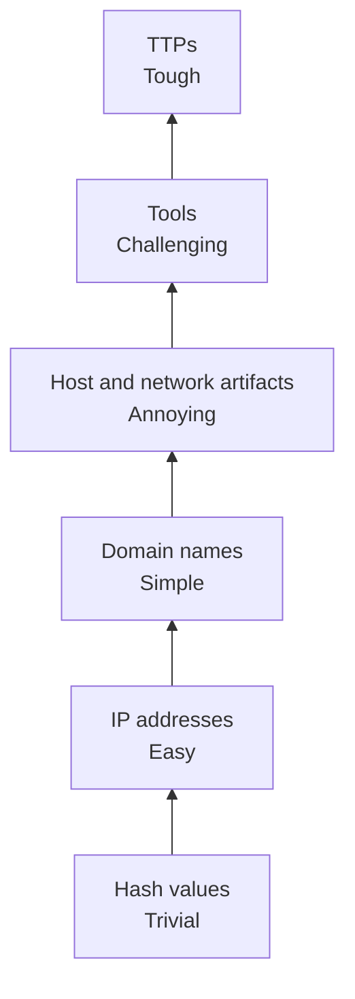

<!-- TODO: add screenshot (optional: room intro or header at the start) -->

## Task 2: Hash Values (Trivial)

A hash is a fixed-length value made from data by a hashing algorithm, so it works like a fingerprint for a file. Analysts use hashes to name and look up a malware sample.

| Algorithm | Size | Notes (my summary) |
|---|---|---|
| MD5 | 128-bit, 32 hex characters | Not cryptographically secure because of known collision attacks |
| SHA-1 | 160-bit, 40 hex characters | Deprecated by NIST, replaced by SHA-2 / SHA-3 families |
| SHA-256 (SHA-2) | 256-bit, 64 hex characters | The most common SHA-2 variant today |

Two free lookup sites were shown: VirusTotal and MetaDefender Cloud.

<p align="center">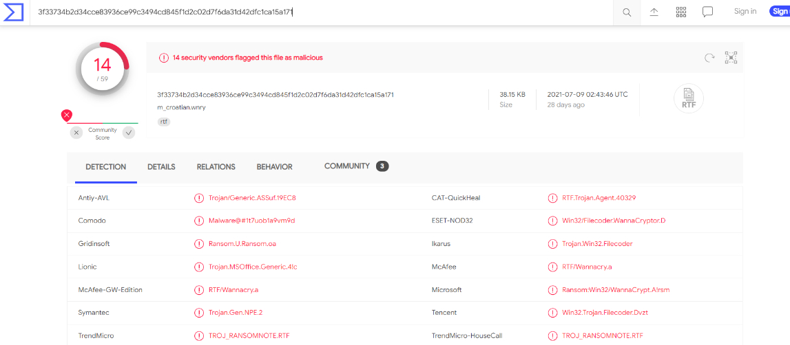</p>

> **What it shows:** Room example: a VirusTotal page for hash 3f33734b...a15a171 with "14 / 59" and "14 security vendors flagged this file as malicious", file name `m_croatian.wnry`, size 38.15 KB, type RTF, plus vendor labels such as Win32/Filecoder.WannaCryptor.D, RTF/Wannacry.a and TROJ_RANSOMNOTE.RTF.  
> **Why it matters:** A hash lookup tells you quickly whether a file is known bad and what the vendors call it. The file name sits just under the hash.  
> **Remember:** Paste the hash, read the detection count and the file name.

<p align="center">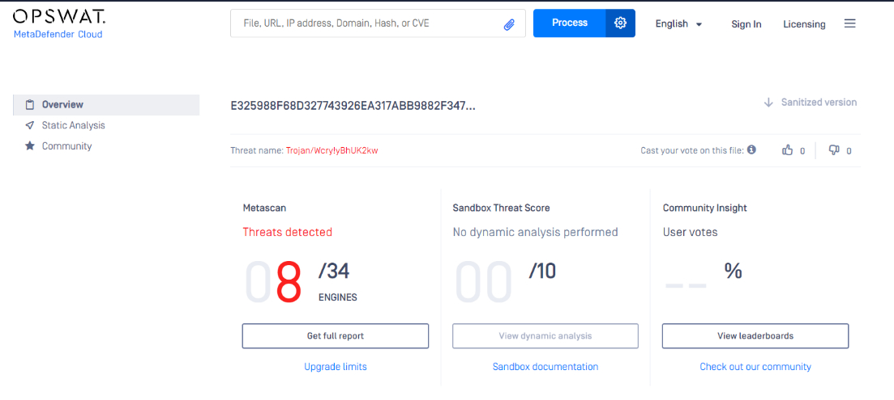</p>

> **What it shows:** Room example: a MetaDefender Cloud page for hash E325988F68D327743926EA317ABB9882F347..., threat name Trojan/WcryfyBhUK2kw, "Threats detected" 8 of 34 engines, Sandbox Threat Score 0 of 10 with "No dynamic analysis performed", and no community votes.  
> **Why it matters:** A second tool gives a second opinion. A low engine count (8 of 34) is still a detection, and "no sandbox run" means behaviour is unknown.  
> **Remember:** Different tools show different counts; use more than one.

The weakness of hashes is how easy they are to change. Appending even a short string to a file gives it a completely different hash.

<p align="center">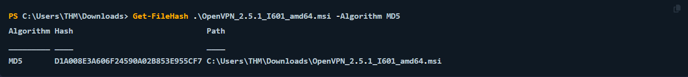</p>

> **What it shows:** Room example in PowerShell: `Get-FileHash .\OpenVPN_2.5.1_I601_amd64.msi -Algorithm MD5` returns MD5 D1A008E3A606F24590A02B853E955CF7.  
> **Why it matters:** This is the baseline hash of an untouched file.  
> **Remember:** `Get-FileHash <file> -Algorithm MD5` prints the hash.

<p align="center">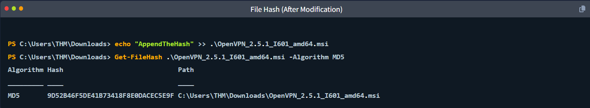</p>

> **What it shows:** Room example: `echo "AppendTheHash" >> .\OpenVPN_2.5.1_I601_amd64.msi` then the same `Get-FileHash` returns a different MD5, 9D52B46F5DE41B73418F8E0DACEC5E9F.  
> **Why it matters:** A tiny change gives a new hash, so an attacker can dodge hash-based detection with almost no effort.  
> **Remember:** One appended string equals a new hash, which is why hashes sit at the trivial base.

The room then gave a VirusTotal report for a specific hash and asked for the sample's file name.

<p align="center">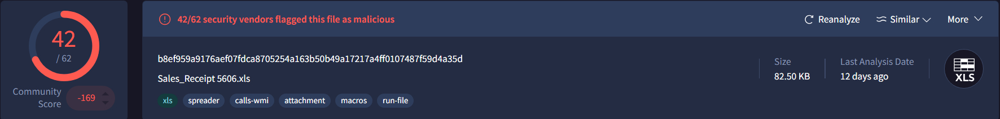</p>

> **What it shows:** A VirusTotal summary for hash b8ef959a...59d4a35d: "42 / 62", "42/62 security vendors flagged this file as malicious", file name `Sales_Receipt 5606.xls`, size 82.50 KB, community score -169, and tags xls, spreader, calls-wmi, attachment, macros, run-file.  
> **Why it matters:** The tags tell a story before any deeper analysis: an Excel attachment with macros that calls WMI and spreads.  
> **Remember:** Read the file name, the vendor count and the tags first.

<details>
<summary>Task 2 quiz screenshot</summary>

<p align="center">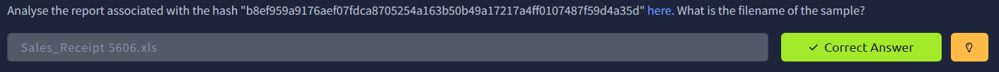</p>

> **What it shows:** The question about the file name of the sample from that report, with my answer marked "Correct Answer".  
> **Why it matters:** It confirms I read the right field in the report.  
> **Remember:** The answer is the file name shown in screenshot 05.

</details>

## Task 3: IP Address (Easy)

An IP address identifies a device on a network, and defenders often block known-bad addresses at the firewall. This helps, but an attacker can just move to a new IP, so it is not bulletproof. One trick that makes blocking harder is **Fast Flux**, where one domain name points to many IP addresses that keep changing, which hides command-and-control (C2) servers behind compromised hosts. The room warns not to interact with any of the IPs in the reports.

<p align="center">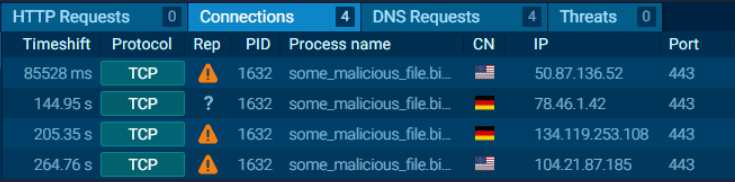</p>

> **What it shows:** Room example: the ANY.RUN Connections tab (4 connections, 0 HTTP requests, 4 DNS requests, 0 threats). Process `some_malicious_file.bi...` PID 1632 makes four TCP connections on port 443 to 50.87.136.52 (US, at 85,528 ms), 78.46.1.42 (Germany, 144.95 s), 134.119.253.108 (Germany, 205.35 s) and 104.21.87.185 (US, 264.76 s).  
> **Why it matters:** The timeshift column tells you which connection was first, which is how you answer "what did it contact first".  
> **Remember:** "First" means lowest timeshift, not top of someone else's table.

<p align="center">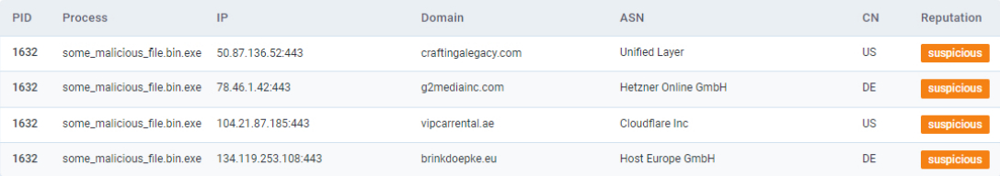</p>

> **What it shows:** A report table for PID 1632 (`some_malicious_file.bin.exe`) pairing each IP with a domain, owner and reputation, all marked "suspicious": 50.87.136.52 craftingalegacy.com (Unified Layer, US); 78.46.1.42 g2mediainc.com (Hetzner Online GmbH, DE); 104.21.87.185 vipcarrental.ae (Cloudflare Inc, US); 134.119.253.108 brinkdoepke.eu (Host Europe GmbH, DE).  
> **Why it matters:** Pairing IP, domain and owner shows what you would be blocking. One address belongs to Cloudflare, which many legitimate sites share.  
> **Remember:** Check who owns an IP before you block it.

<details>
<summary>Task 3 quiz screenshot</summary>

<p align="center">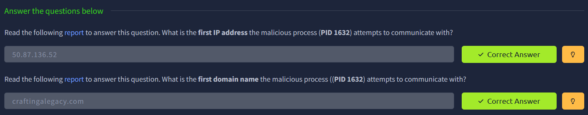</p>

> **What it shows:** Two questions about the first IP address and first domain the malicious process contacts, both marked "Correct Answer".  
> **Why it matters:** It confirms I took the first entry by time from the report.  
> **Remember:** The answers match the earliest row in screenshots 07 and 08.

</details>

## Task 4: Domain Names (Simple)

A domain name maps an IP address to readable text. It is slightly harder for an attacker to change than an IP because they usually have to buy and register it and set up DNS records, but many DNS providers make this easy with APIs. Two tricks are worth knowing. **Punycode (homograph) attacks** use look-alike Unicode characters so a fake domain looks real at a glance. **URL shorteners** hide the real destination, but adding `+` to the end of a short link shows a preview of where it goes. Proxy and web server logs help detect these. The room also shows how to read an ANY.RUN report's HTTP, Connections and DNS tabs.

<p align="center">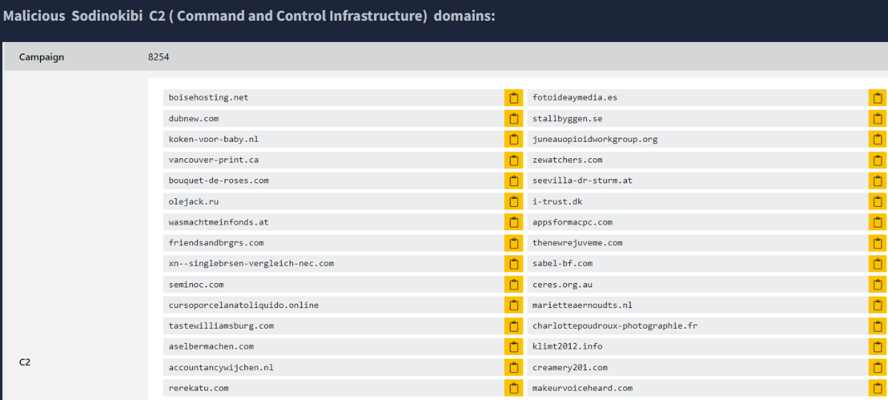</p>

> **What it shows:** Room example: a heading "Malicious Sodinokibi C2 (Command and Control Infrastructure) domains" with Campaign 8254 and a list of C2 domains (30 visible, the list continues). One entry, `xn--singlebrsen-vergleich-nec.com`, starts with `xn--`.  
> **Why it matters:** It shows that one campaign can use dozens of domains, and `xn--` marks a Punycode-encoded name.  
> **Remember:** `xn--` at the start of a label means Punycode.

<p align="center">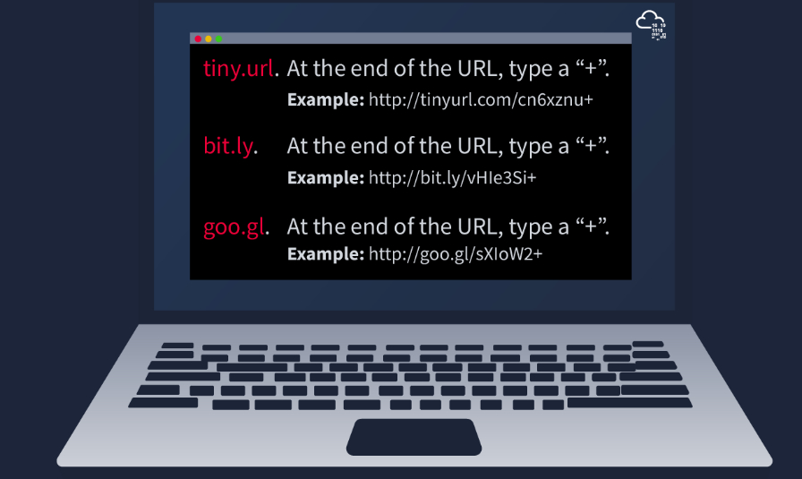</p>

> **What it shows:** Room illustration: for tinyurl, bit.ly and goo.gl, "type a + at the end of the URL" with examples ending in `+` such as `http://bit.ly/vHIe3Si+`. The first label reads "tiny.url" while its example uses tinyurl.com.  
> **Why it matters:** It is a safe way to see a short link's destination without visiting it.  
> **Remember:** Short link plus `+` equals preview.

<details>
<summary>ANY.RUN tab views (HTTP, Connections, DNS)</summary>

<p align="center">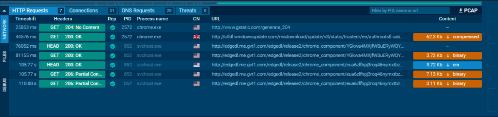</p>

> **What it shows:** Room example: HTTP Requests tab (7), with GET and HEAD requests from `chrome.exe` PID 2572 and `svchost.exe` PID 852 to gstatic.com, windowsupdate.com and gvt1.com, with content types like compressed, binary and crx.  
> **Why it matters:** This tab shows what a sample downloaded or called back to. In this example the traffic looks like ordinary browser and Windows update activity.  
> **Remember:** HTTP tab = what was fetched.

<p align="center">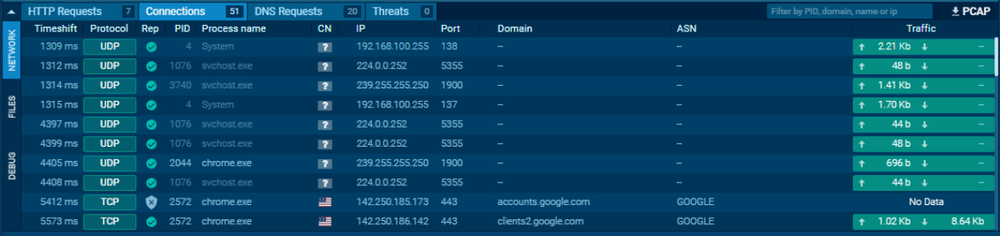</p>

> **What it shows:** Room example: Connections tab (51) with UDP rows from `System` and `svchost.exe` to local and multicast addresses, and TCP port 443 rows from `chrome.exe` to Google domains.  
> **Why it matters:** Connections show which process talks to which host, which is how C2 or uploads would appear.  
> **Remember:** Connections tab = who talked to whom, by process.

<p align="center">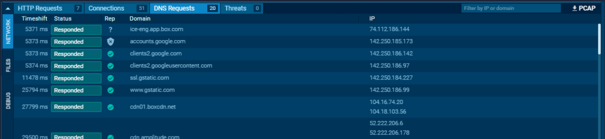</p>

> **What it shows:** Room example: DNS Requests tab (20) with Responded entries for ice-eng.app.box.com (reputation shown as "?"), accounts.google.com, clients2.google.com, gstatic.com and boxcdn.net domains.  
> **Why it matters:** DNS lookups reveal domains a sample tried to reach, even if the connection fails.  
> **Remember:** DNS tab = which names were looked up.

</details>

<details>
<summary>Task 4 quiz screenshot</summary>

<p align="center">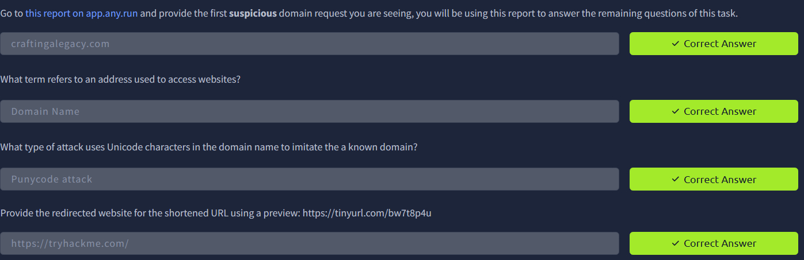</p>

> **What it shows:** Four questions (first suspicious domain request, the term for a website address, the attack using Unicode look-alike characters, and the destination of a shortened link), all marked "Correct Answer".  
> **Why it matters:** It covers the three ideas of the task: domain names, Punycode and short-link previews.  
> **Remember:** Domain name; Punycode attack; short link plus `+`.

</details>

## Task 5: Host Artifacts (Annoying)

Host artifacts are traces left on the machine: registry values, odd processes, dropped files, attack patterns. Detecting these is annoying for the attacker because they must change how their tools behave on the host. The room gives three views of one kind of Word-based attack.

<p align="center">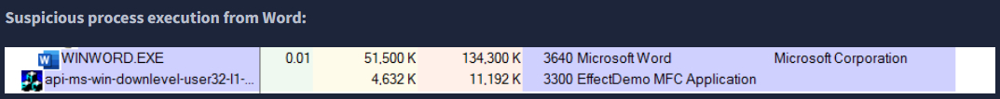</p>

> **What it shows:** Room example headed "Suspicious process execution from Word": `WINWORD.EXE` (PID 3640) with a child process `api-ms-win-downlevel-user32-l1-...` described as "EffectDemo MFC Application" (PID 3300).  
> **Why it matters:** Word starting another program is a classic sign of a malicious macro document.  
> **Remember:** Office app spawning a child process = investigate.

<p align="center">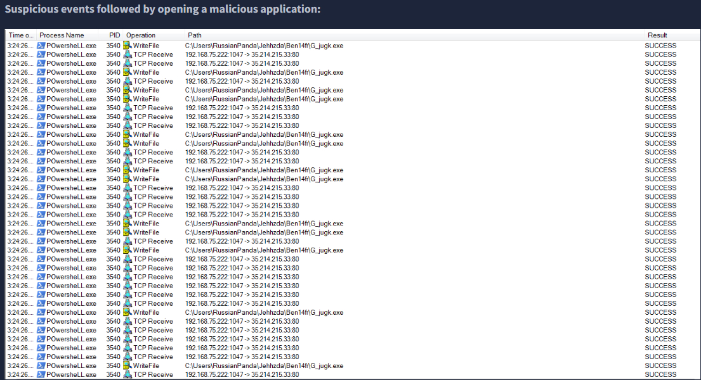</p>

> **What it shows:** Room example: repeated events from `POwersheLL.exe` (PID 3540), alternating WriteFile to `C:\Users\RussianPanda\Jehhzda\Ben14f\G_jugk.exe` and TCP Receive from 35.214.215.33:80 to 192.168.75.222:1047, all with result SUCCESS.  
> **Why it matters:** It looks like a file being downloaded over HTTP and written to disk by PowerShell. The odd mixed-case name `POwersheLL.exe` is also worth noticing.  
> **Remember:** PowerShell writing an executable while receiving network data = download-and-drop.

<p align="center">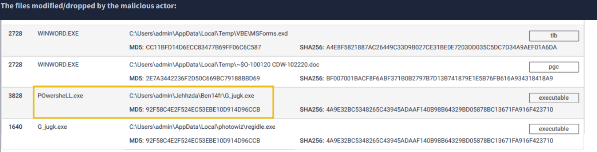</p>

> **What it shows:** Room example headed "The files modified/dropped by the malicious actor": two files written by `WINWORD.EXE` (PID 2728), `G_jugk.exe` written by `POwersheLL.exe` (PID 3828, highlighted, executable) and `regidle.exe` written by `G_jugk.exe` (PID 1640). The last two show the same MD5 92F58C4E2F524EC53EBE10D914D96CCB and the same SHA256 starting 4A9E32BC.  
> **Why it matters:** Two names with one hash means the same program was copied under a new name. A rename would not fool a hash check, but a name-based rule would miss it.  
> **Remember:** Same hash, different file name = same file.

## Task 6: Network Artifacts (Annoying)

Network artifacts are things like a User-Agent string, C2 details or the URI patterns of HTTP POST requests. They sit in the same "annoying" zone, because an attacker has to rework their tool to change them. They can be found in packet captures (PCAPs) with Wireshark or TShark, or in IDS alerts such as Snort. In the room's TShark example, the output was a list of near-identical old Internet Explorer 7 style User-Agent strings, which the room links to the Emotet trojan. The command shown filters HTTP requests and prints selected fields:

```
tshark -Y http.request -T fields -e http.host -e http.user_agent -r analysis_file.pcap
```

<p align="center">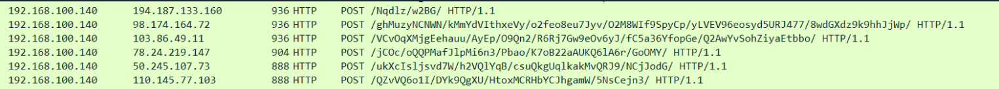</p>

> **What it shows:** Room example: six HTTP POST requests from 192.168.100.140 to 194.187.133.160, 98.174.164.72, 103.86.49.11, 78.24.219.147, 50.245.107.73 and 110.145.77.103, each with a long random-looking URI path.  
> **Why it matters:** Many POSTs with random paths to different IPs look like beaconing. The User-Agent is the next field to check.  
> **Remember:** Random URIs plus odd User-Agent equals a network artifact you can detect.

<details>
<summary>Task 6 quiz screenshot</summary>

<p align="center">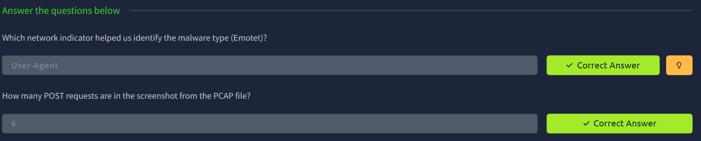</p>

> **What it shows:** Two questions (the network indicator that identified the malware type, and the number of POST requests in the capture screenshot), both marked "Correct Answer".  
> **Why it matters:** It confirms the indicator was the User-Agent and that the count matched the six requests shown.  
> **Remember:** The User-Agent string is the clue; count the POST rows.

</details>

## Task 7: Tools (Challenging)

At this level you are detecting the attacker's tools: macro documents for phishing, backdoors, custom EXE and DLL files, payloads and password crackers. Once a tool is detected, the attacker has to find, buy or build a replacement and maybe learn it, which costs time and money. Useful defences are antivirus signatures, detection rules and YARA rules. Sample and feed sources named were MalwareBazaar and Malshare, and SOC Prime for detection rules. **Fuzzy hashing** (for example ssdeep) matches files that are similar but not identical.

<p align="center">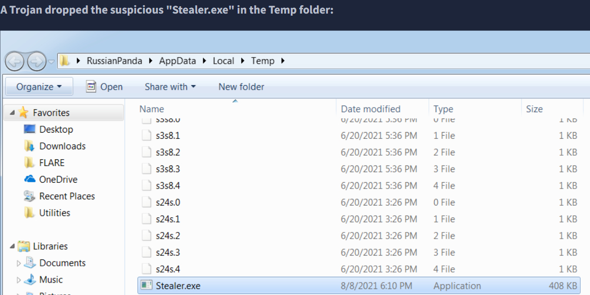</p>

> **What it shows:** Room example headed "A Trojan dropped the suspicious Stealer.exe in the Temp folder": folder path RussianPanda > AppData > Local > Temp, small 1 KB files from 6/20/2021 (`s3s8.1` to `s3s8.4`, `s24s.0` to `s24s.4`) and `Stealer.exe`, 408 KB, modified 8/8/2021 6:10 PM.  
> **Why it matters:** An executable in the Temp folder with a much later date than its neighbours is the kind of thing a hunt for tools looks for.  
> **Remember:** Executables in Temp are suspicious, especially with odd dates.

<p align="center">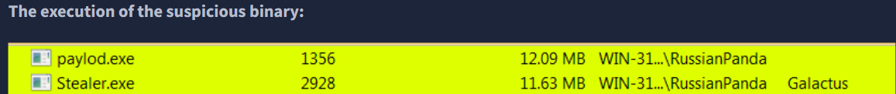</p>

> **What it shows:** Room example headed "The execution of the suspicious binary": `paylod.exe` (PID 1356, 12.09 MB) and `Stealer.exe` (PID 2928, 11.63 MB, description "Galactus"), both under the RussianPanda user.  
> **Why it matters:** It shows the dropped tool actually running, which moves it from "file on disk" to "execution".  
> **Remember:** Dropped is one thing; running is the alert.

<p align="center">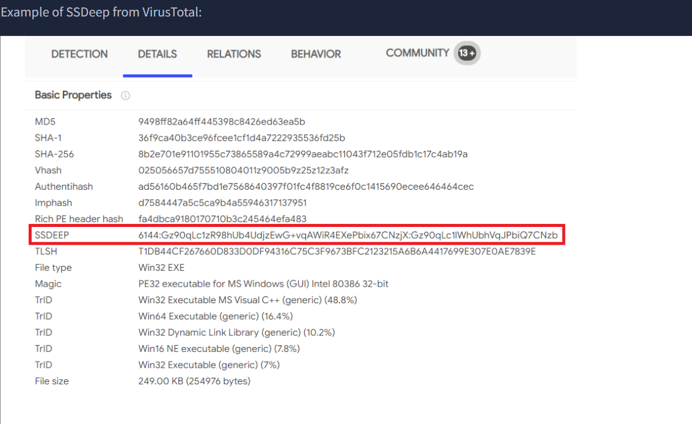</p>

> **What it shows:** Room example: a VirusTotal Details tab with Basic Properties (MD5, SHA-1, SHA-256, Vhash, Authentihash, Imphash, Rich PE header hash, SSDEEP highlighted, TLSH), file type Win32 EXE and size 249.00 KB (254976 bytes).  
> **Why it matters:** Fuzzy hashes like SSDEEP and TLSH help find files that are close to a known sample, which a normal hash would miss.  
> **Remember:** SSDEEP is the fuzzy hash; its format starts with a block size (6144 here).

<details>
<summary>Task 7 quiz screenshot</summary>

<p align="center">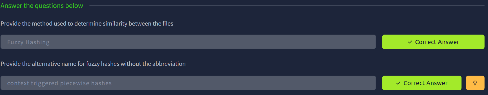</p>

> **What it shows:** Two questions (the method used to find similarity between files, and the alternative name for fuzzy hashes without the abbreviation), both marked "Correct Answer".  
> **Why it matters:** It ties fuzzy hashing back to its full name.  
> **Remember:** Fuzzy hashing = context triggered piecewise hashing.

</details>

## Task 8: TTPs (Tough)

TTPs are Tactics, Techniques and Procedures, which cover the whole MITRE ATT&CK matrix: every step an attacker takes from phishing to persistence to data theft. This is the top of the pyramid because the attacker's habits are the hardest thing to change. Detecting and responding to a technique early (the room's example is Pass-the-Hash seen in Windows event logs) leaves the attacker with two choices: retrain and rebuild, or give up and pick another target. The task questions asked about the ATT&CK site (the number of Exfiltration techniques, and a remote access tool used by the group Chimera).

<!-- TODO: add screenshot of the Task 8 questions (ATT&CK exfiltration and Chimera) if you have them -->

## Task 9: Practical: The Pyramid of Pain

The practical is a static website where six descriptions have to be matched to the correct tier of the pyramid. Completing it returns a flag, which is not shown here.

<p align="center">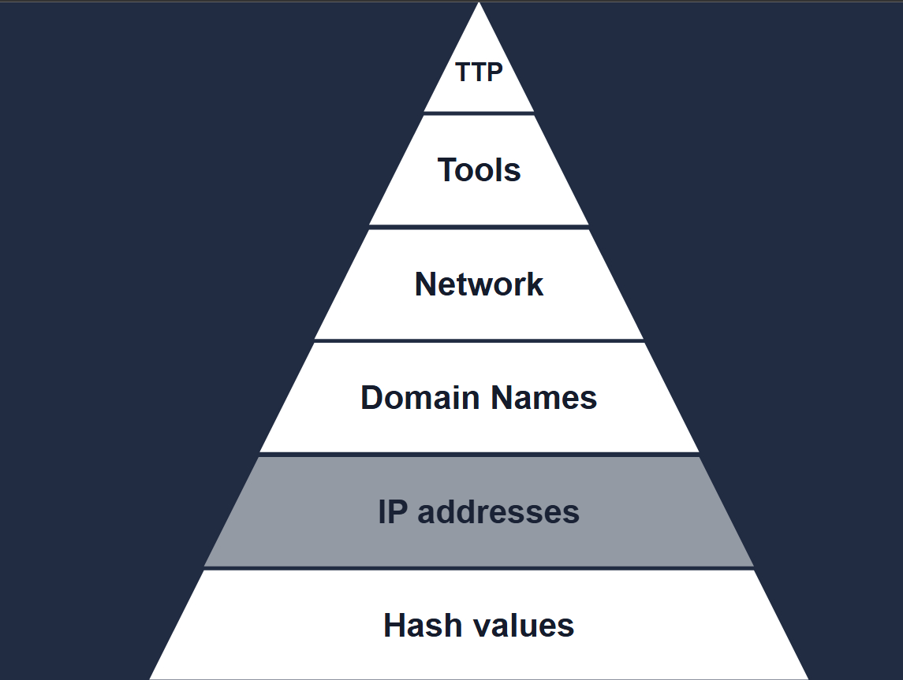</p>

> **What it shows:** A white pyramid with six tiers from top to bottom: TTP, Tools, Network, Domain Names, IP addresses (shaded grey) and Hash values.  
> **Why it matters:** These are the six buckets the descriptions must be sorted into.  
> **Remember:** Top to bottom: TTP, Tools, Network, Domain, IP, Hash.

<p align="center">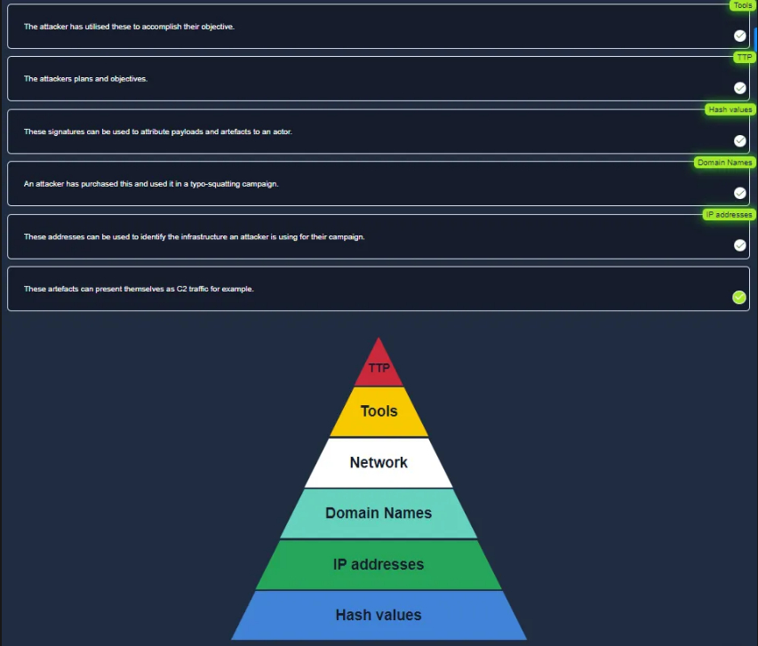</p>

> **What it shows:** Six description cards with green ticks. Tier tags are visible on five: Tools, TTP, Hash values, Domain Names and IP addresses. The sixth card (about C2-style artefacts) has a green tick but no visible tag. A coloured pyramid sits below (TTP red, Tools yellow, Network white, Domain Names teal, IP addresses green, Hash values blue).  
> **Why it matters:** It is my own placement: tools used to reach the goal go to Tools, plans and objectives to TTPs, signatures that attribute files to Hash values, bought typo-squatting domains to Domain Names, infrastructure addresses to IP addresses, and C2 traffic artefacts to the remaining tier (Network, by elimination).  
> **Remember:** Match the description to what the attacker has to replace.

**Gap:** the sixth card shows no tier tag in this screenshot, so its placement is my reading by elimination. The completion screenshot below shows the room accepted at 100%.

## Task 10: Conclusion

The room closes by suggesting you pick an APT group, list its indicators and ask where each sits on the pyramid and what detection you could build. The takeaway idea is that how much pain you cause an adversary depends on which indicators you can detect.

<p align="center">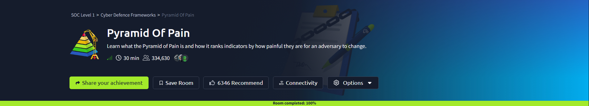</p>

> **What it shows:** The Pyramid Of Pain header (SOC Level 1 > Cyber Defence Frameworks, 30 min) with "Share your achievement" and a green bar reading "Room completed: 100%".  
> **Why it matters:** It is the completion record for this write-up.  
> **Remember:** Simulated lab: hands-on practice, not job experience.

## Investigation Notes: Sample Reports

The room has no console alerts. These notes come from the sample reports it provided. Evidence is what the screenshots show; the rest is my reading.

### Sample A: process PID 1632 (Tasks 3 and 4)

| W | Evidence from the screenshots |
|---|---|
| Who | Process `some_malicious_file.bin.exe`, PID 1632 |
| What | Four outbound TCP connections on port 443, each paired with a domain and marked suspicious in the report table |
| When | 85,528 ms, 144.95 s, 205.35 s and 264.76 s after the sandbox run started (timeshift, not clock time) |
| Where | IPs in the US and Germany (see the IOC table) |
| Why | Not stated. My reading: callbacks to attacker infrastructure |

### Sample B: Word-based chain (Task 5)

| W | Evidence from the screenshots |
|---|---|
| Who | `WINWORD.EXE`, `POwersheLL.exe`, `G_jugk.exe`, `regidle.exe`; user folders RussianPanda and admin (see the note below) |
| What | Word with a child process; PowerShell writing `G_jugk.exe` while receiving network data from 35.214.215.33 on port 80; `G_jugk.exe` and `regidle.exe` with the same hash |
| When | Event times from 3:24:26 in the PowerShell screenshot; no common timeline across screenshots |
| Where | Temp and user profile folders; remote IP 35.214.215.33 |
| Why | Not stated. My reading: a malicious macro document that downloads and drops a payload |

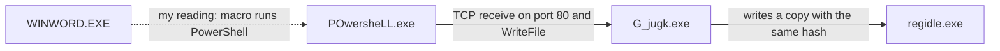

**Discrepancies I noticed (flagged, not hidden):**

- The PIDs differ between screenshots (Word 3640 vs 2728, PowerShell 3540 vs 3828) and the user folder is RussianPanda in one and admin in another, so these views come from different captures. I did not build one timeline from them.
- In the connections tab, 78.46.1.42 shows a "?" reputation, but the report table marks it suspicious. These are different views of the report.
- The connections tab and the report table list the third and fourth IPs in a different order, so "first" must be decided by timeshift.
- The hash lookup example shows the file name `m_croatian.wnry`, while the room's caption spells it differently.
- In the TShark section, the command in the room's text uses `--Y` and an extra `http.host` field, while the terminal shows `-Y` with only the User-Agent. The correct flag is `-Y`.

**IOC table (simulated data, not checked against threat intelligence; do not visit these):**

| Type | Value | Context | Screenshot |
|---|---|---|---|
| IP address | 50.87.136.52 | First connection by PID 1632, domain craftingalegacy.com | 07, 08 |
| IP address | 78.46.1.42 | domain g2mediainc.com, Germany | 07, 08 |
| IP address | 104.21.87.185 | domain vipcarrental.ae, Cloudflare | 07, 08 |
| IP address | 134.119.253.108 | domain brinkdoepke.eu, Germany | 07, 08 |
| IP address | 35.214.215.33 | Source of data received by PowerShell on port 80 | 17 |
| File name | G_jugk.exe / regidle.exe | Same file under two names, MD5 92F58C4E2F524EC53EBE10D914D96CCB (as read from the screenshot) | 18 |
| File name | Sales_Receipt 5606.xls | 42/62 vendors flagged | 05 |
| File name | Stealer.exe | Executable in Temp folder | 21 |

**MITRE ATT&CK (what fits what is shown):** T1059.001 PowerShell (PowerShell running and writing a file), T1105 Ingress Tool Transfer (file written while receiving data over HTTP), T1071.001 Web Protocols (HTTP POST beaconing with random URIs). T1204.002 User Execution: Malicious File is possible given Word spawning a process, but I did not see the macro itself. T1568.001 Fast Flux is the concept from Task 3, not something I saw proven.

**What I would do next (recommendations, not actions shown in the room):**

- Block the IPs and domains for a quick win, but expect them to change; check ownership first (one IP is Cloudflare).
- Build detections higher up the pyramid: Office applications spawning PowerShell, mixed-case PowerShell names, executables written to Temp, unusual User-Agent strings and POSTs with random URIs.
- Add file-similarity checks (fuzzy hash) next to exact hashes, and search for the same hash under other file names.

## Revision Notes

**One-minute summary**

- The Pyramid of Pain ranks indicators by how hard they are for an attacker to change.
- Bottom to top: hash values (trivial), IP addresses (easy), domain names (simple), host and network artifacts (annoying), tools (challenging), TTPs (tough).
- Blocking the easy ones is quick but short-lived; detecting the hard ones forces the attacker to change their whole approach.
- Hashes change with one byte; IPs change with fast flux; domains can use look-alike Unicode and short links.
- Artifacts are found in process lists, file drops, PCAPs and User-Agent strings.
- Fuzzy hashes (ssdeep) and detection rules (signatures, YARA) go after tools.
- Aim detections as high as you can afford.

**Core concepts**

| Concept | Plain-English meaning | Example from this room |
|---|---|---|
| IOC | A sign that something malicious happened | A hash, IP, domain or file name |
| Hash | Fingerprint of a file's contents | MD5 changed after appending a string |
| Fast Flux | One domain, many changing IPs | Hides C2 servers |
| Punycode attack | Look-alike domain using Unicode | `xn--` names |
| Host artifact | Trace left on the machine | Word spawning a process, dropped files |
| Network artifact | Trace in traffic | User-Agent, random POST URIs |
| Fuzzy hash | Hash that matches similar files | SSDEEP |
| TTP | Attacker behaviour | Whole ATT&CK matrix |

**Cheat sheet**

| Level | Pain for attacker | Easy defence | Attacker's workaround | Example in room |
|---|---|---|---|---|
| Hash values | Trivial | Block or search by hash | Change one byte | Appended string changed the MD5 |
| IP addresses | Easy | Firewall block | New IP, fast flux | PID 1632 connections |
| Domain names | Simple | Block domain, check proxy logs | Register another, Punycode, short links | craftingalegacy.com |
| Host / network artifacts | Annoying | Process, file and traffic detections | Rework the tool's behaviour | Word to PowerShell, POST requests |
| Tools | Challenging | Signatures, YARA, fuzzy hash | Build or buy a new tool | Stealer.exe |
| TTPs | Tough | Behaviour detections mapped to ATT&CK | Retrain, change approach | Pass-the-Hash example |

Other facts: MD5 32 hex, SHA-1 40 hex, SHA-256 64 hex. `Get-FileHash <file> -Algorithm MD5`. TShark: `tshark -Y http.request -T fields -e http.host -e http.user_agent -r file.pcap`. ANY.RUN tabs: HTTP Requests, Connections, DNS Requests, Threats. Short link preview: add `+`.

**Analyst workflow (what this room teaches)**

1. Collect the indicators from the report or alert (hashes, IPs, domains, artifacts).
2. Look up hashes and check the detection count, file name and tags.
3. Read the sandbox tabs (HTTP, Connections, DNS) and sort by timeshift to find the first contact.
4. Check who owns each IP and domain before blocking.
5. Note host artifacts: parent-child processes, dropped files, hashes.
6. Note network artifacts: User-Agent, URI patterns, POST counts.
7. Block the quick wins, then write detections for tools and behaviours.
8. Place each finding on the pyramid to decide how much it is worth.

**Common mistakes / false-positive traps**

- Relying on hashes alone, which an attacker can change in seconds.
- Blocking an IP owned by a shared provider such as Cloudflare.
- Reading "first" from a table that is not sorted by time.
- Treating normal Chrome and Windows update traffic in a sandbox report as malicious.
- Trusting a low detection count as "safe" (or a high one as the whole story).
- Chaining screenshots from different captures into one timeline.
- Visiting suspicious IPs or domains instead of using previews and reports.
- Matching on process names only; a copy can have another name and the same hash.

**Self-check questions**

1. Which level of the pyramid is the easiest for an attacker to change?
<details><summary>Answer</summary>Hash values.</details>

2. How long is a SHA-256 hash in hex characters?
<details><summary>Answer</summary>64.</details>

3. Why does blocking IP addresses give only a short-lived win?
<details><summary>Answer</summary>The attacker can move to a new IP, and fast flux keeps changing the addresses behind a domain.</details>

4. What does `xn--` at the start of a domain label mean?
<details><summary>Answer</summary>The name is Punycode-encoded, which is used in look-alike Unicode domain attacks.</details>

5. How can you preview where a short link goes without visiting it?
<details><summary>Answer</summary>Add `+` to the end of the short URL.</details>

6. In a sandbox report, how do you decide which connection came first?
<details><summary>Answer</summary>Use the timeshift column and take the smallest value.</details>

7. Why is Word starting another process suspicious?
<details><summary>Answer</summary>It is typical of a malicious macro launching tools such as PowerShell.</details>

8. What network indicator helped tie the traffic to Emotet?
<details><summary>Answer</summary>The User-Agent string.</details>

9. What is fuzzy hashing used for?
<details><summary>Answer</summary>Finding files that are similar but not identical, for example with ssdeep.</details>

10. Why are TTPs at the top of the pyramid?
<details><summary>Answer</summary>They describe attacker behaviour, which is the hardest and costliest thing for them to change.</details>

**Interview angle**

- *What is the Pyramid of Pain and how do you use it?* It ranks indicators by how hard they are for an attacker to change, from hashes at the bottom to TTPs at the top. I use it to decide which detections to block quickly and which to invest in.
- *Why are hash-only detections weak?* Changing one byte of a file changes its hash, so the attacker evades with almost no effort. Fuzzy hashes, behaviour rules and YARA hold up better.
- *How would you safely check a suspicious shortened link?* Do not open it; use a preview (for example adding `+`) or a URL scanner, then check the destination domain in threat intelligence and proxy logs.

## Key Takeaways

- The higher the indicator on the pyramid, the more it costs the attacker when you detect it.
- Hashes, IPs and domains are quick to block but quick to replace.
- Host and network artifacts, tools and TTPs are where lasting detections live.
- Always sort by time and check ownership before acting on IPs and domains.
- Sandbox reports contain a lot of normal traffic, so filter before concluding.
- Place each finding on the pyramid to decide how much effort it deserves.

## Glossary

| Term | Meaning (my words) |
|---|---|
| IOC | Evidence of a possible attack, such as a hash, IP or domain |
| Pyramid of Pain | A model ranking IOCs by how painful they are for attackers to change |
| Hash | A fixed-length value that fingerprints a file |
| Fast Flux | Rapidly changing IPs behind one domain name |
| C2 | Command and control, the attacker's remote control channel |
| Punycode | A way to write Unicode domain names in plain ASCII (`xn--`) |
| Sandbox | An isolated environment to run and watch a sample safely |
| PID | Process ID, a number identifying a running process |
| User-Agent | A request header that names the client software |
| PCAP | A saved capture of network packets |
| Fuzzy hash | A hash that can match files that are similar, not identical |
| YARA | A rule format for matching patterns in files |
| TTP | Tactics, techniques and procedures: how an attacker works |

## Skills Demonstrated

`Pyramid of Pain` `IOC analysis` `Hash lookup` `Sandbox report reading` `Host and network artifacts` `Fuzzy hashing` `MITRE ATT&CK basics` `Write-up documentation`

---

[Back to all labs](../../README.md)
