# Summit | TryHackMe

| | |
|---|---|
| **Platform** | [TryHackMe: Summit](https://tryhackme.com/room/summit) (premium room) |
| **Path** | SOC Level 1 > Cyber Defence Frameworks |
| **Difficulty** | Easy <!-- TODO: confirm difficulty --> |
| **Status** | Completed, 25 Nov 2026 <!-- TODO: confirm completion date --> (room progress 100% in the final screenshot) |
| **Environment** | Browser-based simulation: PicoSecure console with mail client, Malware Sandbox, IOC Management (hash, firewall, DNS rules) and a Sysmon rule builder with Sigma validation |
| **Focus** | Detection engineering across the Pyramid of Pain: hashes, IPs, domains, host artefacts, tools, TTPs |

> Flags are redacted in all screenshots.
<!-- TODO: blur the flag banner in 07, 12, 30 and 37 before publishing. Not done yet. -->

## Contents

- [What this lab is about](#what-this-lab-is-about)
- [Objective](#objective)
- [At a Glance](#at-a-glance)
- [Stage 0: Briefing and the first sample](#stage-0-briefing-and-the-first-sample)
- [Stage 1: Sample 1, file hash](#stage-1-sample-1-file-hash)
- [Stage 2: Sample 2, IP address](#stage-2-sample-2-ip-address)
- [Stage 3: Sample 3, domain name](#stage-3-sample-3-domain-name)
- [Stage 4: Sample 4, host artefact (registry)](#stage-4-sample-4-host-artefact-registry)
- [Stage 5: Sample 5, tool (beaconing)](#stage-5-sample-5-tool-beaconing)
- [Stage 6: Sample 6, TTPs](#stage-6-sample-6-ttps)
- [Room completed](#room-completed)
- [IOC table](#ioc-table)
- [MITRE ATT&CK mapping](#mitre-attck-mapping)
- [Discrepancies and caveats](#discrepancies-and-caveats)
- [Revision Notes](#revision-notes)
- [Key Takeaways](#key-takeaways)
- [Glossary](#glossary)
- [Skills Demonstrated](#skills-demonstrated)

## What this lab is about

Blocking one malicious file is easy, but attackers can change that file in seconds. This room shows why some detections hurt an attacker far more than others by walking up the Pyramid of Pain. A simulated attacker (Sphinx) sends six malware samples, and each time I detonate the sample in a sandbox, find a new kind of indicator and turn it into a block or detection rule. Each rule is harder for the attacker to dodge than the last: first a hash, then an IP, a domain, a registry change, a beacon pattern and finally the commands the attacker runs after getting access. A SOC L1 analyst needs this because alerts are only useful if the rule behind them survives the attacker's next small change. Knowing which indicator to turn into a rule is part of the job.

This was hands-on practice in a simulated environment, not real incident work.

## Objective

Analyse six samples in a malware sandbox, extract the indicator that fits each level of the Pyramid of Pain, and create the matching block or detection rule in the PicoSecure console until the attacker gives up.

## At a Glance

| Item | Detail |
|---|---|
| Covered | Sandbox report reading for six samples, hash blocklist, egress firewall rule, DNS deny rule, Sysmon-style registry, network-connection and file rules |
| Tools / views | PicoSecure Mail, Malware Sandbox (General Info, Behaviour, Network, DNS, Registry, Processes, Files), Manage Hashes, Firewall Rule Manager, DNS Rule Manager, Sysmon rule builder, Sigma rule validation |
| Frameworks | Pyramid of Pain, MITRE ATT&CK (tactic chosen per Sysmon rule) |
| Actually investigated | Sandbox reports for all six samples; one rule built per sample |
| Only seen / not investigated | Real host telemetry, a SIEM, alert triage, escalation. None of these appear in this room |

---

## Stage 0: Briefing and the first sample

The room starts with an email from Sphinx, who plays a penetration tester running a detection-engineering exercise. The plan is iterative: I detect a sample, Sphinx upgrades it, and we repeat. Sample 1 is the starting point.

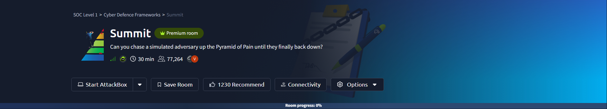

**Screenshot explanation**
> **What it shows:** The Summit room header under SOC Level 1 > Cyber Defence Frameworks, marked as a premium room, 30 min, with room progress at 0%.
> **Why it matters:** It records the starting state and where the room sits in the path.
> **Remember:** Summit = chase the adversary up the Pyramid of Pain.

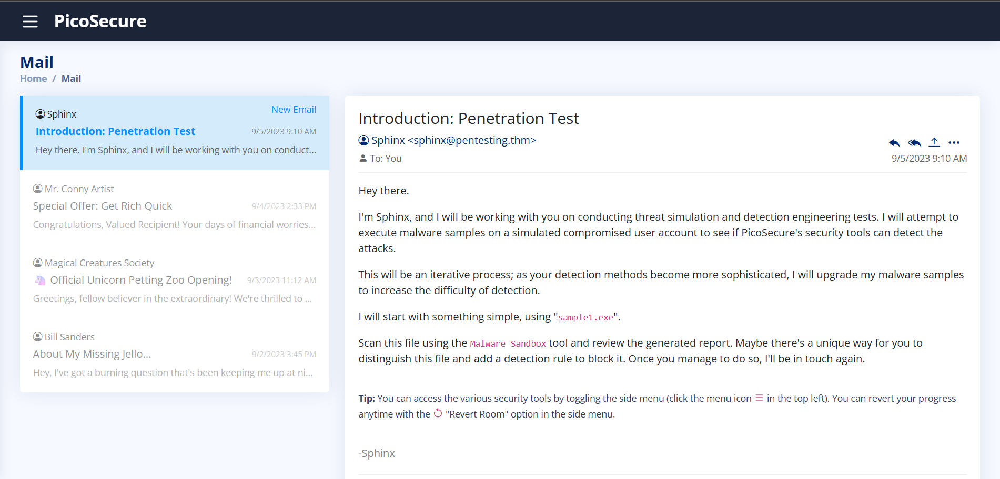

**Screenshot explanation**
> **What it shows:** PicoSecure Mail with a new email from Sphinx (sphinx@pentesting.thm), dated 9/5/2023 9:10 AM, subject "Introduction: Penetration Test". It names sample1.exe and points to the Malware Sandbox. Three unrelated emails sit below it.
> **Why it matters:** It sets the scenario: a simulated attacker who improves each round, and an analyst whose job is to detect.
> **Remember:** Sphinx = the simulated red team that adapts after every detection.

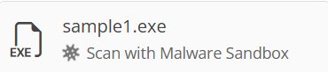

**Screenshot explanation**
> **What it shows:** The sample1.exe attachment card with a "Scan with Malware Sandbox" link.
> **Why it matters:** Suspicious files are detonated in a sandbox, not opened on a normal host.
> **Remember:** Sandbox first, rule second.

<!-- Note: this screenshot is a low-resolution crop. Optional retake. -->

---

## Stage 1: Sample 1, file hash

Sample 1 is a Metasploit-tagged trojan. The sandbox gives its file hashes. The fix here is the simplest one: add its hash to the blocklist.

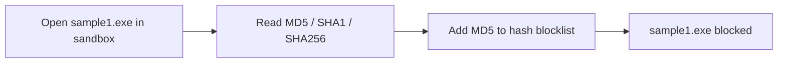

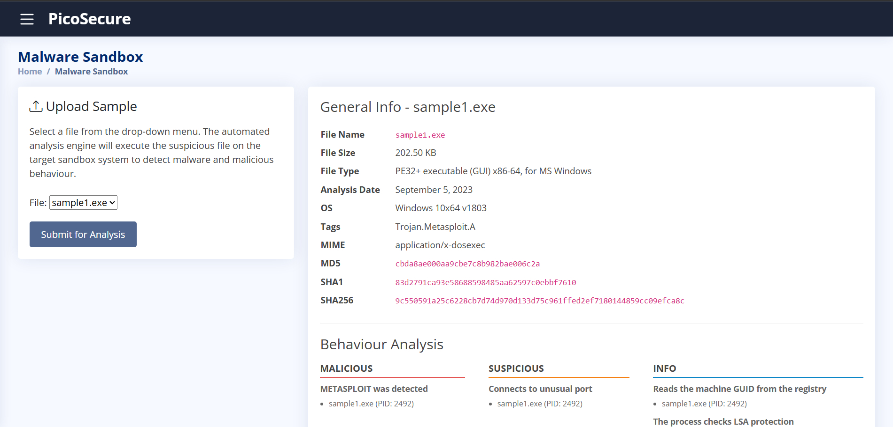

**Screenshot explanation**
> **What it shows:** General Info for sample1.exe: 202.50 KB, PE32+ GUI executable for x86-64, Windows 10 x64 v1803 sandbox, tag Trojan.Metasploit.A, MD5 cbda8ae000aa9cbe7c8b982bae006c2a. Behaviour starts with "METASPLOIT was detected" (PID 2492).
> **Why it matters:** The sandbox hash is the first indicator I can turn into a rule.
> **Remember:** A hash identifies one exact file and nothing else.

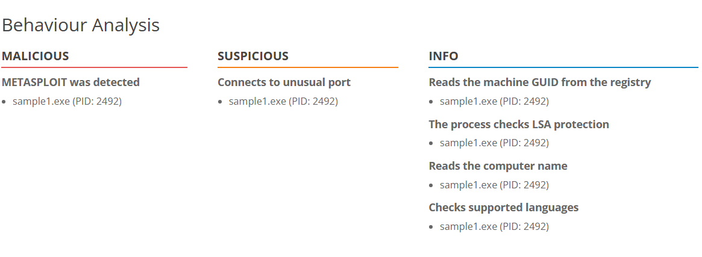

**Screenshot explanation**
> **What it shows:** Behaviour Analysis for sample1.exe (PID 2492). Malicious: METASPLOIT detected. Suspicious: connects to an unusual port. Info: reads the machine GUID, checks LSA protection, reads the computer name, checks supported languages.
> **Why it matters:** The sandbox sorts behaviour by severity, so the analyst can start with the malicious and suspicious items.
> **Remember:** Malicious > Suspicious > Info. Info items alone are not proof.

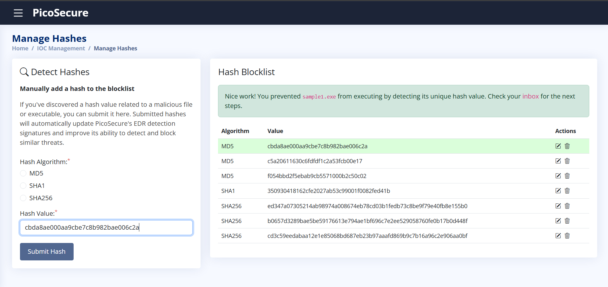

**Screenshot explanation**
> **What it shows:** Manage Hashes under IOC Management. The hash value field holds the sample1 MD5, and the Hash Blocklist has a new highlighted MD5 row with the same value. A banner says sample1.exe was prevented from executing. In this capture none of the algorithm radio buttons look selected.
> **Why it matters:** A hash block is exact and high confidence: if it matches, it is that file.
> **Remember:** Hash = highest confidence, lowest pain for the attacker.

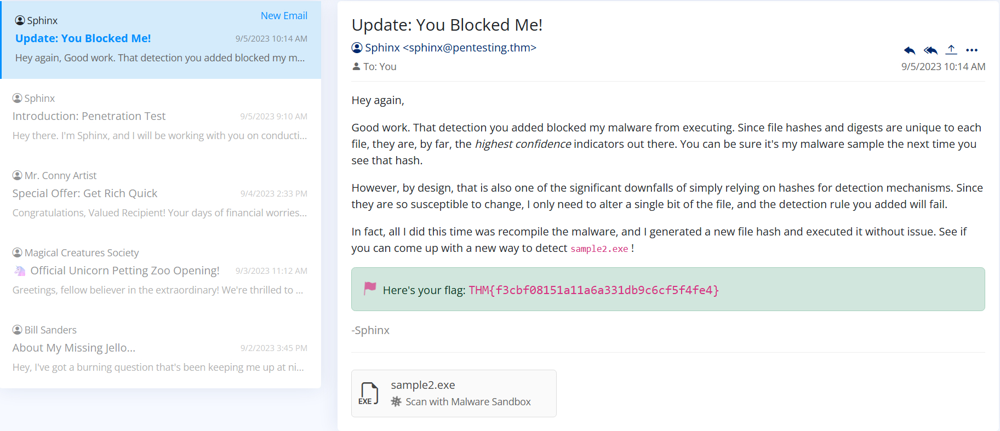

**Screenshot explanation**
> **What it shows:** Sphinx's reply "Update: You Blocked Me!" (9/5/2023 10:14 AM). It says a hash block is reliable but breaks if a single bit of the file changes, and that a recompiled sample2.exe is attached. A flag banner is visible in the file (to be blurred).
> **Why it matters:** It states the weakness of hash-only detection: trivial for the attacker to change.
> **Remember:** One changed bit = new hash = rule bypassed.

---

## Stage 2: Sample 2, IP address

Sample 2 is a recompiled version of the same malware, with a new hash and nearly the same size. The sandbox shows a connection to an unusual public IP, so the better rule is an egress deny on that IP.

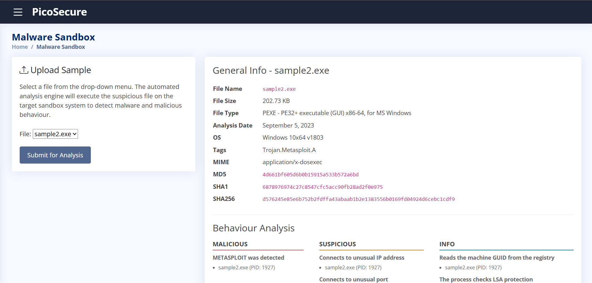

**Screenshot explanation**
> **What it shows:** General Info for sample2.exe: 202.73 KB, tag Trojan.Metasploit.A, MD5 4d661bf605d6b0b15915a533b572a6bd (PID 1927). Suspicious items include connecting to an unusual IP address and an unusual port.
> **Why it matters:** Same family, new hash, so hash blocking no longer helps and I need a more durable indicator.
> **Remember:** Different hash, same behaviour.

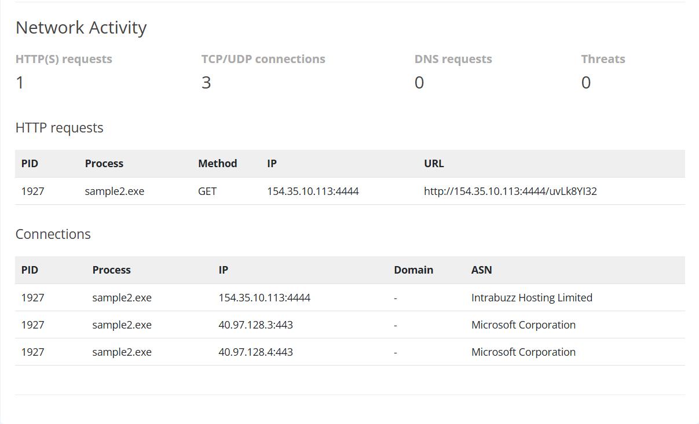

**Screenshot explanation**
> **What it shows:** Network Activity for sample2.exe: 1 HTTP request, 3 TCP/UDP connections, 0 DNS requests, Threats 0. A GET goes to 154.35.10.113:4444 (path /uvLk8YI32, ASN Intrabuzz Hosting Limited). Two further connections go to 40.97.128.3:443 and 40.97.128.4:443 (Microsoft Corporation).
> **Why it matters:** Of the three connections, only one is to an unusual IP and port. Zero DNS requests means the sample went straight to an IP address.
> **Remember:** No DNS lookup = hard-coded IP.

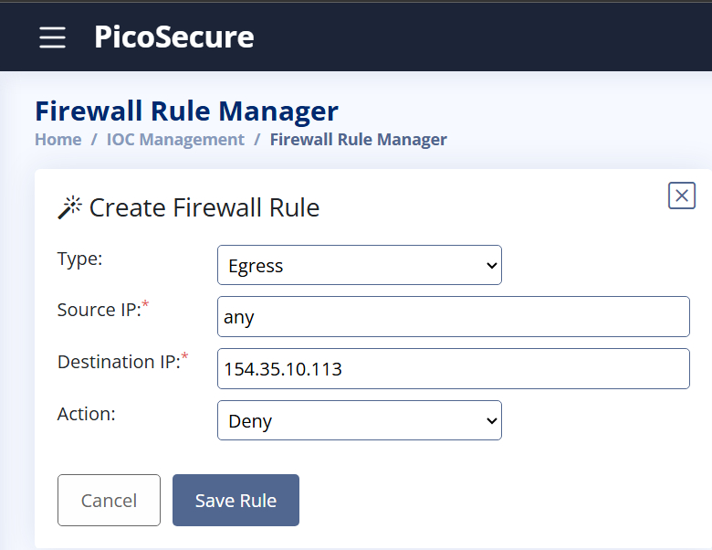

**Screenshot explanation**
> **What it shows:** Firewall Rule Manager, "Create Firewall Rule": Type Egress, Source IP any, Destination IP 154.35.10.113, Action Deny. The rule has not yet been saved in this view.
> **Why it matters:** An egress deny cuts the call-back to the attacker's server.
> **Remember:** Egress = outbound traffic. Block C2 call-backs on egress.

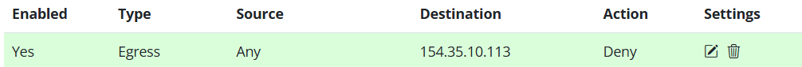

**Screenshot explanation**
> **What it shows:** A highlighted row in the firewall rules table: Enabled Yes, Type Egress, Source Any, Destination 154.35.10.113, Action Deny.
> **Why it matters:** It confirms the rule exists and is active.
> **Remember:** Check the Enabled column after saving a rule.

<!-- TODO: add screenshot of the success banner after saving the firewall rule (not captured). -->

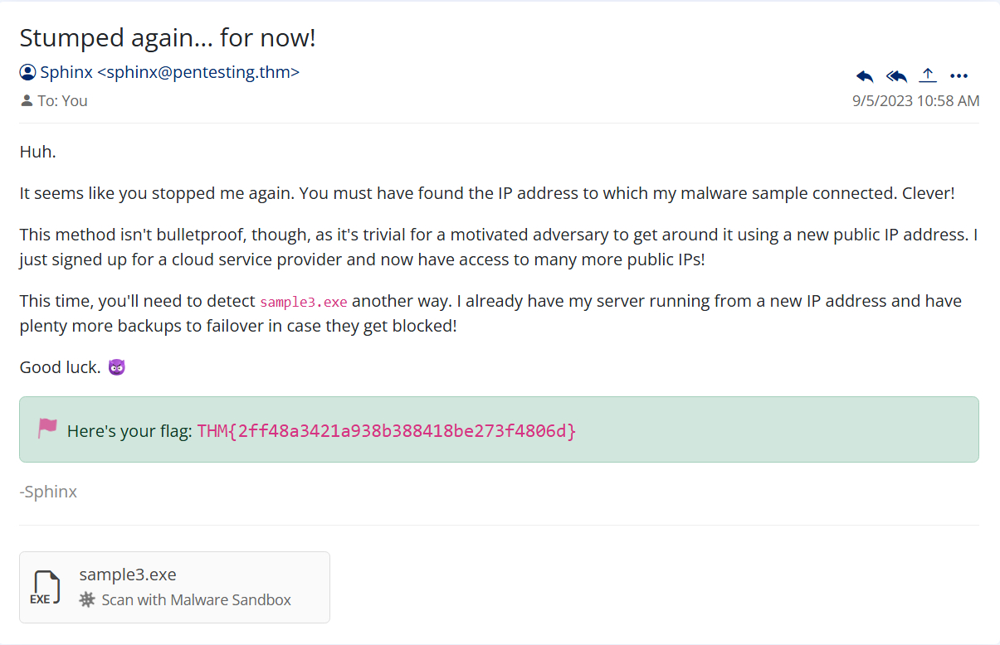

**Screenshot explanation**
> **What it shows:** Sphinx's email "Stumped again... for now!" (9/5/2023 10:58 AM). It says blocking an IP is easy to get around with a fresh cloud IP and attaches sample3.exe. A flag banner is visible in the file (to be blurred).
> **Why it matters:** IP blocks are useful but cheap for the attacker to replace.
> **Remember:** IP address = easy for the attacker to change.

---

## Stage 3: Sample 3, domain name

Sample 3 downloads a second-stage executable from a named server on a new IP. The domain stays the same even if the IP rotates, so a DNS deny rule is the better fix.

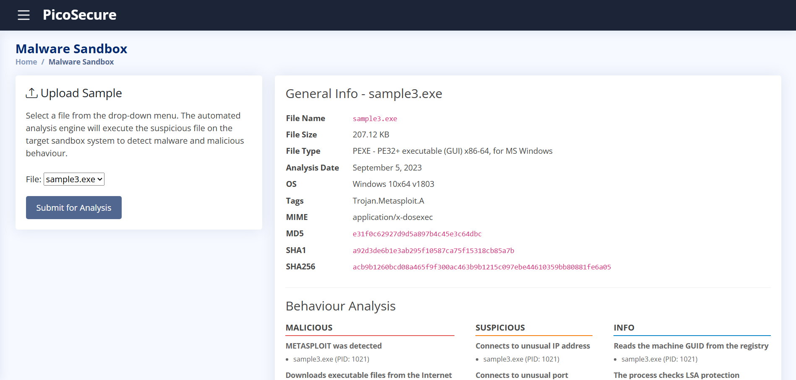

**Screenshot explanation**
> **What it shows:** General Info for sample3.exe: 207.12 KB, tag Trojan.Metasploit.A, MD5 e31f0c62927d9d5a897b4c45e3c64dbc (PID 1021). Malicious items include METASPLOIT detected and downloading executables from the Internet. Suspicious items include an unusual IP and port.
> **Why it matters:** A new hash and a new IP again, plus a download stage. The next fixed point to look for is the domain.
> **Remember:** Downloader behaviour hints at a second stage.

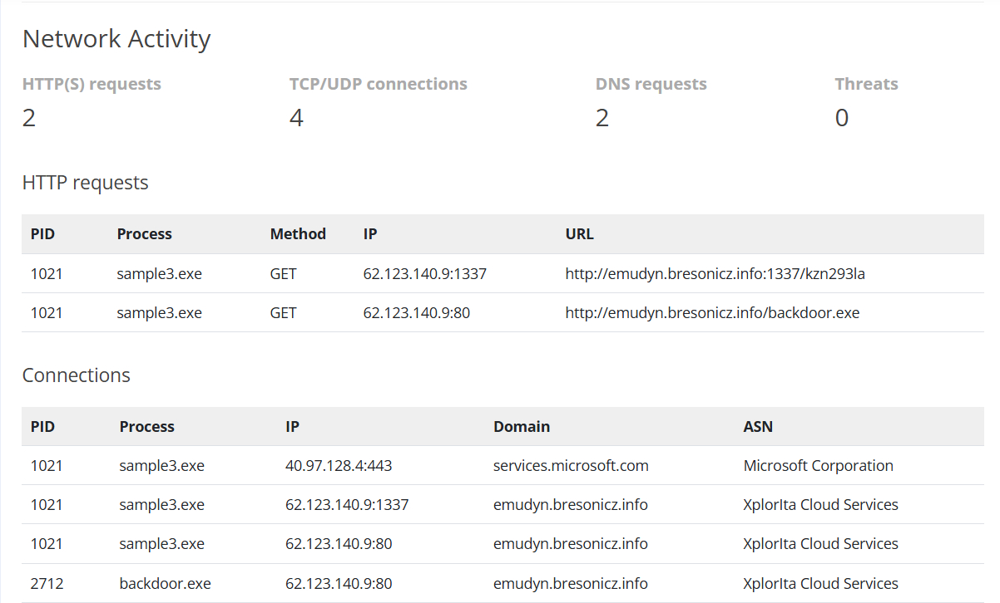

**Screenshot explanation**
> **What it shows:** 2 HTTP requests, 4 connections, 2 DNS requests, Threats 0. sample3.exe (PID 1021) sends GETs to emudyn[.]bresonicz[.]info (62.123.140.9) on port 1337 and on port 80 for /backdoor.exe. It also connects to services.microsoft.com (40.97.128.4:443). A process named backdoor.exe (PID 2712) connects to the same host on port 80. ASN for the attacker host: XplorIta Cloud Services.
> **Why it matters:** The sample fetches a second file, and the same domain appears in both requests.
> **Remember:** Block the domain, not just its current IP.

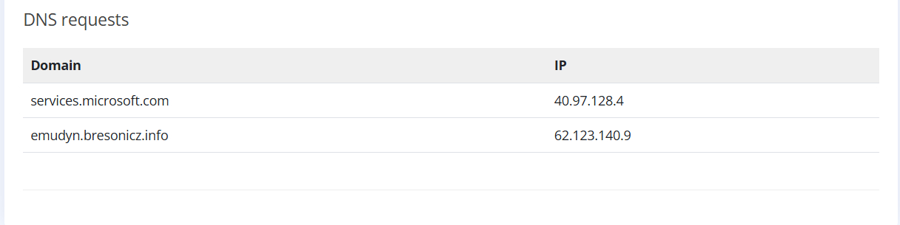

**Screenshot explanation**
> **What it shows:** DNS requests: services.microsoft.com resolves to 40.97.128.4 and emudyn.bresonicz.info resolves to 62.123.140.9.
> **Why it matters:** DNS ties the suspicious name to its IP and separates it from the Microsoft lookup.
> **Remember:** DNS logs show names before the connection happens.

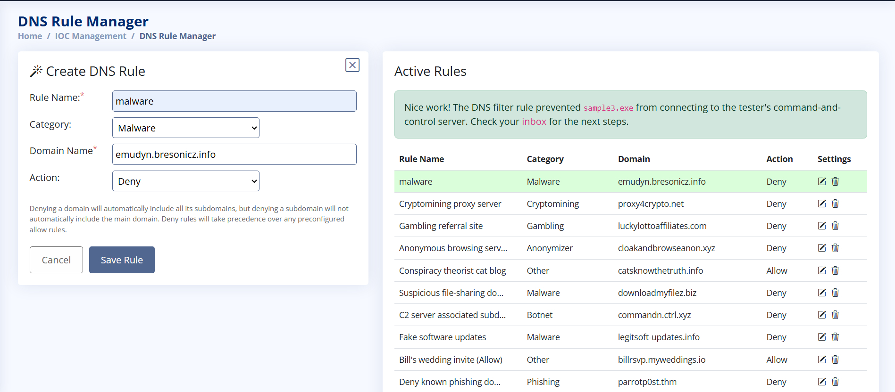

**Screenshot explanation**
> **What it shows:** DNS Rule Manager. New rule: name "malware", category Malware, domain emudyn.bresonicz.info, action Deny. The Active Rules table shows it highlighted with other deny rules and two allow rules, and a banner says the filter stopped sample3.exe reaching the tester's C2 server. Help text says denying a domain covers its subdomains, denying a subdomain does not cover the parent, and deny beats allow.
> **Why it matters:** A domain block survives IP changes, though the attacker can still register a new domain.
> **Remember:** Deny a domain = subdomains included. Deny overrides allow.

<!-- TODO: add screenshot of the next email (sample4.exe attachment), not captured. It will contain a flag, so blur it. -->

---

## Stage 4: Sample 4, host artefact (registry)

Sample 4 changes infrastructure again (new domain, new IP) and has no known-family tag. What stays the same is something it does on the host: it switches off Windows Defender real-time monitoring through a registry value. That is a host artefact.

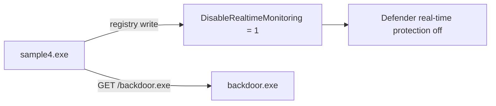

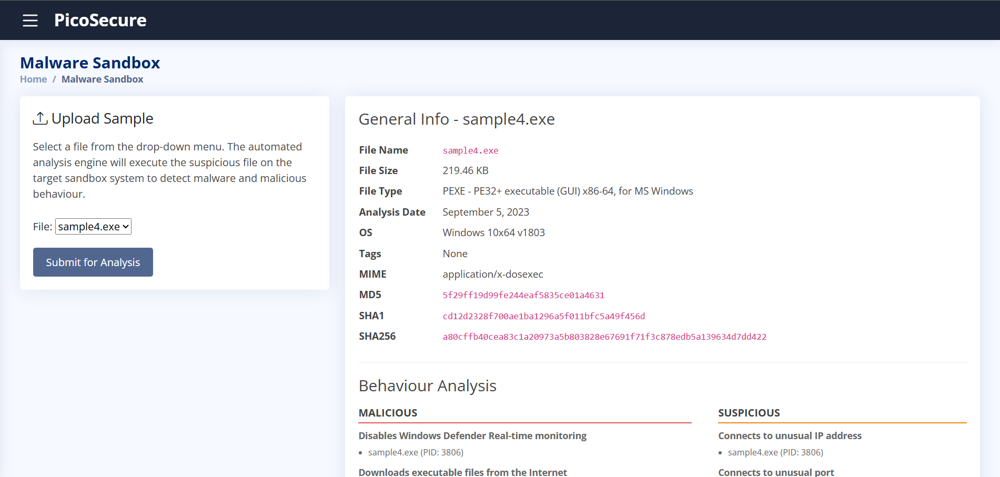

**Screenshot explanation**
> **What it shows:** General Info for sample4.exe: 219.46 KB, Tags None, MD5 5f29ff19d99fe244eaf5835ce01a4631 (PID 3806). Malicious: disables Windows Defender real-time monitoring, downloads executables from the Internet. Suspicious: unusual IP and port.
> **Why it matters:** With no family tag, behaviour is the only strong lead, and turning off the security tool stands out.
> **Remember:** "Tags: None" does not mean "safe".

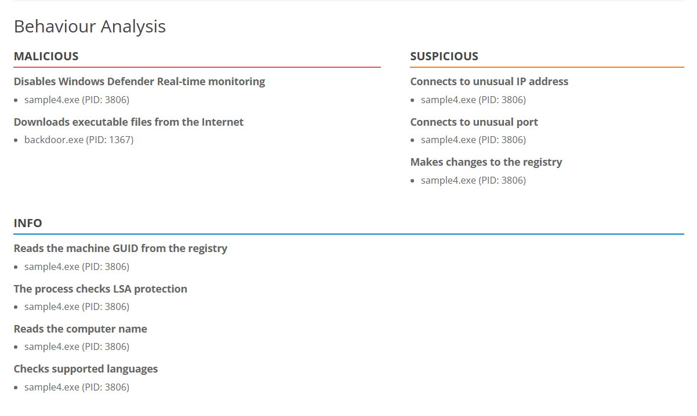

**Screenshot explanation**
> **What it shows:** Malicious: disables Defender real-time monitoring (sample4.exe, PID 3806) and downloads executables (listed under backdoor.exe, PID 1367). Suspicious: unusual IP, unusual port, makes registry changes (PID 3806). Four Info items.
> **Why it matters:** "Makes changes to the registry" plus "disables Defender" points to a registry-based defence evasion.
> **Remember:** Security-tool tampering is a high-value alert.

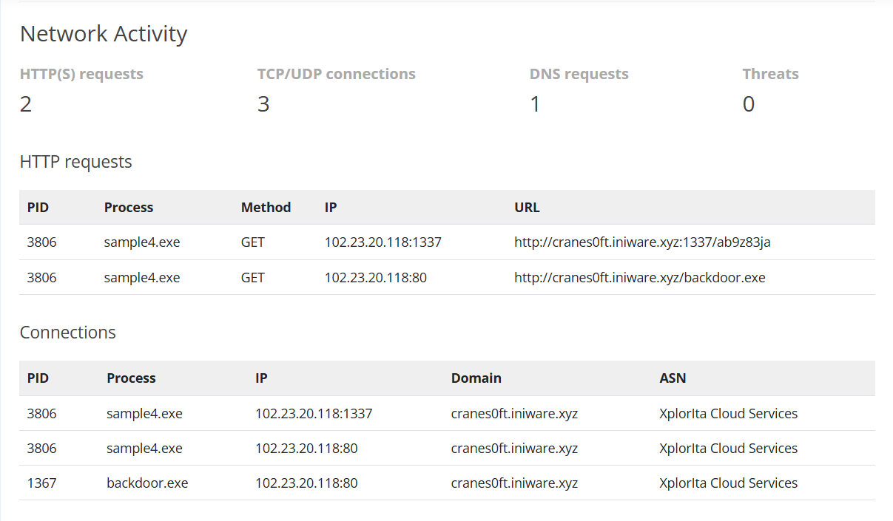

**Screenshot explanation**
> **What it shows:** 2 HTTP requests, 3 connections, 1 DNS request, Threats 0. sample4.exe (PID 3806) sends GETs to cranes0ft[.]iniware[.]xyz (102.23.20.118) on port 1337 and port 80 (/backdoor.exe). backdoor.exe (PID 1367) also connects on port 80. ASN: XplorIta Cloud Services.
> **Why it matters:** New domain and new IP, so the earlier firewall and DNS rules do not catch this sample.
> **Remember:** Network indicators rotate. Host behaviour is harder to rotate.

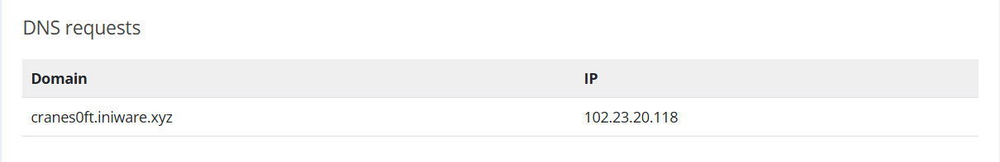

**Screenshot explanation**
> **What it shows:** One DNS request: cranes0ft.iniware.xyz resolves to 102.23.20.118.
> **Why it matters:** It links the new domain to the new IP.
> **Remember:** Domain and IP both changed between sample 3 and sample 4.

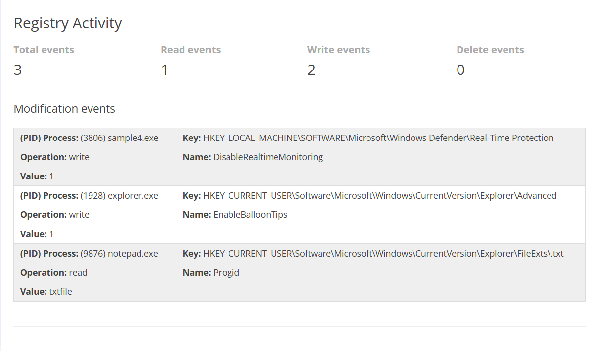

**Screenshot explanation**
> **What it shows:** Registry Activity: 3 events (1 read, 2 writes, 0 deletes). sample4.exe (PID 3806) writes DisableRealtimeMonitoring = 1 under HKLM\SOFTWARE\Microsoft\Windows Defender\Real-Time Protection. explorer.exe (PID 1928) writes EnableBalloonTips = 1 under the Explorer\Advanced key. notepad.exe (PID 9876) reads Progid under FileExts\.txt.
> **Why it matters:** Only one of the three events is a security setting changed by the suspicious process. The others are normal-looking noise.
> **Remember:** Pick the event that weakens a defence, ignore routine writes.

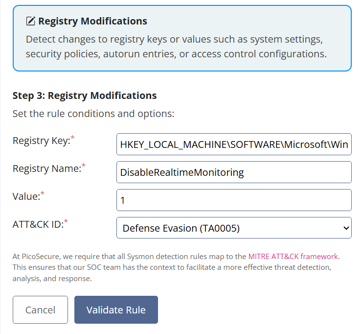

**Screenshot explanation**
> **What it shows:** Sysmon rule builder, Step 3 "Registry Modifications": Registry Key (HKLM\SOFTWARE\Microsoft\Win... truncated in the field), Registry Name DisableRealtimeMonitoring, Value 1, ATT&CK ID Defense Evasion (TA0005). A note says every Sysmon rule must map to MITRE ATT&CK.
> **Why it matters:** Detection rules carry ATT&CK context so the SOC knows what the alert means.
> **Remember:** Registry rule = key + value name + value + ATT&CK tactic.

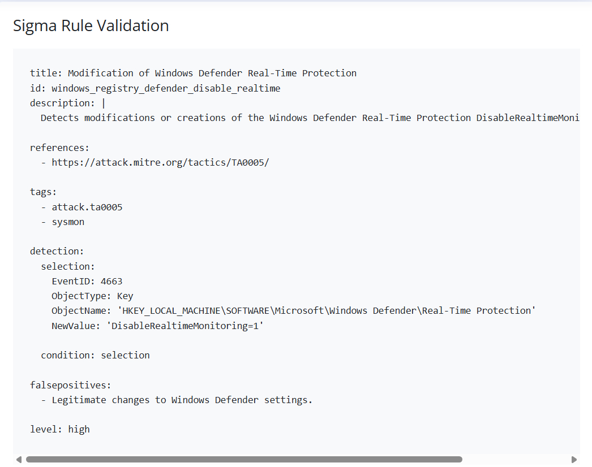

**Screenshot explanation**
> **What it shows:** Sigma Rule Validation output titled "Modification of Windows Defender Real-Time Protection", tags attack.ta0005 and sysmon, selection on EventID 4663, ObjectType Key, the Defender Real-Time Protection key and NewValue DisableRealtimeMonitoring=1. False positives listed: legitimate Defender setting changes. Level: high. The description line is cut off by the horizontal scroll.
> **Why it matters:** It shows what the rule becomes in Sigma form, and that an admin changing Defender on purpose could trigger it.
> **Remember:** Always note the likely false positive next to a rule.

<!-- TODO: add screenshot of the next email (sample5.exe attachment), not captured. It will contain a flag, so blur it. -->

---

## Stage 5: Sample 5, tool (beaconing)

Sample 5 downloads beacon.bat, which then calls home repeatedly. The sandbox counts 402 HTTP requests, almost all identical POST keep-alives. The rule here targets the beacon pattern (small fixed-size message at a fixed interval), which is a property of the attacker's tooling.

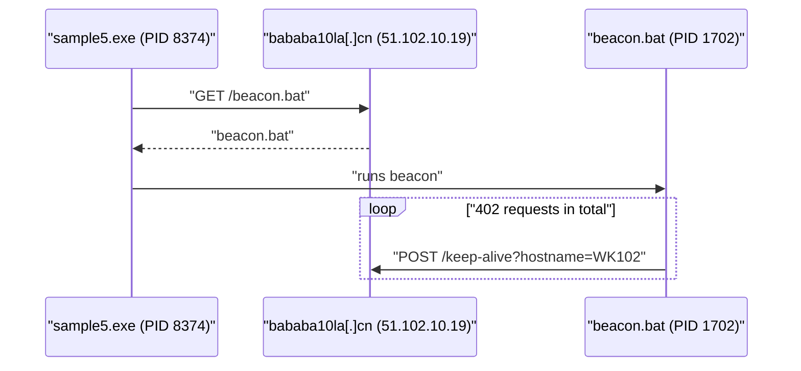

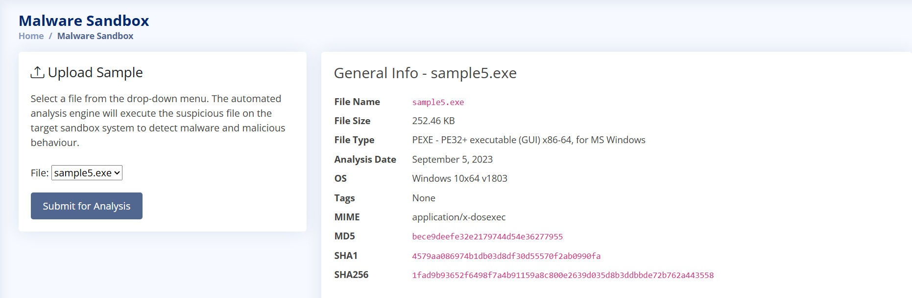

**Screenshot explanation**
> **What it shows:** General Info for sample5.exe: 252.46 KB, Tags None, MD5 bece9deefe32e2179744d54e36277955. Behaviour is not visible in this capture.
> **Why it matters:** Another new file, another new hash.
> **Remember:** Expect a fresh hash on every sample.

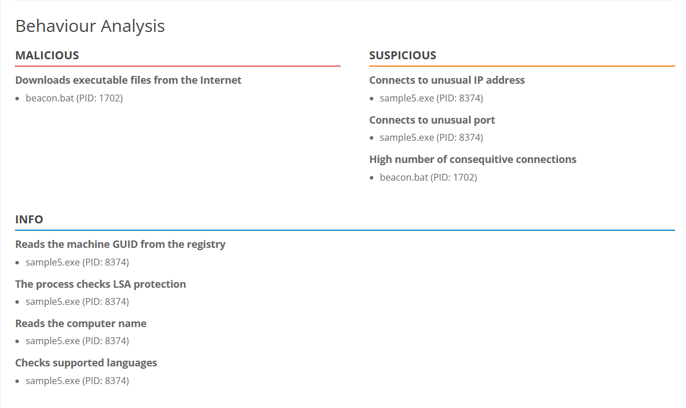

**Screenshot explanation**
> **What it shows:** Malicious: downloads executables (beacon.bat, PID 1702). Suspicious: unusual IP and port (sample5.exe, PID 8374) and "high number of consecutive connections" (beacon.bat, PID 1702). Four Info items for sample5.exe.
> **Why it matters:** The "consecutive connections" flag is the sandbox hint that something is beaconing.
> **Remember:** Beaconing = regular, repeated small call-outs.

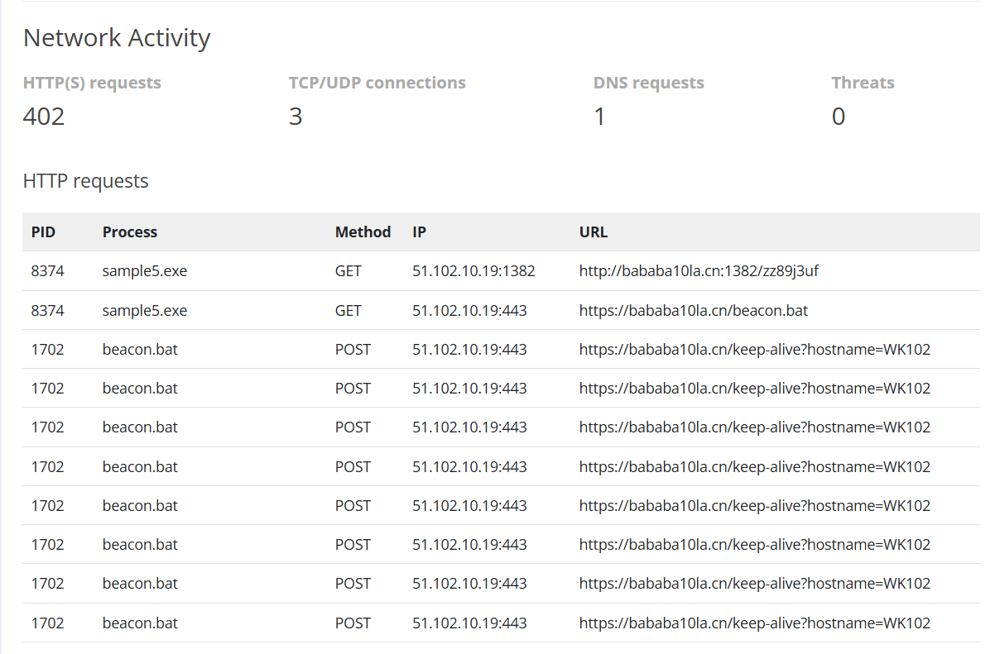

**Screenshot explanation**
> **What it shows:** 402 HTTP(S) requests, 3 connections, 1 DNS request, Threats 0. sample5.exe (PID 8374) sends a GET to bababa10la[.]cn:1382 and a GET for /beacon.bat over HTTPS. beacon.bat (PID 1702) then sends repeated POSTs to /keep-alive?hostname=WK102 on 51.102.10.19:443.
> **Why it matters:** The count and the identical rows show a beacon. The hostname parameter shows the malware reporting which machine it is on.
> **Remember:** Many identical POSTs to one URL = beacon.

Supporting views: scrolled requests, connections and DNS

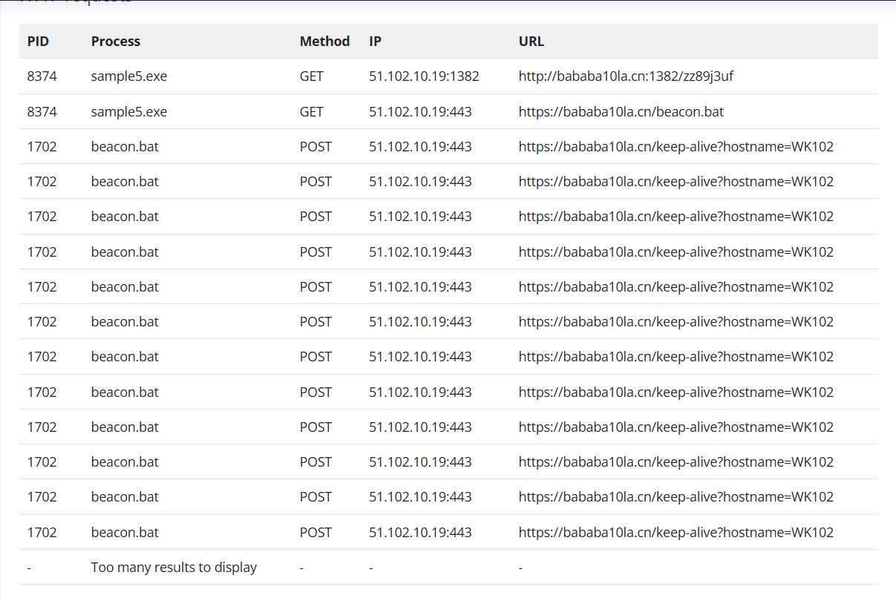

**Screenshot explanation**
> **What it shows:** A longer part of the same request table with the same beacon.bat POST rows repeated, ending in a "Too many results to display" row. It overlaps with the previous screenshot.
> **Why it matters:** The console truncates long lists, so the analyst relies on the count and the repeated pattern instead of reading every row.
> **Remember:** When a list is truncated, describe the pattern and the total.

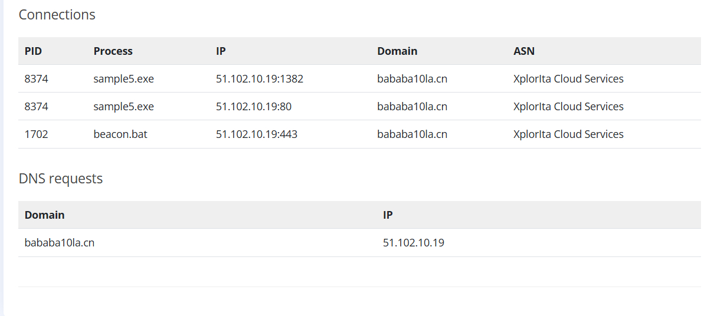

**Screenshot explanation**
> **What it shows:** Connections: sample5.exe (PID 8374) to 51.102.10.19 on ports 1382 and 80, and beacon.bat (PID 1702) to 51.102.10.19:443, all for bababa10la.cn (XplorIta Cloud Services). One DNS request: bababa10la.cn resolves to 51.102.10.19.
> **Why it matters:** It ties the beacon process to the same domain and IP as the downloader.
> **Remember:** Match each connection to the process that made it.

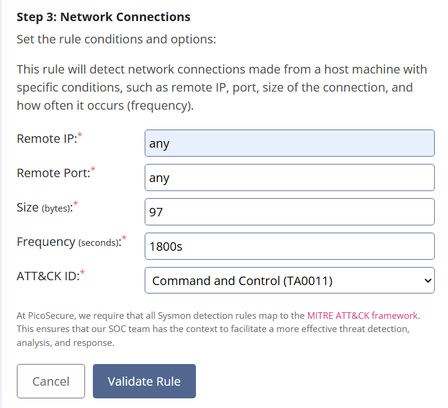

**Screenshot explanation**
> **What it shows:** Sysmon rule builder, Step 3 "Network Connections": Remote IP any, Remote Port any, Size 97 bytes, Frequency 1800 s, ATT&CK ID Command and Control (TA0011).
> **Why it matters:** The rule keys on message size and interval rather than on a specific IP or domain, so changing infrastructure would not hide it.
> **Remember:** Fixed size + fixed interval = beacon signature.

<!-- TODO: add screenshot of the network connection log that shows the 97-byte, 30-minute pattern (I only have it as pasted text). -->
<!-- TODO: add screenshot of the Sigma validation output for this rule (I only have it as pasted text). -->

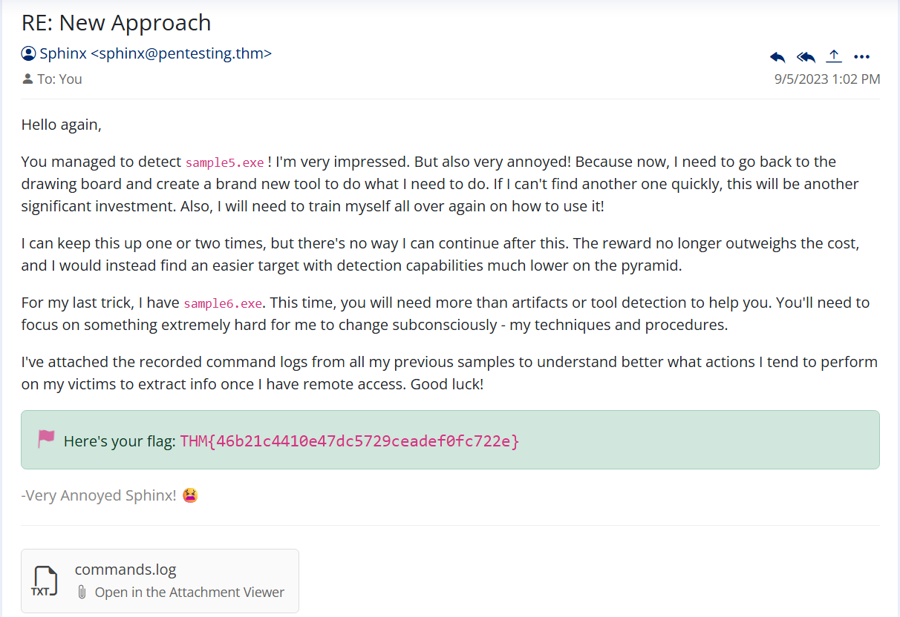

**Screenshot explanation**
> **What it shows:** Sphinx's email "RE: New Approach" (9/5/2023 1:02 PM). It says sample5.exe was detected, that a new tool would be costly, and that sample6.exe is the last attempt. It attaches commands.log and shows a flag banner (to be blurred).
> **Why it matters:** Detecting tools forces the attacker to rebuild or retrain, which costs much more than swapping a hash or IP.
> **Remember:** Tools = challenging for the attacker.

---

## Stage 6: Sample 6, TTPs

Sample 6 looks similar to earlier samples in the sandbox, but it spawns three cmd.exe processes that run discovery commands and write the output to a file in the Temp folder. The attached commands.log shows the habits of this attacker. The rule here is built on the file that the activity creates.

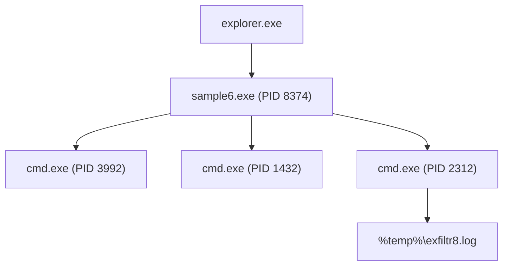

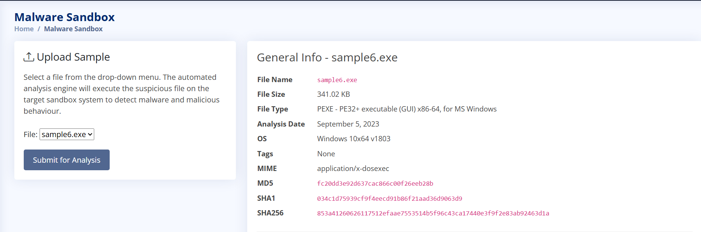

**Screenshot explanation**
> **What it shows:** General Info for sample6.exe: 341.02 KB, Tags None, MD5 fc20dd3e92d637cac866c00f26eeb28b.
> **Why it matters:** It is the largest sample so far, with a new hash and no family tag.
> **Remember:** A bigger file does not tell you what it does. Check behaviour.

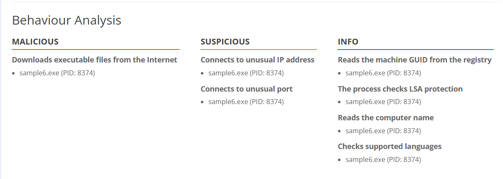

**Screenshot explanation**
> **What it shows:** Malicious: downloads executables from the Internet (sample6.exe, PID 8374). Suspicious: unusual IP and port. Info: machine GUID, LSA protection check, computer name, supported languages.
> **Why it matters:** The sandbox verdicts are almost the same as for earlier samples, so the difference must be found in the process and file activity.
> **Remember:** Same verdict labels can hide different behaviour.

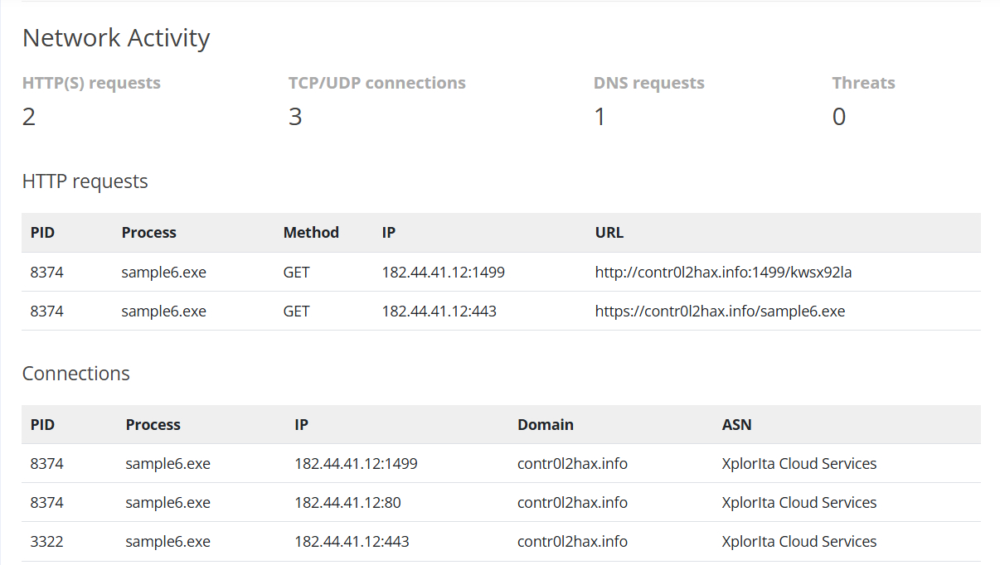

**Screenshot explanation**
> **What it shows:** 2 HTTP requests, 3 connections, 1 DNS request, Threats 0. GETs go to contr0l2hax[.]info (182.44.41.12) on port 1499 and for /sample6.exe over HTTPS. Connections show sample6.exe PID 8374 on ports 1499 and 80, and a sample6.exe entry with PID 3322 on port 443. ASN: XplorIta Cloud Services.
> **Why it matters:** The network indicators are new again, which supports moving away from IP and domain rules.
> **Remember:** Check PIDs: the same process name can appear with different IDs.

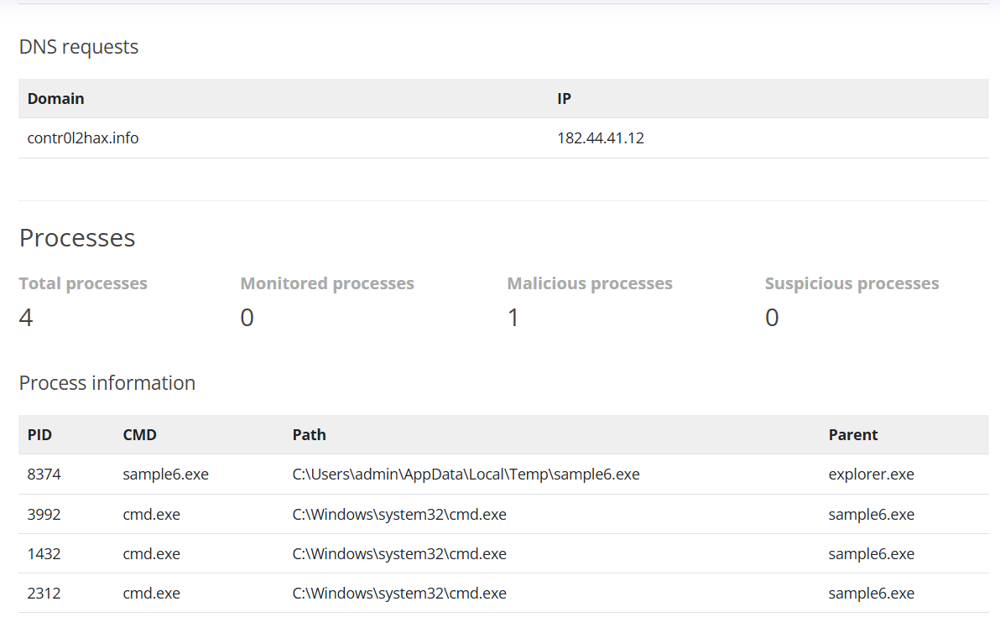

**Screenshot explanation**
> **What it shows:** DNS: contr0l2hax.info resolves to 182.44.41.12. Processes: 4 total, 0 monitored, 1 malicious, 0 suspicious. sample6.exe (PID 8374, path C:\Users\admin\AppData\Local\Temp\sample6.exe, parent explorer.exe) and three cmd.exe processes (PIDs 3992, 1432, 2312, C:\Windows\system32\cmd.exe), all with sample6.exe as parent.
> **Why it matters:** A program running from the user's Temp folder that launches several command shells is a pattern worth alerting on.
> **Remember:** Read the process tree: explorer.exe > sample6.exe > cmd.exe x3.

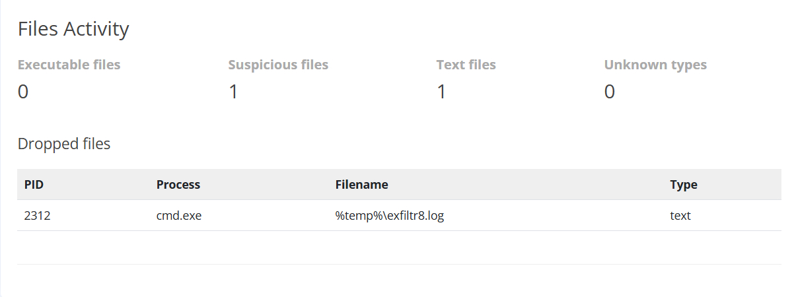

**Screenshot explanation**
> **What it shows:** Files Activity: 0 executable files, 1 suspicious file, 1 text file, 0 unknown. Dropped file: PID 2312, cmd.exe, %temp%\exfiltr8.log, type text.
> **Why it matters:** The shell writes its output into one text file, which gives a concrete artefact to detect.
> **Remember:** Output files from command shells can reveal what the attacker collected.

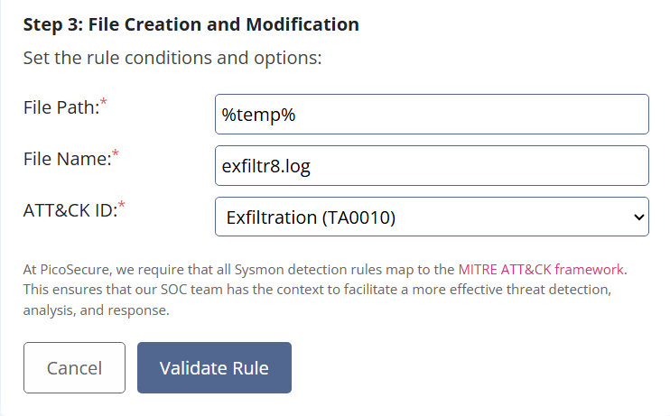

**Screenshot explanation**
> **What it shows:** Sysmon rule builder, Step 3 "File Creation and Modification": File Path %temp%, File Name exfiltr8.log, ATT&CK ID Exfiltration (TA0010).
> **Why it matters:** The rule fires when that file is created in Temp. The ATT&CK tactic chosen here is Exfiltration (see the discrepancy note below).
> **Remember:** File rule = path + file name + ATT&CK tactic.

<!-- TODO: add screenshot of commands.log in the Attachment Viewer (I only have it as pasted text). -->
<!-- TODO: add screenshot of the Sigma validation output for this rule (I only have it as pasted text). -->

### What commands.log shows (from the pasted attachment text)

The commands in the log all append their output to the same %temp% file. Grouped by purpose:

| Purpose | Commands in the log |
|---|---|
| File and folder listing | `dir` on `c:\`, `c:\Documents and Settings`, `c:\Program Files\` and `d:\` |
| Local privileged accounts | `net localgroup administrator` |
| System information | `ver`, `systeminfo` |
| Network configuration and connections | `ipconfig /all`, `netstat -ano` |
| Running services | `net start` |

Reading: this is a standard first look around a new victim machine. The sequence is an attacker habit, not a file, IP or tool, so it is much harder to change.

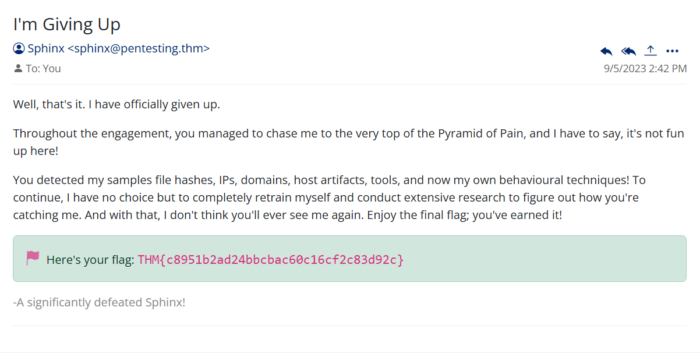

**Screenshot explanation**
> **What it shows:** Sphinx's final email "I'm Giving Up" (9/5/2023 2:42 PM). It lists what was detected (hashes, IPs, domains, host artefacts, tools, behavioural techniques) and shows a flag banner (to be blurred).
> **Why it matters:** It confirms the end of the exercise: the attacker would have to relearn their techniques.
> **Remember:** Top of the pyramid = TTPs = tough for the attacker.

---

## Room completed

**Screenshot explanation**
> **What it shows:** The Summit room header with "Room completed: 100%" and a "Share your achievement" button. The player counter reads 77,279 (it was 77,264 in the first screenshot).
> **Why it matters:** It is the completion record for the room.
> **Remember:** The counter difference is just a live number. It is not a data problem.

### Pyramid of Pain summary (my reading)

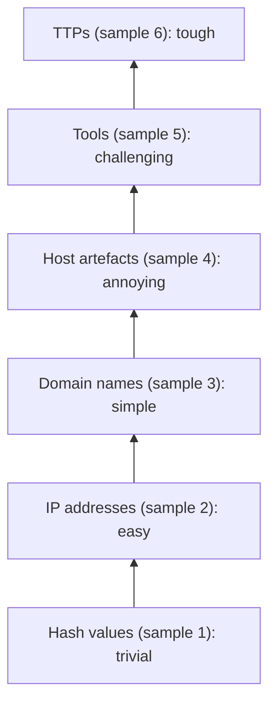

| Sample | Indicator used | Rule built | Attacker's cost to dodge |
|---|---|---|---|
| 1 | File hash | Hash blocklist entry | Recompile the file |
| 2 | Destination IP | Egress firewall deny | Rent a new public IP |
| 3 | Domain | DNS deny rule | Register a new domain |
| 4 | Defender registry change | Registry modification rule | Use a different way to disable protection |
| 5 | Beacon size and interval | Network connection rule | Rebuild or replace the tool |
| 6 | Temp output file from discovery commands | File creation rule | Change routine behaviour |

Note: Sphinx's emails describe sample 5 as a tool-level detection. The rule itself uses network telemetry (size and frequency). I follow the emails for the tier, but this is my reading.

---

## IOC table

Defanged on purpose. Sandbox IDs and PIDs come from the screenshots. Full SHA1 and SHA256 values are visible in the General Info screenshots.

| Sample | MD5 | IP | Domain / URL | Other |
|---|---|---|---|---|
| sample1.exe | cbda8ae000aa9cbe7c8b982bae006c2a | not shown | not shown | Tag Trojan.Metasploit.A |
| sample2.exe | 4d661bf605d6b0b15915a533b572a6bd | 154.35.10.113:4444 | hxxp://154.35.10[.]113:4444/uvLk8YI32 | Tag Trojan.Metasploit.A |
| sample3.exe | e31f0c62927d9d5a897b4c45e3c64dbc | 62.123.140.9 | emudyn[.]bresonicz[.]info, /backdoor.exe, :1337/kzn293la | backdoor.exe (PID 2712) |
| sample4.exe | 5f29ff19d99fe244eaf5835ce01a4631 | 102.23.20.118 | cranes0ft[.]iniware[.]xyz, /backdoor.exe, :1337/ab9z83ja | Registry: Defender `DisableRealtimeMonitoring` = 1 |
| sample5.exe | bece9deefe32e2179744d54e36277955 | 51.102.10.19 | bababa10la[.]cn, /beacon.bat, /keep-alive?hostname=WK102 | beacon.bat (PID 1702) |
| sample6.exe | fc20dd3e92d637cac866c00f26eeb28b | 182.44.41.12 | contr0l2hax[.]info, /sample6.exe, :1499/kwsx92la | File: `%temp%\exfiltr8.log` |

Benign-looking noise seen in the sandbox: connections to Microsoft Corporation addresses (40.97.128.3, 40.97.128.4, services.microsoft.com) and the explorer.exe and notepad.exe registry events.

## MITRE ATT&CK mapping

The console asks for a tactic on each Sysmon rule. The technique IDs below are my own mapping and are not shown in the room.

| Observation | Evidence (screenshot) | Tactic in console | My technique mapping |
|---|---|---|---|
| Defender real-time monitoring disabled by registry write | 21, 22, 23 | Defense Evasion (TA0005) | T1562.001 Impair Defenses: Disable or Modify Tools |
| Executables fetched over HTTP after the first stage | 14, 19, 26, 33 | not asked | T1105 Ingress Tool Transfer |
| Repeated POST keep-alives, fixed size and interval | 26, 29 | Command and Control (TA0011) | T1071.001 Application Layer Protocol: Web Protocols |
| Discovery commands writing to one Temp file | 34, 35, 36 and commands.log | Exfiltration (TA0010) | Discovery techniques (T1083, T1082, T1016, T1049, T1007, T1069.001) and T1074.001 Local Data Staging |

Console label vs evidence: the file rule is labelled Exfiltration, but what is visible is discovery output being collected into a local file. No transfer of that file out of the host is visible. I show both and use staging and discovery as my reading.

## Discrepancies and caveats

| # | Where | What I noticed |
|---|---|---|
| 1 | 23 | The Sigma rule is tagged `sysmon` but uses EventID 4663, which is a Windows Security object-access event as far as I know. Sysmon registry events are usually 12, 13 and 14. I would check this before relying on the rule. |
| 2 | Pasted file-rule Sigma text | The file rule uses Sysmon EventID 2 (which, as far as I know, is "file creation time changed", while file creation is 11). Its reference path also uses `/techniques/TA0010`, though TA0010 is a tactic ID. |
| 3 | 36 | Console tactic is Exfiltration, but the visible evidence is local staging of discovery output (see ATT&CK section). |
| 4 | 18, 25 | "Downloads executable files" is attributed to backdoor.exe and beacon.bat, but the HTTP tables show sample4.exe and sample5.exe making the download requests. The label points at the downloaded file's process. |
| 5 | 33, 34 | A sample6.exe connection is listed under PID 3322 (port 443), but the process table lists sample6.exe only as PID 8374. |
| 6 | 25, 33, 34 | sample5.exe and sample6.exe both show PID 8374. They are separate sandbox runs, so reuse is plausible, but I did not verify it. |
| 7 | 9, 14, 19, 26, 33 | "Threats: 0" is shown for every sample even though behaviour is flagged malicious. I read this counter as a separate measure that does not reflect the behaviour verdicts. |
| 8 | 17, 24, 31 | Tags show "None" for samples 4 to 6 although their behaviour is malicious or suspicious. |
| 9 | 35 | Files Activity shows 1 suspicious file and 1 text file, but only one dropped file (a text file) is listed. |
| 10 | 6 | The success banner and new blocklist row are visible, but no hash algorithm radio button looks selected in the form. |
| 11 | Pasted network log | The log is dated 2023-08-15 and uses source host 10.10.15.12, while the beacon URL names host WK102 and the sandbox runs are dated 9/5/2023. The log does not show the link between 10.10.15.12 and WK102. |
| 12 | 26 | Only part of the 402 requests is visible (see 27), so the count is read from the header, not checked row by row. |

---

## Revision Notes

### One-minute summary

- The room simulates an attacker who changes one thing after each detection.
- I detonated six samples in a sandbox and used each report to build a rule.
- Early rules (hash, IP, domain) are quick to build but quick for the attacker to dodge.
- Later rules (registry change, beacon pattern, command behaviour) cost the attacker far more.
- Each Sysmon rule must carry an ATT&CK tactic so the SOC understands what the alert means.
- The final email confirms the attacker gave up at the top of the pyramid.
- This was a simulated lab, so it counts as hands-on practice, not work experience.

### Core concepts

| Concept | Plain-English meaning | Example from this room |
|---|---|---|
| Pyramid of Pain | A ranking of indicator types by how much it hurts the attacker when you detect them | Hash at the bottom, TTPs at the top |
| Sandbox detonation | Running a suspicious file in an isolated machine to watch what it does | sample1.exe to sample6.exe reports |
| Hash blocklist | Blocking a file by its fingerprint | sample1 MD5 added to the list |
| Egress rule | A rule on traffic leaving the network | Deny to 154.35.10.113 |
| DNS deny rule | Blocking name lookups for a domain | emudyn.bresonicz.info |
| Host artefact | A trace left on the machine | `DisableRealtimeMonitoring` = 1 |
| Beaconing | Regular, small call-outs to a controller | 97-byte messages every 1800 s (rule values) |
| TTPs | The way an attacker works | Discovery commands collected into `exfiltr8.log` |
| Sigma rule | A shareable text format for a detection | Registry rule validation output |

### Cheat sheet

| Pyramid tier | Pain for attacker | Example indicator here | Rule type | Typical bypass |
|---|---|---|---|---|
| Hash values | Trivial | MD5 of sample1.exe | Hash blocklist | Recompile |
| IP addresses | Easy | 154.35.10.113 | Egress deny | New IP |
| Domain names | Simple | emudyn.bresonicz.info | DNS deny | New domain |
| Host artefacts | Annoying | Defender registry value | Registry rule | Other evasion method |
| Tools | Challenging | beacon.bat pattern | Network connection rule | New tool |
| TTPs | Tough | Discovery command habits | File / behaviour rule | Retrain operator |

Sandbox report tabs to check: General Info, Behaviour (Malicious/Suspicious/Info), Network (HTTP, connections, DNS), Registry, Processes, Files.

Sysmon and Windows event IDs (general knowledge beyond this room, as far as I know): Sysmon 1 process create, 3 network connection, 11 file create, 12/13 registry, 22 DNS query; Windows Security 4663 object access.

### Analyst workflow

1. Open the sample in the sandbox and note the file hash.
2. Read the Behaviour tab from Malicious down to Info.
3. Check Network: HTTP requests, connections, DNS. Separate known-good (for example Microsoft) from unusual.
4. Check Registry, Processes and Files for host changes.
5. Pick the indicator that stays the same across samples, as high up the pyramid as you can.
6. Build the matching rule and map it to an ATT&CK tactic.
7. Note the likely false positive and check the rule is enabled.

### Common mistakes / false-positive traps

- Stopping at the hash block and assuming the threat is handled.
- Treating "Tags: None" or "Threats: 0" as a clean result.
- Picking routine registry events (EnableBalloonTips, FileExts read) as the malicious one.
- Blocking only the IP when a domain is the stable indicator.
- Writing rules with "any" values and no size or frequency, which would match a lot of normal traffic.
- Rules that flag legitimate Defender changes by an admin.

### Self-check questions

1. Why does a hash block stop working after a recompile?

Answer
Any change to the file gives a different hash, so the old entry no longer matches.

2. What told me sample 2 went straight to an IP address?

Answer
The sandbox showed zero DNS requests and a connection to a raw IP and port.

3. Why is a domain block stronger than an IP block?

Answer
The attacker can move a server to a new IP quickly, but the domain name stays until they register a new one.

4. In the DNS Rule Manager, what does denying a domain also cover?

Answer
Its subdomains. Denying only a subdomain does not cover the parent domain.

5. Which registry value showed Defender being turned off?

Answer
`DisableRealtimeMonitoring` set to 1 under the Windows Defender Real-Time Protection key.

6. Why can the Defender registry rule produce false alarms?

Answer
An administrator may change Defender settings on purpose.

7. What two values defined the beacon rule?

Answer
A message size of 97 bytes and a frequency of 1800 seconds.

8. What sandbox label hinted at beaconing for sample 5?

Answer
"High number of consecutive connections", plus 402 HTTP requests that were mostly identical.

9. Which process was the parent of the three cmd.exe shells in sample 6?

Answer
sample6.exe, which itself was started by explorer.exe from the user's Temp folder.

10. Why is the file rule's Exfiltration label worth questioning?

Answer
The visible evidence is discovery output saved to a local file, with no outbound transfer of that file shown.

### Interview angle

**Q: What is the Pyramid of Pain and why does it matter to a SOC?**
A: It ranks indicators by how much effort the attacker needs to replace them, from hashes at the bottom to TTPs at the top. It helps me choose detections that last longer than the attacker's next small change.

**Q: A hash block worked, but the same malware appears again. What do you do?**
A: I assume the file was changed and move to indicators that survive that: the network destination, domain and host behaviour. I would still add the new hash, but not rely on it alone.

**Q: What would you look at in a sandbox report?**
A: I check behaviour severity first, then network, registry, process and file activity. I look for what repeats across samples and what changes a security setting.

---

## Key Takeaways

- Hashes are exact but fragile: they are the cheapest rule to write and the cheapest to dodge.
- IP and domain blocks help, but attackers can replace them quickly.
- Host and network patterns (registry change, beacon size and interval) last longer.
- Behaviour-based rules cost the attacker the most, because they cover habits.
- Check rule details such as event IDs and ATT&CK labels, because the console is not always consistent with the evidence.
- Always note the false-positive risk of a rule you write.

## Glossary

| Term | Meaning |
|---|---|
| Sandbox | An isolated machine used to run a suspicious file and record what it does |
| IOC | Indicator of compromise: a hash, IP, domain or other trace of an attack |
| Egress | Traffic leaving a network |
| C2 | Command and control: the attacker's server that controls the malware |
| Beacon | A small, repeated call from malware to its controller |
| Sysmon | A Windows logging tool that records process, network, file and registry events |
| Sigma | A text format for sharing detection rules across tools |
| ATT&CK | A catalogue of attacker tactics and techniques |
| TTPs | Tactics, techniques and procedures: how an attacker works |
| Staging | Collecting data in one place before moving it |

## Skills Demonstrated

`Malware Sandbox Analysis` `Pyramid of Pain` `IOC Extraction` `Hash Blocklisting` `Firewall Egress Rules` `DNS Filtering` `Sysmon Rules` `Sigma` `MITRE ATT&CK Mapping` `Beacon Detection` `Detection Engineering` `Technical Documentation`

---

[Back to all labs](../../README.md)
