# Unified Kill Chain | TryHackMe

| | |
|---|---|
| **Platform** | TryHackMe: [Unified Kill Chain](https://tryhackme.com/room/unifiedkillchain) (about 40 min) |
| **Path** | SOC Level 1 → Cyber Defence Frameworks |
| **Difficulty** | Easy (as listed on the room page) |
| **Status** | Completed, 24 Nov 2026 |
| **Environment** | Browser only: room content and a static-site practical |
| **Focus** | The 18 phases of the Unified Kill Chain, grouped as In, Through and Out, and how they relate to other frameworks |

> Flags are redacted in all screenshots.

## Contents

- [What this lab is about](#what-this-lab-is-about)
- [Objective](#objective)
- [At a Glance](#at-a-glance)
- [Task 1: Introduction](#task-1-introduction)
- [Task 2: What is a "Kill Chain"](#task-2-what-is-a-kill-chain)
- [Task 3: What is "Threat Modelling"](#task-3-what-is-threat-modelling)
- [Task 4: Introducing the Unified Kill Chain](#task-4-introducing-the-unified-kill-chain)
- [Task 5: Goal: In (Initial Foothold)](#task-5-goal-in-initial-foothold)
- [Task 6: Goal: Through (Network Propagation)](#task-6-goal-through-network-propagation)
- [Task 7: Goal: Out (Action on Objectives)](#task-7-goal-out-action-on-objectives)
- [Task 8: Practical](#task-8-practical)
- [Task 9: Conclusion](#task-9-conclusion)
- [Scenario Mapping: SOC Alerts to Phases](#scenario-mapping-soc-alerts-to-phases)
- [Revision Notes](#revision-notes)
- [Key Takeaways](#key-takeaways)
- [Glossary](#glossary)
- [Skills Demonstrated](#skills-demonstrated)

## What this lab is about

Attackers do not just "hack in". They research, prepare, trick someone, run code, stay hidden, move around and finally reach a goal, and they often loop back to earlier steps along the way. The Unified Kill Chain (UKC), published by Paul Pols in 2017 and updated in 2022, lays out 18 phases and groups them into three goals: getting In, getting Through the network, and getting Out with what they came for. This room explained each group, tested me by mapping small SOC scenarios to phases, and ended with a practical where I matched attacker actions to the right phase. A SOC L1 analyst needs this because an alert makes much more sense once you can say which phase it belongs to, what probably happened before it and what could come next.

## Objective

Understand why frameworks like the UKC matter, learn the 18 phases and the In / Through / Out grouping, and see how the UKC complements frameworks such as the Lockheed Martin Cyber Kill Chain and MITRE ATT&CK. This is hands-on practice in a simulated lab, not work experience.

## At a Glance

| Item | Detail |
|---|---|
| What was covered | Kill chain idea, threat modelling, the 18 UKC phases, the three goals (In, Through, Out), mapping scenarios to phases |
| Tools / views used | Room content, quiz boxes, and a static-site practical with multiple-choice scenario cards |
| Frameworks | Unified Kill Chain (Paul Pols), compared with the Lockheed Martin Cyber Kill Chain and MITRE ATT&CK |
| Actually did | Answered the quiz questions for Tasks 4 to 7 and worked through five practical scenario cards |
| Only read | Tasks 1 to 3 (no quiz screenshots) |
| Gaps | The practical's cards show the questions but not my chosen answers or a result screen |

## Task 1: Introduction

The room opens by saying that understanding how an attacker thinks and works is the first step to a strong defence (a good "security posture"). The UKC is introduced as a framework for exactly that. Goals: see why frameworks help, use the UKC to understand an attacker's motive and methods, learn the phases, and see how the UKC complements frameworks like MITRE ATT&CK.

<!-- TODO: add screenshot (optional: room header / task 1 view) -->

## Task 2: What is a "Kill Chain"

The term comes from the military, where a kill chain describes the stages of an attack. In cyber security it describes the path that attackers (hackers or APT groups) follow to approach and break into a target. An example is scanning a target, exploiting a web flaw and then escalating privileges. If a defender understands that path, they can put controls in place to stop it early or disrupt it.

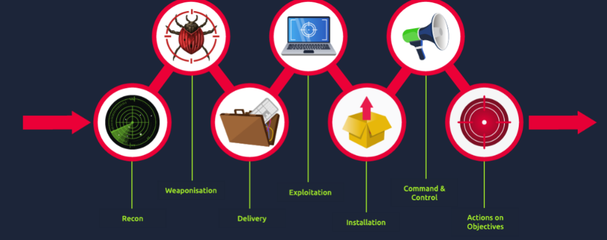

> **What it shows:** Seven round icons joined in a zig-zag with entry and exit arrows: Recon, Weaponisation, Delivery, Exploitation, Installation, Command & Control and Actions on Objectives.  
> **Why it matters:** It is the classic seven-step kill chain picture, which the UKC later builds on and extends.  
> **Remember:** A kill chain is an ordered path, and a defender wins by breaking it early.

I placed this image by content; it is the Lockheed Martin-style chain, not the 18-phase UKC.

## Task 3: What is "Threat Modelling"

Threat modelling is a set of steps to make a system more secure by identifying risk. In my words: (1) list the systems and applications that matter and what they do, for example one that is critical or holds payment data; (2) work out their weaknesses and how they could be exploited; (3) make a plan to fix or protect them; (4) set policies so the same weaknesses do not come back, such as a secure development life cycle or phishing awareness training. The result is a high-level picture of the organisation's IT assets (an asset is a piece of software or hardware) and how to deal with their weaknesses. The UKC helps because it shows possible attack surfaces and how they might be abused. STRIDE, DREAD and CVSS are other threat-modelling tools the room mentions.

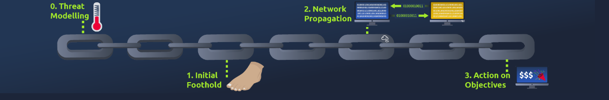

> **What it shows:** A chain with four labelled points: 0. Threat Modelling (thermometer icon), 1. Initial Foothold (foot icon), 2. Network Propagation (two computers exchanging data) and 3. Action on Objectives (laptop with $$$ symbols).  
> **Why it matters:** It places threat modelling as step zero before the three attack goals, so defence starts before the attack does.  
> **Remember:** Threat modelling is step 0; In, Through and Out are steps 1 to 3.

I placed this image by content; it was not tied to a screenshot position in the room.

<!-- TODO: add screenshot of the Task 2 and Task 3 questions if you have them -->

## Task 4: Introducing the Unified Kill Chain

The UKC was created by Paul Pols and published in 2017. It does not compete with the Lockheed Martin kill chain or MITRE ATT&CK; it complements them. It has 18 phases, covering everything from reconnaissance to data theft and the attacker's motive, and the room groups them into three areas.

| UKC strength (my summary) | Typical older framework |
|---|---|
| Modern: released in 2017 and updated in 2022 | Some, like MITRE's, date from 2013 |
| Very detailed with 18 phases | Often only a handful of phases |
| Covers the whole attack, from recon through post-exploitation to motive | Cover fewer stages |
| More realistic: phases can repeat, for example recon again after exploiting a machine to pivot elsewhere | Often treat the attack as a straight line |

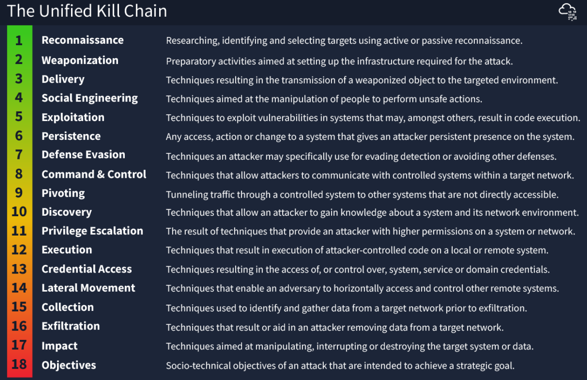

> **What it shows:** "The Unified Kill Chain" as 18 numbered phases on a green-to-red scale: 1 Reconnaissance, 2 Weaponization, 3 Delivery, 4 Social Engineering, 5 Exploitation, 6 Persistence, 7 Defense Evasion, 8 Command & Control, 9 Pivoting, 10 Discovery, 11 Privilege Escalation, 12 Execution, 13 Credential Access, 14 Lateral Movement, 15 Collection, 16 Exfiltration, 17 Impact, 18 Objectives, each with a one-line description.  
> **Why it matters:** This is the core reference list. The colour scale runs from early, low-risk phases (green) to late, damaging ones (red).  
> **Remember:** 18 phases; first is Reconnaissance, last is Objectives.

Task 4 quiz screenshot

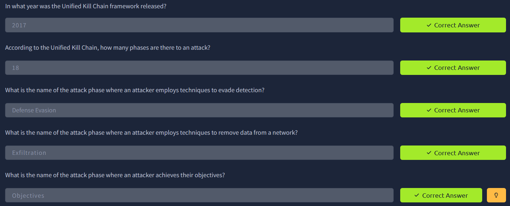

> **What it shows:** Five questions (release year, number of phases, the phase for evading detection, the phase for removing data, the phase for achieving objectives), all marked "Correct Answer": 2017, 18, Defense Evasion, Exfiltration, Objectives.  
> **Why it matters:** It checks the basic facts about the framework and three key phase names.  
> **Remember:** 2017, 18 phases, Defense Evasion, Exfiltration, Objectives.

## Task 5: Goal: In (Initial Foothold)

The "In" goal covers gaining access to a system or network and often creating a way back in (persistence). Attackers frequently combine several of these phases.

| Phase | What it means (my summary) | Example |
|---|---|---|
| Reconnaissance | Gathering information on the target, passively or actively | Finding services, employee lists, possible credentials, network layout |
| Weaponization | Setting up the infrastructure for the attack | A C2 server or a system that catches reverse shells and delivers payloads |
| Delivery | Getting the weaponised object to the target | Appears in the framework and diagram; the room text does not describe it separately |
| Social Engineering | Manipulating people to help the attack | Malicious attachment, fake login page, impersonating staff for a password reset |
| Exploitation | Abusing a weakness to run code | Reverse shell uploaded to a web app, abusing a script, a web app flaw |
| Persistence | Keeping access to the foothold | A service for regaining access, adding the host to C2, a backdoor triggered by an action |
| Defence Evasion | Avoiding defences | Getting past WAFs, firewalls, antivirus and IDS |
| Command & Control | Communication between the attacker and the victim | Running commands, stealing data, pivoting from the controlled host |
| Pivoting | Reaching systems not directly reachable | Using a public web server to attack internal machines |

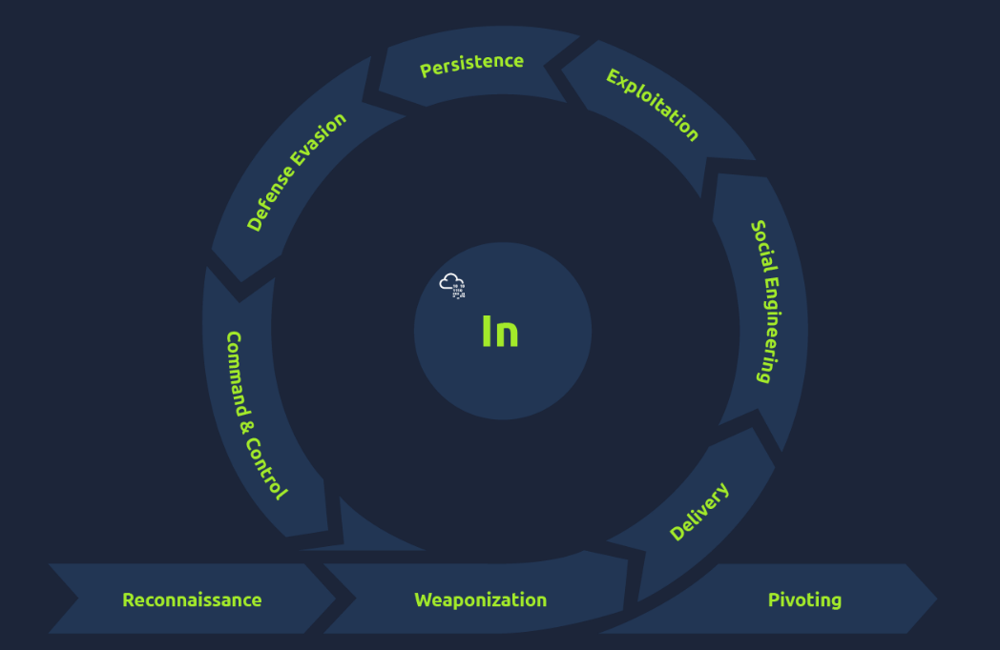

> **What it shows:** A circular diagram with the centre label "In" and nine phases: Reconnaissance, Weaponization, Delivery, Social Engineering, Exploitation, Persistence, Defense Evasion, Command & Control and Pivoting.  
> **Why it matters:** The loop shape shows that these phases repeat and overlap instead of running once in a line.  
> **Remember:** "In" has nine phases and ends with Pivoting.

Task 5 quiz screenshot

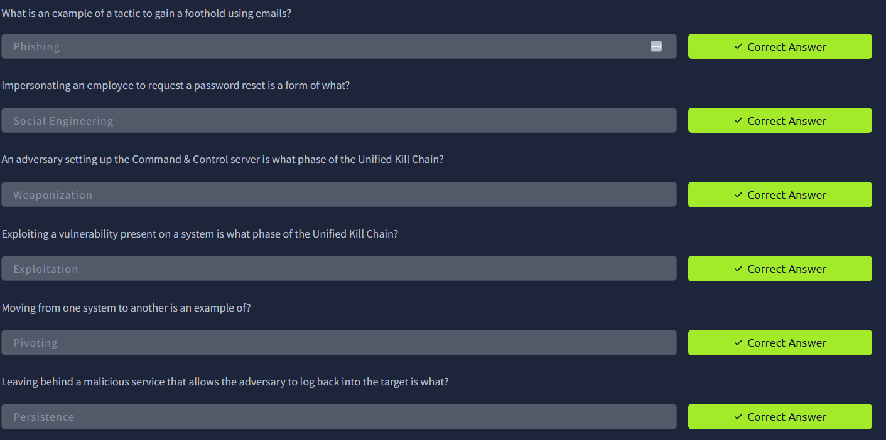

> **What it shows:** Six questions, all marked "Correct Answer": an email tactic for a foothold (Phishing), impersonating an employee for a password reset (Social Engineering), setting up a C2 server (Weaponization), exploiting a vulnerability (Exploitation), moving from one system to another (Pivoting), and leaving a malicious service to log back in (Persistence).  
> **Why it matters:** It trains the key distinction that setting up C2 is Weaponization, while using it is Command & Control.  
> **Remember:** Prepare the server = Weaponization; talk to the victim through it = Command & Control.

## Task 6: Goal: Through (Network Propagation)

Once the attacker has a foothold, the "Through" goal is about gaining more access and privileges. They set up a base on one machine, learn about the internal network, and move onwards.

| Phase | What it means (my summary) |
|---|---|
| Pivoting | Use the compromised host as a staging point and tunnel into the internal network; also a distribution point for later malware |
| Discovery | Learn about the system and network: accounts, permissions, software, files, shares, configuration |
| Privilege Escalation | Gain higher rights (SYSTEM/root, local admin, admin-like or specific-access accounts) using flaws and misconfigurations |
| Execution | Run malicious code from the pivot host: trojans, C2 scripts, malicious links, scheduled tasks |
| Credential Access | Steal usernames and passwords (keylogging, credential dumping), which also makes the attacker look legitimate |
| Lateral Movement | Use credentials and privileges to jump to other systems, as stealthily as possible |

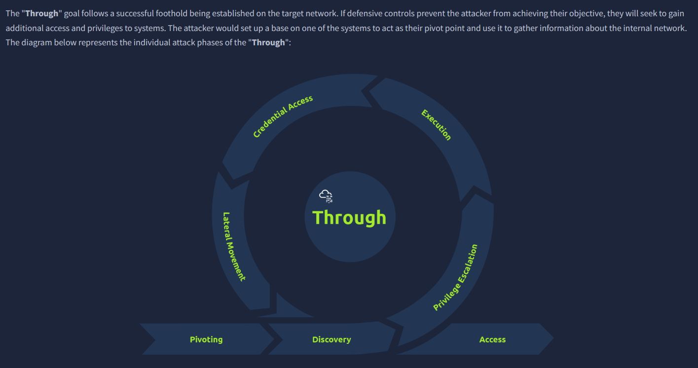

> **What it shows:** An introduction to the "Through" goal and a circular diagram with the centre label "Through" and the labels Credential Access, Execution, Privilege Escalation, Lateral Movement, Pivoting, Discovery and a bottom arrow reading "Access".  
> **Why it matters:** It shows how the phases feed each other: discover, escalate, steal credentials, move on, repeat.  
> **Remember:** Escalation and credential access work hand in hand, and attackers loop through these.

Task 6 quiz screenshot

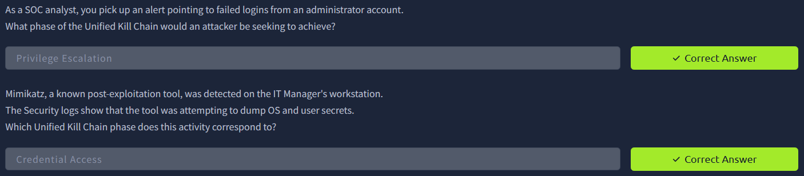

> **What it shows:** Two scenario questions, both marked "Correct Answer": failed logins from an administrator account (Privilege Escalation) and Mimikatz dumping OS and user secrets (Credential Access).  
> **Why it matters:** Real alerts arrive like this: a symptom, and the analyst must name the phase.  
> **Remember:** Admin login attempts suggest privilege escalation; Mimikatz means credential access.

## Task 7: Goal: Out (Action on Objectives)

The "Out" goal is where the attacker has access to the critical assets and acts on their goals, usually damaging confidentiality, integrity or availability (the CIA triad).

| Phase | What it means (my summary) |
|---|---|
| Collection | Gather the data of interest from drives, browsers, audio, video and email (hurts confidentiality, leads to exfiltration) |
| Exfiltration | Steal the data, often compressed and encrypted to avoid detection, using the earlier C2 channel or tunnel |
| Impact | Manipulate, interrupt or destroy assets: account removal, disk wipes, ransomware, defacement, DoS (hurts integrity and availability) |
| Objectives | The attacker's strategic goal, for example ransom for money, or leaking private data to damage a reputation |

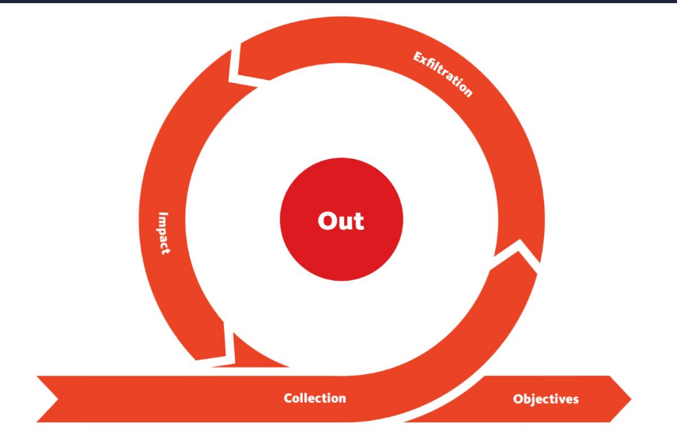

> **What it shows:** A red circular diagram with the centre label "Out" and four phases: Collection, Exfiltration, Impact and Objectives.  
> **Why it matters:** The loop shows that the final goals cluster together and may repeat, such as collecting more data after finding a new store.  
> **Remember:** "Out" has four phases: collect, exfiltrate, impact, objectives.

Task 7 quiz screenshot

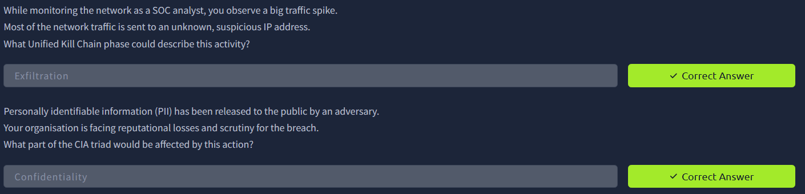

> **What it shows:** Two scenario questions, both marked "Correct Answer": a large traffic spike to an unknown IP (Exfiltration) and PII released to the public with reputational damage (Confidentiality).  
> **Why it matters:** It links a network symptom to a phase and a data-loss event to the CIA triad.  
> **Remember:** Big outbound spike to an unknown IP = exfiltration; leaked PII = confidentiality.

## Task 8: Practical

The practical is a static website where each card describes an attacker's action and I pick the matching UKC phase. Completing all cards reveals a flag, which is not shown here. The screenshots show the five cards I captured (the card text is cut off at the bottom of some). No chosen answers or result screen are visible in them, so the mapping below is my reading of the correct phase.

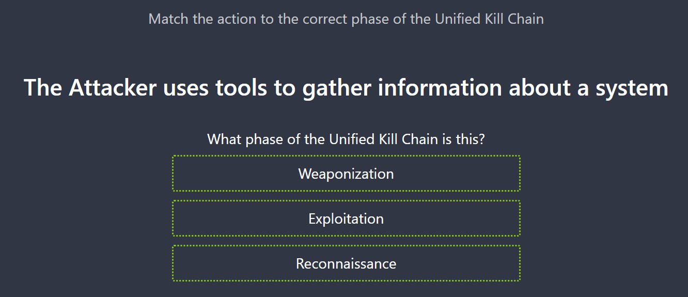

> **What it shows:** A card: the attacker uses tools to gather information about a system. Options: Weaponization, Exploitation, Reconnaissance.  
> **Why it matters:** Information gathering is the first phase of the chain.  
> **Remember:** Gathering information = Reconnaissance.

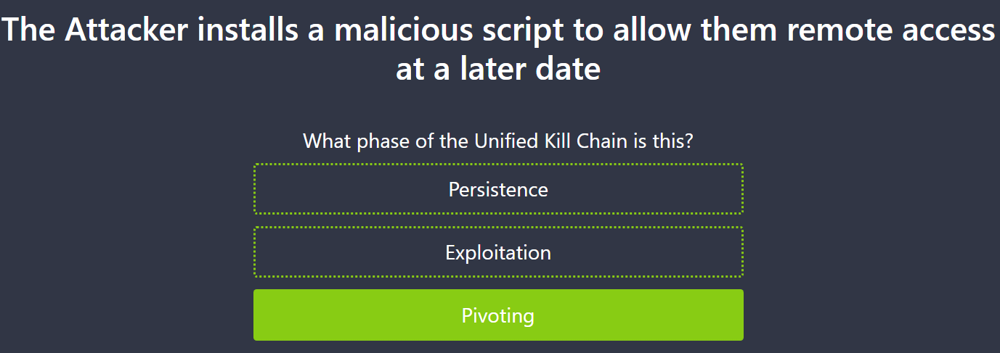

> **What it shows:** A card: the attacker installs a malicious script to allow remote access at a later date. Options: Persistence, Exploitation, Pivoting. The Pivoting option is highlighted in solid green.  
> **Why it matters:** Staying in for later is persistence. The solid highlight on Pivoting may be a hover or a click state, so this screenshot does not confirm my answer.  
> **Remember:** Access for later = Persistence.

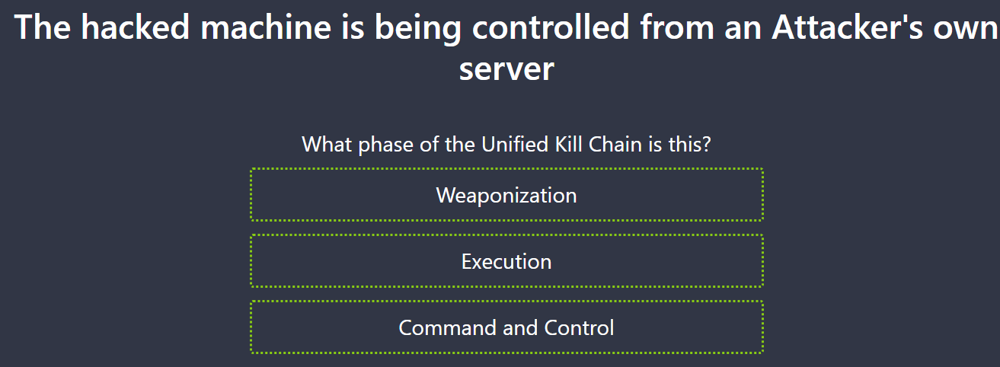

> **What it shows:** A card: the hacked machine is controlled from the attacker's own server. Options: Weaponization, Execution, Command and Control.  
> **Why it matters:** Using the attacker's server to control a victim is C2, not the earlier set-up work.  
> **Remember:** Controlling the victim remotely = Command and Control.

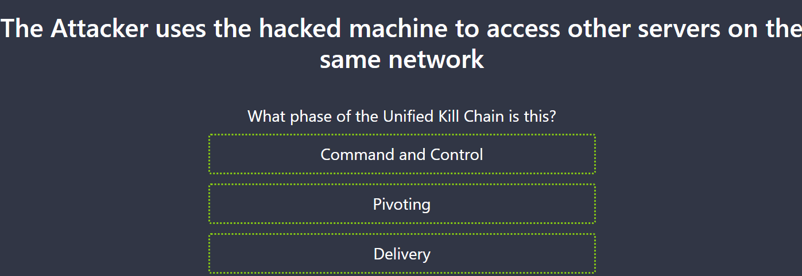

> **What it shows:** A card: the attacker uses the hacked machine to access other servers on the same network. Options: Command and Control, Pivoting, Delivery.  
> **Why it matters:** Using one host as a stepping stone to others is pivoting.  
> **Remember:** Hop from one host to others = Pivoting.

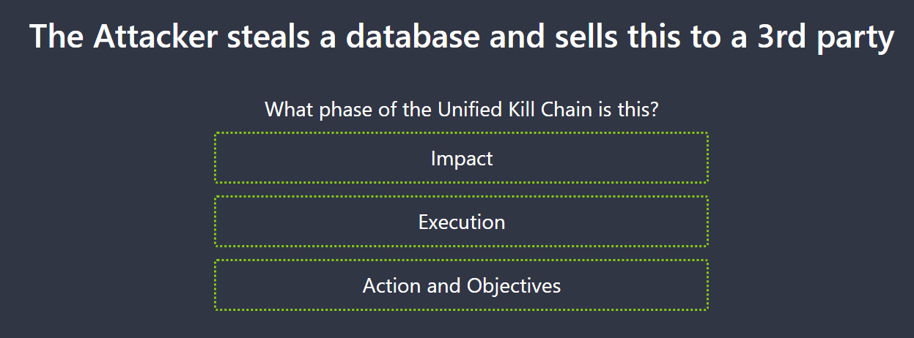

> **What it shows:** A card: the attacker steals a database and sells it to a third party. Options: Impact, Execution, Action and Objectives.  
> **Why it matters:** Selling stolen data is the attacker's goal. The option is worded "Action and Objectives" here, while the UKC list calls the phase "Objectives".  
> **Remember:** Cashing in on stolen data = the objective.

| Card | Scenario (my words) | My reading of the phase |
|---|---|---|
| 1 | Using tools to learn about a system | Reconnaissance |
| 2 | Leaving a script for later remote access | Persistence |
| 3 | Victim machine controlled from the attacker's server | Command and Control |
| 4 | Hacked machine used to reach other servers | Pivoting |
| 5 | Database stolen and sold | Action and Objectives (Objectives) |

<!-- TODO: add screenshot of the practical's completed or result state (without the flag) -->

## Task 9: Conclusion

The room closes by saying that frameworks like the UKC help identify risk and plan defences by rebuilding the steps an attacker took. It positions the UKC as a modern extension of other frameworks, such as Lockheed Martin's Cyber Kill Chain, and points to related rooms (Principles of Security, Pentesting Fundamentals and Cyber Kill Chain).

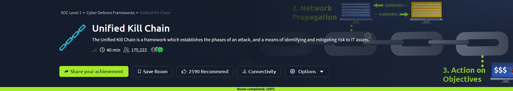

> **What it shows:** The Unified Kill Chain header (SOC Level 1 > Cyber Defence Frameworks, 40 min) with "Share your achievement" and a green bar reading "Room completed: 100%".  
> **Why it matters:** It is the completion record for this write-up.  
> **Remember:** Simulated lab: hands-on practice, not job experience.

## Scenario Mapping: SOC Alerts to Phases

The room has no console alerts or logs. These four are the quiz scenarios, written as a quick drill. Evidence is only what the scenario states; the rest is my reading.

| Scenario (from the quiz) | Phase | Why | What I would check next (recommendation, not shown in the room) |
|---|---|---|---|
| Failed logins from an administrator account | Privilege Escalation | The attacker is trying to get high-privilege access | Source IP and time, whether any login succeeded, and other accounts targeted from the same source |
| Mimikatz found on an IT manager's workstation, dumping OS and user secrets | Credential Access | The tool exists to steal credentials; maps to ATT&CK OS Credential Dumping (T1003) | Isolate the host, reset exposed credentials, and look for lateral movement from that host |
| Large traffic spike to an unknown, suspicious IP | Exfiltration | A large outbound transfer suggests data leaving | Destination reputation, what data and which host, whether it follows collection or staging |
| PII released publicly with reputational damage | Objectives / Impact (Confidentiality hit) | Public leak harms confidentiality | Confirm scope, notify the right teams, and trace back how the data was taken |

## Revision Notes

**One-minute summary**

- The UKC (Paul Pols, 2017, updated 2022) has 18 phases and complements the Lockheed Martin chain and MITRE ATT&CK.
- Three goals: In (initial foothold), Through (network propagation), Out (action on objectives); Threat modelling is step 0.
- Pivoting appears in both In and Through; counting it once gives 18 phases (9 + 5 + 4).
- Phases repeat: after exploiting a host an attacker often does recon again to pivot.
- Setting up a C2 server is Weaponization; using it is Command & Control.
- Alerts map to phases: failed admin logins (privilege escalation), Mimikatz (credential access), outbound spike (exfiltration).
- Naming the phase tells you what came before and what may come next.

**Core concepts**

| Concept | Plain-English meaning | Example from this room |
|---|---|---|
| Kill chain | Ordered stages of an attack | Seven-step chain (Task 2) |
| Threat modelling | Finding and reducing risk before an attack | Step 0 in the chain |
| In / Through / Out | The three attacker goals | Foothold, propagation, action on objectives |
| Pivoting | Using a host to reach others | Public web server to internal servers |
| Persistence | Keeping access | Malicious service, backdoor |
| Credential dumping | Pulling passwords or secrets from memory | Mimikatz |
| CIA triad | Confidentiality, integrity, availability | PII leak hits confidentiality |

**Cheat sheet: the 18 phases by goal, with the ATT&CK tactic the room links to each**

| Goal | Phase | ATT&CK tactic named in the room |
|---|---|---|
| In | Reconnaissance | TA0043 Reconnaissance |
| In | Weaponization | TA0001 (Initial Access) |
| In | Delivery | not described in the room text |
| In | Social Engineering | TA0001 (Initial Access) |
| In | Exploitation | TA0002 (Execution) |
| In | Persistence | TA0003 Persistence |
| In | Defence Evasion | TA0005 Defense Evasion |
| In | Command & Control | TA0011 Command and Control |
| In / Through | Pivoting | TA0008 (Lateral Movement) |
| Through | Discovery | TA0007 Discovery |
| Through | Privilege Escalation | TA0004 Privilege Escalation |
| Through | Execution | TA0002 Execution |
| Through | Credential Access | TA0006 Credential Access |
| Through | Lateral Movement | TA0008 Lateral Movement |
| Out | Collection | TA0009 Collection |
| Out | Exfiltration | TA0010 Exfiltration |
| Out | Impact | TA0040 Impact |
| Out | Objectives | no ATT&CK tactic named |

The table shows that several UKC phases share one ATT&CK tactic (for example Weaponization and Social Engineering both point to TA0001), so the mapping is not one-to-one. Tactic names beside the IDs are from my knowledge of ATT&CK.

```mermaid
flowchart LR
    subgraph IN["In: Initial Foothold"]
        R["Reconnaissance"] --> W["Weaponization"] --> D["Delivery"] --> SE["Social Engineering"] --> EX["Exploitation"] --> P["Persistence"] --> DE["Defense Evasion"] --> C2["Command and Control"] --> PV["Pivoting"]
    end
    subgraph THROUGH["Through: Network Propagation"]
        DI["Discovery"] --> PE["Privilege Escalation"] --> EXE["Execution"] --> CA["Credential Access"] --> LM["Lateral Movement"]
    end
    subgraph OUT["Out: Action on Objectives"]
        CO["Collection"] --> EXF["Exfiltration"] --> IM["Impact"] --> OB["Objectives"]
    end
    PV --> DI
    LM --> CO
    LM -.->|"can loop back: recon, pivot again"| R
```

**Analyst workflow (what this room teaches)**

1. Take the alert or event and name its UKC phase.
2. Ask what must have happened before it (earlier phases) and what could come next.
3. Remember phases can repeat; check for pivoting and fresh recon.
4. Look for the attacker's motive, not only their tools.
5. Choose where the chain can be broken soonest.
6. Map to MITRE ATT&CK techniques for precise reporting.
7. Feed the findings back into threat modelling.

**Common mistakes / false-positive traps**

- Treating the chain as a straight line; real attacks loop.
- Mixing up Weaponization (preparing infrastructure) with Command & Control (using it).
- Mixing up Execution (a Through phase) with Exploitation (an In phase).
- Reading the practical's "Action and Objectives" as a separate phase from "Objectives".
- Assuming one UKC phase equals one ATT&CK tactic.
- Missing the "Delivery" phase because the room text does not describe it.

**Self-check questions**

1. Who published the Unified Kill Chain, and when?

Answer
Paul Pols, in 2017 (updated in 2022).

2. How many phases does the UKC have?

Answer
18.

3. Name the three goals.

Answer
In (initial foothold), Through (network propagation), Out (action on objectives).

4. Which phase appears in both In and Through?

Answer
Pivoting.

5. Setting up a command and control server is which phase?

Answer
Weaponization.

6. What UKC phase does Mimikatz dumping secrets belong to?

Answer
Credential Access.

7. Failed logins from an admin account suggest which phase?

Answer
Privilege Escalation.

8. A large outbound traffic spike to an unknown IP suggests which phase?

Answer
Exfiltration.

9. Which part of the CIA triad is hit when PII is leaked publicly?

Answer
Confidentiality.

10. Why is the UKC seen as more realistic than older kill chains?

Answer
It has more phases and allows phases to repeat, like recon again after exploiting a machine.

**Interview angle**

- *What is the Unified Kill Chain and how is it different from the Lockheed Martin kill chain?* It is an 18-phase model grouped into In, Through and Out, and it allows phases to repeat. The Lockheed model has seven phases and is more linear and perimeter focused.
- *How would you use the UKC when you get an alert?* I would name the phase, then look at what likely came before and what could come next. That tells me what to check and how urgent the alert is.
- *How does the UKC relate to MITRE ATT&CK?* They complement each other. The UKC gives the overall attack story and ATT&CK gives detailed tactics and techniques to report against.

## Key Takeaways

- The UKC shows the whole attack story, from recon to the attacker's goal, in 18 phases.
- In, Through and Out give a simple way to talk about the attack's progress.
- Phases repeat, so a new alert may be an old phase happening again on a new host.
- Naming the phase of an alert tells me what to look for before and after it.
- The UKC and ATT&CK work together; the mapping between them is not one-to-one.
- Threat modelling comes first: know your assets and weaknesses before attackers do.

## Glossary

| Term | Meaning (my words) |
|---|---|
| Kill chain | The ordered stages of an attack |
| UKC | Unified Kill Chain, an 18-phase attack model |
| Threat modelling | Identifying risks and planning to reduce them |
| Asset | A piece of software or hardware in IT |
| Initial foothold | The first access an attacker gets |
| Pivoting | Using a compromised host to reach others |
| Persistence | Keeping access after the first compromise |
| Lateral movement | Moving between systems inside a network |
| Credential dumping | Extracting passwords or secrets from a system |
| Exfiltration | Stealing data out of the network |
| CIA triad | Confidentiality, integrity and availability |
| ATT&CK | MITRE's knowledge base of attacker tactics and techniques |

## Skills Demonstrated

`Unified Kill Chain` `Attack phase mapping` `Threat modelling basics` `MITRE ATT&CK alignment` `Alert-to-phase analysis` `CIA triad` `Write-up documentation`

---

[Back to all labs](../../README.md)
