# Phishing Analysis Fundamentals | TryHackMe

| Item | Details |
|------|---------|
| **Platform** | [TryHackMe: Phishing Analysis Fundamentals](https://tryhackme.com/room/phishingemails1tryoe) |
| **Path** | SOC Level 1 → Phishing Analysis |
| **Difficulty** | Easy (30 min) |
| **Status** | Completed, 27 Nov 2026 (room header shows 100%) |
| **Environment** | Browser-based Linux VM (Thunderbird, file manager) plus CyberChef |
| **Focus** | Reading the parts of an email: address, delivery path, headers, body and attachments |

> Flags are redacted in all screenshots.

## Contents

1. [What this lab is about](#what-this-lab-is-about)
2. [Objective](#objective)
3. [At a Glance](#at-a-glance)
4. [Starting the room](#starting-the-room)
5. [The email address](#the-email-address)
6. [How an email travels](#how-an-email-travels)
7. [Email headers](#email-headers)
8. [Email body and attachments](#email-body-and-attachments)
9. [A phishing example to compare against](#a-phishing-example-to-compare-against)
10. [Practical: the Home Depot email](#practical-the-home-depot-email)
11. [Triage Summary](#triage-summary)
12. [Revision Notes](#revision-notes)
13. [Key Takeaways](#key-takeaways)
14. [Glossary](#glossary)
15. [Skills Demonstrated](#skills-demonstrated)

---

## What this lab is about

Most phishing triage starts with an email that looks fine at first glance, so you need to know what the pieces of an email are before you can say which one is lying. This room walks through those pieces in order: the address, the route a message takes between mail servers, the headers, the body and finally attachments. I followed along in a Linux VM with Thunderbird and then in CyberChef. What stuck with me is that the part you see in your inbox (display name, nice logo, big button) is the easiest part for an attacker to fake, and the parts underneath (Reply-To, Received, the real link in the HTML) are where the story usually falls apart. As a SOC L1 analyst I'll be asked to make a call on emails like this every day, so the habit of opening the source instead of trusting the preview is the main thing I'm taking away.

## Objective

Learn what each part of an email means and where to look for signs of a phishing attempt, then use that to check one sample email in the VM and answer questions about its sender and headers.

## At a Glance

| Area | Detail |
|------|--------|
| What was covered | Email address structure, SMTP/POP3/IMAP, header fields, message source, text vs HTML bodies, attachments, one hands-on sample |
| Tools / views used | Thunderbird (header view and Message Source), file manager, CyberChef (From Base64, Render PDF) |
| Frameworks | None used in the room. MITRE ATT&CK noted only once, loosely, in the practical |
| Investigated | One sample email (Home Depot lookalike): sender, originating IP, mail server that wrote the authentication header |
| Only seen | Worked examples for headers, HTML and attachments (shown in the room's own illustrations) |

## Starting the room

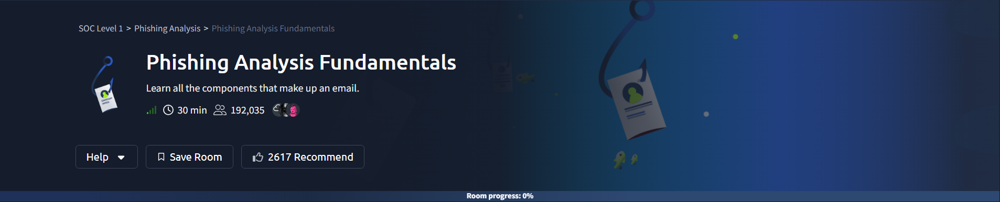

> **What it shows:** Room "Phishing Analysis Fundamentals" under SOC Level 1 > Phishing Analysis, 30 min, with room progress at 0%.
> **Why it matters:** It is my starting point, so together with the final header it shows the room was completed from scratch.
> **Remember:** Module = Phishing Analysis, topic = parts of an email.

<!-- TODO: add screenshot of the intro task page if I want to show the room's own setup text -->

## The email address

An address has three bits: the mailbox name, the @, and the domain. The mailbox name says who, the domain says which mail system. When I check a sender, the domain is the part I look at hardest, because the name in front of it can be anything.

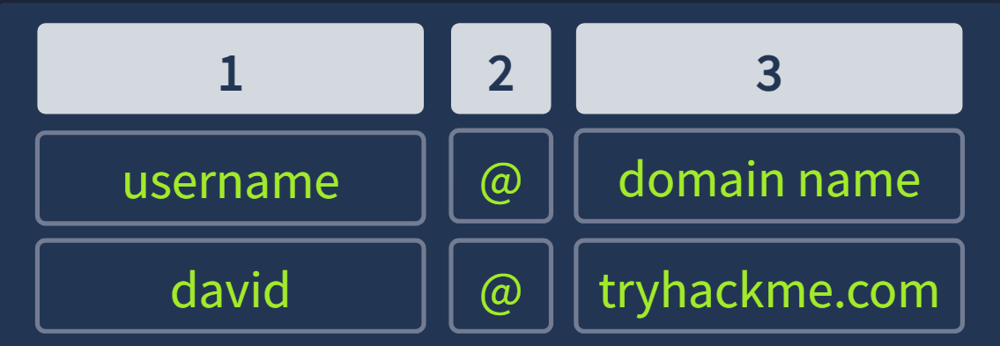

> **What it shows:** An address split into three labelled boxes: 1 username, 2 the @ symbol, 3 domain name, with the example david@tryhackme.com underneath.
> **Why it matters:** Splitting an address like this is the first step in judging a sender. Look-alike domains only show up if you read the domain part on its own.
> **Remember:** username @ domain. Judge the domain.

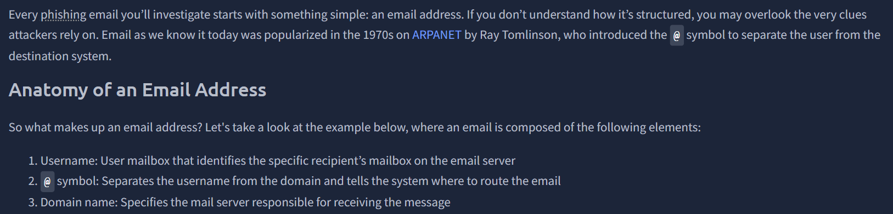

> **What it shows:** The "Anatomy of an Email Address" text. It places modern email in the 1970s on ARPANET, credits Ray Tomlinson with the @ symbol, and lists username, @ and domain name as the three parts.
> **Why it matters:** It backs up the diagram above: the @ separates the user from the system that receives the mail.
> **Remember:** Ray Tomlinson, ARPANET, 1970s, @ separates user and destination.

## How an email travels

Roughly: my mail client hands the message to my mail server (SMTP), that server asks DNS where the recipient's domain receives mail, then passes the message on, and the recipient later pulls it down with POP3 or IMAP. Knowing this helps because every hop can leave a line in the headers.

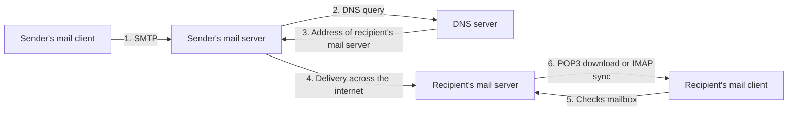

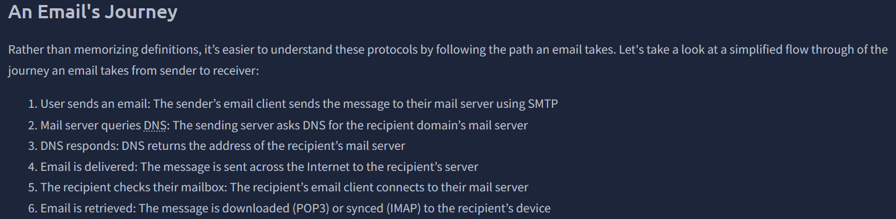

> **What it shows:** A six-step list: the client sends with SMTP, the server queries DNS, DNS replies, the email is delivered to the recipient's server, the recipient checks the mailbox, and the message is retrieved with POP3 or synced with IMAP.
> **Why it matters:** The order explains where header entries come from, since each server in the middle can add its own line.
> **Remember:** Send (SMTP) → find (DNS) → deliver → collect (POP3/IMAP).

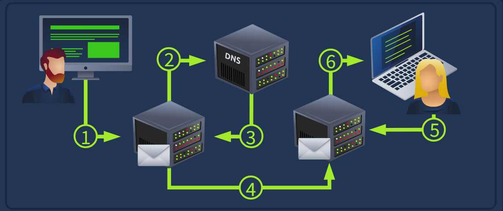

> **What it shows:** The same journey as a picture: sender's computer, mail server, a DNS server, the recipient's mail server and the recipient's laptop, joined by arrows numbered 1 to 6.
> **Why it matters:** A picture of the path makes it easier to see which hop a header line belongs to.
> **Remember:** Two mail servers in the middle, DNS is only used to find the second one.

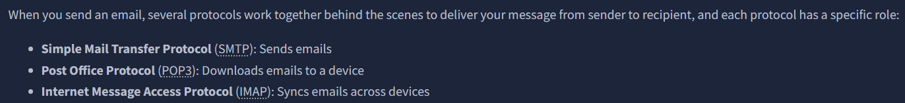

> **What it shows:** SMTP sends emails, POP3 downloads emails to a device, IMAP syncs emails across devices.
> **Why it matters:** It gives each protocol one job, which makes "which protocol is this?" questions quick to answer.
> **Remember:** SMTP = send, POP3 = download, IMAP = sync.

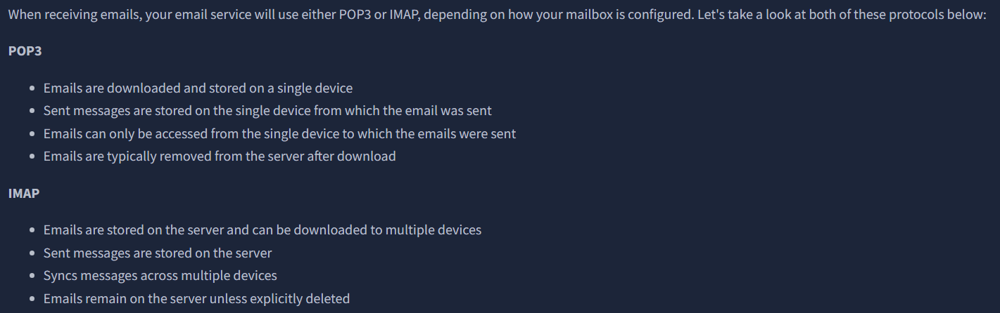

> **What it shows:** POP3 points: mail is stored on one device, sent messages stay on that device, access only from that device, and mail is usually removed from the server after download. IMAP points: mail stays on the server and can reach several devices, sent messages are kept on the server, messages sync, and mail stays until deleted.
> **Why it matters:** It tells me where a copy of a suspicious email may still be sitting (server vs one laptop), which matters when I need it for investigation.
> **Remember:** POP3 = one device, IMAP = server copy plus sync.

| | POP3 | IMAP |
|---|---|---|
| Where mail lives | One device | Server (and synced to devices) |
| Multiple devices | No | Yes |
| After download | Usually removed from server | Stays unless deleted |
| Sent mail | On the sending device | On the server |

## Email headers

Headers are the part of an email you normally don't see. The visible ones are easy: From, To, Reply-To, Subject, Date. The room then shows how to open the full source, where the delivery details sit.

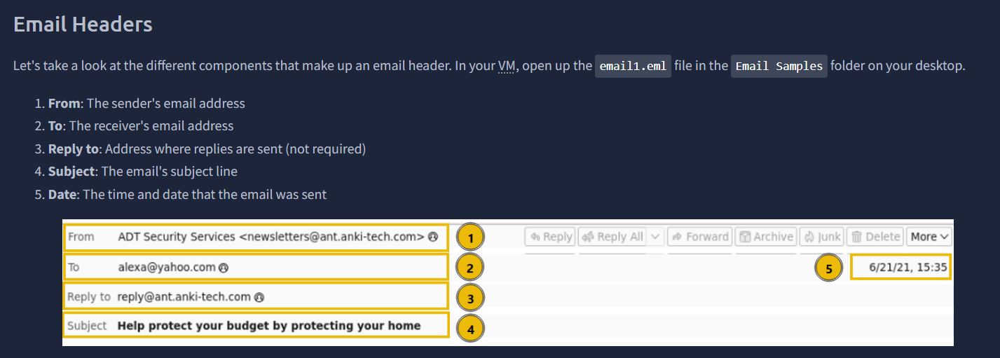

> **What it shows:** The five basic fields numbered on a sample email: From "ADT Security Services" at newsletters@ant.anki-tech.com, To alexa@yahoo.com, Reply to reply@ant.anki-tech.com, Subject "Help protect your budget by protecting your home", Date 6/21/21 15:35. The room asks me to open email1.eml from the Email Samples folder.
> **Why it matters:** The Reply-To address differs from the From address, so a reply would not go back to the sender shown.
> **Remember:** Always compare From and Reply-To.

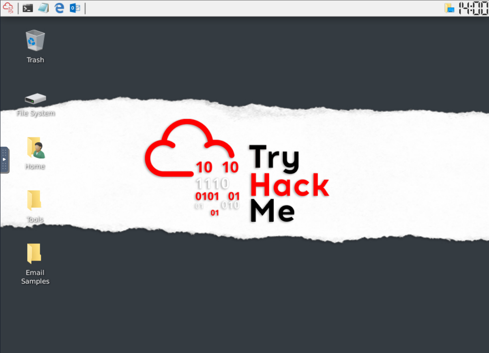

> **What it shows:** The VM desktop with Trash, File System, Home, Tools and Email Samples icons.
> **Why it matters:** The samples sit in a normal folder on the desktop, so the lab is "open files and read them", no live mailbox involved.
> **Remember:** Samples live in the Email Samples folder on the desktop.

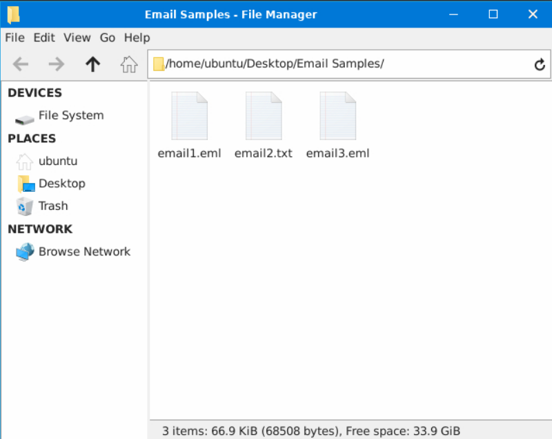

> **What it shows:** The folder /home/ubuntu/Desktop/Email Samples/ with three files: email1.eml, email2.txt and email3.eml. The status bar reads 3 items, 66.9 KiB.
> **Why it matters:** .eml is a saved raw email, which is why a mail client can open it and show the source.
> **Remember:** .eml = a saved email message.

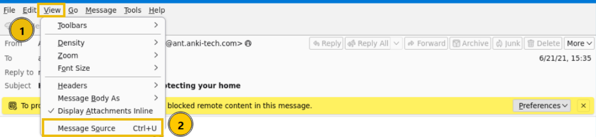

> **What it shows:** Thunderbird with the View menu open. Step 1 marks the View menu, step 2 marks "Message Source" (Ctrl+U). A yellow bar says remote content is blocked.
> **Why it matters:** Message Source is where the full headers are. The blocked remote content bar is also useful, since it stops tracking images loading.
> **Remember:** View → Message Source, or Ctrl+U.

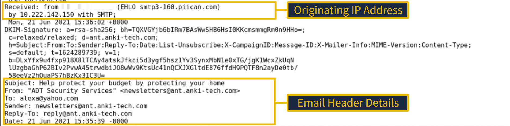

> **What it shows:** The source of the sample. The Received line (from smtp3-160.piican.com, by 10.222.142.150 with SMTP, Mon 21 Jun 2021 15:36:02 +0000) is labelled "Originating IP Address", though the IP itself is blanked out in the room's image. A DKIM-Signature follows (d=ant.anki-tech.com, t=1624289739). Below it: Subject, From, To, Sender newsletters@ant.anki-tech.com, Reply-To reply@ant.anki-tech.com, Date 21 Jun 2021 15:35:39 -0000.
> **Why it matters:** The Received line tells me where the message really came from, and the DKIM d= value names the domain that signed it.
> **Remember:** Received = path and origin, DKIM d= = signing domain.

## Email body and attachments

The body can be plain text or HTML. Plain text is what it looks like. HTML can look like anything, which is why attackers like it.

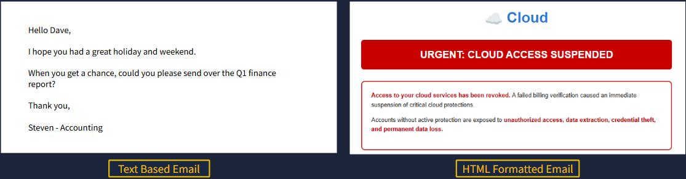

> **What it shows:** Left, a plain text email from "Steven - Accounting" asking Dave for the Q1 finance report. Right, a styled HTML email with a "Cloud" heading and a red banner saying cloud access is suspended after a failed billing check.
> **Why it matters:** The HTML one uses branding, red colours and threats to rush the reader. Plain text can still be a phish, but it has nothing to dress up.
> **Remember:** Urgency plus branding in HTML is a flag, not proof.

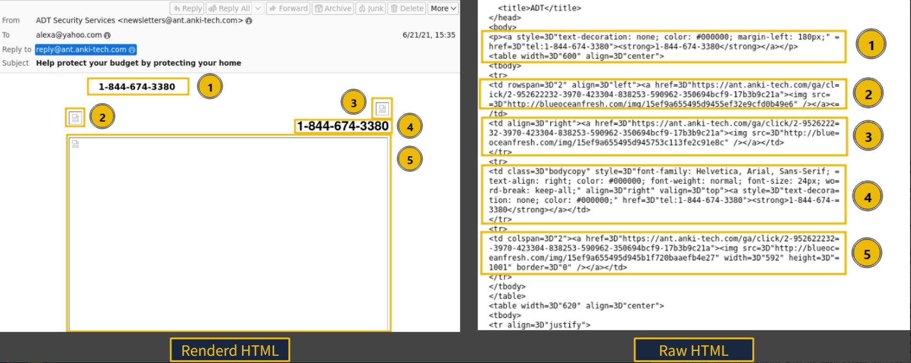

> **What it shows:** Left, the rendered email: a phone number (1-844-674-3380) in two places and several broken image boxes. Right, the raw HTML with matching numbered parts: tel: links for the phone number, and image tags wrapped in links to ant.anki-tech.com click-tracking addresses, with images loaded from blueoceanfresh.com. Characters appear as "=3D" in the raw text.
> **Why it matters:** The rendered view hides where links and images point. The raw view shows every href and src, so I can see the real destinations.
> **Remember:** Read the raw HTML for href and src. "=3D" is just an encoded equals sign.

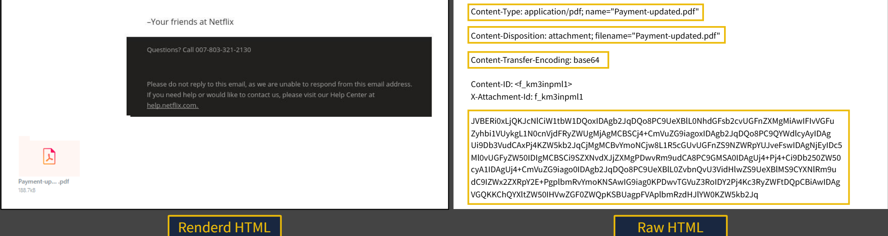

> **What it shows:** Left, a Netflix-styled email with an attachment shown as Payment-updated.pdf (188.7kB). Right, the raw part: Content-Type application/pdf with name "Payment-updated.pdf", Content-Disposition attachment, Content-Transfer-Encoding base64, a Content-ID and X-Attachment-Id, then a block of base64 text.
> **Why it matters:** An attachment is stored inside the email as text. Decoding it lets me look at the file without opening it normally.
> **Remember:** base64 attachment → decode it, don't just double-click it.

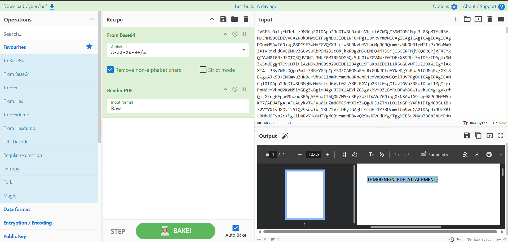

> **What it shows:** CyberChef with a two-step recipe: From Base64 (standard alphabet, remove non-alphabet characters ticked, strict mode off), then Render PDF (input format Raw). The input is about 48,333 characters over 621 lines. The output pane shows a one-page PDF with a single highlighted line of text.
> **Why it matters:** It is the hands-on version of the previous screenshot: paste the base64, decode, render, and see what the attachment contains.
> **Remember:** CyberChef recipe for a PDF attachment: From Base64 → Render PDF.

## A phishing example to compare against

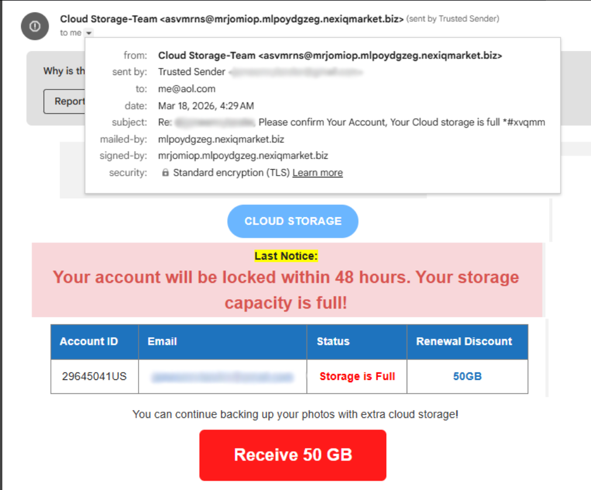

> **What it shows:** An email from "Cloud Storage-Team" with an address on a long random-looking subdomain of nexiqmarket.biz, marked "sent by Trusted Sender". The details popup lists the recipient (me@aol.com), date Mar 18, 2026 4:29 AM, a subject starting with "Re:" and ending "Please confirm Your Account, Your Cloud storage is full", and mailed-by and signed-by values on nexiqmarket.biz subdomains. The body says the account will be locked within 48 hours, shows a table (Account ID, Email, Status "Storage is Full", Renewal Discount 50GB) and a red "Receive 50 GB" button.
> **Why it matters:** It packs several classic signs in one place: a generic team name, an odd domain, a fake "Re:" subject, a 48-hour threat and a free reward button.
> **Remember:** Threat + deadline + free reward + odd sender domain.

<!-- TODO: add screenshot if there was a task header or short explanation for this example in the room -->

## Practical: the Home Depot email

This is the part of the room where I had to check an email myself. The sample opens in Thunderbird.

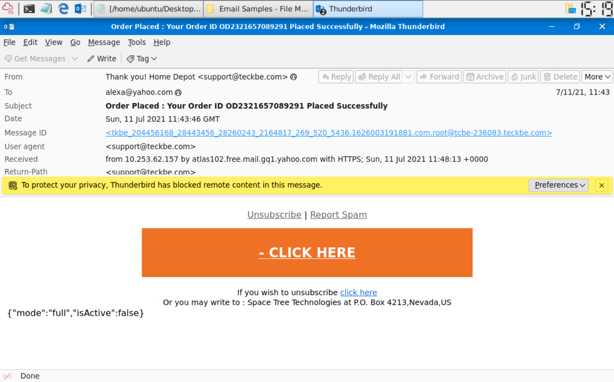

> **What it shows:** An email titled "Order Placed : Your Order ID OD2321657089291 Placed Successfully", from the display name "Thank you! Home Depot" with the address support@teckbe.com, sent to alexa@yahoo.com. Date Sun, 11 Jul 2021 11:43:46 GMT. The Received line shows delivery from 10.253.62.157 by atlas102.free.mail.gq1.yahoo.com with HTTPS on 11 Jul 2021 11:48:13 +0000. Remote content is blocked. The body has an Unsubscribe / Report Spam line, a large orange "CLICK HERE" button, another "click here" for unsubscribing, a postal address for Space Tree Technologies in Nevada, and a stray text line {"mode":"full","isActive":false}.
> **Why it matters:** The display name says Home Depot but the actual address is on a different domain, and the body is a generic button rather than order details.
> **Remember:** Display name is free text. The domain in the address is the evidence.

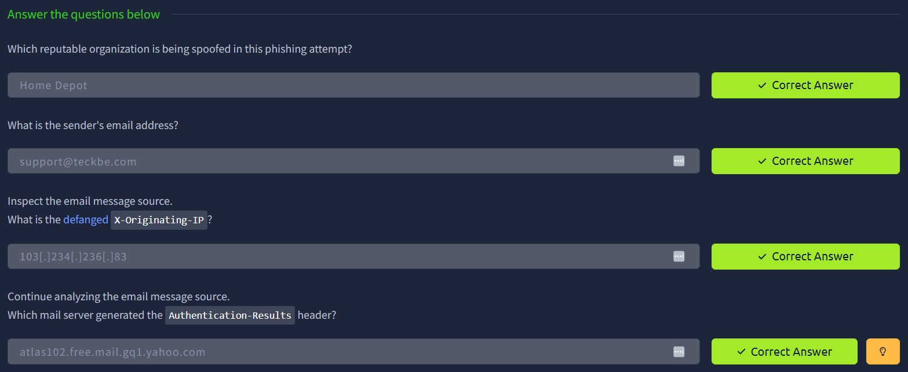

> **What it shows:** Four answered questions, all marked correct. Spoofed organisation: Home Depot. Sender address: support@teckbe.com. Defanged X-Originating-IP: 103[.]234[.]236[.]83. Mail server that produced the Authentication-Results header: atlas102.free.mail.gq1.yahoo.com. A lightbulb (hint) icon sits next to the last row.
> **Why it matters:** These answers are the usual first pass on a phish: who is being imitated, who really sent it, where it came from, and which server checked it.
> **Remember:** Defang IPs (dots as [.]) before putting them in a ticket.

Once the questions were done, the room header flipped to completed.

> **What it shows:** The same room header as the start, now with "Room completed: 100%" and the Share your achievement and Start AttackBox buttons.
> **Why it matters:** It confirms the room is finished, which pairs with the 0% header at the beginning.
> **Remember:** Start 0%, end 100%, practical done in the VM.

### Five Ws (from visible evidence only)

| W | Finding |
|---|---------|
| **Who** | Display name "Thank you! Home Depot", address support@teckbe.com. Recipient alexa@yahoo.com |
| **What** | An "order placed" style email with a big CLICK HERE button, unsubscribe links and a Nevada postal address |
| **When** | Sent Sun 11 Jul 2021 11:43:46 GMT, received at the Yahoo server at 11:48:13 +0000 |
| **Where** | Delivered via atlas102.free.mail.gq1.yahoo.com. Originating IP in the answer screenshot is 103[.]234[.]236[.]83 |
| **Why** | Not shown. My reading: the button is there to get a click, but the link target is not visible in my screenshots |

### IOC table

| Type | Value | Source |
|------|-------|--------|
| Sender address | support@teckbe.com | Screenshots 18 and 19 |
| Sender domain | teckbe.com | Sender address and Message-ID |
| Originating IP (defanged) | 103[.]234[.]236[.]83 | Screenshot 19 (answer) |
| Spoofed brand | Home Depot | Display name |
| Subject | Order Placed : Your Order ID OD2321657089291 Placed Successfully | Screenshot 18 |
| Footer postal name | Space Tree Technologies, P.O. Box 4213, Nevada | Screenshot 18 |

The link behind the CLICK HERE button is not visible, so I have not listed a URL.

### ATT&CK mapping

Only the general technique fits: Phishing (T1566). I would not narrow it to a link-based sub-technique, because the link destination is not shown in my screenshots.

### Evidence vs interpretation

| Evidence (on screen) | Interpretation (mine) |
|---|---|
| Display name says Home Depot, domain is teckbe.com | The sender is imitating the brand |
| Generic button, no order items shown | The "order" is a lure to get a click |
| Received by Yahoo server atlas102... and the same server named in the Authentication-Results answer | Those two screenshots agree with each other |

### Things that looked off, flagged

- In screenshot 18 the "User agent" row holds an email address instead of a mail client name. I left it as shown.
- The body ends with a stray JSON-looking line and the footer names Space Tree Technologies, not Home Depot.
- Screenshot 15 and screenshot 16 are different attachments: the base64 in 15 starts with the pattern for PDF 1.4, the CyberChef input in 16 starts with the pattern for PDF 1.6, so the CyberChef decode is not of the Netflix "Payment-updated.pdf" shown in 15.
- Cross-check I did myself: the DKIM timestamp in screenshot 12 (1624289739) converts to 21 Jun 2021 15:35:39 UTC, which matches the Date line.
- Screenshot 19 shows four questions. If the room had more below them, they are not captured.
- The Message Source view for the Home Depot email is not in my screenshots, so the X-Originating-IP and Authentication-Results lines themselves are not shown, only my answers to them. <!-- TODO: add screenshot -->

## Triage Summary

This room has one sample email, not an alert queue, so this is short.

| Item | Detail |
|------|--------|
| Verdict | Looks like phishing based on visible evidence |
| Why | Brand name in the display name does not match the sender domain, generic call-to-action button, no order details |
| Containment shown | None (the room does not show any) |

**What I would do next (recommendations, not actions shown in the room):**
1. Open the source and read the Received, Authentication-Results and Reply-To lines.
2. Check where the CLICK HERE link goes without clicking it, for example from the raw HTML.
3. Look up the sender domain and the originating IP in a reputation tool.
4. If it is confirmed, block the sender domain and look for other recipients of the same message.

---

## Revision Notes

### One-minute summary

- An email address is username, @, domain. The domain is what I judge.
- SMTP sends, POP3 downloads, IMAP syncs.
- Each server on the route can add a Received line to the headers.
- From, To, Reply-To, Subject and Date are the basic fields. Reply-To not matching From is a flag.
- Message Source (Ctrl+U in Thunderbird) shows the full headers, including the originating IP.
- HTML bodies can hide link targets, so read the raw HTML.
- Attachments are base64 text inside the email. CyberChef can decode and render them.

### Core concepts

| Concept | Plain-English meaning | Example from this room |
|---|---|---|
| Display name | The friendly name shown before the address, easy to fake | "Thank you! Home Depot" on a teckbe.com address |
| Reply-To | Where replies go, can differ from From | reply@ant.anki-tech.com vs newsletters@ant.anki-tech.com |
| Received header | A line added by each mail server on the route | Delivered by atlas102.free.mail.gq1.yahoo.com |
| Message source | The raw email with all headers and body parts | View → Message Source |
| Raw HTML | The code behind the styled email | Links wrapped around images, "=3D" encoding |
| base64 attachment | A file stored as text inside the email | Payment-updated.pdf |
| Defanging | Writing IPs and URLs so they can't be clicked | 103[.]234[.]236[.]83 |

### Cheat sheet

| Field / item | What it tells me | Seen in this room |
|---|---|---|
| From | Claimed sender | Yes |
| Reply-To | Where replies actually go | Yes |
| Sender | Another sender field, in the source | Yes |
| Received | Server hops and origin | Yes |
| DKIM-Signature | Signing domain (d=) and time (t=) | Yes |
| Authentication-Results | Result of checks, written by the receiving server | Only in the question |
| X-Originating-IP | IP the mail came from | Only in the question |
| Content-Type / Content-Disposition | Type of a body part, attachment or not | Yes |
| Content-Transfer-Encoding | How data is encoded, here base64 | Yes |

| Protocol | Job |
|---|---|
| SMTP | Sends mail |
| POP3 | Downloads mail to one device |
| IMAP | Syncs mail across devices |

General knowledge, not from my screenshots: SMTP, POP3 and IMAP commonly use ports 25/587, 110/995 and 143/993.

### Analyst workflow

1. Split the From address into username and domain.
2. Compare From, Reply-To and Sender.
3. Open the message source and read the Received lines for the origin.
4. Note the Authentication-Results and DKIM details.
5. Look at the body: plain text or HTML, urgency, branding, buttons.
6. Read the raw HTML for real link and image destinations.
7. For attachments, find the base64 block and decode it in CyberChef, not by opening it.
8. Defang indicators and write them down.

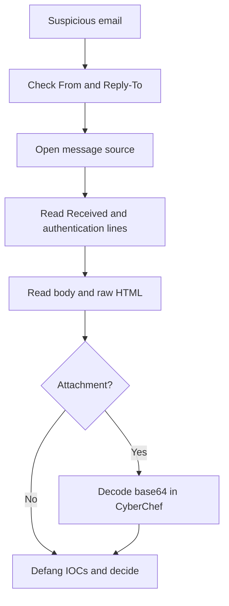

### Common mistakes / false-positive traps

- Trusting the display name and not checking the address.
- Judging only by how the email looks. HTML can copy any brand.
- Forgetting Reply-To, so the reply goes somewhere else.
- Opening an attachment instead of decoding it safely.
- Pasting a live IP or URL into a ticket without defanging.
- Assuming every urgent email is malicious. Marketing mail is urgent too, so the evidence has to back it up.

### Self-check questions

1. What are the three parts of an email address?

Answer
Username, the @ symbol, and the domain name.

2. Which protocol sends mail between a client and a server?

Answer
SMTP.

3. What is the difference between POP3 and IMAP?

Answer
POP3 downloads to one device and usually removes the server copy. IMAP keeps mail on the server and syncs across devices.

4. Why does a different Reply-To address matter?

Answer
Replies go to that address, not to the sender shown in From.

5. How do I open the full headers in Thunderbird?

Answer
View → Message Source, or Ctrl+U.

6. Which header line shows where a message came from?

Answer
The Received line, which carries the originating server or IP.

7. Why read the raw HTML instead of the rendered email?

Answer
The rendered view hides where links and images actually point.

8. How is an attachment stored inside an email?

Answer
As base64 text, with Content-Type, Content-Disposition and Content-Transfer-Encoding headers.

9. Which two CyberChef steps decode a base64 PDF and show it?

Answer
From Base64, then Render PDF.

10. What does defanging an IP look like?

Answer
Dots replaced with [.], for example 103[.]234[.]236[.]83.

### Interview angle

**Q1. How do you check whether an email is phishing?**
I look at the sender domain, compare From and Reply-To, then read the source for the Received and authentication lines. After that I check the body and raw HTML for where links really go.

**Q2. What do you do with a suspicious attachment?**
I don't open it. I find the base64 block in the source, decode it in a safe tool like CyberChef and look at the result or send it for sandbox analysis.

**Q3. What is the difference between the display name and the sender address?**
The display name is free text and can say anything. The address, and especially its domain, is what I trust as evidence.

## Key Takeaways

- The display name tells you nothing. The domain in the address does.
- Reply-To and Received are two of the quickest places to catch a lie.
- Read the raw HTML. What you see and what the link does can be different.
- Attachments are just base64 text, so they can be decoded safely.
- Defang every IOC before it goes into a note.
- This was a guided practice room (hands-on practice, not work experience).

## Glossary

| Term | Meaning |
|---|---|
| SMTP | Protocol that sends email |
| POP3 | Protocol that downloads email to a single device |
| IMAP | Protocol that keeps email on the server and syncs devices |
| Header | Metadata at the top of an email: sender, recipient, route, signatures |
| Reply-To | Address that receives replies, may differ from From |
| Received | Header line added by each server that handled the message |
| DKIM | A signature added by the sending domain so receivers can check the message was not altered |
| base64 | A way of writing binary data as text, used for attachments |
| Defang | Change an IP or URL so it can't be clicked or run by accident |
| .eml | A file format for a saved email message |

## Skills Demonstrated

`Email header analysis` `Email source reading` `Sender spoofing checks` `Raw HTML inspection` `Attachment decoding (CyberChef)` `IOC defanging` `Phishing triage basics` `Technical documentation`

---

[Back to all labs](../../README.md)
