# Phishing Emails in Action | TryHackMe

| | |
|---|---|
| **Platform** | [TryHackMe: Phishing Emails in Action](https://tryhackme.com/room/phishingemails2rytmuv) |
| **Path** | SOC Level 1 > Phishing Analysis |
| **Difficulty** | Easy <!-- TODO: confirm difficulty --> |
| **Status** | Completed, 28 Nov 2026 (room progress shows 100%) |
| **Environment** | Browser only. Static phishing samples shown as screenshots, no attack VM used |
| **Focus** | Spotting phishing techniques in real-world sample emails: spoofed senders, short links, tracking pixels, fake login pages, malicious attachments |

> Flags are redacted in all screenshots.

> **What it shows:** Room header for *Phishing Emails in Action* under SOC Level 1 > Phishing Analysis, listed as 30 min, with the progress bar reading "Room completed: 100%".
> **Why it matters:** This is my proof of completion for the room. It is the only status evidence in this write-up.
> **Remember:** Phishing Emails 1 covers email basics, this room (2) shows real samples, room 3 goes deeper into analysis tools.

---

## Contents

- [What this lab is about](#what-this-lab-is-about)
- [Objective](#objective)
- [At a Glance](#at-a-glance)
- [Task 1: Introduction](#task-1-introduction)
- [Task 2: Fake PayPal receipt](#task-2-fake-paypal-receipt)
- [Task 3: Fake parcel tracking email](#task-3-fake-parcel-tracking-email)
- [Task 4: Fax lure and credential harvesting](#task-4-fax-lure-and-credential-harvesting)
- [Task 5: Netflix payment update](#task-5-netflix-payment-update)
- [Task 6: Apple purchase receipt](#task-6-apple-purchase-receipt)
- [Task 7: DHL shipping notice](#task-7-dhl-shipping-notice)
- [Task 8: Conclusion](#task-8-conclusion)
- [Analysis: Five Ws, IOCs and ATT&CK](#analysis-five-ws-iocs-and-attck)
- [Revision Notes](#revision-notes)
- [Key Takeaways](#key-takeaways)
- [Glossary](#glossary)
- [Skills Demonstrated](#skills-demonstrated)

---

## What this lab is about

Most phishing emails are not clever. They copy a brand's look, borrow a sense of urgency and hope one person in a thousand clicks. This room walks through six real samples so I can see what the common tricks look like in practice: a sender name that says one thing while the address says another, links hidden behind a URL shortener, tiny images that report back to the attacker, fake login pages and attachments that try to run code. A SOC L1 analyst sees these emails every day in the phishing mailbox queue, and the job is to decide quickly whether a message is hostile and which parts of it (sender, link, attachment) are the evidence. This lab trains that first look.

## Objective

Go through each sample, pick out the techniques it uses and note which visible detail gives each one away. By the end I should be able to look at an unfamiliar email and list its red flags in a fixed order: sender, recipient, subject, body, links, attachments.

## At a Glance

| Item | Detail |
|---|---|
| Covered | Six phishing samples: PayPal receipt, parcel tracking, fax / document share, Netflix billing, Apple App Store receipt, DHL shipping notice |
| Views used | Rendered email in a webmail client, raw HTML source, URL expander result, fake landing pages, attachment contents |
| Techniques seen | Spoofed sender, URL shortening, branded HTML, tracking pixel, link manipulation, urgency, credential harvesting, BCC delivery, typos and odd grammar, malicious attachments (PDF, DOT, XLSX) |
| Frameworks | MITRE ATT&CK mapped only where the evidence supports it (see [Analysis](#analysis-five-ws-iocs-and-attck)) |
| Investigated | Headers, rendered bodies, HTML source of two emails, one short-link expansion, the landing pages and the attachment views the room provided |
| Only seen (not analysed) | PDF, DOT and XLSX attachments were shown, not detonated or dissected by me. The room says attachment analysis comes in the next room |

---

## Task 1: Introduction

The room sets the scene: samples come from real spam and phishing campaigns, each one demonstrates a different way of looking trustworthy, and the live links and files in them should be treated as dangerous. Nothing to do in this task beyond reading.

<!-- TODO: add screenshot -->

---

## Task 2: Fake PayPal receipt

**Summary.** The first sample pretends to be a PayPal receipt for a $120 gift-card purchase at a merchant called "Amazing Stuff". The idea is to make the reader think money has gone out of their account and click "Cancel the order" without thinking. The sender line says `service@paypal.com`, but the real address behind it sits on an unrelated domain (`sultanbogor[.]com`). The recipient address is also not a normal Yahoo address. There is no attachment, only one clickable element: the cancel button. In the HTML source that button points to an `is[.]gd` short link, which hides where it really goes.

| Element | What the screenshots show | Why it is suspicious |
|---|---|---|
| Subject | A payment receipt for "Amazing Stuff" | Unexpected payment, makes the reader want to react fast |
| Sender | Display address `service@paypal.com`, real address `noreply...@sultanbogor[.]com` | Display and real address do not match |
| Recipient | Long numeric address on a `yahoo.net` host | Not the user's normal mailbox address |
| Body | PayPal-style HTML, 4 x $30 gift cards, total $120, a "Cancel the order" button | Brand look is easy to copy; the button is the only action |
| Link | `hxxps://is[.]gd/6oCJ4m?#-u7g?ah7Je1` | Shortener hides the destination |
| Expanded link | Preview shows a Google consent page in German | Has nothing to do with PayPal |

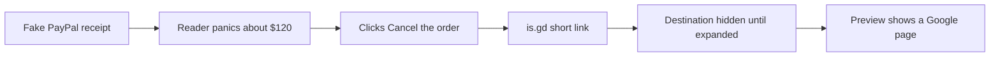

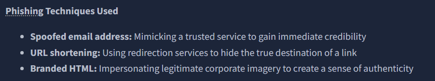

> **What it shows:** A short list of the techniques used in this sample: spoofed email address, URL shortening and branded HTML that imitates a real company.
> **Why it matters:** It gives the vocabulary I use when tagging a phishing email in a ticket.
> **Remember:** Three tags for sample 1: spoof, short link, brand HTML.

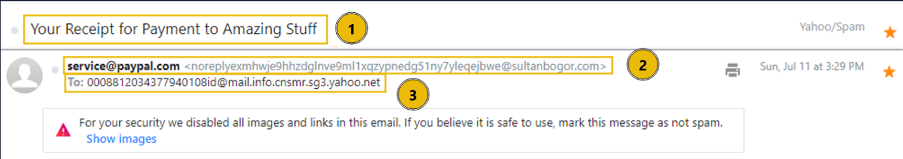

> **What it shows:** Subject "Your Receipt for Payment to Amazing Stuff" (1), sender shown as `service@paypal.com` but with `noreply...@sultanbogor.com` in angle brackets (2), and a long numeric recipient on `mail.info.cnsmr.sg3.yahoo.net` (3). Folder is Yahoo/Spam, dated Sun, Jul 11 at 3:29 PM. Yahoo has disabled images and links.
> **Why it matters:** Comparing the display name with the real address is the first check on any sender.
> **Remember:** Always look inside the angle brackets, not at the name before them.

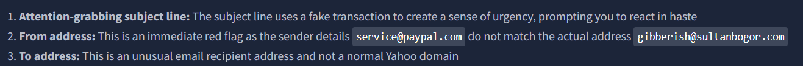

> **What it shows:** The room's three observations on the header: a subject that creates urgency with a fake transaction, a sender name that does not match the actual address, and a recipient address that is not a normal Yahoo one.
> **Why it matters:** It confirms that subject, sender and recipient each carry their own red flag.
> **Remember:** Subject, From, To: three fields, three checks.

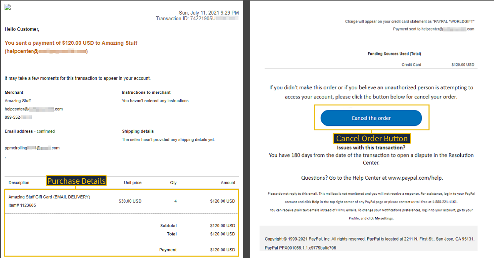

> **What it shows:** Body dated Sun, July 11, 2021 9:29 PM, "You sent a payment of $120.00 USD to Amazing Stuff", merchant details, a purchase table (Amazing Stuff Gift Card, $30.00 x 4 = $120.00) and a blue "Cancel the order" button. Footer text claims to be from PayPal in San Jose.
> **Why it matters:** A professional-looking body proves nothing. Branding is cheap to copy, so the verdict has to come from sender and link evidence.
> **Remember:** A good-looking email is not a trustworthy email.

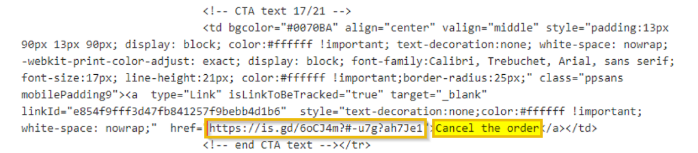

> **What it shows:** Raw HTML of the call-to-action cell. The `href` is `https://is.gd/6oCJ4m?#-u7g?ah7Je1` and the visible link text is "Cancel the order".
> **Why it matters:** What the reader sees and where the link goes are two different things. Checking the `href` is how I catch that.
> **Remember:** Display text vs `href`: never trust the text.

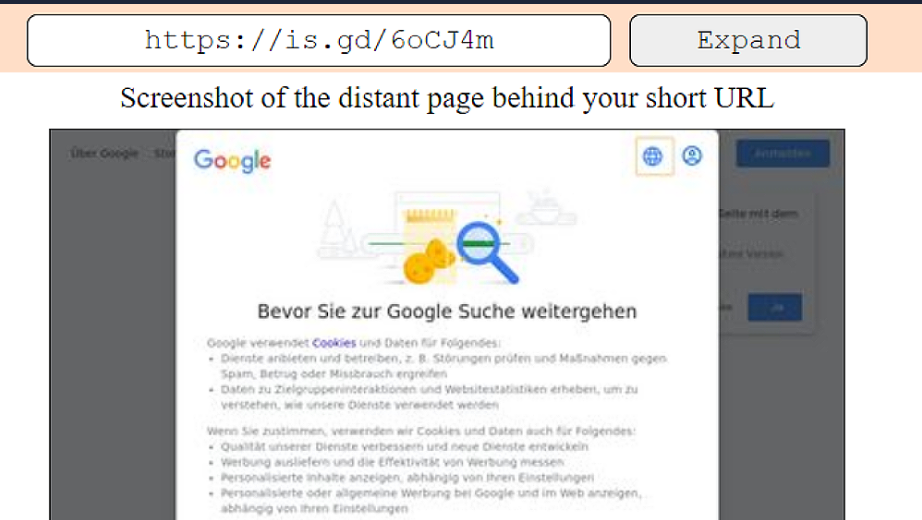

> **What it shows:** A URL expander tool with `https://is.gd/6oCJ4m` entered and a screenshot of the page behind it, a Google cookie-consent dialog in German.
> **Why it matters:** Expanding a short link in a safe tool lets me see the destination without clicking it myself.
> **Remember:** Expand, don't click.

**Evidence vs my reading.** Evidence: the preview shows a Google page. My reading: that does not match a PayPal cancel flow, so either the link had been neutralised by the time it was scanned or it redirects on conditions I cannot see. The screenshots do not tell me which. Also note the room's expander was given the short URL without the trailing `?#-u7g?ah7Je1` part.

<!-- TODO: add screenshot of the quiz answer state for this task (not captured) -->

---

## Task 3: Fake parcel tracking email

**Summary.** Sample two copies a courier notification. The subject carries a tracking number and the big blue link in the body repeats that same text, so it feels consistent. The sender is called "Distribution Center" but the address is on `beginpro[.]club`. The HTML source shows every link going to a different domain again, `devret[.]xyz`, and an image named `Tracking.png`. There is also a second image set to 0 x 0 pixels and hidden. That is a tracking pixel: when the mail client loads it, the attacker's server gets a request. Yahoo had blocked images in this message, which is why nothing loaded.

| Element | Visible detail | Note |
|---|---|---|
| Subject | "Track your package: # LZ8942357486EN" | Looks like a parcel notice |
| Sender | Distribution Center `contact@beginpro[.]club` | Generic name, unrelated domain |
| Main link text | Same text as the subject line | Display text, not the destination |
| Link destination | `hxxp://devret[.]xyz/4833mt...` | Different domain from the sender |
| Image | `hxxp://devret[.]xyz/Creatives/Tracking.png` | Named like a tracker |
| Hidden image | 0 px by 0 px, `display:none`, URL ends with the sender address | Invisible, only exists to be fetched |
| Image maps | Rectangles covering 1500 x 1400 with an `href` | A click anywhere on the image follows a link |

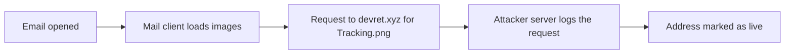

The last two boxes are the usual purpose of a tracking pixel (general knowledge), not something the room's screenshot proves for this exact email.

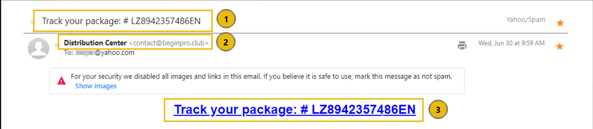

> **What it shows:** Subject "Track your package: # LZ8942357486EN" (1), sender "Distribution Center" `<contact@beginpro.club>` (2), and a blue underlined link with the same text as the subject (3). Sent Wed, Jun 30 at 9:59 AM, in the Yahoo/Spam folder, with images and links disabled.
> **Why it matters:** The subject and the link text match, which makes the email feel coherent. The sender domain is what breaks the story.
> **Remember:** Match the sender domain to the brand it claims.

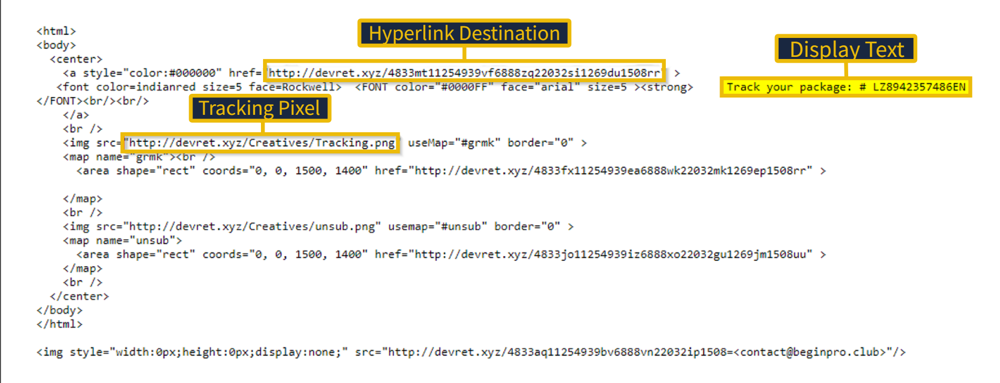

> **What it shows:** HTML source with three callouts: the hyperlink destination (`http://devret.xyz/4833mt...`), the display text ("Track your package: # LZ8942357486EN") and the tracking pixel (`http://devret.xyz/Creatives/Tracking.png`). A second image tag is 0 x 0 px and its URL ends with `contact@beginpro.club`. Links are plain `http`.
> **Why it matters:** Reading the source separates what the reader sees from what the email actually does.
> **Remember:** A 0 x 0 image is a tracker until proven otherwise.

---

## Task 4: Fax lure and credential harvesting

**Summary.** This is the longest chain in the room. An email pretends to deliver a fax through "Citrix Attachments" and says the link expires the same day it was sent. The button leads to a fake OneDrive page, then another page dressed as Adobe Document Cloud, which asks me to pick an email provider, and finally a fake Outlook login. The login does not authenticate anything. The details typed in are sent to whoever runs the page, which is the whole point. The wording on the pages is clumsy in places, which is another warning sign.

| Step | What is visible | Red flag |
|---|---|---|
| Email | From Nir Barak `nirb@profility[.]com`, sent Thu 7/15/2021 1:35 PM, subject starts with "RE: Claim #" | A "RE:" on what looks like a first contact; signature below says Martin Rivera, a different name |
| Lure | Citrix Attachments panel, "Expires July 15, 2021", 4.6 MB, "Download Document Here" | Expiry is the same day it was sent: urgency |
| Page 1 | `app[.]popt[.]in/landing/...`, OneDrive branding, "Get Document" and "Preview Fax Here" | OneDrive look on a non-Microsoft address |
| Page 2 | `bdkmotorsport[.]com/wp-duua/`, Adobe Document Cloud branding, Outlook / Office365 / Other Mail buttons | Third brand in one chain, odd instruction wording |
| Page 3 | "Login with Outlook" form on the same `bdkmotorsport[.]com` address | Fake login, error shown anyway |

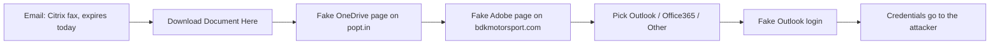

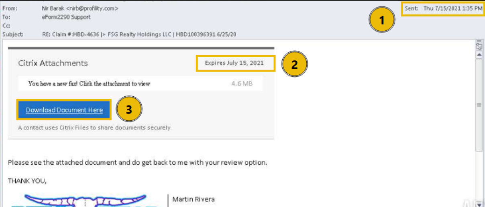

> **What it shows:** An Outlook-style message from Nir Barak `<nirb@profility.com>` to "eForm2290 Support", sent Thu 7/15/2021 1:35 PM (1). The Citrix Attachments panel reads "Expires July 15, 2021" (2) and has a "Download Document Here" button (3) for a 4.6 MB item. The signature below names Martin Rivera.
> **Why it matters:** Same-day expiry pushes the reader to act before thinking. The sender name and signature name also disagree.
> **Remember:** Urgency plus a download button is the classic pair.

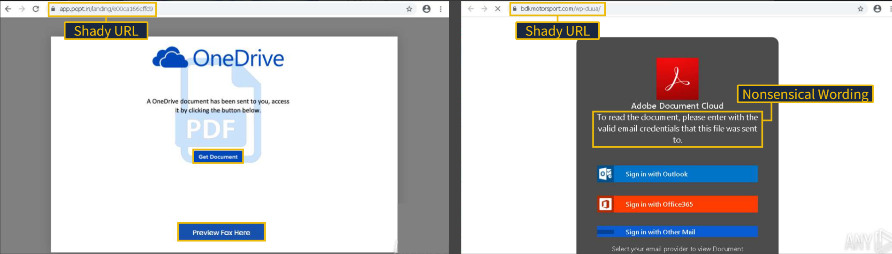

> **What it shows:** Left page at `app.popt.in/landing/e00ca166cffd9` with OneDrive branding, a "Get Document" button and a "Preview Fax Here" button. Right page at `bdkmotorsport.com/wp-duua/` branded Adobe Document Cloud, with "Sign in with Outlook / Office365 / Other Mail" and a callout on its awkwardly worded instruction. A padlock-style icon appears next to both URLs.
> **Why it matters:** Neither address belongs to Microsoft or Adobe, and one email has now borrowed three brand names (Citrix, OneDrive, Adobe). A padlock only means the connection is encrypted, not that the site is honest.
> **Remember:** Check the domain, not the logo and not the padlock.

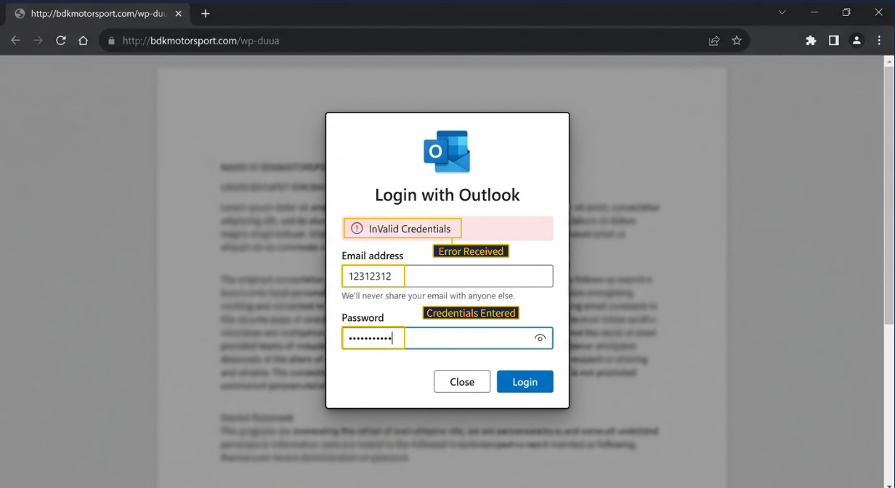

> **What it shows:** A "Login with Outlook" box on `bdkmotorsport.com/wp-duua`, with a red "InValid Credentials" banner, `12312312` typed in the email field and a masked password. The blurred page behind it looks like a document.
> **Why it matters:** The test values were obviously fake, yet the form still produced an error rather than anything useful. The room's point is that a harvesting page cannot really check credentials, and real ones would be captured too. That is the room's explanation, I did not test it myself.
> **Remember:** The page doesn't log you in; it collects what you type.

---

## Task 5: Netflix payment update

**Summary.** This one pretends to be Netflix billing. The subject and the sender name both use misspelt versions of the brand, the sender address is on `musacombi[.]online`, and the main message is that the account is on hold. The email asks the reader to open an attached PDF to fix payment details. The PDF contains a red "Update Payment Account" button. The footer phone number starts with `007`, which looks odd for a service aimed at a US customer (my reading, not stated in the screenshot).

| Element | Visible detail | Note |
|---|---|---|
| Subject | "Netfllx ID Suspended" | Misspelt brand, plus urgency |
| Sender | "Netllx billing" `<z99@musacombi[.]online>` | Different misspelling, unrelated domain |
| Recipient | Bcc to a Yahoo address | Hidden recipient, mass-mail style |
| Date | Wed, Mar 10 at 9:08 AM | Folder label reads Yahoo/Sent |
| Body | Netflix logo, "Your account is on hold." and "Please update your payment details" | Urgency |
| Attachment | PDF named `Payment-up...pdf`, 188.7 kB | The real action sits inside the file |
| PDF content | "Update Payment Account" button, plus text about a password reset | Text does not match the payment story |
| Footer | Phone number starting `007`, "help.netflix.com" as visible text | Link target not verified in the screenshot |

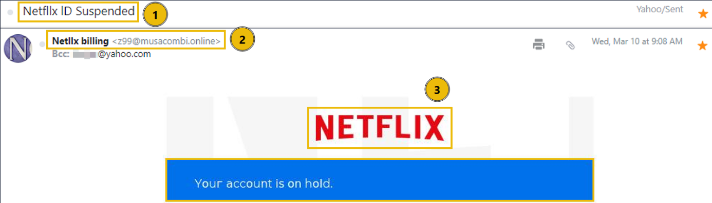

> **What it shows:** Subject "Netfllx ID Suspended" (1), sender "Netllx billing" `<z99@musacombi.online>` (2), recipient in Bcc, dated Wed, Mar 10 at 9:08 AM, and a large Netflix logo over a blue banner reading "Your account is on hold." (3). A paperclip icon shows an attachment.
> **Why it matters:** Two different misspellings of the brand in two fields, and a sender domain that has nothing to do with Netflix, are enough to flag it.
> **Remember:** Typos in the brand name itself are a red flag, not just in the body.

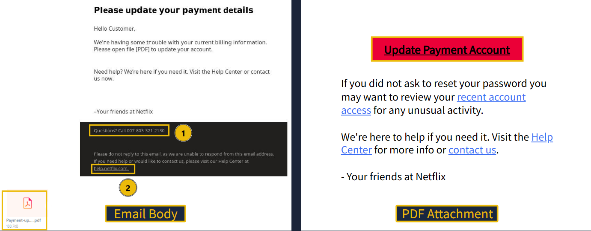

> **What it shows:** Left, the email body "Please update your payment details" asking me to open the PDF, with a footer phone number (1) and "help.netflix.com" text (2), and the attachment icon (`Payment-up...pdf`, 188.7 kB). Right, the PDF with an "Update Payment Account" button and a paragraph about resetting a password.
> **Why it matters:** The email pushes the reader into the attachment, where a link can hide from simple email filters. The password-reset text inside does not fit a billing problem.
> **Remember:** If the email pushes you into a file, the file is the payload.

<!-- TODO: add screenshot of the PDF link target if the room provides it -->

---

## Task 6: Apple purchase receipt

**Summary.** The sample looks like an Apple Support message about an App Store purchase for "Double Jackpot Slots Las Vegas". The sender address is on `sumpremed[.]com` and the "To" address is a made-up Apple lookalike, with the real recipient hidden in Bcc. Both addresses contain typos (`donoreply`, `payament`). The room describes the message as having no body, only an attachment, a `.dot` file (Word template). Opened, it shows a big receipt-style image with a $14.99 charge and a link that bounces through Tumblr's redirect service. The idea is that the reader will see a charge they never made and click to dispute it.

| Element | Visible detail | Note |
|---|---|---|
| Subject | "Re : Action Required - Your recent purchase ... Date: Fri 03 Apr 2020 09:32:24 +0000" | "Re:" on a first message, date text pasted into the subject |
| Sender | "Apple Support" `<donoreply-storemails...@sumpremed[.]com>` | Typo-ridden local part, wrong domain |
| To | `noreply.payament_@app.apple.iud456.com` | Typo, fake Apple-style host |
| Bcc | Yahoo address | Real recipient hidden |
| Attachment | `Double Jack...dot` | Word template format |
| Receipt | Apple ID `example@appleid.com`, order and document numbers, billed to a placeholder-looking address, $14.99 In-App Purchase | Receipt is one large image |
| Link | `hxxps://t[.]tumblr[.]com/redirect?z=hxxps://apps[.]ios-games[.]mansiiea[.]com/...` | Redirect through a legitimate site to an unrelated domain |

<!-- TODO: add screenshot of the email body view if the room provides it -->

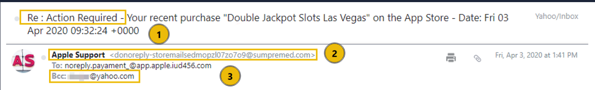

> **What it shows:** Subject starting "Re : Action Required" with an embedded date "Fri 03 Apr 2020 09:32:24 +0000" (1). Sender "Apple Support" `<donoreply-storemailsedmopzl07zo7o9@sumpremed.com>` (2). To `noreply.payament_@app.apple.iud456.com`, and a Bcc to a Yahoo address (3). The mail client time is Fri, Apr 3, 2020 at 1:41 PM.
> **Why it matters:** Typos in both address fields and a recipient hidden in Bcc show this was not written by Apple. The subject time (09:32:24 +0000) and the client time (1:41 PM) also differ, which is worth noting even though a timezone may explain part of it.
> **Remember:** Bcc plus a fake To address means mass mailing.

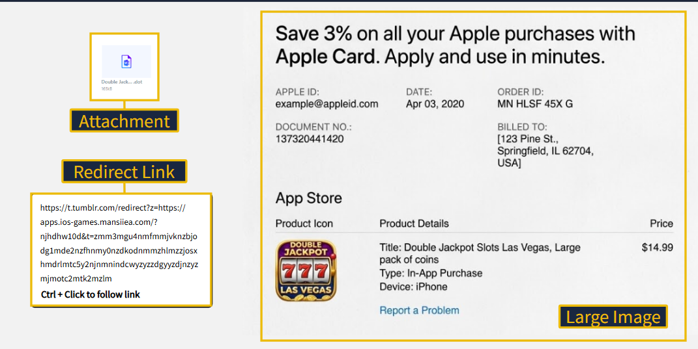

> **What it shows:** The `.dot` attachment icon, a redirect link `https://t.tumblr.com/redirect?z=https://apps.ios-games.mansiiea.com/?...` marked "Ctrl + Click to follow link", and the large receipt image: Apple Card promo, Apple ID `example@appleid.com`, order date Apr 03, 2020, billed to a bracketed placeholder-style address, Double Jackpot Slots Las Vegas in-app purchase for $14.99 on iPhone.
> **Why it matters:** The receipt is one big image, so there is no real text for a filter to scan, and the link borrows a trusted site's redirector to look safer. The bracketed address and the `example@` Apple ID look like template placeholders (my reading).
> **Remember:** Redirect through a trusted site still ends on an untrusted one.

---

## Task 7: DHL shipping notice

**Summary.** The last sample is a DHL shipping notice with an Excel attachment. The sender is `info@glamcarcompany[.]de`, which is not DHL. The HTML looks like a DHL template, but the "view as a web page" link has no real destination in the source. The only thing to interact with is the spreadsheet. Inside, I see a Chinese-language supplier appraisal form addressed to an Indian company, and a red line telling me to click "Enable Editing". The final screenshot shows a console window opening from `AppData\Roaming\regasms.exe` and an NTVDM error, so something was executed from a spreadsheet that arrived by email.

| Element | Visible detail | Note |
|---|---|---|
| Subject | "DHL Express Courier Shipping notice CBJ200620039539" | Reference number reused in body |
| Sender | "DHL Express" `<info@glamcarcompany[.]de>` | Car company domain, not DHL |
| Body | DHL banner, "Thank you for scheduling a courier shipment with DHL!", "See attached for confirmation B/L" | Template look |
| Attachment | `CBJ2006200...xlsx`, 15.1 kB | The only interactive item |
| Spreadsheet | Chinese-language "supplier appraisal" form, "To. MENON AND MENON LIMITED, Wanmangar, KOLHAPUR", "Ref. No. PURNA/F34" | Has nothing to do with a DHL shipment |
| Instruction | Red banner: "To translate language kindly click enable editing above" | Pushes the reader to disable Protected View |
| Execution | `C:\Users\admin\AppData\Roaming\regasms.exe` in a console, MS-DOS subsystem error | File dropped to a user-writable folder and run |

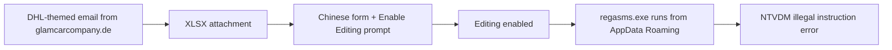

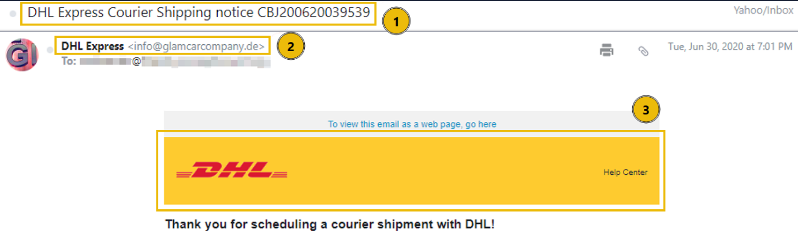

> **What it shows:** Subject "DHL Express Courier Shipping notice CBJ200620039539" (1), sender "DHL Express" `<info@glamcarcompany.de>` (2), received Tue, Jun 30, 2020 at 7:01 PM with a paperclip icon. A DHL-styled yellow banner (3) and the line "Thank you for scheduling a courier shipment with DHL!" appear below.
> **Why it matters:** The look is DHL, the sender is not. A shipment I never scheduled is itself a prompt to be careful.
> **Remember:** Brand colours are not evidence.

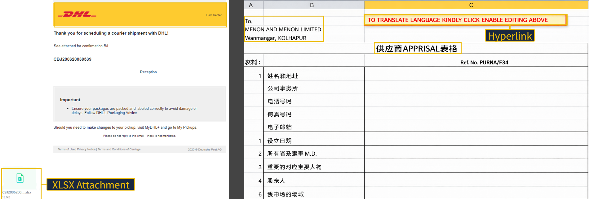

> **What it shows:** Left, the DHL-styled body with "See attached for confirmation B/L", the reference `CBJ200620039539`, a packaging notice, and an `.xlsx` attachment of 15.1 kB. Right, the spreadsheet: "To. MENON AND MENON LIMITED, Wanmangar, KOLHAPUR", a Chinese-language "supplier appraisal" form (Ref. No. PURNA/F34), and a red banner telling me to click Enable Editing.
> **Why it matters:** The attachment content has nothing to do with the DHL story. A document that pushes me to enable editing is trying to get past Protected View.
> **Remember:** "Enable editing" in an unexpected file is a stop sign.

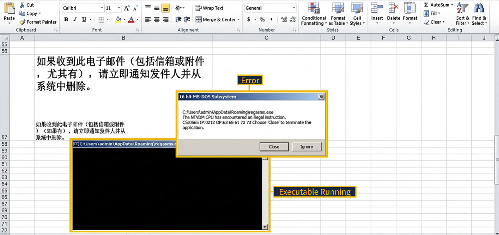

> **What it shows:** Excel with Chinese warning text, a console window titled `C:\Users\admin\AppData\Roaming\regasms.e...` and a "16 bit MS-DOS Subsystem" error for `C:\Users\admin\AppData\Roaming\regasms.exe`, saying the NTVDM CPU hit an illegal instruction.
> **Why it matters:** A spreadsheet should not start an executable. The path (a user's Roaming profile) and the name are what I would pivot on in EDR.
> **Remember:** Office app starting a process from `AppData` = investigate.

**Discrepancies worth flagging.** (1) The attachment is labelled `.xlsx`, a format that normally cannot hold macros, yet the screenshots show code running. The room does not show how it was triggered, so I treat the mechanism as unknown. (2) `regasms.exe` is one letter away from `RegAsm.exe`, a genuine Microsoft .NET tool. That name resemblance is my reading, and the room does not state it. (3) The error says an illegal instruction was hit, so the payload did not run cleanly in this screenshot. That does not make the file safe.

---

## Task 8: Conclusion

The room closes by pointing to extra reading on spotting phishing and says that recognising these emails mostly comes from awareness training and practice. Nothing to submit.

<!-- TODO: add screenshot -->

---

## Analysis: Five Ws, IOCs and ATT&CK

The room does not give an alert queue, so I treated each sample as a reported email and wrote down what the evidence shows.

### Five Ws per sample

| Sample | Who | What | When | Where | Why (attacker's goal) |
|---|---|---|---|---|---|
| PayPal receipt | Sender shows `paypal.com`, real address on `sultanbogor[.]com` | Fake receipt with a cancel button and short link | Sun, Jul 11 (2021 in the body) | Yahoo mailbox, Spam folder | Get a click on the hidden link |
| Parcel tracking | "Distribution Center" on `beginpro[.]club` | Fake tracking email with a tracking pixel and links to `devret[.]xyz` | Wed, Jun 30, 9:59 AM | Yahoo, Spam folder | Confirm the mailbox is live, drive a click |
| Fax lure | Nir Barak `profility[.]com` (signature says Martin Rivera) | Chain of fake OneDrive, Adobe and Outlook pages | Thu, 15 Jul 2021, 1:35 PM | Outlook-style client, then three web pages | Harvest email credentials |
| Netflix | "Netllx billing" on `musacombi[.]online` | "Account on hold" email with a PDF button | Wed, Mar 10, 9:08 AM | Yahoo mailbox, Bcc | Get the reader to open the PDF and follow its link |
| Apple receipt | "Apple Support" on `sumpremed[.]com` | Fake receipt in a `.dot` file with a redirect link | Fri, Apr 3, 2020 | Yahoo Inbox, Bcc | Scare the reader into clicking the dispute link |
| DHL notice | "DHL Express" on `glamcarcompany[.]de` | XLSX attachment that runs `regasms.exe` | Tue, Jun 30, 2020, 7:01 PM | Yahoo Inbox, then a Windows host | Get code executed on the machine |

Console label vs evidence: in two places the label and the evidence disagree. The PayPal header shows 3:29 PM while the body shows 9:29 PM, and the Apple subject text shows 09:32:24 +0000 while the client shows 1:41 PM. Both could be timezone display differences, but I cannot confirm that from the screenshots.

### IOC table

All values defanged. These are indicators from a training room, not from an incident of mine.

| Type | Indicator | Sample | Screenshot |
|---|---|---|---|
| Sender domain | `sultanbogor[.]com` | PayPal | 03 |
| Short URL | `hxxps://is[.]gd/6oCJ4m` | PayPal | 06, 07 |
| Sender domain | `beginpro[.]club` | Parcel | 08 |
| Link / pixel domain | `devret[.]xyz` (incl. `/Creatives/Tracking.png`) | Parcel | 09 |
| Lure ID | `LZ8942357486EN` | Parcel | 08 |
| Sender domain | `profility[.]com` | Fax | 10 |
| Landing page | `app[.]popt[.]in/landing/e00ca166cffd9` | Fax | 11 |
| Landing page | `bdkmotorsport[.]com/wp-duua` | Fax | 11, 12 |
| Sender domain | `musacombi[.]online` | Netflix | 13 |
| File | `Payment-up...pdf` (188.7 kB) | Netflix | 14 |
| Phone number | `007-803-321-2130` | Netflix | 14 |
| Sender domain | `sumpremed[.]com` | Apple | 15 |
| Recipient host | `app[.]apple[.]iud456[.]com` | Apple | 15 |
| Redirect | `hxxps://t[.]tumblr[.]com/redirect?z=hxxps://apps[.]ios-games[.]mansiiea[.]com/...` | Apple | 16 |
| File | `Double Jack...dot` | Apple | 16 |
| Sender domain | `glamcarcompany[.]de` | DHL | 17 |
| File | `CBJ2006200...xlsx` (15.1 kB), ref `CBJ200620039539` | DHL | 17, 18 |
| Process path | `C:\Users\admin\AppData\Roaming\regasms.exe` | DHL | 19 |

### MITRE ATT&CK mapping

Only where the screenshots support it.

| Technique | Where it applies | Confidence |
|---|---|---|
| T1566.002 Phishing: Spearphishing Link | PayPal, parcel, fax samples (links to short URL, `devret[.]xyz`, landing pages) | High |
| T1566.001 Phishing: Spearphishing Attachment | Netflix (PDF), Apple (DOT), DHL (XLSX) | High |
| T1204.001 / T1204.002 User Execution (link / file) | Clicking the links, enabling editing in the XLSX | Medium: the screenshots show the result, not the user action |
| T1656 Impersonation | PayPal, Netflix, Apple, DHL brand copies | High |
| T1036.005 Masquerading: Match Legitimate Name or Location | `regasms.exe` resembling `RegAsm.exe` | Low: based on my reading of the name only |

I have not mapped credential theft to a specific technique ID. The fake login is visible, but no harvested data is shown leaving the page.

### Verdicts and recommended next steps

These are my recommendations. The room does not show a containment step for any sample.

| Sample | Verdict | What I would do next |
|---|---|---|
| PayPal | Malicious phishing | Block the sender domain and short URL, search for other recipients, delete from mailboxes |
| Parcel | Malicious phishing with tracking | Block `devret[.]xyz`, check proxy logs for anyone who loaded the pixel or link |
| Fax | Malicious, credential harvesting | Block both landing domains, check whether any user visited, reset passwords if so |
| Netflix | Malicious phishing | Block sender domain, submit the PDF for analysis |
| Apple | Malicious phishing | Block sender domain and redirect target, submit the DOT file for analysis |
| DHL | Malicious, execution seen | Isolate the host if opened, hunt for `regasms.exe` in `AppData\Roaming`, submit the XLSX to a sandbox |

Because the room has no alerts and no analyst comment to review, I have not added an escalation-notes reflection.

---

## Revision Notes

### One-minute summary

- Six real phishing samples, each showing a different mix of tricks.
- Sender display name and real address often disagree: always check the address in angle brackets.
- Short URLs, redirectors and mismatched link text hide the real destination; read the `href` and expand safely.
- Tracking pixels are tiny or hidden images that report back when loaded.
- Fake login pages collect whatever is typed and can show an error either way.
- Attachments (PDF, DOT, XLSX) carry the payload or a link, often with "enable editing" pressure.
- Urgency, typos and brand copies are supporting evidence; sender, links and files are the proof.

### Core concepts

| Concept | Plain-English meaning | Example from this room |
|---|---|---|
| Spoofed sender | Display name or address made to look like a real brand | `service@paypal.com` on top, `sultanbogor[.]com` underneath |
| URL shortening | A short link that hides the real destination | `is[.]gd/6oCJ4m` on the cancel button |
| Branded HTML | Email styled with the target brand's look | PayPal, Netflix and DHL layouts |
| Tracking pixel | A tiny or hidden image fetched when the mail opens | `Tracking.png` and the 0 x 0 image from `devret[.]xyz` |
| Link manipulation | Visible text differs from the real link | "Track your package" pointing at `devret[.]xyz` |
| Urgency | Time pressure to stop careful thinking | Fax link expiring the day it was sent |
| Credential harvesting | A fake login that collects what is typed | Fake Outlook login on `bdkmotorsport[.]com` |
| BCC delivery | Real recipient hidden, To field is a decoy | Netflix and Apple samples |
| Malicious attachment | A file that carries code or a link | PDF, DOT and XLSX in this room |

### Cheat sheet

| Check | What to look at | Seen in |
|---|---|---|
| Sender | Display name vs address in `<...>` vs brand domain | PayPal, parcel, Netflix, Apple, DHL |
| Recipient | To vs Bcc, odd or typo'd addresses | PayPal, Apple |
| Subject | Fake transaction, fake tracking number, "suspended", "action required" | PayPal, parcel, Netflix, Apple |
| Date | Compare date in subject, header and body | PayPal, Apple |
| Links | `href` vs display text, shorteners, redirectors, plain `http` | PayPal, parcel, Apple, fax |
| Images | Names like `Tracking.png`, 0 x 0 size, `display:none` | Parcel |
| Landing page | Domain vs brand, wording, number of brands in one chain | Fax |
| Attachment | Type vs story (DOT, XLSX, PDF), "enable editing" prompts | Netflix, Apple, DHL |
| Execution | Office or PDF process launching something from `AppData` | DHL |

General knowledge, not shown in this room: SPF, DKIM and DMARC results in the full headers, and Protected View on Office files, are also worth checking.

### Analyst workflow

1. Read sender, recipient, subject and date. Compare the display name with the real address.
2. Note anything that creates urgency or fear.
3. Look at the body: brand look, typos, grammar, what action it asks for.
4. Find every interactive element (link, button, attachment) and read the raw source for the real destination.
5. Expand short links in a safe tool instead of clicking.
6. Look at the landing pages in a sandbox: domain, branding, what it asks for.
7. Open or detonate attachments only in an isolated environment and note what they run.
8. Record indicators (domains, URLs, file names, hashes, process paths), then block, search and report.

### Common mistakes and false-positive traps

- Trusting the logo and layout. They prove nothing.
- Trusting the display name and never reading the address.
- Trusting the link text and never checking the `href`.
- Assuming a padlock on a page means the site is legitimate.
- Assuming a clean-looking email with no body is harmless: the file may carry everything.
- Assuming an `.xlsx` is always safe because it usually has no macros. The room shows code running after an attachment of that name.
- Reading a timestamp difference as proof of forgery. It may just be a timezone.

### Self-check questions

1. What is the quickest way to tell a spoofed sender from a real one?

Answer
Compare the display name with the actual address inside the angle brackets and check whether the domain belongs to the brand.

2. Why can a short link be dangerous even when the email looks professional?

Answer
It hides the real destination, so the reader cannot judge it before clicking. Expand it in a safe tool first.

3. What gives a tracking pixel away in HTML?

Answer
A tiny or hidden image (for example 0 x 0 or `display:none`), often with a name like Tracking.png, loaded from an unrelated domain.

4. Why does a mail provider block images by default?

Answer
Loading remote images tells the sender the mail was opened and can leak details about the reader.

5. What does a fake login page do with typed credentials?

Answer
It sends them to the attacker, whether or not it shows a success or an error.

6. Why is a same-day expiry on a download link a red flag?

Answer
It is urgency, designed to make the reader act before checking anything.

7. What does Bcc tell you about a suspicious email's delivery?

Answer
The real recipient is hidden and the To address is a decoy, which fits a mass mailing rather than a message meant for one person.

8. Why is a Word template (`.dot`) attachment suspicious in a purchase receipt?

Answer
A receipt should not need a template file, and Office formats are a common way to carry code or links.

9. In the DHL sample, which artefact would I search for in EDR first?

Answer
The process or file `regasms.exe` under `AppData\Roaming`, and the parent Office process that launched it.

10. Why do I judge an email by sender and links rather than by how it looks?

Answer
Look and brand are trivial to copy. Sender domain, link destination and attachment behaviour are much harder to fake convincingly.

### Interview angle

**1. How would you check whether an email is phishing?**
Compare the sender address with the brand domain, check urgency and the requested action, then read the real link destinations and attachment types. Confirm in a safe environment before acting.

**2. What is a tracking pixel and why does it matter?**
A tiny or hidden image that makes the mail client contact an external server when the mail is opened. It can tell the sender the mailbox is active, so I treat the sender domain and linked domain as indicators.

**3. A user says they typed their password into a link from an email. What do you do?**
Treat it as a compromise: reset the password and revoke sessions, block the landing domain, check sign-in logs for the account, and search for other recipients of the same email.

---

## Key Takeaways

- Read the address, not the display name.
- Always check where a link really goes before judging the email.
- Hidden images and short links are quiet signs of a mass campaign.
- Fake login pages do not log you in; they collect what you type.
- Attachments are where several of these samples keep the real payload.
- Hands-on practice with sample emails builds a repeatable first-look routine, but it is not the same as working live incidents.

## Glossary

| Term | Meaning (my words) |
|---|---|
| Phishing | Messages that trick people into clicking, logging in or opening something harmful |
| Spoofing | Faking who a message appears to be from |
| Display name | The friendly name shown before the actual address |
| URL shortener | A service that turns a long link into a short one |
| Tracking pixel | A tiny image used to see whether and when an email was opened |
| Credential harvesting | Collecting usernames and passwords through a fake login |
| BCC | Blind carbon copy: recipients hidden from each other |
| Protected View | Office mode that opens downloaded files read-only until editing is enabled |
| IOC | Indicator of compromise: a domain, URL, file or process that points to malicious activity |
| NTVDM | Windows 16-bit DOS emulation subsystem, named in the error in the last screenshot |

## Skills Demonstrated

`Phishing analysis` `Email header review` `Sender spoofing detection` `URL analysis` `Short-link expansion` `HTML source review` `Tracking pixel identification` `Credential harvesting recognition` `Attachment triage` `IOC extraction` `MITRE ATT&CK mapping` `Technical documentation`

---

[Back to all labs](../../README.md)
