# SOC L1 Alert Reporting | TryHackMe

| | |
|---|---|
| **Platform** | [TryHackMe](https://tryhackme.com/room/socl1alertreporting) |
| **Path** | SOC Level 1 → SOC Team Internals |
| **Difficulty** | Easy (about 60 min) |
| **Status** | Completed (100%), 06 Nov 2026 |
| **Environment** | TryHackMe simulated SIEM / SOC dashboard |
| **Focus** | Alert reporting, escalation to L2, SOC communication |

> Flags are redacted in all screenshots. This write-up documents my process and what I learned, not the answer key.

---

## Objective

Learn what an L1 analyst does *after* triage: write a clear alert report, decide whether to escalate, hand the alert to L2, and communicate with other teams when something goes wrong.

  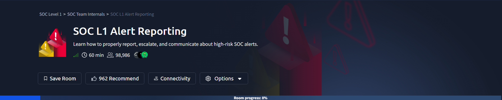

---

## Task 2: The Alert Funnel

L1 receives the alerts, closes most of them as false positives, and escalates the real threats. Only a small share becomes a full incident for DFIR.

  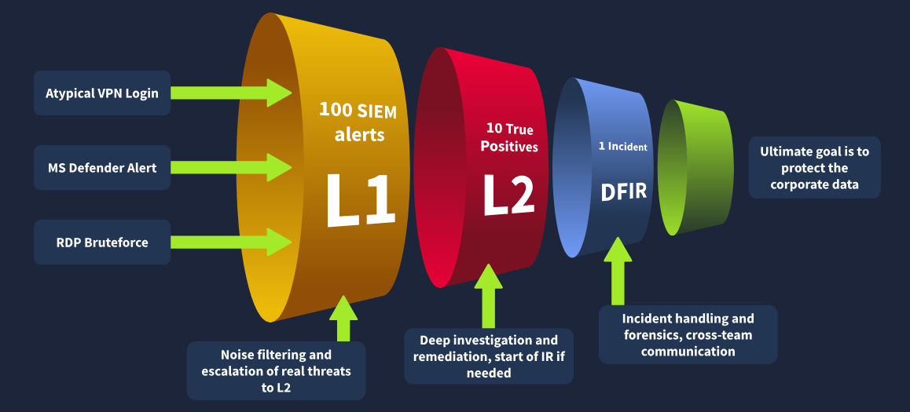

Three terms introduced here:

| Term | Meaning |
|---|---|
| **Alert reporting** | Formally documenting the alert details and my findings |
| **Alert escalation** | Passing a suspicious alert to L2 for review |
| **Communication** | Coordinating with other teams (IT, HR, management) during or after analysis |

| Before | After |
|---|---|
| 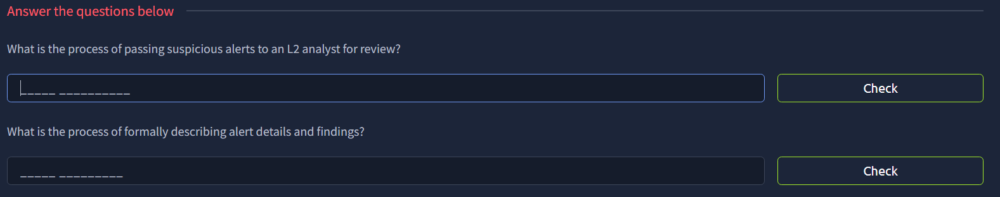 | 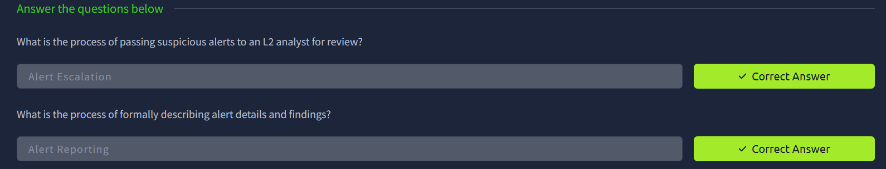 |

---

## Task 3: Reporting Guide

### Why L1 writes reports

  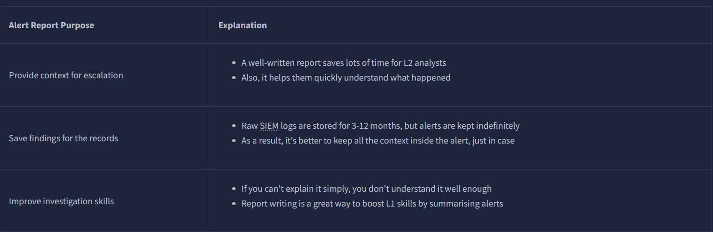

- Gives L2 context so they don't start from scratch
- Alerts are kept indefinitely, while raw SIEM logs are kept only for months
- Writing the report forces me to understand the alert properly

### The Five Ws format

| W | What to include |
|---|---|
| **Who** | User who logged in, ran the command, or downloaded the file |
| **What** | The exact action or sequence of events |
| **When** | When the activity started and ended |
| **Where** | Device, IP, or website involved |
| **Why** | The reasoning behind my verdict (the most important W) |

Example of a well-written report, with the checklist the room uses to grade it:

  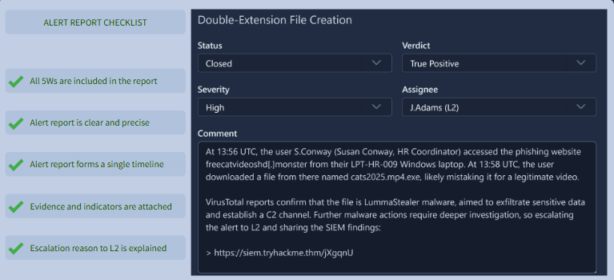

### Investigation in the SOC dashboard

The dashboard starts with a queue of unassigned alerts. I assigned myself, moved the alert to **In Progress**, then investigated.

  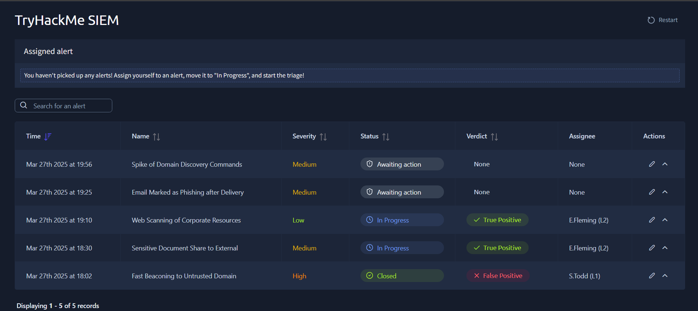

**Data leak alert (Sensitive Document Share to External).** The alert showed the source user `m.boslan@tryhackme.thm` (HR) sharing the *Employee Records (Updated)* spreadsheet from the HR Internal folder to an external Protonmail address. The details also noted that an earlier attempt to download the whole HR folder was blocked by DLP.

  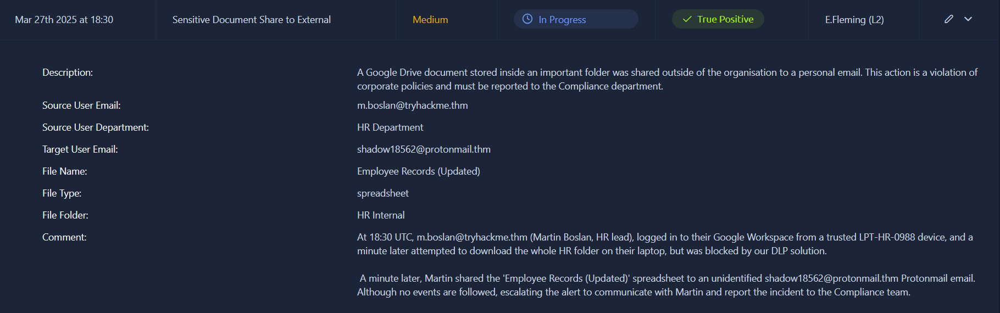

**Phishing alert (Email Marked as Phishing after Delivery).**

| Field | Value |
|---|---|
| Subject | Important Update: Microsoft Teams Pricing Increase |
| Sender | `support@microsoft.com` (spoofed) |
| Recipient | Eddie Huffman, IT Manager |
| Security checks | **SPF: Fail, DKIM: Fail** |
| Attachment | `REPORT.rar` |
| Body keywords | "600% price increase", "urgent notice", "download the report" |

  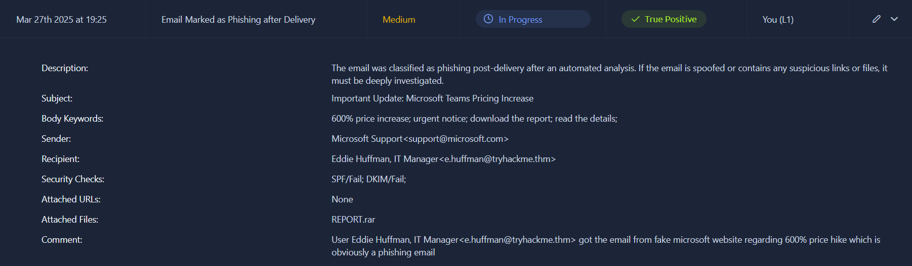

My analyst comment and verdict (**True Positive**):

  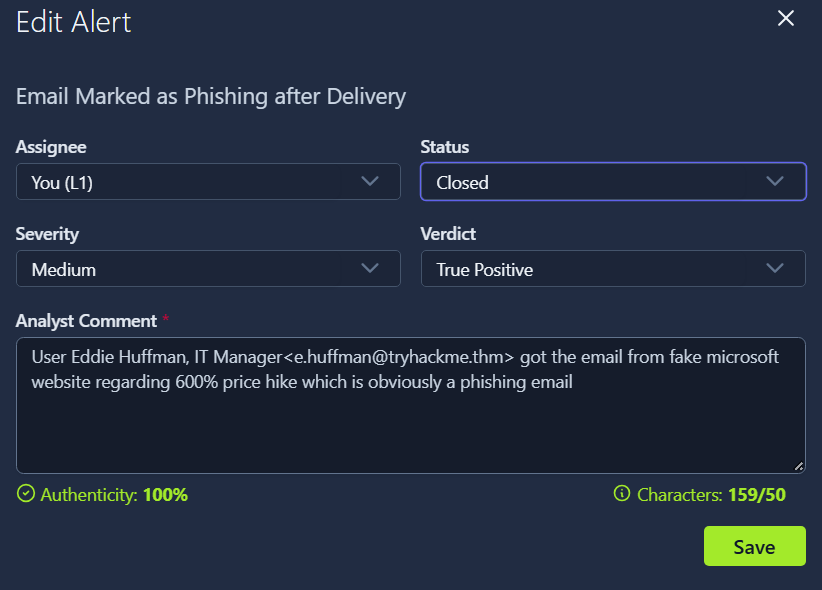

### Reflection: how I'd write this report now

My first comment was accurate but thin. It had no timestamp, no mention of the failed SPF/DKIM checks, and no recommended action. Using the full Five Ws:

> **Who:** Eddie Huffman (IT Manager, e.huffman@tryhackme.thm) received the email.
> **What:** An email titled "Important Update: Microsoft Teams Pricing Increase" claimed a 600% price hike and pushed the user to download an attached report (`REPORT.rar`). The sender address `support@microsoft.com` is spoofed.
> **When:** 27 Mar 2025, 19:25 (alert time in the SIEM).
> **Where:** Delivered to the recipient's mailbox. No URLs, one archive attachment.
> **Why (True Positive):** SPF and DKIM both failed, so the sender is not authorized to send as Microsoft. Urgency, a fear-based pricing claim, and an archive attachment are typical phishing and malware-delivery traits.
> **Next steps:** Check whether the user opened the attachment, remove the email from the mailbox, block the sender, and analyse the attachment hash. Escalate to L2 if it was opened.

| Before | After |
|---|---|
| 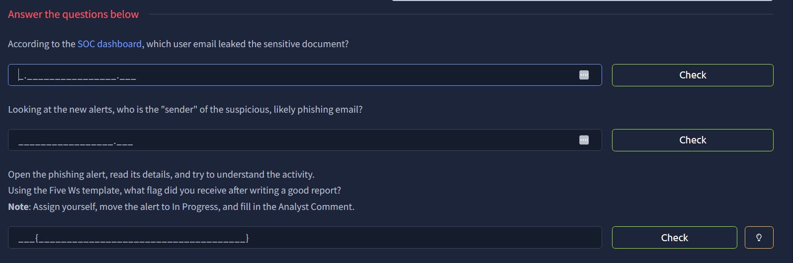 | 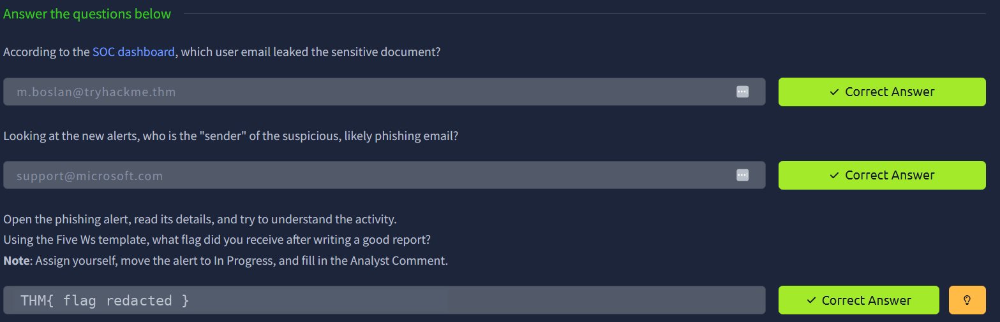 |

---

## Task 4: Escalation Guide

### When to escalate

1. The alert indicates a major attack that needs deeper investigation or DFIR
2. Remediation is needed (malware removal, host isolation, password reset)
3. Customers, partners, management, or law enforcement must be contacted
4. I don't fully understand the alert and need senior help

### Escalation workflow in the dashboard

1. Move the alert to **In Progress** and analyse it
2. Write the alert report and set the verdict (e.g. True Positive)
3. **Reassign the alert to the L2 on shift** (in this lab, *E.Fleming*)
4. L2 gets notified and starts from my report

  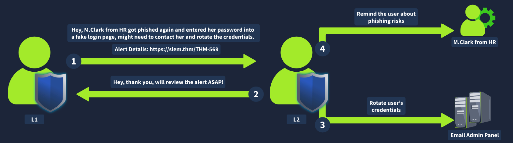

### Second alert: Spike of Domain Discovery Commands

  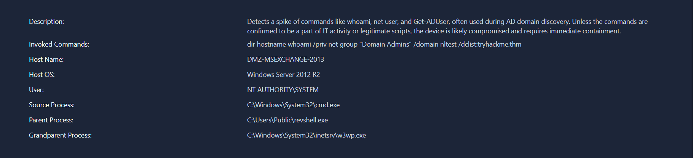

| Indicator | Observation |
|---|---|
| Commands | `whoami /priv`, `net group "Domain Admins" /domain`, `nltest /dclist:tryhackme.thm` |
| Host | `DMZ-MSEXCHANGE-2013` (Windows Server 2012 R2, internet-facing) |
| User | `NT AUTHORITY\SYSTEM` |
| Process chain | `w3wp.exe` (IIS worker) → `revshell.exe` → `cmd.exe` |

**Assessment:** The IIS worker process spawned a reverse shell from `C:\Users\Public\`, and that shell ran Active Directory reconnaissance as SYSTEM. This points to a **web shell on an unpatched Exchange server**, so the host is likely compromised and needs immediate L2 escalation for containment.

**MITRE ATT&CK mapping:** T1505.003 (Web Shell), T1033 (System Owner/User Discovery), T1069.002 (Domain Groups discovery).

<!-- TODO: replace the quote below with the exact comment you submitted in the dashboard, and add a screenshot of the edit-alert window:

-->

> **Who:** Process activity on `DMZ-MSEXCHANGE-2013` running as `NT AUTHORITY\SYSTEM`.
> **What:** Domain discovery commands (`whoami /priv`, `net group "Domain Admins" /domain`, `nltest /dclist`) launched by `revshell.exe`, itself spawned by the IIS worker process `w3wp.exe`.
> **When:** 27 Mar 2025, 19:56 (alert time).
> **Where:** DMZ Exchange 2013 server on Windows Server 2012 R2, a likely internet-facing host.
> **Why (True Positive):** A web server process spawning a reverse shell followed by AD reconnaissance is not legitimate IT activity. Likely web shell exploitation. Escalating to L2 for host isolation and credential review.

  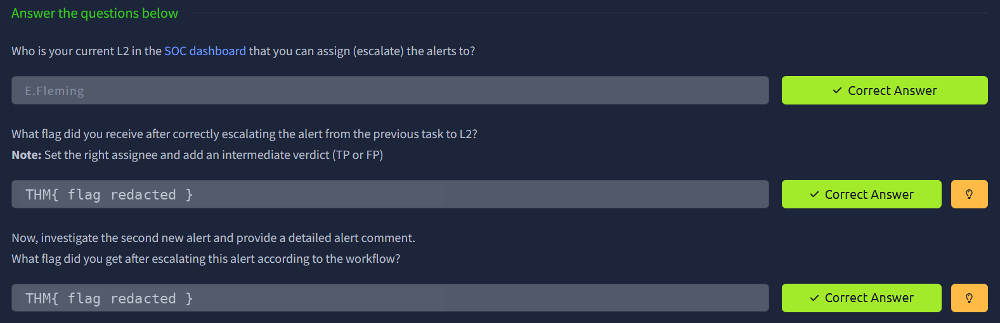

---

## Task 5: SOC Communication

Scenarios the room prepares me for, and what to do:

| Situation | Action |
|---|---|
| Critical alert, L2 not responding for 30 min | Call L2, then L3, then the manager. Know where emergency contacts are |
| Chat account (Slack/Teams) compromised | Verify with the user via another channel, such as a phone call, never the breached chat |
| Flood of alerts including critical ones | Prioritise by workflow and tell L2 what's happening |
| Realised later I misclassified an alert | Tell L2 immediately, because attackers can stay quiet for weeks |
| SIEM logs not parsed or searchable | Investigate what I can and report the issue to L2 or the SOC engineer |

After escalation, L2 typically validates the alert, starts incident response, and brings in legal, PR, or other teams.

  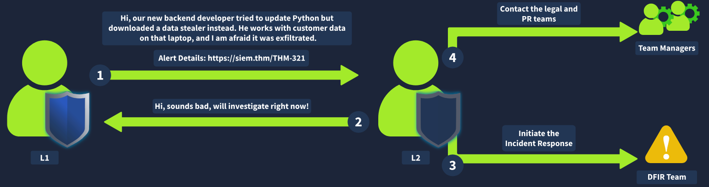

---

## Task 6: Completion

  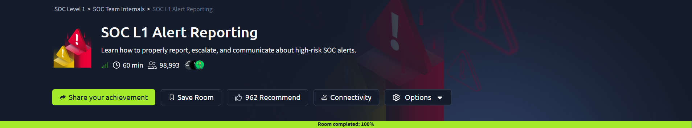

---

## Key Takeaways

- A good report lets L2 act without asking me questions. Use the **Five Ws** every time.
- Escalate when remediation, deeper investigation, or outside communication is needed, and also when I'm unsure.
- Escalation is a handoff: right assignee, clear verdict, and a complete comment.
- Never contact a user through a compromised channel.
- Reporting a mistake early is always better than hiding it.

## Skills Demonstrated

`Alert triage` · `Incident reporting (Five Ws)` · `Escalation workflow` · `Phishing analysis (SPF/DKIM)` · `Windows process-chain analysis` · `MITRE ATT&CK mapping` · `SOC communication`

---
[⬅ Back to all labs](../../README.md)
