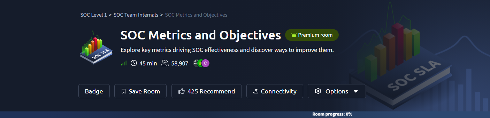
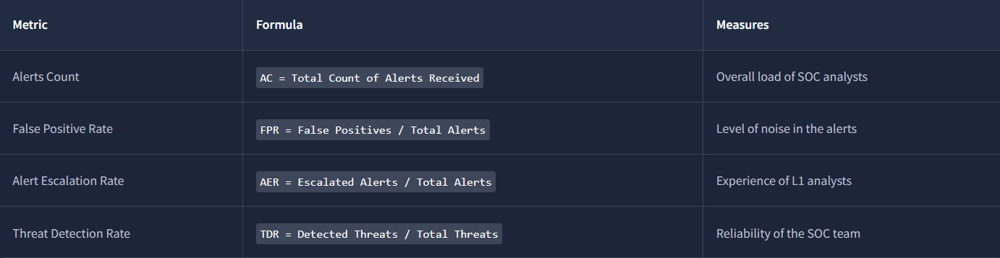
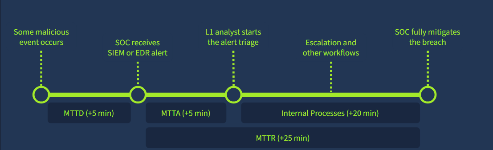
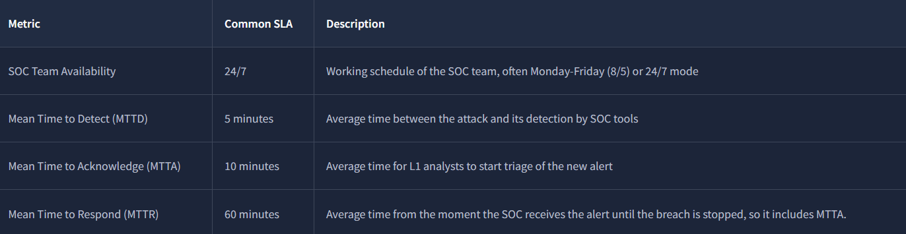
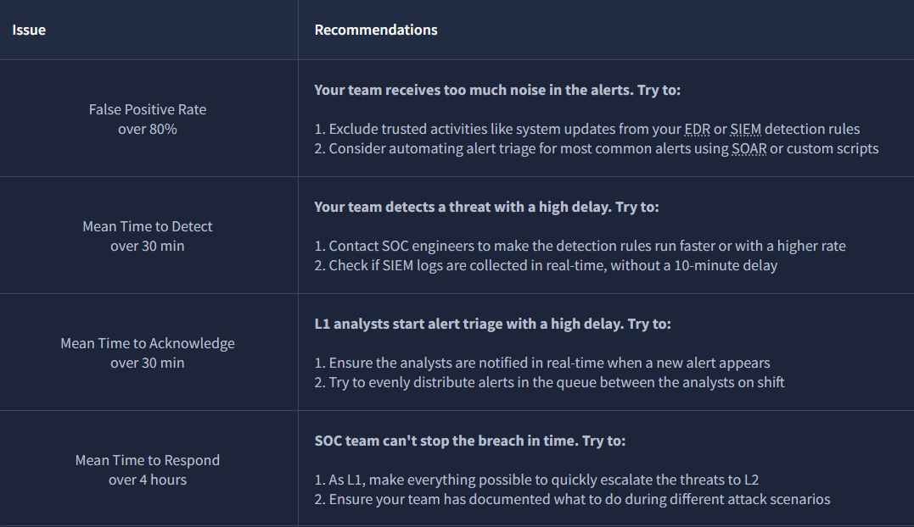
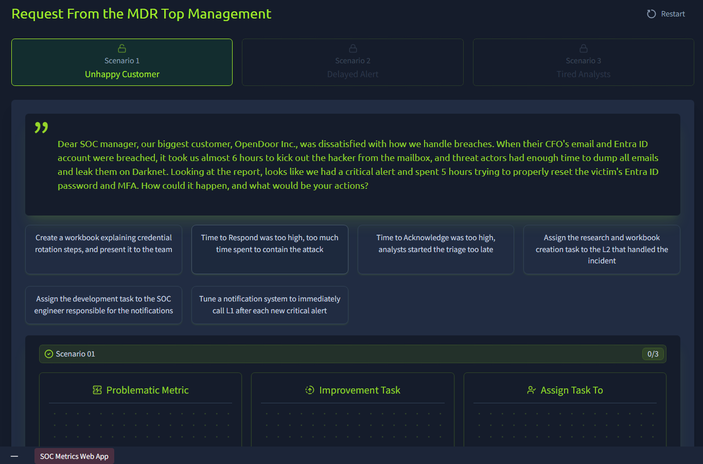
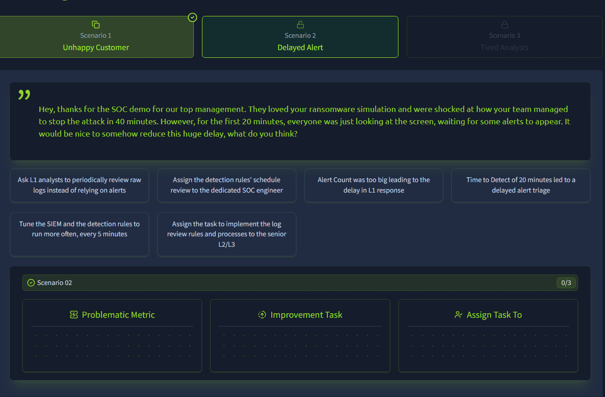
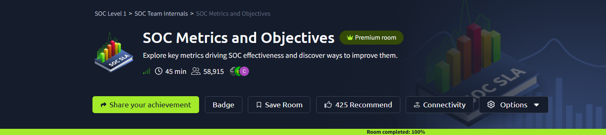

# SOC Metrics and Objectives | TryHackMe

| | |
|---|---|
| **Platform** | [TryHackMe](https://tryhackme.com/room/socmetricsobjectives) (premium room) |
| **Path** | SOC Level 1 > SOC Team Internals |
| **Difficulty** | Easy |
| **Status** | Completed, 11 Nov 2026 (100%) |
| **Environment** | Browser-based room with an interactive "SOC Metrics Web App" |
| **Focus** | SOC KPIs, detection and response SLAs, metric-driven improvement |

> Flags are redacted in all screenshots.

## Objective

Learn which metrics show how well a SOC is performing, what typical SLA targets look like, and how a weak metric points to a specific fix. The room ends with management-style scenarios where a poor metric has to be matched to an improvement task and an owner.

## Task 1: Introduction

Short intro to why a SOC needs measurable objectives. No screenshots beyond the room header above.

## Task 2: Core Metrics

In my own words, four metrics cover the basics of SOC health:

| Metric | How it's calculated | What it tells you |
|---|---|---|
| Alerts Count | Total alerts received | Workload on the analysts |
| False Positive Rate | False positives ÷ total alerts | How noisy the detections are |
| Alert Escalation Rate | Escalated alerts ÷ total alerts | How much L1 analysts can resolve on their own, which reflects their experience |
| Threat Detection Rate | Detected threats ÷ total threats | How reliable the SOC's detection is |

Worked examples:

- If only 10 of 50 alerts are real threats, the other 40 are false positives, so FPR = 40 / 50 = 80%.
- Zero alerts for a whole month is not a good sign. It more likely means detection gaps than a quiet network.

## Task 3: Triage Metrics

The room walks through one incident timeline: a malicious event happens, the SIEM/EDR raises an alert, an L1 analyst starts triage, then escalation and other internal steps run until the breach is contained.

- **MTTD (Mean Time to Detect):** attack start to detection by SOC tools.
- **MTTA (Mean Time to Acknowledge):** alert raised to L1 starting triage.
- **MTTR (Mean Time to Respond):** alert received to breach stopped. It includes MTTA.

Common SLA targets shown in the room:

| Metric | Typical target |
|---|---|
| SOC availability | 24/7 (some SOCs run 8/5) |
| MTTD | about 5 minutes |
| MTTA | about 10 minutes |
| MTTR | about 60 minutes |

Worked example: a critical alert that arrives on Saturday at a team working 8/5 will not be acknowledged until Monday, which is why availability affects MTTA directly.

## Task 4: Improving Metrics

The room links each warning level to a likely cause and a practical fix:

| Warning level | What it suggests | Fix direction |
|---|---|---|
| False positive rate above 80% | Too much noise | Exclude trusted activity such as system updates from rules; automate triage of repetitive alerts (SOAR or scripts) |
| MTTD above 30 min | Late detection | Have SOC engineers speed up rule execution; check SIEM log ingestion isn't delayed |
| MTTA above 30 min | Alerts sit unattended | Notify analysts in real time; balance the queue across the shift |
| MTTR above 4 hours | Containment too slow | Escalate to L2 faster; document response steps for common attack scenarios |

## Task 5: Practice Scenarios

Three management-style scenarios. In each one I act as the SOC manager and fill three boxes: the problematic metric, the improvement task, and who the task is assigned to.

### Scenario 1: Unhappy Customer

A major customer was upset after a mailbox and Entra ID compromise. Containment took almost 6 hours, and about 5 hours of that went on properly resetting the account password and MFA. Answer cards covered high response time, high acknowledgement time, workbook creation, notification tuning and task owners.

| Box | Reasoning |
|---|---|
| Problematic metric | **MTTR.** The alert was picked up, and the time was lost during the fix itself, so acknowledgement time is not the issue. |
| Improvement task | **Write a workbook with the credential rotation steps** (password reset, session revoke, MFA reset) and present it to the team, so the fix takes minutes instead of hours. |
| Assign to | **The L2 who handled the incident**, because they already know where the process got stuck. |

<!-- TODO: add screenshot of Scenario 1 solved (3/3) -->

### Scenario 2: Delayed Alert

During a ransomware demo the team stopped the attack in 40 minutes, but the first 20 minutes passed with no alert on screen. The task is to reduce that delay.

| Box | Reasoning |
|---|---|
| Problematic metric | **MTTD.** The 20-minute gap sits between the attack and the alert, well above the typical 5-minute target. |
| Improvement task | **Tune the SIEM and detection rules to run every 5 minutes.** Having analysts read raw logs by hand does not fix a detection-timing problem. |
| Assign to | **The dedicated SOC engineer** who owns the detection rules and their schedule. |

<!-- TODO: add screenshot of Scenario 2 solved (3/3) -->

### Scenario 3: Tired Analysts

<!-- TODO: add screenshot of the Scenario 3 prompt and solved board, then fill in the metric, task and owner from what I chose -->

## Task 6: Conclusion

## Key Takeaways

- Each SOC metric answers a different question: workload, noise, analyst capability or detection reliability.
- MTTD, MTTA and MTTR measure different stages of one incident, and MTTR includes MTTA.
- A bad number should lead to a specific fix, such as rule tuning, SOAR automation, alert routing or better playbooks.
- A high false positive rate wastes analyst time and can delay real alerts.
- Slow acknowledgement is often a notification or queue problem, not an analyst problem.
- L1 can help lower MTTR by escalating quickly and following documented response steps.

## Skills Demonstrated

`SOC Metrics` `KPIs` `SLA Awareness` `MTTD/MTTA/MTTR` `False Positive Reduction` `Alert Triage Concepts` `Escalation` `SOC Process Improvement`

*Simulated lab. This is hands-on practice, not work experience.*

[Back to all labs](../../README.md)
