# SOC Workbooks and Lookups | TryHackMe

| | |
|---|---|
| **Platform** | [TryHackMe: SOC Workbooks and Lookups](https://tryhackme.com/room/socworkbookslookups) |
| **Path** | SOC Level 1, SOC Team Internals |
| **Difficulty** | <!-- TODO: add difficulty --> |
| **Status** | Completed (10 Nov 2026) |
| **Environment** | Browser-based interactive room (inventory tables, network map, drag-and-drop workbook flowcharts). Premium room. |
| **Focus** | Identity and asset inventories, network map context, alert-triage workbooks |

> Flags are redacted in all screenshots.

## Objective

Hands-on practice with the reference material an L1 analyst uses during triage: identity and asset inventories, a network map, and step-by-step alert workbooks. The aim is to see how that context turns a raw alert into a quick decision to escalate or close as a false positive (FP). This is simulated lab practice, not work experience.

## Identity and Asset Inventories

Inventories answer "who is this account?" and "what is this machine?" when an alert names a username or hostname. The room covers where each inventory usually comes from.

**Where the data comes from**

| Inventory | Typical sources (as shown) |
|---|---|
| Identities | Active Directory / Entra ID, SSO providers (Okta, Google Workspace), HR systems (BambooHR, SAP, HiBob), custom CSV/Excel sheets |
| Assets | Active Directory / Entra ID, SIEM or EDR agents (Elastic, CrowdStrike), MDM tools (MS Intune, Jamf), custom CSV/Excel sheets |

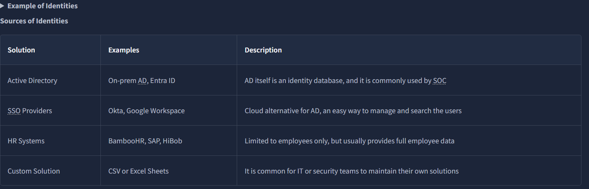

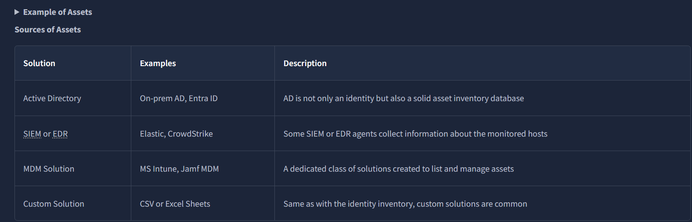

**What the example inventories contain**

| Inventory | Fields in the example |
|---|---|
| Identity | Full name, username, email, role, location, access |
| Asset | Hostname, location, IP address, OS, owner, purpose |

My observations from the examples:
- Identities include both people (CFO, CTO, a US financial adviser) and service accounts (a backup account and a web-app account). The service accounts have no email or location.
- The access column shows what each account can reach, such as VPN, finance, DMZ or AWS.
- Remote laptops have no IP in the inventory.
- The file server for financial records (172.16.15.89) and the primary domain controller (172.16.15.10) both fall inside the 172.16.15.0/24 range labelled as the database subnet on the network map.

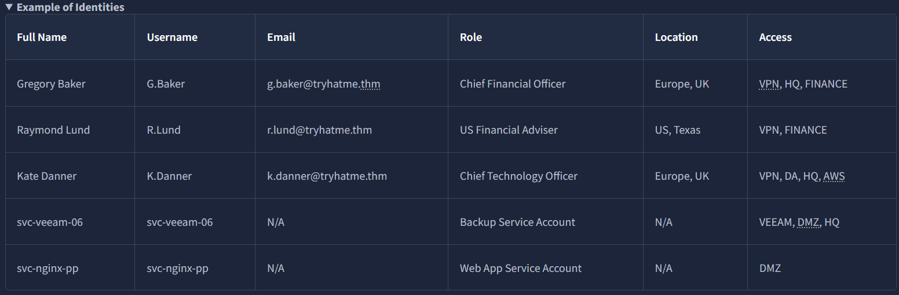

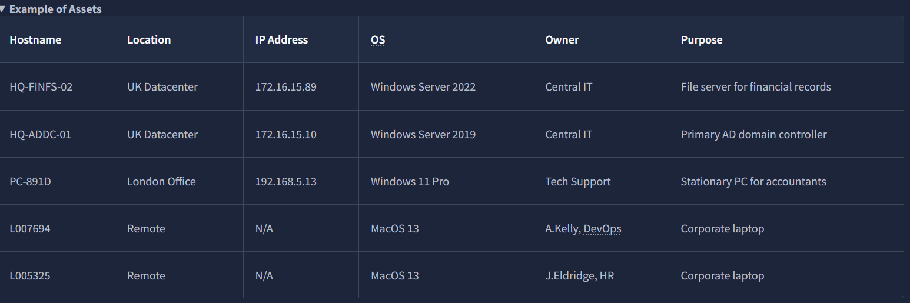

## Network Map

A network map shows where an IP sits and what is exposed to the internet. The example map has an external actor (103.61.240.174), VPN users and website visitors coming through the internet to a firewall.

| Element | Detail from the map |
|---|---|
| Exposed ports | www.tryhatme.thm:80, www.tryhatme.thm:443, vpn.tryhatme.thm:10443 |
| Database subnet | 172.16.15.0/24 |
| VPN subnet | 10.10.0.0/16 |
| Office subnet | 172.16.23.0/24 |

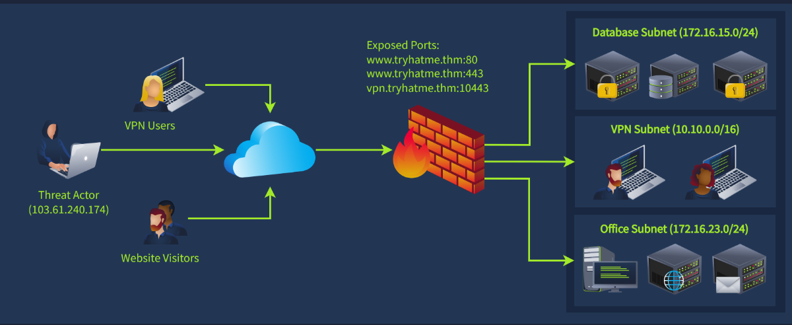

## Alert Workbooks

Workbooks are flowcharts that guide triage from alert to verdict. Each ends in either "Escalate to L2" or "Close as FP".

### Example workbook: suspicious login

| Stage | Steps shown |
|---|---|
| Enrichment | Check the user's expected location in the HR system (BambooHR), look the login IP up in threat intelligence, then in anonymisation-detection services |
| Investigation | If the IP is malicious, escalate. If not, list the user's actions after login in Splunk. Escalate on suspicious actions such as an MFA reset |
| Investigation (cont.) | Otherwise run the Splunk "Login Timeline" dashboard for 90 days and check for VPN or atypical location, then atypical login time |
| Outcome | Atypical location/VPN or login time leads to contacting the user. Otherwise close as FP. User response decides between FP and escalation |
| Escalation | Write the alert report and pass it to an L2 analyst |

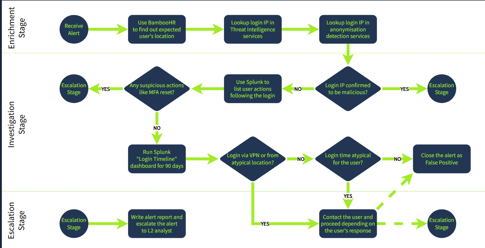

### Workbook 1: external email with script or binary attachment

Workbook 1 (Email Analysis) is built from a pool of step cards that go into a flowchart. The cards cover:
- analysing the email in an EML analyser (SPF/DKIM, content, sender domain reputation)
- getting recipient context from the identity inventory
- checking recipients' login events against corporate servers and VPN
- attachment analysis (sandbox for binaries, manual review for scripts)
- gathering triage evidence
- writing an alert report for L2
- writing an alert comment
- warning employees in chat

The decision point is whether the attachment is malicious, the origin is faked, or the email is unexpected for the recipients' roles. Yes leads to escalating to L2, and no leads to closing as FP.

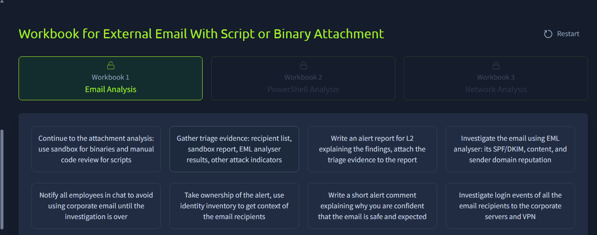

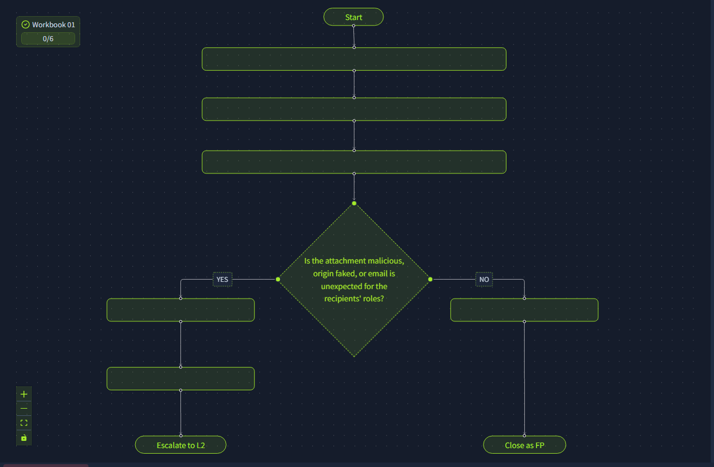

<!-- TODO: add screenshot of the completed email workbook flowchart (6/6) -->

### Workbook 2: suspicious PowerShell activity

Workbook 2 (PowerShell Analysis) uses the same card-to-flowchart format. The cards cover:
- taking ownership of the alert and pulling context on the affected machine from the asset inventory
- building a process tree to find the parent process and the account that launched PowerShell
- saving the Windows process tree and login timeline SIEM searches as evidence
- using threat intel on the URL and static analysis on the downloaded executable
- emailing the user to confirm whether they approve the PowerShell usage
- writing an alert report for L2 with evidence, assumptions and SIEM results
- writing a short verdict comment and asking SOC engineers to tune the detection rule
- reassigning the alert to the system owner (IT) and raising severity to Critical

The decision point is whether the file is malicious, was downloaded from an untrusted resource, or came from a suspicious process. Yes leads to escalating to L2, and no leads to closing as FP.

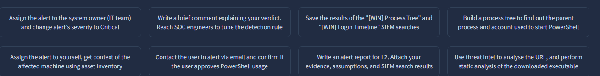

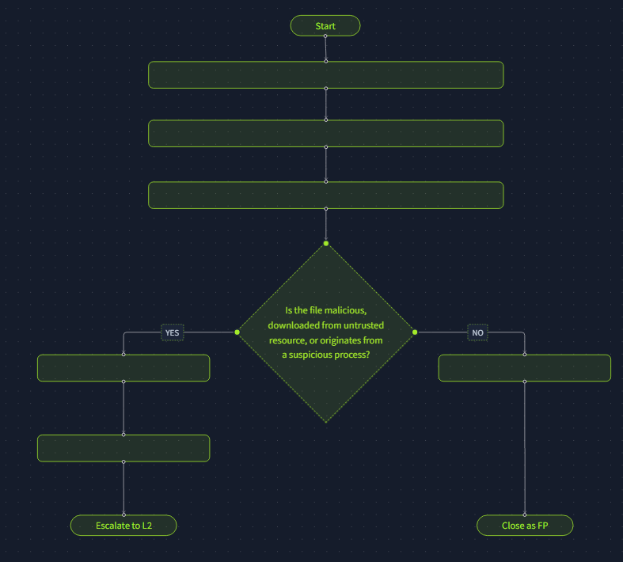

<!-- TODO: add screenshot of the completed PowerShell workbook flowchart (6/6) -->

### Workbook 3: port scanning from internal IP

Workbook 3 (Network Analysis) is another pool of step cards. They cover:
- listing the scanned ports and the services likely behind them
- getting IP context from the network map and asset inventory
- collecting evidence (time range, scanned ports, IP context)
- checking whether a corporate scanner (such as Nessus or Zabbix) explains the pattern
- using EDR to check for data exfiltration alerts
- writing an alert comment and report
- contacting SOC engineers to tune the rule

The decision point is whether the source IP is unlisted or the scan looks like a malicious Discovery attempt. Yes leads to escalating to L2, and no leads to closing as FP.

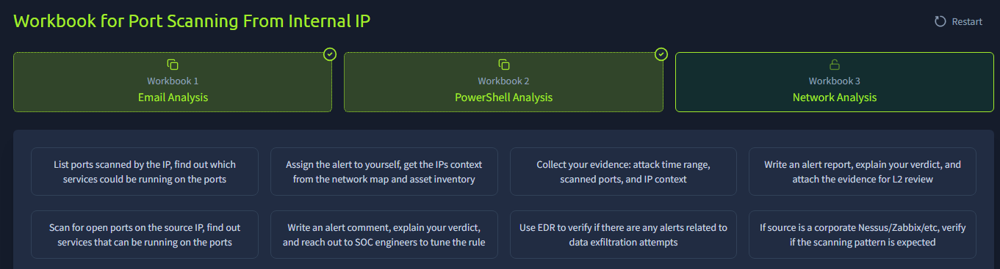

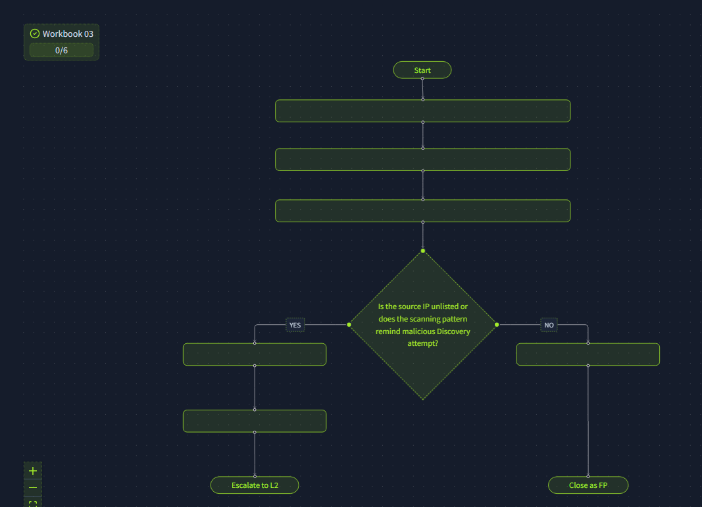

<!-- TODO: add screenshot of the completed port-scan workbook flowchart (6/6) -->

<!-- TODO: add my own alert comment, report and Five Ws once I write one for a workbook scenario -->

## MITRE ATT&CK Context

This is my general mapping of the scenario types, not the result of an alert investigation.

| Scenario | Tactic / Technique |
|---|---|
| External email with script or binary attachment | Initial Access, T1566.001 Phishing: Spearphishing Attachment |
| Suspicious PowerShell with downloaded executable | Execution, T1059.001 PowerShell; Command and Control, T1105 Ingress Tool Transfer |
| Port scanning from internal IP | Discovery, T1046 Network Service Discovery |

## Key Takeaways

- Identity and asset inventories give an alert context fast: who the user is, what the host does, who owns it.
- Inventories come from several systems (AD, SSO, HR, EDR, MDM, spreadsheets), so knowing where to look matters as much as the data.
- A network map shows which subnet an IP belongs to and which ports are exposed, which helps judge how serious a scan or login is.
- Workbooks structure triage into enrich, investigate, then escalate or close, so verdicts are consistent and defensible.
- Many alerts are closed as FP only after checking user behaviour (location, time, 90-day history) rather than on the IP alone.
- For PowerShell alerts, the parent process and the account behind it matter as much as the command itself.

## Skills Demonstrated

`SOC L1 Triage` `Alert Triage Workflows` `Identity Inventory Lookups` `Asset Inventory Lookups` `Network Map Reading` `Email Alert Triage` `PowerShell Alert Triage` `Port Scan Triage` `Escalation to L2` `False Positive Analysis` `MITRE ATT&CK Mapping`

[Back to all labs](../../README.md)
